最近我一直在测试一个很有意思的玩法，效果出乎意料地好，迫不及待想分享给大家。

我是郭耀天，圈内朋友都叫我郭少，在生财待了六年，一直在做虚拟项目。这回我研究的不是别的，正是用视频号直播给公众号引流——一天涨粉1000+，最关键的是，这套方法对任何领域、任何账号都适用，只要开播就有机会涨粉，尤其是垂直领域的粉丝，导到公众号之后价值特别高。话不多说，直接上干货。

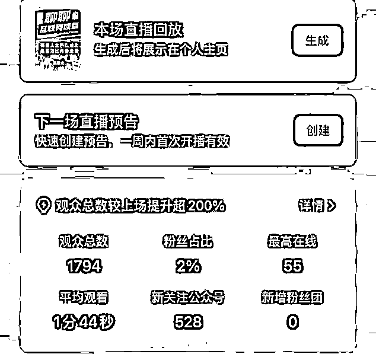

先晒一下数据：一场直播带来528个新关注，连播两场，单日涨粉破千。不管你是有私域引流的需求，还是想快速拿下流量主，又或者单纯想积累粉丝，这套思路都能用。至于涨多少，取决于你直播间能进多少人，我这边目前转化率大概在三分之一左右。账号被推荐的多、投流到位的话，一天几万几十万也不是没可能——设置个99元的小门槛，有需要的人自然会买，实操直接上手就行。

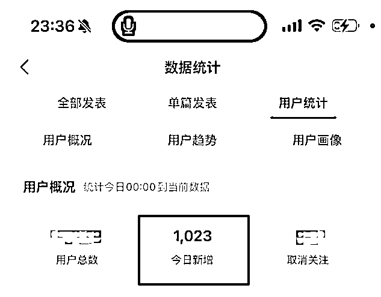

核心原理其实很简单。视频号绑定公众号之后，直播时会以公众号的身份展示。你只需要在直播时挂一个福袋，规定“关注主播才能领取”，粉丝就顺理成章地沉淀到公众号了。个人号、企业号都能操作，下面是详细流程。

第一步，把公众号和视频号绑定起来。

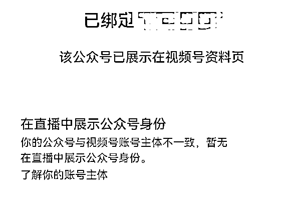

这里有个硬条件：公众号和视频号的主体必须一致，否则你开启展示的时候会提示主体不匹配，根本绑不上。个人注册的公众号，必须用个人注册的视频号来绑，名字不一样没关系，主体一致就行。难就难在企业号身上——如果你是企业公众号，想开通直播展示公众号功能，得先把视频号的主体改成企业。很多人不知道的是，视频号可以借助公众号做辅助认证，前提是你的公众号已经完成认证。

实际操作中经常遇到这种情况：你有公众号，但辅助认证时要求视频号的名字和公众号名字一致。比如我的公众号叫“郭耀天”，那视频号也得叫“郭耀天”，名字对不上就认证不了。

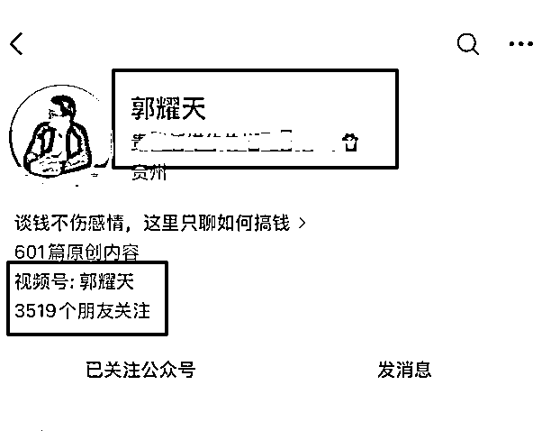

那如果“郭耀天”被别人注册了怎么办？很简单，在名字后面加个加减号“±”，或者加个点“.”。比如我的名字“郭少”被人占了，最后就用“郭少+”搞定。

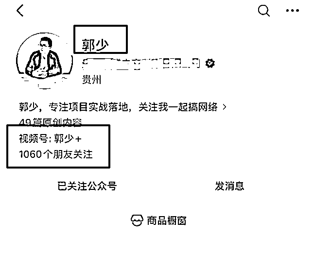

视频号认证也不复杂。打开视频号创作者中心，点顶部头像，进去后再点机构认证，按提示操作，就能完成辅助认证。

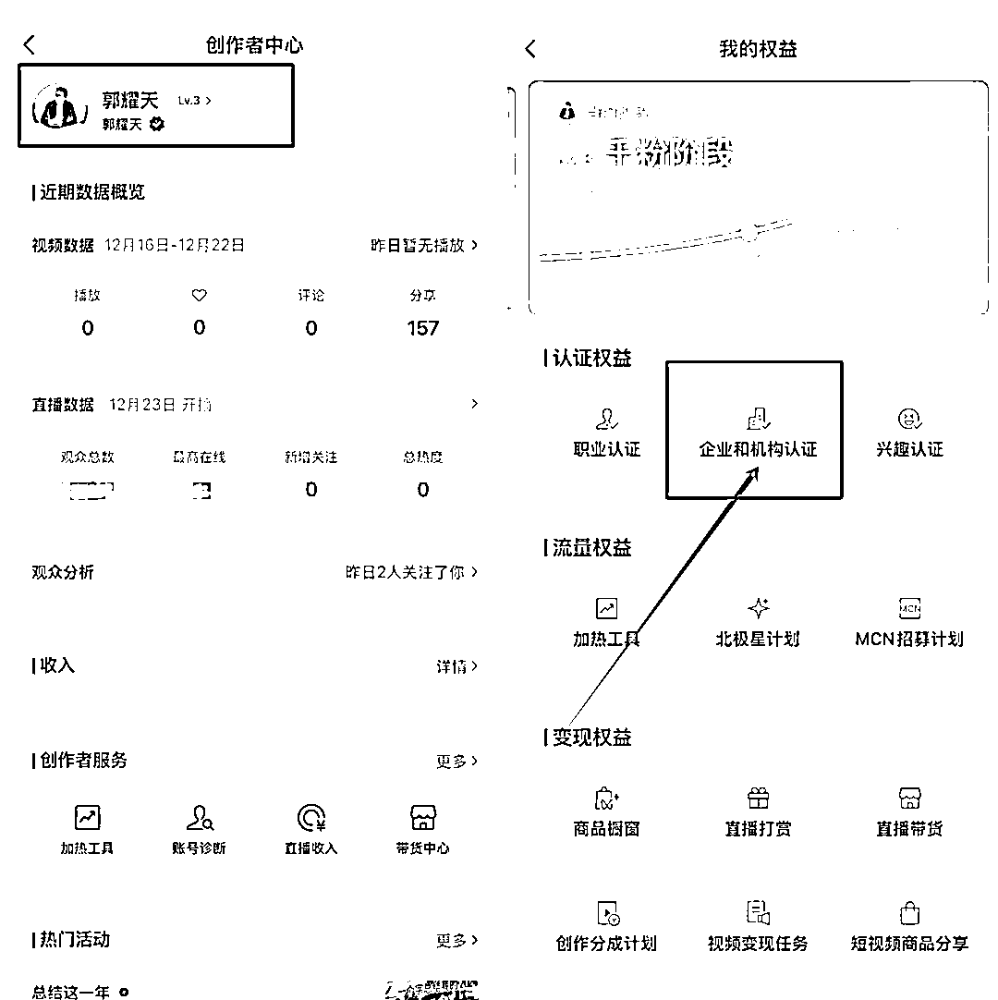

认证完事之后，就可以绑定公众号了。你可以从视频号这边出发：点视频号右上角的“账号安全与绑定”，找到公众号入口，搜索你想绑定的公众号即可。绑定过程中遇到收不到验证码的情况，从公众号这边走反而更快捷。

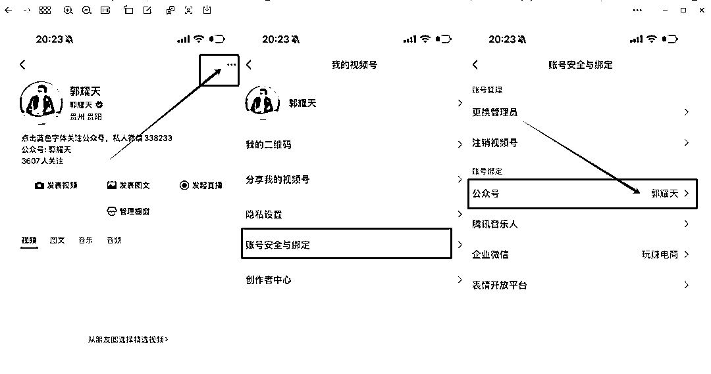

因为视频号绑定需要电话验证，而公众号这边不需要。你只需要在绑定的视频号私信里收到一条确认信息，点击确认就完成了，相当方便。

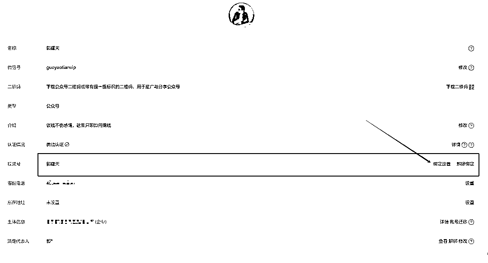

绑好之后，接下来就该开播了。有一个细节容易被忽略：所有账号和公众号绑定后，默认是“关注公众号”状态，但关注按钮默认是关闭的——开播之前一定要记得开启。还是老路径：视频号右上角“账号安全与绑定”，找到公众号点进去，开启展示功能，一切就绪。

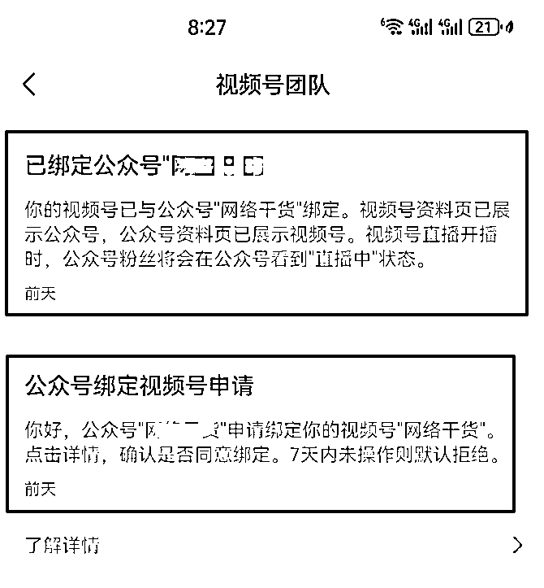

这里得额外提一嘴。你可能听说过“在直播中展示公众号身份”，但我也注意到，有些老账号在绑定之前就开通了接口，视频和直播都能展示公众号。这种账号相当稀缺——如果你打开自己的视频号看到这个功能，这号价值保守估计5000到一万，想买都不一定找得到渠道。

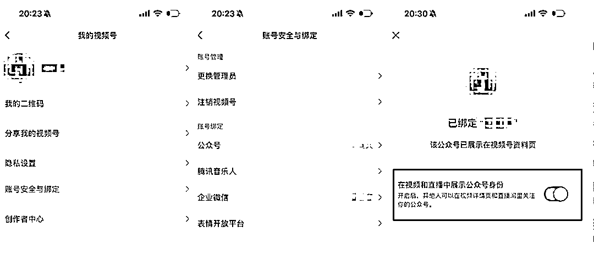

准备工作全部打点好之后，就可以开启直播了。直播形式没有限制，视频、音频、游戏都行，核心只有一个：不要违规。一旦平台不给推荐流量，涨粉就无从谈起。正常开播后，重点就是发福袋。

福袋设置上，礼物的分配方式可以选每人相同，也可以拼手气，礼物数量和中奖名额保持一致。这里有一个关键提醒：官方默认的开奖时间是3分钟，一定要手动改成15分钟，时间拉长了，参与的人自然更多。

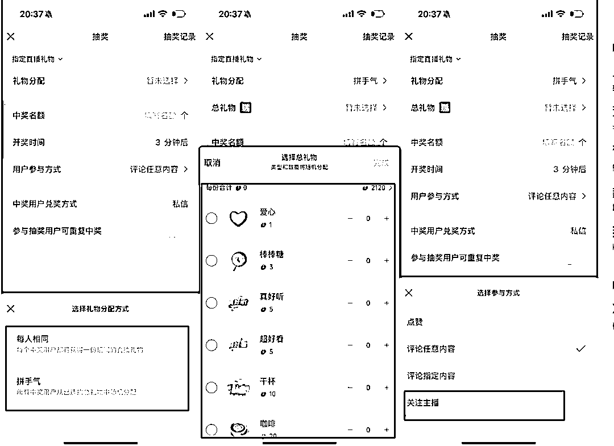

礼物选择上，爱心、棒棒糖都可以，土豪随意选贵的，也可以一样来一点，当作活动氛围。重点在于“参与方式”必须设为“关注主播”，不然不会涨粉的。中奖方式不用管，至于“可重复中奖”，开不开都行，我自己是关掉的。

剩下的就是持续直播、持续搞流量——流量越大，涨粉越快。有的领域甚至可以直接上投放来放大效果。我自己涨这1000粉，发礼物的成本不到20块钱，算算这个成本，是真的低。当然，会有粉丝取消关注，但总体影响不大，干就完了。

还有一点想补充的是，有些人可能会质疑：这种靠抽奖来的粉丝是不是都是泛粉，没啥价值？其实关键在于你怎么运营流量——如果你本身在视频号上有垂直粉丝，通过直播导到公众号，价值就很大；做投放进来的泛粉，也可以通过后续内容做优化和筛选。任何玩法最终都是拼运营。

如果哪里有不清楚的地方，欢迎在评论区打出来，我看到都会回复。这次的分享就到这里，希望对你有帮助。