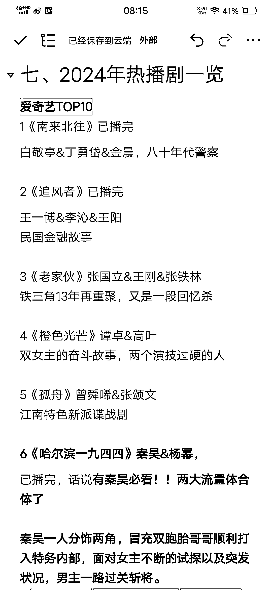

# 从神坛到同桌：一个赚钱人眼里的龙哥形象十年观

## 互联网造神与毁神：龙哥在赚钱圈友中的形象变迁

作者：亦小亮

日期：2024-12-27

前几天看到龙哥发帖征集圣诞礼物，这才有了这篇梳理。

互联网的运行规律其实很清晰，先捧上神坛再推下来。你刚踏进圈子时，龙哥就是那种无所不能的存在。他的每个判断都像标准答案，他写的每一篇干货，尤其是《小灯塔》，总能精准击中痛点，让人觉得他不仅会赚钱，还额外带有情绪价值加成。

进入赚钱的初期，几乎所有人都把龙哥当做标杆。过了一阵子，在航海里磕了几次壁，就开始集体开喷，什么赚钱不行啦，铺天盖地的吐槽就来了。

我自己是 2020 年跟着 V 先生入内的。那时外界关于龙哥的故事满天飞。进去后没多久，我就拿到了 5 篇精华帖，直接进了龙珠俱乐部，深深被这个人的气场吸引。时间推移到一年后，龙哥推荐了一个圈友开的星球，我抱着信任跟进去。结果更新稀少，大多是助手在维护，第二年果断不续费。那一刻我对龙哥的滤镜开始松动，开始对他的推荐保持警惕，也觉得他的战略并非无懈可击。他在我心中已不再是神。

这种心态的转变其实很健康。刚进来时，龙哥是百万量级的认知高地，我只是认知个位数的小白。过了大概一年，我的认知量级已经到 5 位数，差距正在被拉近。觉得他不神奇了，并非他变了，而是我跟他的距离缩短了。即便依然有差距，但对比刚进来的自己，进步是肉眼可见的。

归根结底一句话，你认知的迭代，决定了龙哥在你心中的坐标。多数赚钱新手，路径大致相同：从神化到尚可，到平常，再到认可，最后到佩服。这是一次次自我进化的过程。而龙哥本人其实一年也见不到一次面，变化更多是我们自己的变化投射出来。

看到很多人给鱼丸送花篮，我这份礼物就不走寻常路了。给龙哥准备一份 3000 字的航海建议吧。如今赚钱像个娘家，我真心希望它能一直走下去。

* * *

**进入正题**

先说我的基本判断。志愿者、领队、教练，本质上都是赚钱官方的志愿服务角色，只是分工被大家区分开了。

我本人已经参与了不少航海志愿服务，今天就聊聊航海这块，并给赚钱提点想法。

# 一、关于打卡机制

### 1、不同角色看打卡的差异

船员：首要关注自己的航海日志，偶尔也能翻看他人的日志，尤其是领队标记的精选日志，可以瞄一下。

志愿者：打卡层面受益最大，能接触到全员的信息流，这也是我当时选择做志愿者的原因之一。

领队：视角被进一步收敛，只能看到志愿者挑出来的优质日志，基本是好事集锦。

教练：看到的是领队二筛后的内容，主要是典型问题和代表性好事，用来激励大家。

以我这次担任 YouTube 航海志愿者为例。

从数量看，志愿者接触的日志最多，信息量也最大。能明显看到新项目启动期的共性，账号、魔法相关的问题占据前几天的大头。中期则变成疯狂换选题做测试，后期聚焦效率提升，比如缩短一个视频的制作时长，提升日产量。

从质量看，领队省去了大量重复阅读的成本，呈现给你的都是写得扎实、有收获的日志。

教练看到的是领队提炼后的典型问题盘点和正向案例。

### 2、打卡问题的设计

当前打卡字段是：

> 今日发布作品数量

> 昨日最高浏览量

> 昨日 GMV

> 今日收获

> 待改进的地方

> 明日计划

> 记录我的航海成就

大致是这 7 个维度堆出来的。整体偏向结果展示，缺少挫折记录。航行本就不可能一帆风顺，应该给失败和卡点留出共情的空间。

我提供几个可参考的问题方向：

（1）今天碰到了什么困难？怎么解决的？没解决的话需要哪方面的支持。
（2）在这个项目里，你看到了哪些机会点？
（3）航行一段时间了，假如要放弃，你的理由会是什么？这个问题更适合长期零打卡的人。
（4）本次航海，你都解决了哪些具体问题？
（5）你发现了哪些好用的工具？小程序、网站、App 都行，比如去水印、查数据。

也可以按航行周次来设计问题。

第一周：基础搭建+入门
第二周：基础搭建+深化
第三周：基础搭建+复盘分享

**打卡问题的提炼可以用三个标准：好玩、能解决问题、愿意填。***

另外一个设想：由教练抛一个项目关键问题，让大家在下方集中回复，形成类似圆桌讨论的效果。

可以放在醒目的位置： images.zsxq.com/FpwmWxc0lvcky5eInWFZOGOjQF_o)

船员以评论形式集中回应，这样就积累成了优质的项目素材，也让 21 天的闭卷项目变成开卷的航海，更容易获得正反馈。

### 3、打卡的意义何在

我已经有 7 期👸号爆款航海教练的经验，很久没做志愿者了。这次做 YouTube 志愿者时，发现仍有船员在水卡。

赚钱的航海已经做了十几期了，理应大家都清楚打卡的设计初衷。

我借志愿者、领队、教练的身份替大家说一说，不到位的地方请赚钱团队和各位志愿者补充。

把执行、思考、结果写出来，有三大作用。

**一是过程留存。** 项目做完容易忘，写下来才能复盘。否则下一个号重开，又要重复踩坑。记录下来既能自用也能分享。

**二是共同答卷。** 类似共读一本书，大家一起做同一份考卷。不是比快比好，而是都在这份考卷上拿到想要的结果，比如赚钱、学到方法。

每周一三五教练点评，就是抓典型问题和还没遇到的坑。

**三是缓解焦虑。** 心理学表明，外部化记录能降低焦虑。把想法闷在脑子里会更乱，写出来会更清。记录是认知加工，能帮助情绪调节和问题解决。

打卡不是目的，改变才是。

### 4、怎么打卡更高效更有成长感

前面说了这么多，如何做到既有成长又不费劲？

如果把 21 天打卡看成 6000 字复盘，每天 300 字足够。

打卡可以用 提问-找答案-得答案 的思路：

项目启动即问题启动，带着问题走，边走边列清单。可以先列常规问题，再补项目特有问题。自下而上检验，靶心更准。

21 天后，你获得的不仅是打卡记录，而是一个完整 0 到 1 的项目成长档案，还能看到别人的同类问题和不同解法，丰富玩法。

这就是项目闭卷、航海开卷的精髓。

如果你不想写流水账，可以试试下面三种写法：

（1）任务：每天聚焦一个目标，列清步骤、注释、资源、进度，把相关信息集中在一起。

（2）反思：记录项目瞬间的想法和经历，梳理记忆，沉淀经验教训，捕捉成长。

（3）创意：天马行空的商业点子、故事梗概、选题灵感。从核心思想出发，补充延伸，加入资源和灵感。

以我做的👸号爆款写作举例：

**选题规划  类型：任务**
（1）明确步骤：比如选剧评赛道，就去找 2025 年待播剧单，看演员阵容和网友评价，判断爆款潜力，决定爆或不爆怎么写。
（2）资源集中：
这是我 2023 年整理的 2024 年剧评清单，仅一部分。
（3）优先级和状态：哪部剧优先，哪部在拍摄、杀青、待播。

**👸号排版  类型：创意**
一篇文章分开头、正文、结尾，每个节点放钩子，提升关注、点赞、在看、评论、付费。

**项目反思  类型：反思**
以剧评为例：经验框架、能爆的题材、数据反馈如入池深度、读者画像、阅读量、完读率；下一步改进如如何把入池文章带动后续标题优化。

总之，打卡可以围绕任务、创意、反思三条线展开。创意不一定每日都有，但任务和反思肯定天天都有。当反思量够了，认知自然会升级。

### 5、打卡的激励设计

打卡奖励不一定要海报。可以设两个节点，12 次和 21 次。12 次给续航资格，21 次给赚钱日历或周边。这只是个引子，具体由团队定。

# 二、航海手册的更新方式

建议加上时间轴更新或用*号做批注。老水手不想重看整本，手册现在又变长了。以前龙哥提过减负，如今又变回了长篇。可以用补丁方式追加，新内容直接链接上去即可。

这个位置可以直接贴补充链接。有人会说直接点目录就行，电脑版的手册需要点右上角三道杠才显示目录，操作上并不省事。

# 三、不同船员的管理策略

按冷漠、围观、提醒分层处理。

1、冷漠：真冷漠是全程不回不互动，那就提醒一次即可。假冷漠可能是生活、工作实在忙，先确认一下近期是否打卡，打卡的话一周提醒一次即可。无论如何，志愿者都应给予关怀。

2、围观：围观不代表无感，看一下他的日志，了解困难，尽量每周沟通一次，帮助解决问题，提醒打卡或询问进展。

3、提醒：这类船员要重点跟进日志。有些是特殊情况，比如这次有位船员白天上班，晚上照顾生病母亲，辅导孩子作业，哄睡后才有自己的时间。虽然没完成 12 次打卡，但完成了 10 次，已经很不容易。

这就是送给龙哥的圣诞礼物，收下吧。

* * *

评论区：

龙哥 : 感谢小亮的这份礼物，很有价值。 不要把我看成神，我只是在赚钱这件事上比大多数人多走了一些路而已。在大多数事上，我也不懂，也做不好，有很多困惑。

做龙哥盟，是我第一次做社群，还在努力学习怎么把龙哥盟做好一点，做的不好的地方，感谢大家的包容，期待大家一起想办法一起共创，做好龙哥盟。

亦小亮 : 第一次都做得这么好，而且是几万人的社群，我连 33 人的社群都做得不够好。

小黄 : 对于日志这件事，我很有体会，也找鱼丸反馈过，以往的日志会有精选日志这一选项，能够看到比较精华的日志，给一些走得慢的人启发。这次参加了 youtube 航海，没有看到这个功能，只有好事墙，有点可惜。以及以往的航海我都会有一种共同走的感觉，但这次没有，很多时候都是感觉各干各的，没有交流的氛围。这一点我想也不能强求，但对于提出的一些比如关键问题大家可以在底下讨论，或者在日志里提到踩坑这个功能，或者精选日志，我觉得都能够让人体会到大家一起走的感觉，我觉得这才是航海的意义。

哎呀妈 : 谢谢小亮教练的分享，提醒我下次航海打卡一定要更关注自己的成长[抱拳]

胖大魔（AI 提效版） : 很久没当航海志愿者，有几句想吐槽的。把 12 次当打卡退押金。欲求其上得其中，欲求其中得其下。

贤雅 : 大部分都是这样的

旭宏 : 这不愧是“亦家人”[强] 摆烂的没必要考虑怎么拉一把其实，尊重他人命运...... 反而是那些日更 12-21 天的，需要更多鼓励。

你们觉得如果把航海押金设置成自己决定金额，上限 1 万或 5 万怎么样啊？ 我觉得有些圈友会原因交更多押金， 押金交得钱多意味着重视度高、注意力投入就更多。

也给自己一个积极的心理暗示和压力。 同时也可以把我交了一万块决心要完成一件什么事，发朋友圈或好友，做一个做公开承诺，倒逼这类本来就重视的圈友更加投入

亦小亮 : 押金自己设置，也挺有意思的