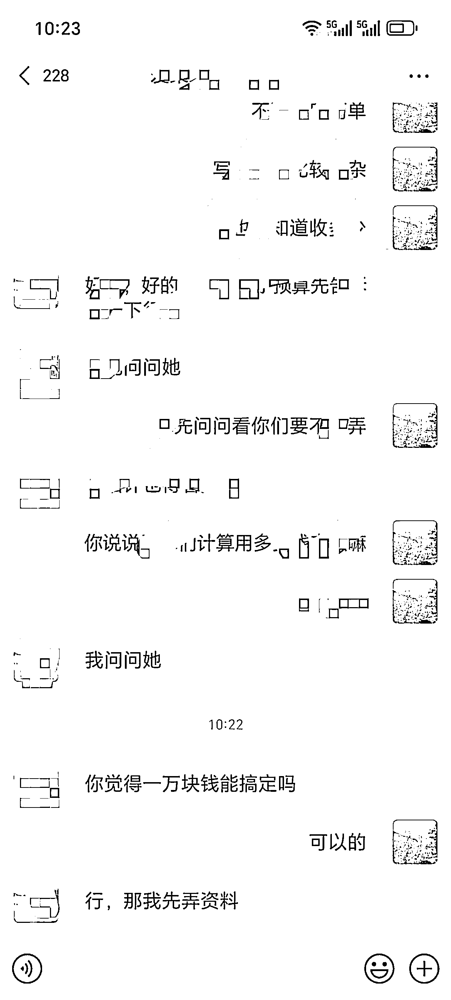

# 用 Cursor 做项目就像驯大圣，紧箍咒念准了，AI 编程也能直接变现五位数
作者：龙哥

## Cursor 用得顺不顺，全看你会不会念紧箍咒：一次 AI 航海变现的实战复盘

作者：泊林家
日期：2024-12-27
[#龙珠悬赏](https://wx.zsxq.com/tags/龙珠悬赏/48824518525858)

今年主业增长进入瓶颈期，正好在盘明年的方向。此时 Super 标 3 上线，AI 话题突然变得很近。我盘了一下自己的情况，觉得从 AI 编程切入，开辟一条新的赚钱线索是可行的。

12 月的 AI 航海开启后，我直接报了 Cursor 编程这条线。报名那天心里还犯嘀咕：怎么把这套工具真正用熟？几乎是同一时间，一个朋友找上门，称她们公司想做一套样品管理的自动化流程，需要做成🛰️小程序。机会来的正是时候，这不就是个天然的实战项目吗。过去我会外包给人，现在有了 Cursor，我决定自己上手把这笔单子拿下。

这次航海在体验上做了个很关键的优化，报名后就能提前看到航海手册的部分内容。我报完名就立刻去啃手册，再结合赚钱网页版的搜索，挖出了不少前端的使用技巧。其中对我帮助最大的是 [如何让吴佳文学会使用 Cursor 完成一个复杂项目](https://scys.com/articleDetail/xq_topic/1525488422112812) 和风向标 [学习 Cursor ，拥抱 AI 编程 | Cursor 101](https://cursor101.com/zh)。

航海的 21 天里，我的大部分时间都砸在了这个小程序上。🛰️小程序我完全是零基础，从装🛰️开发者工具开始，到云函数、云存储、云数据库的搭建，全程都是靠 Cursor 一步步带。我把它当外脑使，我定需求，它给出路径。

实战当然一波三折。代码跑偏了、逻辑乱了，我就干脆整盘推倒，清空目录重新起手。这样的来回重建做了十多次。越用越熟之后才悟到，Cursor 其实很聪明，只要你把目标描述清楚，具体怎么拆解、怎么实现就交给它去搞定。某种程度上它就像七天大圣，编程能力近乎全能，不管是当产品经理提需求，还是当程序员写代码，都能顶上去，关键点在于使用者会不会用紧箍咒去控制它。

航海第 15 天，小程序正式上线了。客户验收后反馈很满意，项目算是顺利交付。

**事后复盘我才觉得自己有失误，手册的重要性被低估了。小程序上线之后再回头翻手册，发现航海期间卡住的大多数坑，手册里其实都有预警和解法。早点重视，至少能省下不少试错时间。**

对这次航海，我有两点核心感受。

第一，机制优化很到位。提前开放部分手册内容，让人能在开航前先搭建知识框架，再通过搜索去查漏补缺，学习效率明显提升。

第二，带着明确目标上航，收获会完全不同。我报名时就锁定一个具体交付物：用 Cursor 做一个可用的🛰️小程序，帮助客户提升工作效率。目标清晰，遇到问题才有方向感：干中学、问中学、解中学，反而学得扎实。

21 天的航海已经靠岸，要感谢教练、志愿者和小伙伴们的陪伴。但对我来说，AI 编程这条路才刚刚起步。下一步的逻辑很简单：先找到有价值、有需求的点子，再用 AI 编程把它快速落地变现。