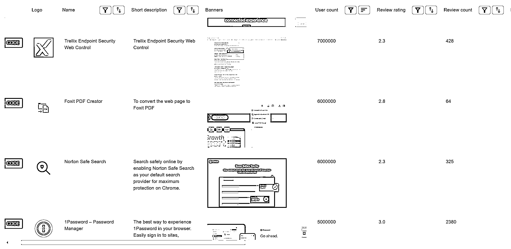
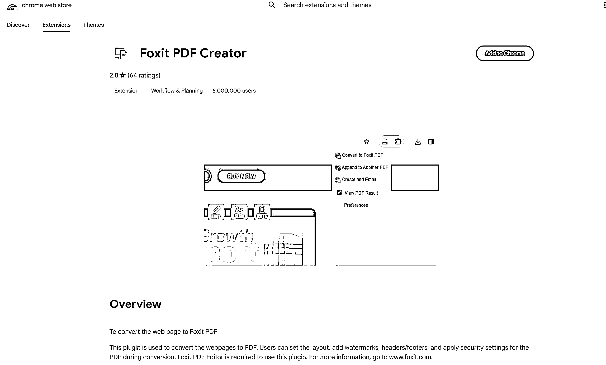
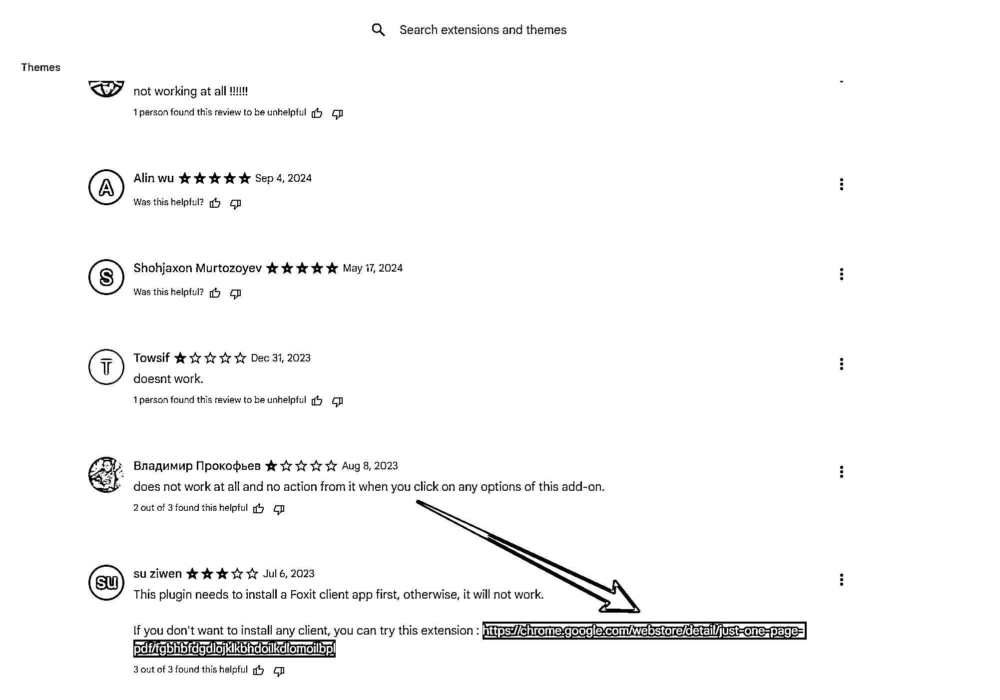
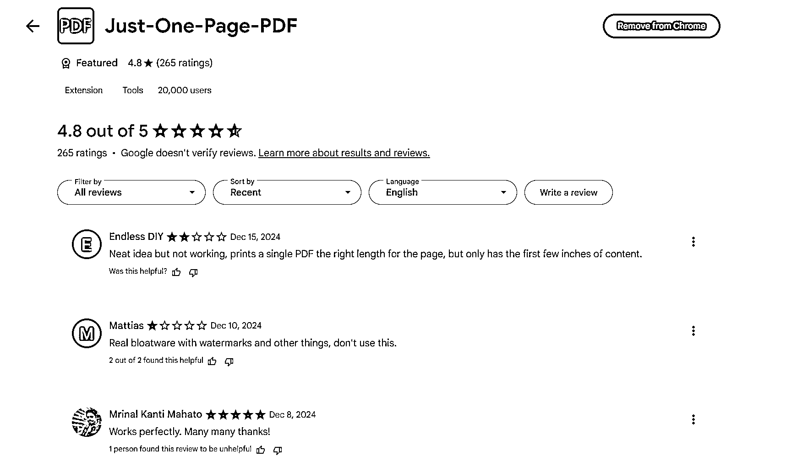
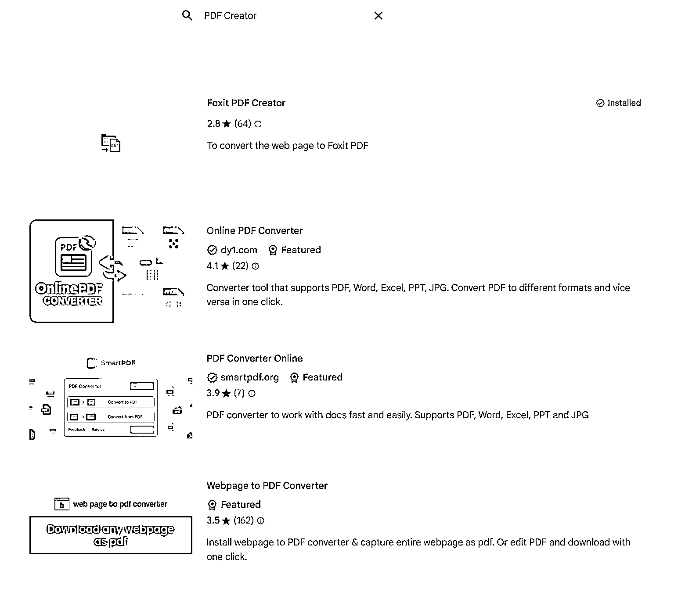
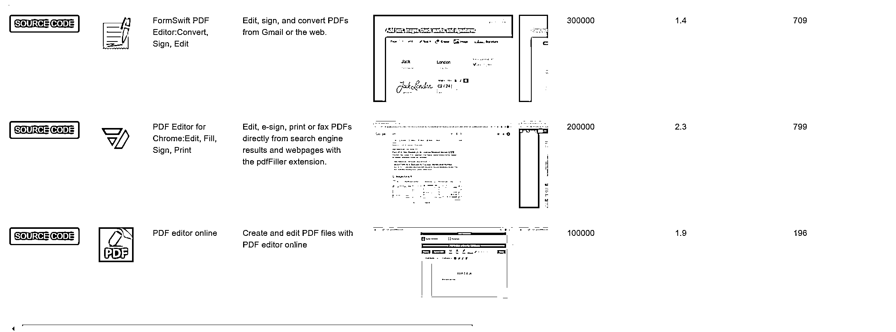
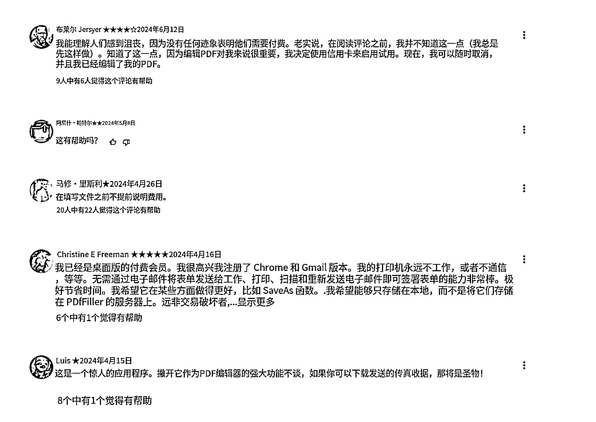

# 怎么快速锁定一个能上手就能变现的对标品

## 找一个上手快、赚钱快的对标品思路拆解

作者： 嘟

日期：2024-12-23

受龙哥的龙珠悬赏启发，我把自己最近摸索的一个找品思路分享出来：

一、 先锁定用户基数大，并且已经有付费习惯的品类
二、 去翻差评，揪出付费用户真正痛的点
三、 做一个补上这些短板的轻量产品，用推广收割头部玩家顾不上、懒得做的细分收益

* * *

最近在练 AI 编程，感觉入手门槛最低的是 Chrome 插件和独立小站。

就拿 Chrome 插件的数据来说，我的筛选逻辑很简单：先把评分在 3.5 分以下的插件捞出来，再按装机量从高到低排。能筛到一批又大又烂的标的。

举个 PDF 工具的例子，装机量 600 万，评分只有 2.8。

进去看评论区，用户吐槽的集中点是功能用不了、长期没人维护。

说明用户池很大、需求很刚，却因为产品烂掉了。这类空位就是很好的切入点。

再往下翻评论，有人直接丢了竞品链接，说明在评论区做引流是被默许的。

点开那个被推荐的竞品试用，发现它的坑在于导出时强制加水印。

我实测了一下，插件完全免费，但默认水印无法去掉，也没有付费去水印的选项。

在插件市场检索 PDF Editor，会发现供给很稀疏。大部分工具只做格式转换，真正能编辑文档的很少。

能编辑的，基本都收费，而且装量都不低，评分却普遍偏低。

举一个典型，翻它的差评，集中在宣传写着免费，实际到导出环节才收费，而且价格不低。前面编辑体验都很顺，等到要保存时才跳付费，沉没成本拉满，用户感觉被套路。 images.zsxq.com/FnLWN3nBut7es9PHH8gRNHXhdLWh)

从评论情绪看，付费模式本身就是它最大的槽点。如果要学它做一模一样的付费设计，可能不是最优解。

但装量证明需求真实存在，并且已经有付费转化，只是满意度不高。这里面有很多可以借鉴的点。

如果要对标，与其照抄，不如做一个价格更友好的版本，并且把付费规则提前讲清楚，让用户没有被坑感，破局的概率会更高。

技术上也不算门槛，文档处理的开源方案很多，让 AI 生成一个 MVP 基本可行。

上面只是我个人的推演路径，实际上评分低、下载高的 Chrome 插件还有一大堆，有兴趣的可以自己去挖一个练手。

数据来源：

[`cws-database.com/`](https://cws-database.com)

你如果也有别的找品打法，欢迎在评论区交流或发帖。

* * *

评论区：

暂无评论