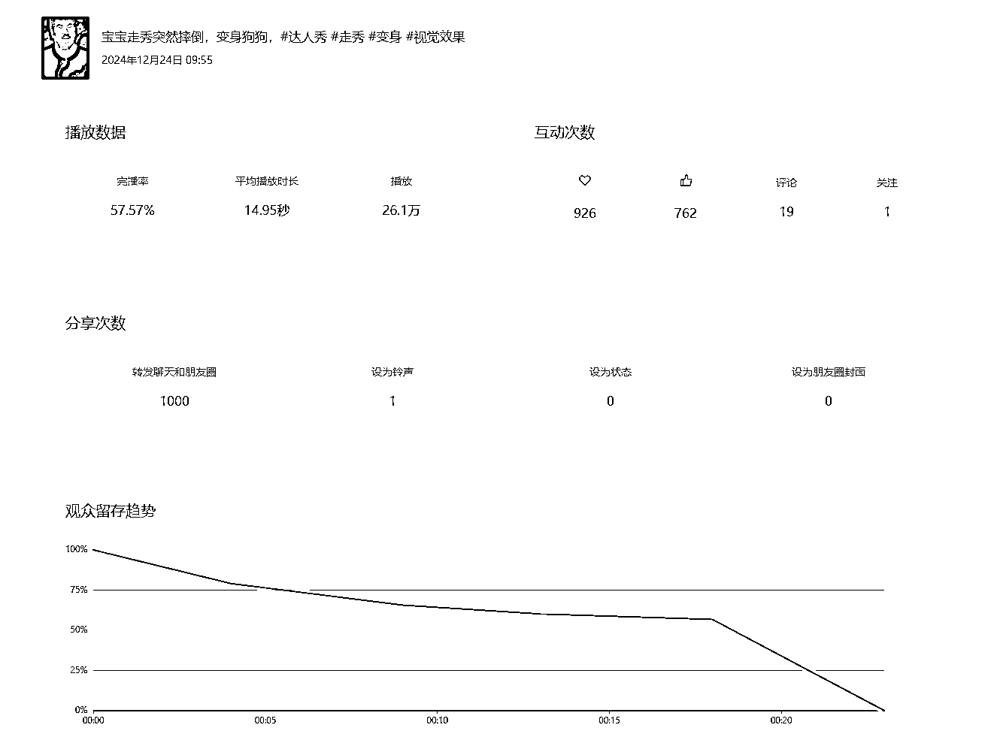
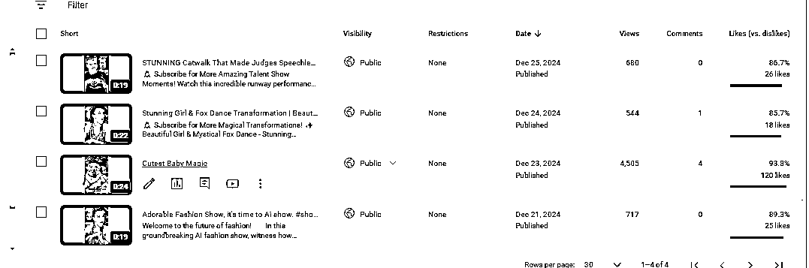
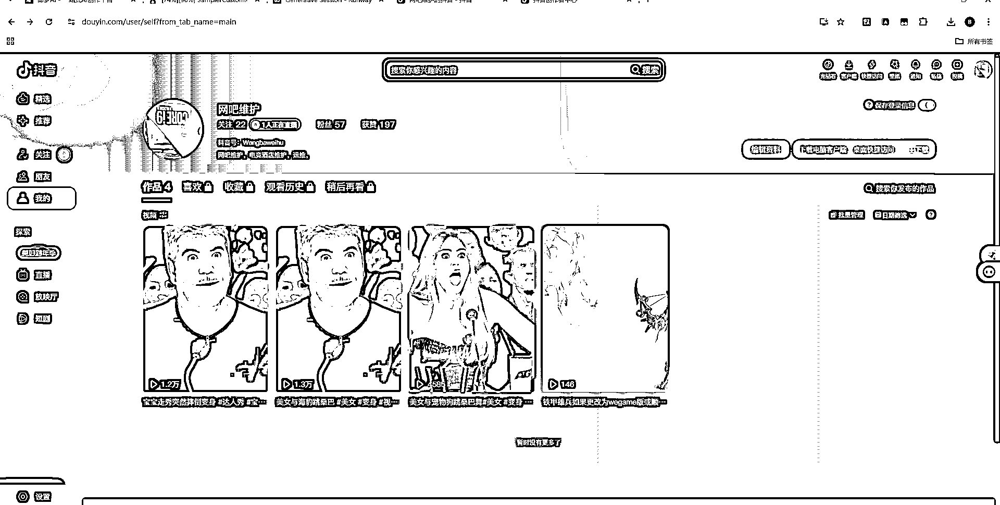

# ('为了给生财送礼，我来捧个人场', (2, 16))

为给生财送礼，我也来凑个热闹

亦仁老大昨天开口要新年礼物，加上看到有龙珠悬赏的帖子，我琢磨了一整晚，干脆把压箱底的工具全部整理了一遍，放到社群里。先感谢 @刀姐、@土豆君 等伙伴的支持。

先晒晒成绩单：达人秀项目在国内拿到了26万流量，抖音新号两条视频突破10k，YouTube单条视频冲到4k播放，TK只有1.1k，就不拿出来丢人了。

好了，说正事。这次我会把工作流、Claude提示词和配套程序全部分享出来，这些内容价值好几十万，希望能帮到真正需要的人。剩下的部分我放在飞书文档里，链接如下：

[`vwsu4jb9k4s.feishu.cn/docx/XEQtdlg8loeRb5x3IuUcCH0Tndg?from=from_copylink`](https://vwsu4jb9k4s.feishu.cn/docx/XEQtdlg8loeRb5x3IuUcCH0Tndg?from=from_copylink)

#航海好事 #项目实操 #龙珠悬赏