# 年终报告只有文字干巴巴？分享一个 Al 图表神器，助你快速制作高大上的图表！

年底总结报告是不是总觉得文字形式太干巴没活力？今天我强烈推荐一款我超推崇的AI图表制作神器，专攻快速出具效果专业、搭配和谐的可视化图表，助你高效完成汇报和方案展示！

原文：[`www.napkin.ai/`](https://www.napkin.ai/)

我是龙哥，一名AI企业培训讲师和办公提效顾问。年底很快来临了，大家都在抓紧年终总结和客户汇报的准备，对吧？

前段时间我在上海交通大学给企业家们授课，下课后顺便回到了老东家，跟一些老同事们叙叙旧情。

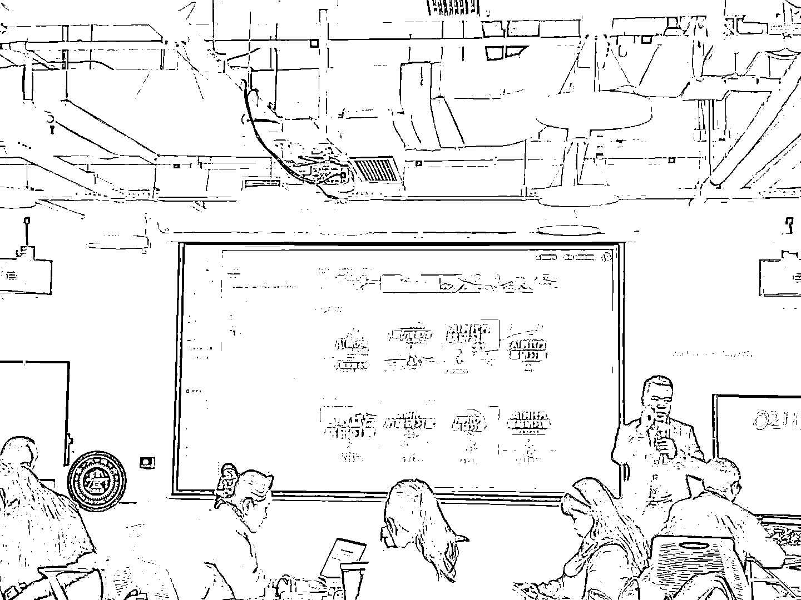

聊着聊着，他们立刻向我咨询当前有没有什么好用的AI工具可以用来画企业架构图和流程图之类的。

毕竟我们一直服务大型企业，尤其是之前给大企业提供解决方案时，总要处理大量的图表和PPT制作，从产品架构图到流程示意图等，画起来让人手软。

我试用过市面上的十来款AI图表工具，今天我就安利一款我认为目前最好用的——Napkin！

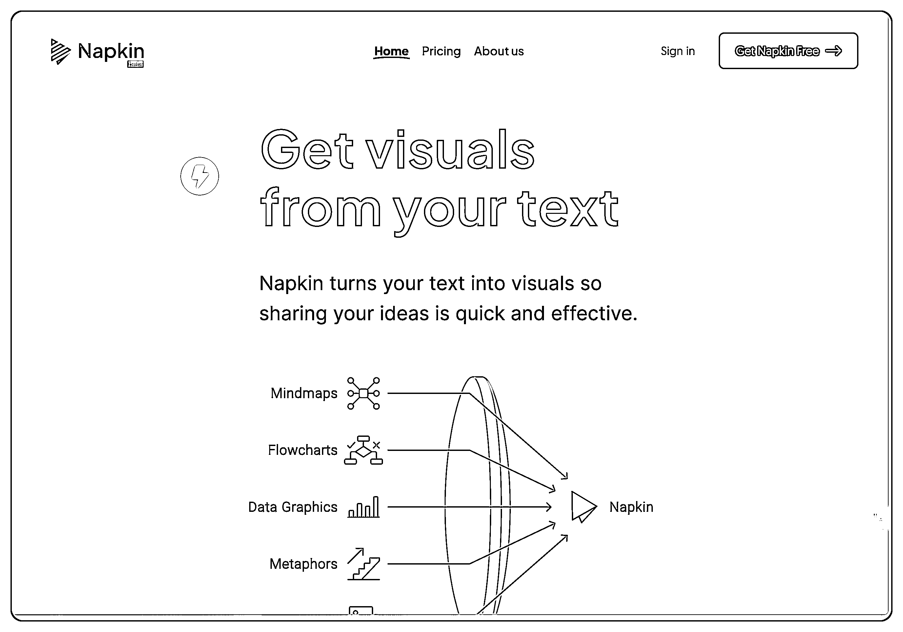

Napkin的核心优势在于它能快速产出各类专业可视化图表。这些图表不仅专业度极高，样式也特别多元，用起来顺滑高效。无论是职场汇报还是PPT演示，这款工具都能帮你大幅提升效率！

对比起PPT自带的智能图表工具，它的表现要优秀太多。

## Napkin效果演示

我来展示几个真实生成案例：

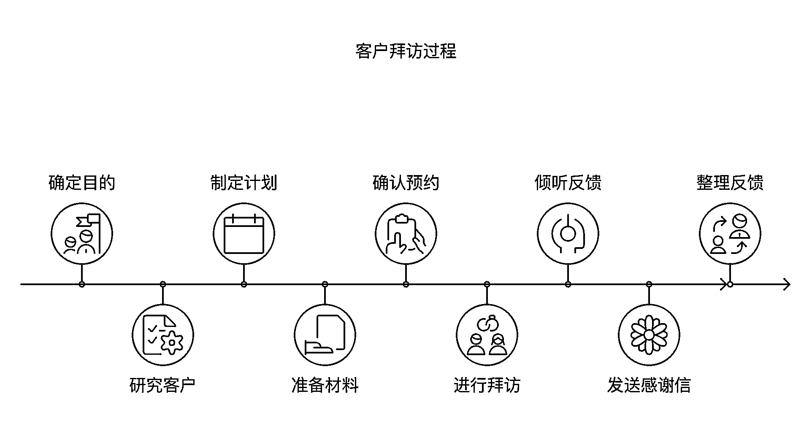

先看这个客户拜访流程图，清晰度高，逻辑关系一目了然，色彩也很搭配舒适，是不是感觉效果很不错？

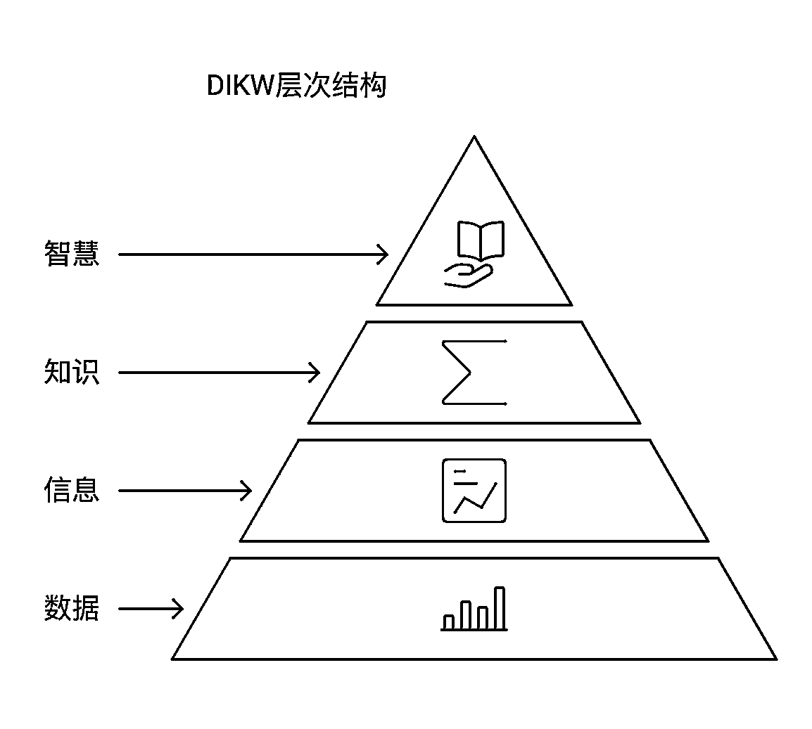

这是一个生成的DIKW模型，各分支层次分明，关键点突出，整体专业性十足。

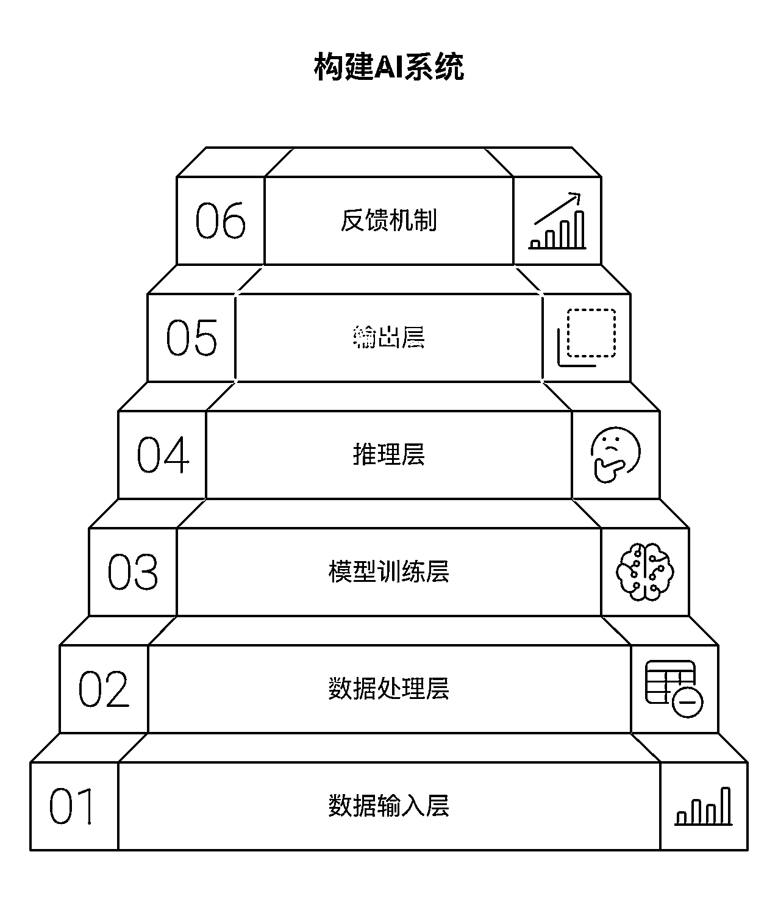

再看一个AI系统架构图，它同样处理得非常轻松，模块间关联说明到位，图形风格专业，拿到手里给客户看都倍感自信！

## napkin怎么用呢？

怎么样？是不是感觉很强悍？别着急，我接下来手把手带大家操作这个神器：

**第一步：打开Napkin，注册登录。**

直接访问Napkin官网（www.napkin.ai），常规注册登录账号即可。

**第二步：新建一个画布。**

打开界面后，先新建一个画布。你可以直接让AI生成文档，或者上传已有的文档或者想法，让AI根据内容自动生成相关图形。

比如我们可以指定让它生成波特五力模型的文档，它会先输出文本，然后确认后再生成图形。

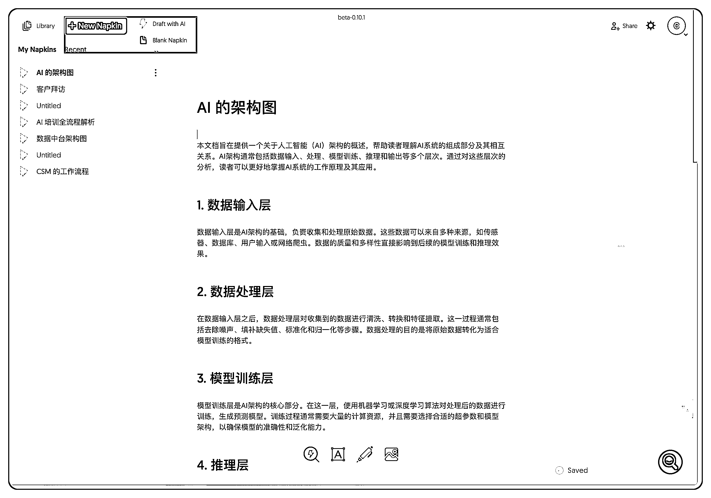

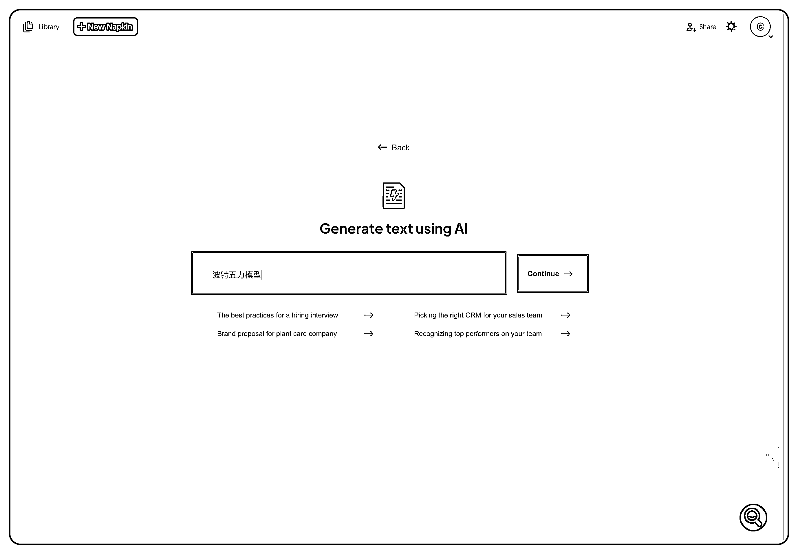

**第三步：开始生成图表！**

选中需要生成图形的文本内容，点击“生成图片”按钮（闪电图标），Napkin就会根据你的提示快速产出对应图表。

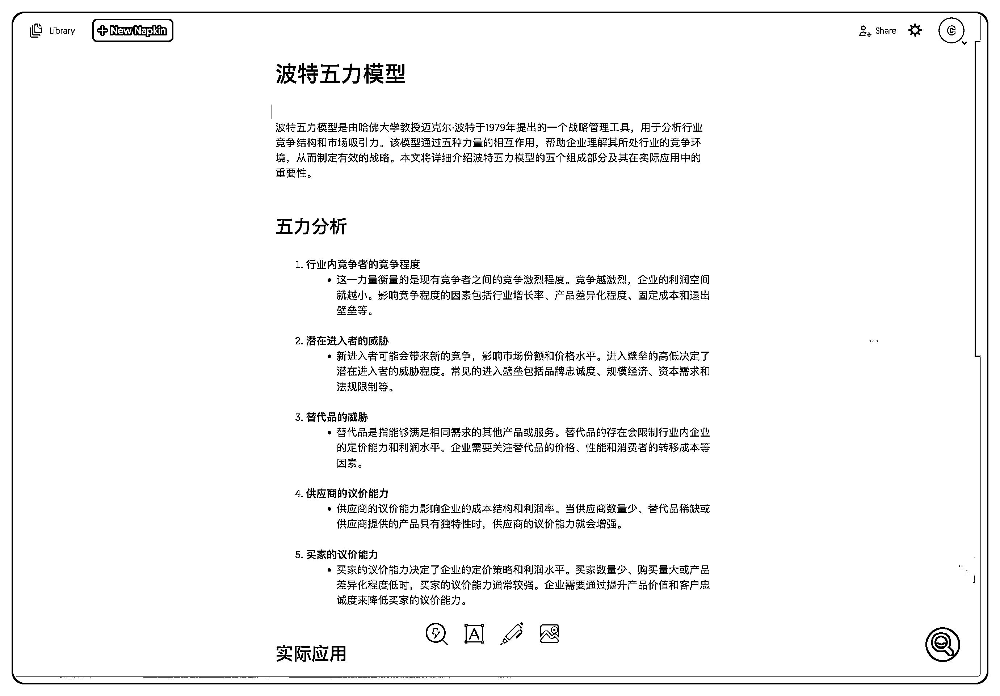

**第四步：选择样式，精细调整。**

图表生成后，可以按喜好挑选不同风格，还能对细节进行微调。

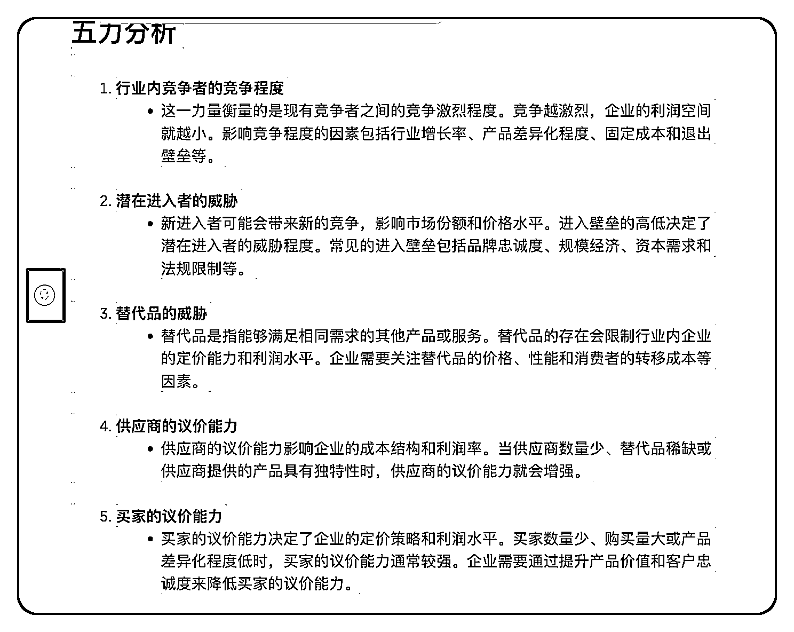

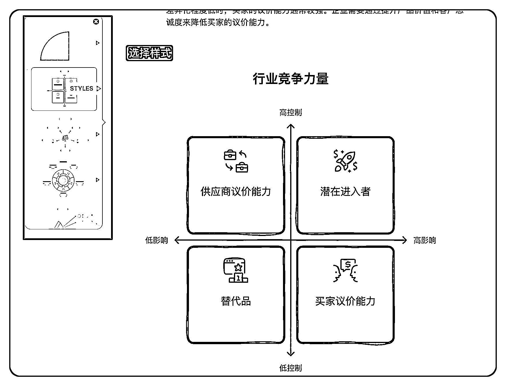

**第五步：下载图片**

调整完毕后，点击右上角下载按钮，即可保存到本地，还支持调整背景、格式和清晰度等细节。

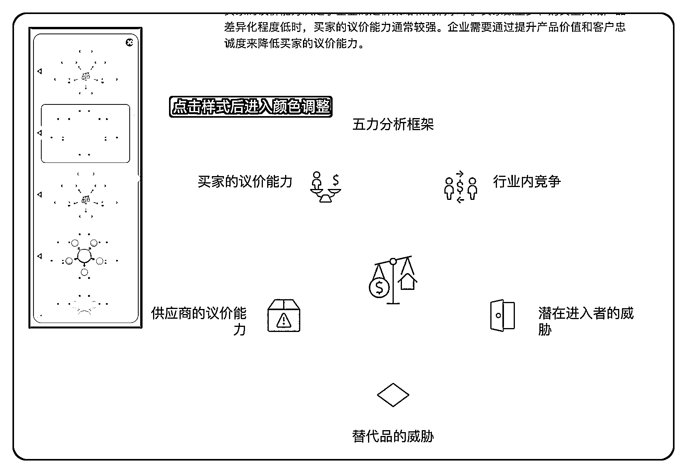

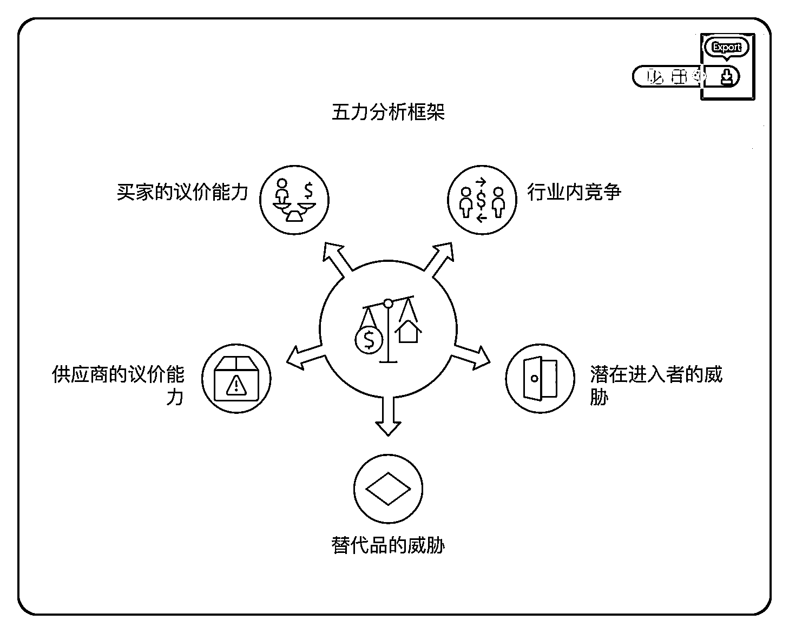

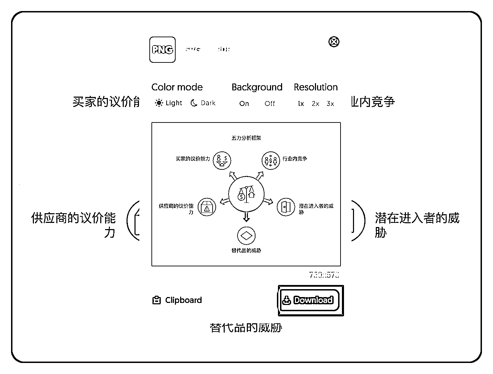

整个过程非常简单易上手！还有很多细化功能，可以自行探索，图表修改编辑性也很强。

而且，最重要的是，目前Napkin完全免费，几乎找不到替代方案。年底正值年终汇报高峰，就拿它做好看的图表来用吧，试用后可能再也离不开它了！

* * *

评论区：

凡夫俗子 : 感谢分享，确实很丝滑，能提效

sky 陈天 : 不客气呀，对你有帮助就好嘿嘿

宋先森 : 这个真好！及时雨！

sky 陈天 : 谢谢反馈[爱心]