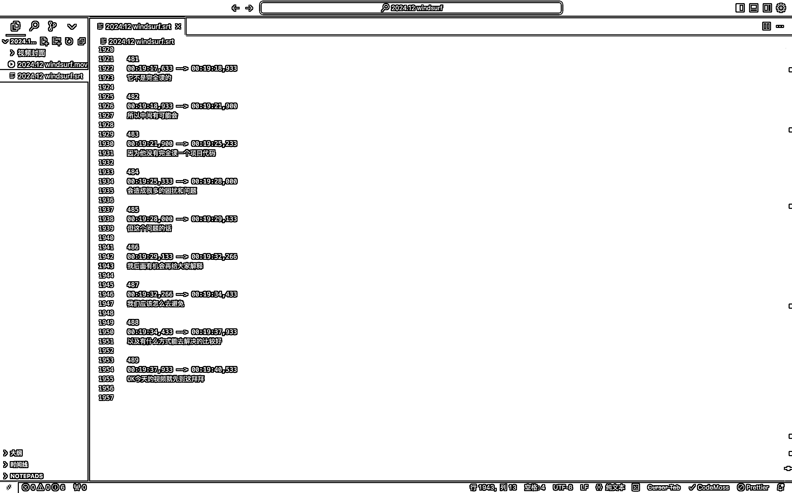
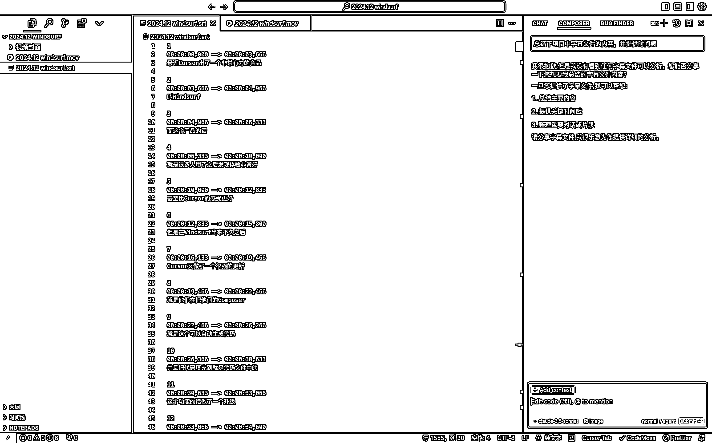
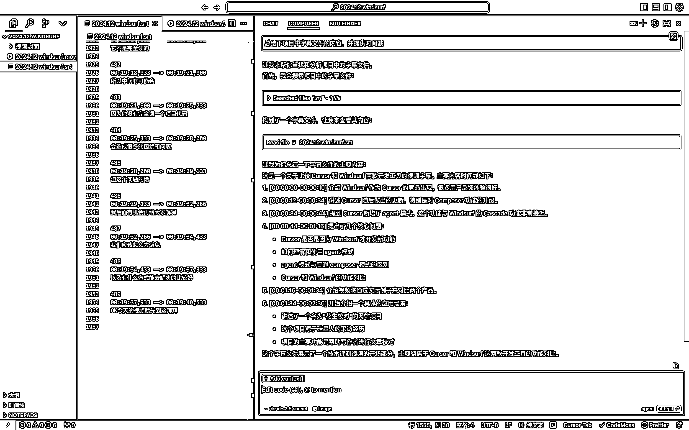
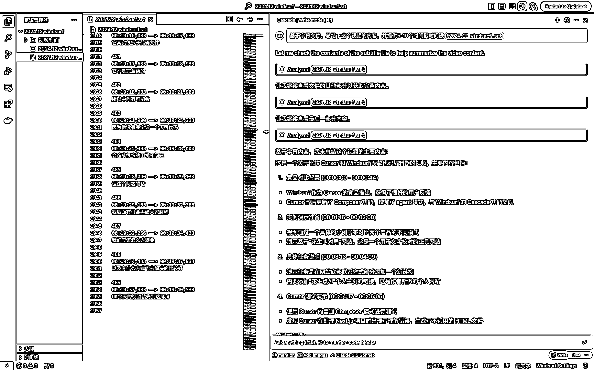
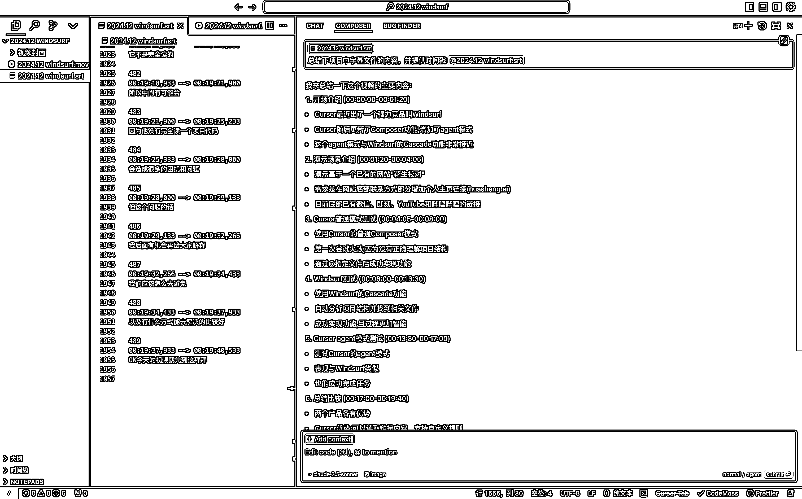
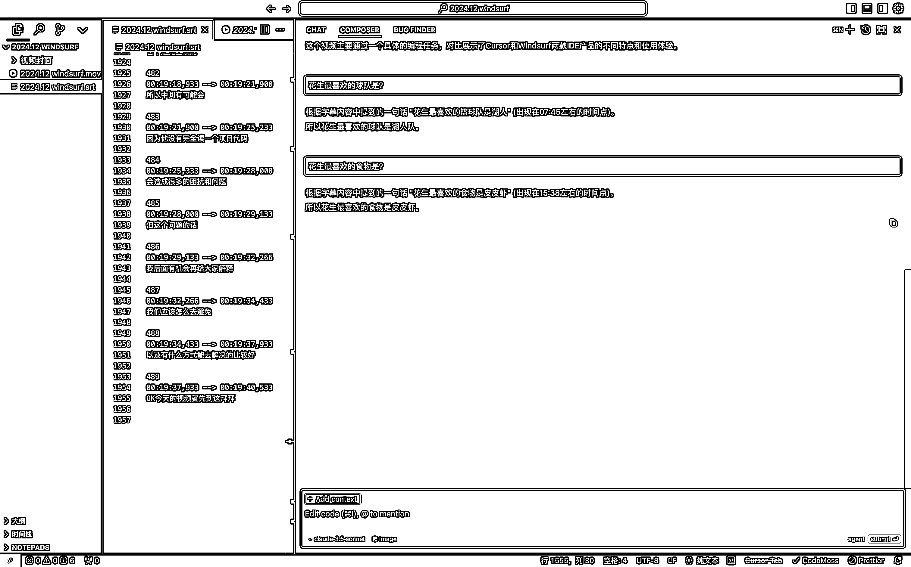
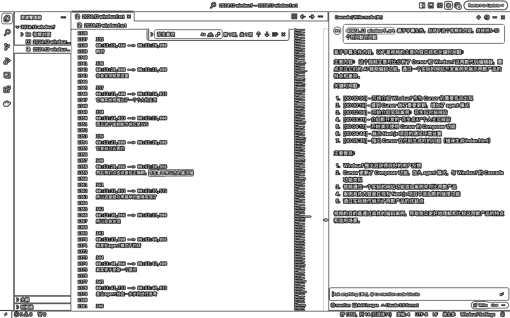

# Cursor 任务执行时代码关联缺口的实操拆解
作者：龙哥

## Cursor 在执行任务时关联代码信息缺失问题的系统性解答

作者：AI 进化论-花生

日期：2024-12-16

各位朋友好，我是龙哥。三个月自学 AI 编程，在 Cursor 等环境投入超过 500 小时，已经做出 AppStore 付费榜第一的「小猫补光灯」，并操盘了数十个小产品。

我也是本期赚钱 Cursor 航海的辅导员之一。航海群里经常有人吐槽 Cursor 的表现不稳定，相似的 bug 反复出现。大量情况源于 Cursor 在承担任务时，所需的相关代码片段并没有被完整带入视野。本篇就是围绕这一现象做的系统化解释。初学者可以直接看结论与建议，玩过几个真实项目的人会从中读到不少根因层面的启发。

> Context, not control.
> ——张一鸣

## 一、背景：AI 编程的成败高度依赖信息可见范围

现阶段让大模型代码能力产生跃迁的核心引擎是模型本身的智力水平，Claude 3.5 Sonnet 已经跨过一个关键门槛。但决定最终交付质量的，另一个关键变量是可用的信息窗口。

Claude 3.5 Sonnet 当前能提供 200k token 的窗口，对纯文本来说绰绰有余，一本五万到十万字的书都能一次性吞下。可一个真实的工程往往由几十到上百个源码组成，单个文件动辄数百至上千行，仅靠对话窗口根本装不下。再加上模型按输入输出计费，成本不可能忽略。

这两个现实催生了 Cursor、Windsurf 这类工具的大量工程取舍，它们的通用目标是：

1）尽可能精准地把和当前任务强相关的代码抓出来，减少窗口占用，从而支撑多步操作的连贯；
2）尽可能剔除无关内容，既为了效果，也为了控制开销。

在同样的限制下，不同产品选择了不同的权衡路径，本质上都是局部最优，并非全局最优，会牺牲一部分使用体验。

本文想拆开这些取舍的思路，搞清楚不同工具在何种情境下更合适，以便能在不同场景下切换使用方式，拿到更理想的结果。

## 二、结论：切入期选 Windsurf，深度调优选 Cursor

基于近期高频使用感受，以及 12 月 15 日对 Cursor 0.43.6 与 Windsurf 1.0.7 的实测，归纳如下：

### 1、针对新手的首次基础任务：Windsurf > Cursor Agent > Cursor Composer 常规

代理式交互在初级任务上普遍优于普通 Composer，因为它会先理解需求、定位文件、读取内容，再分步操作。Windsurf 的代理在任务理解与多步执行上的调优效果，比 Cursor Composer 常规状态下的代理更稳。

### 2、代理模式的核心短板是读取不完整，会在复杂工程与长文件上暴露

Cursor 代理默认只读一个文件的前 250 行，必要时会偶发续读再加 250 行；明确要求搜索时，单次返回上限约 100 行代码。
Windsurf 每次读取约 200 行，若判断不够会重试，最多三次，累计约 600 行。

### 3、@ 单个文件的行为逻辑差异很大，Cursor 的完整度明显更高

Cursor 中对某个文件做 @，会尽可能把整份文件塞入视野，测试中临界点约在 2000 行。
Windsurf 的 @ 文件更像是标注位置，并不等于“重点关注并完整载入”。

### 4、当你能把握工程结构时，Cursor 用 @ 单文件远好于 @ 全仓库

@codebase 时，Cursor 会用轻量模型对每个文件做速读并生成摘要，再把摘要塞回对话窗口，信息自然是压缩过的。相比之下，直接 @ 目标文件能拿到更原生的内容。

## 三、验证过程：用 1955 行字幕文件做“是否真读”的对照

全部结论来自日常 500+ 小时的体感，叠加一次针对性实验。我选用了一份 1955 行的视频字幕，带时间戳且上下文连续，很容易判断模型到底读到哪。

为防止模型靠检索总结蒙混，我在每 500 行前后插入了若干与正文无关的锚点，后期用来校验真实读取范围：

1. 花生最喜欢的运动是网球
2. 花生最喜欢的篮球队是湖人
3. 花生喜欢带白色的圆顶帽
4. 花生最喜欢的食物是皮皮虾

Round1：Cursor Composer 常规模式，未主动查找字幕文件，任务直接失败

Round2：Cursor Composer 代理模式，找到文件但仅读取前 250 行

Round3：Windsurf Cascade 默认代理模式，找到文件并尝试三次读取，累计约 600 行

Round4：Cursor Compose 模式下主动 @ 代码文件，完整载入全部内容，第一次即给出正确答案，后续锚点全部命中，证明是真读

Round5：Cursor Compose 模式主动 @codebase，内容概括大致正确，但全部锚点问题均答错，判断是小模型摘要后回填导致的失真

 images.zsxq.com/FtSixj7r7pk_wRdIC5XsiuJRXhHT) images.zsxq.com/Fuj-u_96X0cXPS4XbUEDDeAXIPOm)

Round6：Windsurf Cascade 主动 @ 代码文件，总结仍限于约 600 行范围，未实现完整载入

## 四、分场景使用建议

1. 尽量把单个源文件控制在 500 行以内，落在 Cursor 代理两次读取的安全区间。
2. 在文件前 100 行用注释写清功能与实现思路，帮助代理快速建立索引。
3. 新手起步或面对中小型工程，Windsurf 的代理上手更顺。
4. 工程复杂、单文件超 600 行且你已熟悉结构，能精准定位相关文件时，Cursor 的 @ 单文件策略更可靠。
5. 避免在对话窗口极长时重启新任务，每完成一个功能或修复一个缺陷就重置一次对话，减少历史污染。
6. 定期把项目现状与结构写入 readme.md 等文档，重启对话时可快速同步状态，避免模型反复咀嚼庞大历史。

希望这套拆解能帮你绕开常见的坑，让 Cursor 或 Windsurf 真正成为提效的伙伴。欢迎在评论区交流你的使用场景。

* * *

评论区：

暂无评论