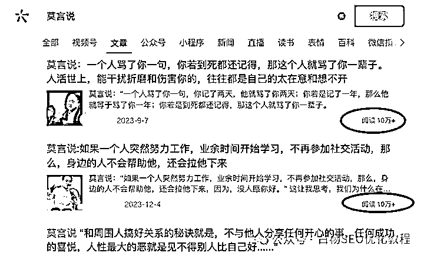
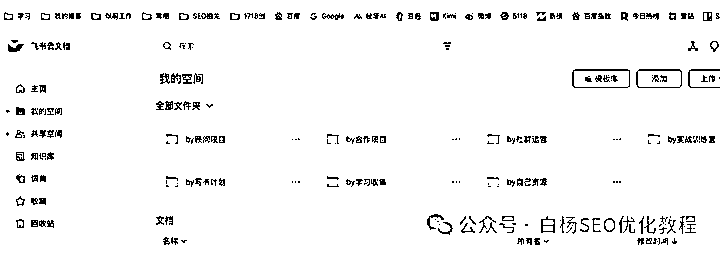
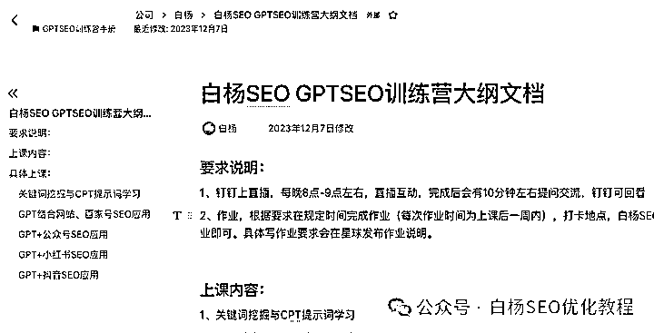
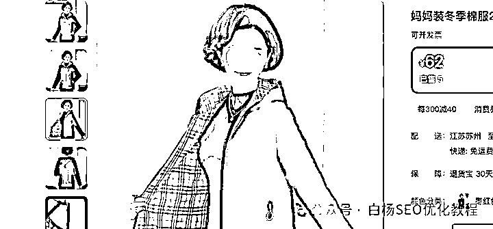
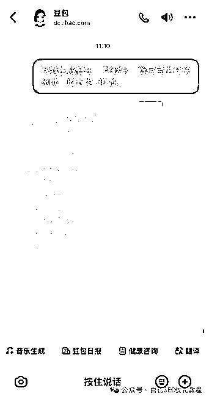
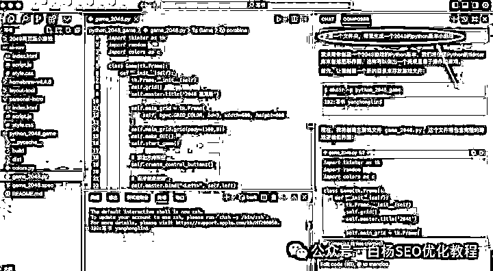
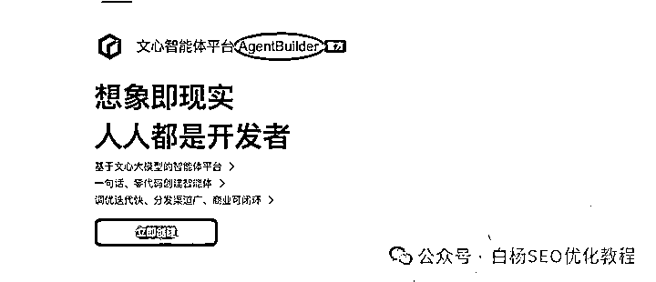
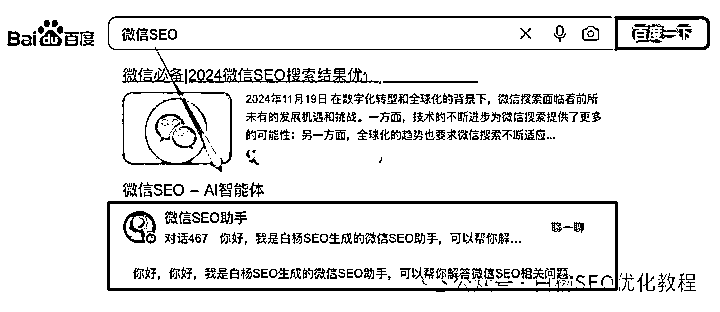
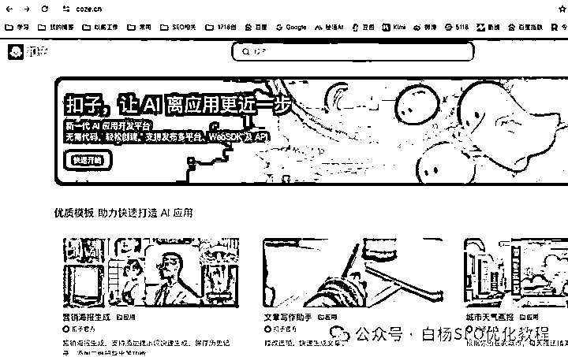

# 字节用 Coze 杀出重围，这串 AI 黑话你真的全懂吗？

## 字节跳动上线 AI 机器人开发平台 Coze，一次性唠清圈内常用英文技术名词

作者： 白杨 SEO

日期：2024-12-17

做任何赛道，刷到这组英文缩写基本都绕不开：

claude、notion、mj、sd、suno、sora、cursor、agent、coze、rpa、ai、seo

你可能会想，这跟我做内容、搞流量有啥关系？先给你一个小测试，这串词里唯一出自中国的只有一 个，你能猜中吗？

SEO 不对，RPA 也不是。

答案就是 **coze**，中文名 **扣子**，字节跳动推出的 AI 聊天机器人搭建平台。猜对了吗？

接下来把这些名词通俗拆解一遍，顺带给你对应可用的国内工具，收藏了以后看别人聊天就不会懵。

**Claude**

Claude 本质上是一个基于 Transformer 架构的大模型，可以像人一样读材料、写内容、做对话和翻译。

写稿、客服问答、文本润色都能派上用场。比如续写故事、提炼要点，基本都能搞定。它是在海量文本上训练出来会组织语言的能力。

业内很多人用它批量生成公众号那种名人名言 10W+爆文，生成后做下排版优化就发了，哈哈哈。

[白杨 SEO：公众号流量从哪里来？公众号搜索与推荐算法解密【干货】](https://link.zhihu.com/?target=https://mp.weixin.qq.com/s?__biz=MzU2NTQzMzA4Nw==&mid=2247498948&idx=1&sn=8bcbb33187c7891da8f68f21fc7f788c&scene=21#wechat_redirect)

再比如给网站加一个智能问答，Claude 生成的回复更像真人，用户停留时间会提升，流量自然就起来了。

Claude 由美国 Anthropic 研发，国内无法直接用，一般要借助网络环境。标准版月费约 20 美元，折合人民币 160 元左右，市场上也有各种接入方案。国内可替代的有豆包、Kimi、新华妙笔、秘塔写作猫。

**Notion**

Notion 就是一个全能型在线工作台，可以理解成可上手的电子笔记本。

支持笔记、文档、数据库和看板式任务管理。个人能用来记学习笔记和计划，团队能共编文档、同步进度。

自媒体人可以用它归档选题、素材和运营数据，通过分享链接沉淀粉丝。国内类似的生态是飞书、FlowUs 息流，我自己从有道云笔记转到飞书。

**MJ 即 Midjourney**

Midjourney 是个文生图模型，像个随时待命的插画师。

只要描述场景，比如“夜晚科幻都市，飞车、霓虹闪烁”，它就能画出来，质量很高，适合概念图、插画、海报。

对电商、社媒运营来说，优质图就是点击率。你可以用它生成带模特的服装图放网站和朋友圈吸睛。据说淘宝、京东、拼多多很多模特图已经是 AI 画的了。

广告设计、游戏美术、插画灵感也常常用它。国际版订阅有基础、标准、专业档，月费约 10、30、60 美元。国内同类有豆包文生图、百度文心一格、智谱清言绘画等，我常用豆包和智谱。

**SD 即 Stable Diffusion**

Stable Diffusion 也是文生图模型，最大特点是开源。

和 Midjourney 类似，输入描述即可出图。开源意味着技术人员可以改模型、训练风格，做动漫风、写真风等定制化输出。

**Suno**

Suno 是个 AI 作曲平台，像个会写歌的小机器。

告诉它风格，比如“欢快流行、强鼓点、明亮旋律”，它就能生成完整音乐。

做播客、短视频需要BGM，用它快速配乐能提升完播率。有声书也能用它做配乐片段增加沉浸感。Suno 有 Pro 和 Premier 档，月费 10 美元和 30 美元，免费用户每天 50 积分，可免费生成约 10 首。

国内同样能做文字转音乐，比如豆包 App 即可尝试。

**Sora**

Sora 是 OpenAI 推出的文生视频模型，能把文字或图转成长达 20 秒的视频片段。体验成本目前偏高，算是流量热点。

想玩文生视频，国内的即梦 AI、可灵 AI 已经是常见选择。

**Cursor**

Cursor 是一款面向开发者的 AI 编程助手，典型的 AI Coding 工具，最近很火。

你可以直接对话让它写代码，比如“写个 Python 求两数之和”，它会直接生成；也能检查报错并给出修改建议。截图里圈中的代码是用户写的，其他是 Cursor 自动补全的。

免费试用 14 天后需付费，月价约 20 美元，约合人民币 160 元。国内替代品有百度文心快码、豆包 MarsCode AI、阿里 Tongyi Lingma。

**Agent**

Agent 在 AI 语境里就是具备自主决策和行动能力的智能体。

在强化学习中，它在环境里试错并根据反馈优化策略；在客服场景里，智能 Agent 能按问题类型自动匹配回答方式。

最近火的各种智能体，百度智能体、豆包智能体、智谱清言智能体，本质都在讲 Agent。

比如搜索“微信 SEO”时出现的微信 SEO 助手，就是我用文心智能体搭建的。

[白杨 SEO：百度智能体是什么、有什么用、怎么创建及使用？【研究】](https://link.zhihu.com/?target=https://mp.weixin.qq.com/s?__biz=MzU2NTQzMzA4Nw==&mid=2247499844&idx=1&sn=4f9ac513e5093d8b3ac744a9885c8899&scene=21#wechat_redirect)

**Coze**

Coze 是一款零代码搭建聊天机器人的平台。

你可以配置机器人的知识库和对话流程，让它完成问答、客服、语音助手等任务。企业常用它做专属客服机器人，解答产品相关问题。

国内版地址是 http://coze.cn 。

有朋友已用 Coze 的工作流批量处理公众号内容分发和群发，感兴趣可以自己探索。

把机器人嵌入网站或社媒，就能 7x24h 互动。比如教育机构可自动回复课程、时间、学费问题，筛选出高意向用户，带来精准流量。

**RPA 即 Robotic Process Automation**

RPA 是软件机器人，能模仿人工完成重复规则化流程，比如数据录入、文件整理、报表生成。财务部门常用来多系统取数自动做报表，提升效率和准确性。

市面上很多人用 RPA 批量生产图文视频，或讨论 Cursor 是否替代它。关键永远是能不能用好工具，而不是神话工具。RPA、Cursor、AI、SEO 都只是手段。

**AI 即 Artificial Intelligence**

人工智能是让机器具备学习、推理和解决问题的技术。AI 能分析用户行为，比如电商浏览路径、停留时长，基于此做精准推荐，提升转化和留存。

它还能解析用户画像，用于广告投放的自动化优化。现在百度竞价、抖音信息流投放都深度依赖 AI 决策。

**SEO 即 Search Engine Optimization**

SEO 是提升搜索引擎排名的方法论，现在已演变为全平台的流量思维。

这篇文章很基础，但做 SEO 或互联网流量的人必须认识这些名词，不然完全听不懂圈内对话。

**作者介绍：**

白杨 SEO，专注 SEO 十年，全网 SEO 流量实战派，对互联网精准流量有深入研究。

* * *

评论区：

暂无评论