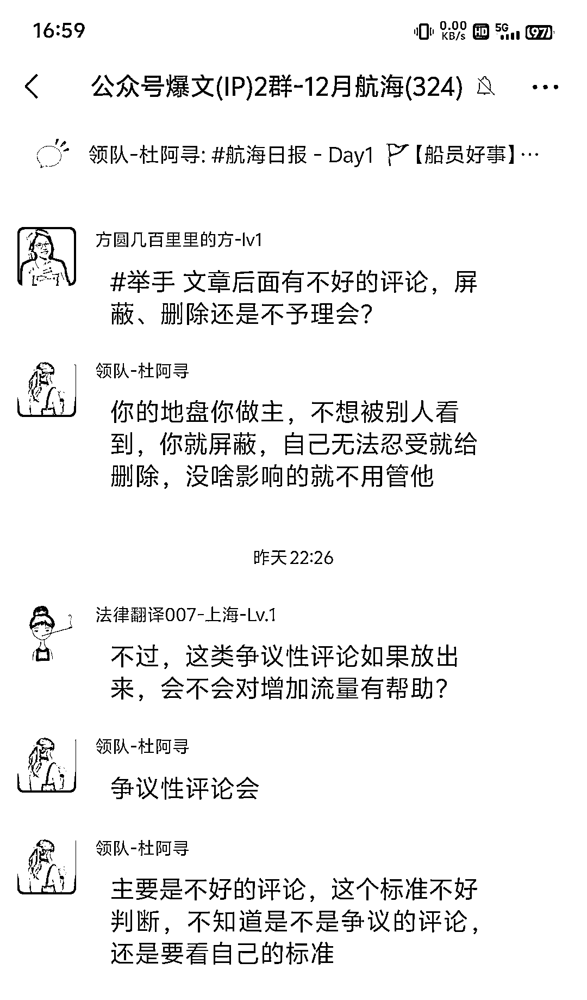
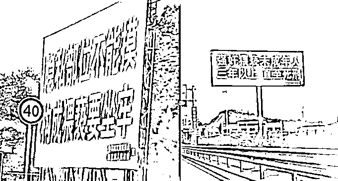
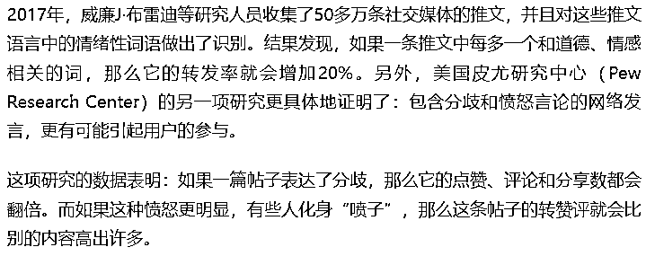
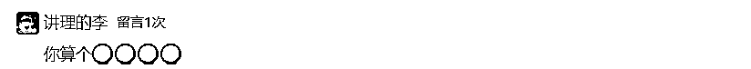
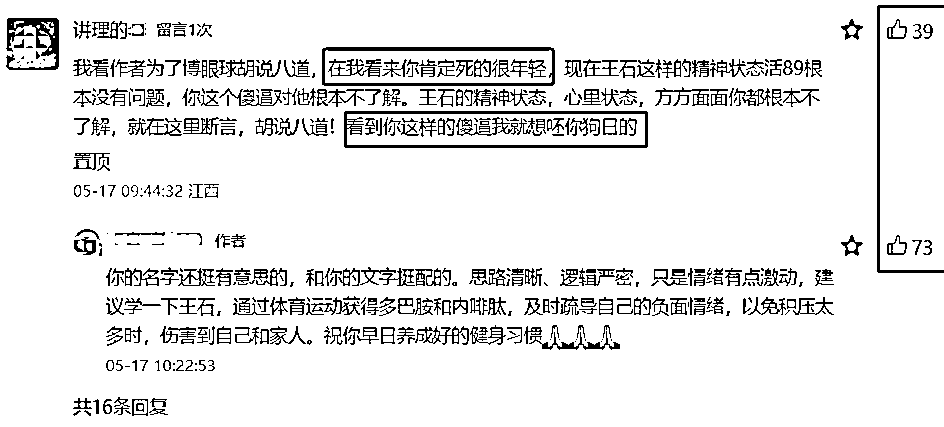
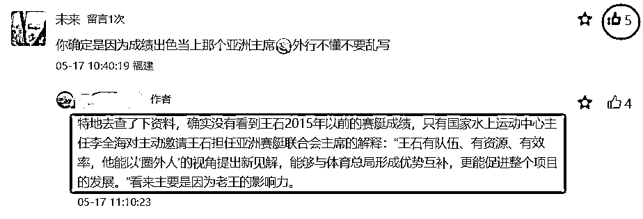
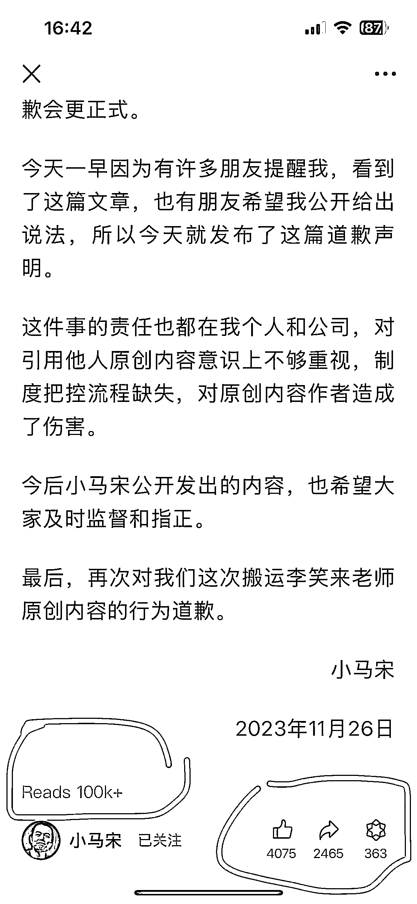

# 没有”差评“，你还写什么👸号？趁早换项目吧！

你的👸号连差评都刷不到，还有继续做的必要吗？

做内容的人，是不是都怕差评？以前我也怕，直到我发现，差评其实是一种“奖赏”。

前几天在👸号爆文航海群里，有人问“负面评论怎么处理”，领队答得很细： 我也跟着回了几句，毕竟👸号图文、短视频、直播这几摊事我都碰过差评，后来想，干脆系统梳理一下。

先说结论：看到差评，先别急着删。心态上，你应该高兴，因为“闻过则喜”不是鸡汤，是流量逻辑。我的做法是：主动保留，不删除，也不必每条都回，挑几条有价值的回复就行。

为什么？你想想，那些让人气到想骂人的内容，用户是不是会停下来敲一大段字？在评论区打字、看别人吵架，都是在给平台贡献“用户时长”。平台之间抢的就是这个。头条和抖音抢，👸号和视频号抢，连社群之间都在抢。谁的停留时间长，谁就更有广告价值，算法也越愿意推。抖音一年广告收入几千亿，🛰️也是，👸号就是🛰️广告牌上的大板块，但广告牌再大，也要能让人记住。像高速路边那些巨幅广告，你能记住几个？但下面这两块，你肯定忘不了： 因为“死亡、性、暴力、异常”全是注意力钩子，另外还有第八种——愤怒。

就像之前网上有一批儿媳吐槽婆婆包饺子不戴手套的视频，评论区全是骂声，但播放量、转发量都高得离谱。这不是我们要学的，但它揭示了流量的秘密。

今年年初，农夫山泉的钟睒睒被全网骂，就是被“愤怒”裹挟的例子。一些营销号编造民族主义内容，煽动网民去攻击他，评论区全是情绪。这是反面教材，我们不学。但周鸿祎后来专门发视频讲愤怒情绪在社交媒体上的传播力： 我也查了相关研究： 结论是，愤怒能显著提高互动意愿，点赞、转发、评论都会变多。👸号的差评，很多时候就是“愤怒”的读者写的。

有人会问，那只有负面案例吗？当然不是。你写有争议的话题，只要事实客观、观点鲜明，照样会有人来抬杠。比如你写江歌妈妈，会有人说你是消费逝者；你写中国足球有希望，会有人说你瞎；你写日本官方援助中国43年，也会有人骂。这些骂声就是评论，就是流量。我们不是故意找骂，而是像咪蒙写《致贱人》那样，观点明确，情绪到位，让认同的人爽，让不认同的人跳脚。金枪大叔有句话我很认同：“初创品牌要愤怒。”新手写👸号，同样是初创品牌，完全可以借一点“愤怒”。

当然，我不是支持“黑红也是红”，这个价值观我坚决反对。但你要记住：做内容，有差评，好过没评论。

理解了差评的价值，你就不至于一看到就手抖删掉。但心里还是不舒服，怎么让自己坦然保留差评？先给差评分分类。

第一种，读者只是误会了你。被误会是表达者的宿命。做自媒体，迟早要挨骂。你只要知道，骂你的人骂的是他们想象中的你，不是真实的你，那你就不必激动。

第二种，读者根本不关心事实，就是来发泄的。其中又分两类：一类直接骂脏话，系统会帮你屏蔽，漏网的你可以删掉拉黑；如果骂得不太过分，也可以留着，你的粉丝会帮你怼回去。比如这种： 另一类看似讲道理，实际胡搅蛮缠。这种也别删，等明白人来反驳，反而能把评论量和推荐量顶上去。比如我写王石和田朴珺那篇，有个人没认真读文章，曲解后骂我。我专门把这条评论置顶，理性回复。结果点赞他的人不少，但给我点赞的人更多，底下还有十多个陌生人主动帮我说话。

第三种，确实是我们写错了，读者批评得对。这种我真心接受。有人愿意指出错误，是帮我长见识。比如有一次： 我认错、回复，其他读者反而会点赞。遇到态度犀利的指错，也要学会“出来写，错了就要认，挨打要立正”。像小马宋为洗稿传闻给李笑来的道歉信，阅读量10W+，评论区却关了。要知道，他过去一年10W+也就3篇。如果是我，我一定会放开评论，迎接这波富贵。

最后，把关于差评的几点看法总结一下：

第一，新手做👸号，别怕差评，就怕没评论。短视频同理，直播另说。

第二，想要不怕差评，得先理解差评为什么对你有利，把底层逻辑想通了，心态自然就稳了。

第三，选题时可以主动碰一些有争议的人物和事件，但避开政治、刑事等敏感领域。

第四，写错了就大方认错，差评也能变成你进步的机会。

再补充一点：内容创作也需要一点“不招人妒是庸才”的心态。在价值观不越线的提前下，甚至可以策略性地招黑——该表态就表态，该站队就站队。比如大V大蓝靠批评打工人被骂出圈，反而吸引来大量中小老板，而这些老板正是他的目标付费用户；赚钱圈友花生在📕分享技术“炫技”笔记，一开始被程序员差评，结果流量上来了，还吸引来女性用户，最后好评反超，笔记成了爆款。另外，评论量也直接影响👸号流量主收益——文末广告单价高，把用户引到评论区，顺手看到广告，价值就出来了。同样的文章发在两个号上，评论量99的那个，就是比评论量为0的更让人想点开。所以，用小号搬运同主题的高赞评论，或者把别人爆文点赞最高的三条评论写进自己正文，都是制造“双爆”潜质的二创技巧。

差评不可怕，可怕的是你的内容平庸到没人愿意多看一眼。从今天起，善待每一条差评吧。