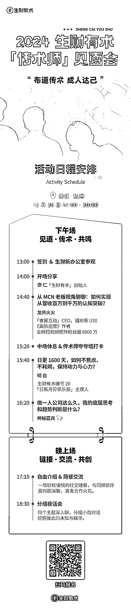
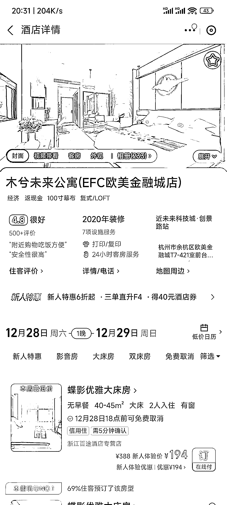
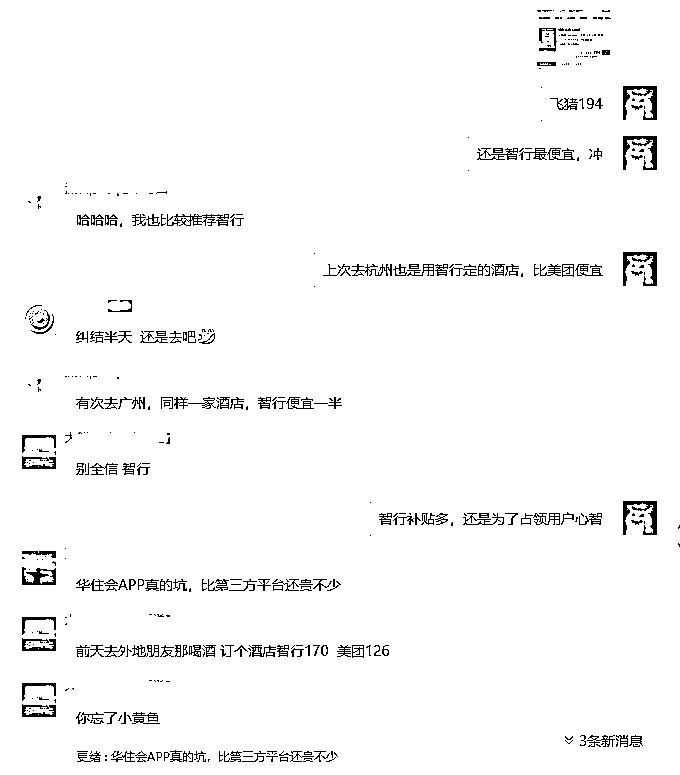
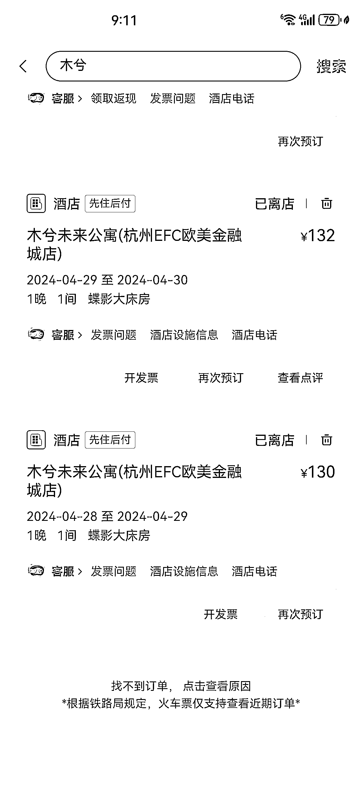

# 一票难求之后，大家居然在为住哪儿“拼”了？
作者：龙哥

最近赚钱传术师群里可太热闹了。28号线下活动的门票刚放出来，60个名额瞬间被秒空，那场面堪比春运抢票，手慢一点就得等下一波。抢到票的伙伴们兴奋劲儿还没过，就发现活动下午开始，晚上还有夜话会，于是订机票、买车票、找酒店又成了当务之急。

## 先从酒店说起

一开始，我在智行上刷到赚钱办公室附近的“木兮未来公寓”，1.5米大床、带窗、45平，只要162元，觉得性价比相当能打，就丢到群里问问有没有人拼房。结果一对比，美团同款185，飞猪194，差价还挺有意思。

群里的大佬们七嘴八舌，有人说智行便宜，有人说美团更香，还有人吐槽华住会APP比第三方平台贵，更有人提到闲鱼也能代订。这时候我和圈友秋秋桂老师一拍即合，准备拼单，有前辈建议人多可以直接找老板谈协议价，团购肯定更划算。秋秋桂老师行动力一流，立马加了老板🛰️。

## 砍价大作战

我在群里发起接龙，统计想住这家的人数，目标先定十间房。群里大佬预估120以内能拿下，毕竟OTA平台也在抽成。另一边，有老师订了附近的“米莱迪公寓”，价格比木兮还低，条件却差不多。于是大家开始在线支招，教我们怎么拿着别家的低价去“逼”老板松口。一开始老板还挺硬气，直到看到米莱迪的报价，才答应去申请一下。

在赚钱，精华帖里学的是“龙哥盟”，传术师群里却能亲身体验“省钱有术”。来来老师还分享说住过木兮，环境不错，房间带冰箱和洗衣机，四月份入住才130，比现在162的团购价更划算。实拍图看着也确实干净舒适，这波不亏。

## 第二天画风突变：换目标，比价！

第二天一问秋秋桂老师，木兮老板咬死最低150，不肯再降。其实这价也不错了，但我想起自己淘宝88VIP好像有酒店权益，从来没试过，干脆打开看看能拿到什么价。不查不知道，一查吓一跳——同一家澳美酒店，88VIP报价131，智行283，高德168，美团361。同样的房型，四个平台跨度从131到361，差了快三倍！

这还只是四个渠道，市面上能订酒店的平台可远不止这些。我问了下豆包，它列了一长串：

- 在线旅游平台：携程、美团、Booking、Agoda……
- 酒店官网：凯悦、华住会等，会员常有专属优惠
- 手机应用：艺龙、首旅如家等
- 旅行社：线上线下的都能帮你订
- 其他：企业商旅平台、直接电话预订等

常用的大家都很熟：美团、智行、飞猪、携程、同程、去哪儿。容易被忽略的还有：淘宝（接飞猪）、🛰️（接同程）、高德（接飞猪）、支付宝（接飞猪）、闲鱼（代下单）。

为了更直观地感受“大数据杀熟”的威力，我用同一台手机、同一个手机号，横向对比了两家热门酒店在不同平台的价格：

### 杭州EFC澳美国际公寓（心选大床房）

- 淘宝88VIP：131
- 智行：283
- 高德：168
- 美团：361
- 飞猪：131
- 携程：295
- 同程：284
- 去哪儿：276
- 支付宝内飞猪：131
- 支付宝内美团：381
- 🛰️内同程：292

最低131，最高381，近三倍差价。有意思的是，同样是飞猪渠道，高德地图里就卖168，淘宝里只要131，同一个渠道在不同入口价格都不相同。

### 尚仕精选公寓（景观大床房）

- 淘宝88VIP：130.98+24开卡费
- 智行：149
- 高德：124.23+24开卡费
- 美团：216
- 飞猪：130.98+24开卡费
- 携程：166
- 同程：163
- 去哪儿：145
- 支付宝内飞猪：130.98+24开卡费
- 支付宝内美团：216
- 🛰️内同程：163

最低去哪儿145，最高美团216。不过这只是我手机上的价格，群里圈友有人用140拿下尚仕，还有人把澳美做到了124.7。同样的房间，不同的人、不同的平台，价格天差地别，省钱的门道，懂的都懂。

## 换个思路：酒店代订是不是门生意？

既然差价这么大，能不能帮别人代订赚个差价？大多数人手机里就装一两个常用APP，哪会像我这样挨个比价。比如在闲鱼挂个“8折9折代订酒店”的链接，客户把酒店名称、入住时间、房型发过来，你先查自己渠道的底价，有利润就接单，几乎没有额外成本，纯赚信息差。

最后放两张苹果和安卓手机的酒店价格截图，供大家参考。

祝各位龙哥盟，也祝省钱有术。在生活质量不缩水的前提下，少被资本“薅”一点，就是赚到。

 images.zsxq.com/Ft3fmgT_DVLG2OqJwQT5vXOyQ3LS) images.zsxq.com/FvUOh6633Jm3BUw_K4b1iScZ_SbZ) images.zsxq.com/FgBrg-8of--pJ8FJLU3JBBSKWWZA)

 images.zsxq.com/FsYIOTHrXB__EEO149IukKyOSaXw) images.zsxq.com/FqKAFzJg3mLCKGM-TshjOGSSVzPW)

 images.zsxq.com/FpxMomPzWksx8-1ISQJF4nXwZBol) images.zsxq.com/FlwctK33OKOi6d6KwcgeFxsCVwUa) images.zsxq.com/FmeJyrT0g8ac1HI3mdTer6Oo_SJX)

 ioR1)

 images.zsxq.com/lgfQg7Uvhrb3wTnGRS6DoPwrWtas) images.zsxq.com/FoN6jPeTIBDud-NgbKvt5hLcJ-9I) images.zsxq.com/FjEoG7GCW_YDRdEYWl0Y2ys4ykja) images.zsxq.com/FpXRscVg8p7r9DfpV8_gKR6jcHDp)

 wQpV67z4-) images.zsxq.com/FvESjcF2MgVt1gM1-OKd0PB7EfeJ) images.zsxq.com/FuRIyv_rS40mAJ7jd8i8ptfW8ap8) images.zsxq.com/FgsNqnrxhuqt2A5xfCA0TIsMyGkS)

 IseVtTJpHx) images.zsxq.com/FqAQmlyUQfHFPjRMBKwJ4KnxxZsI)