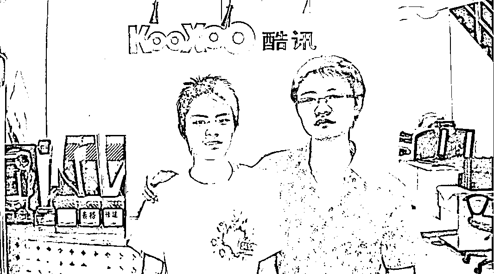
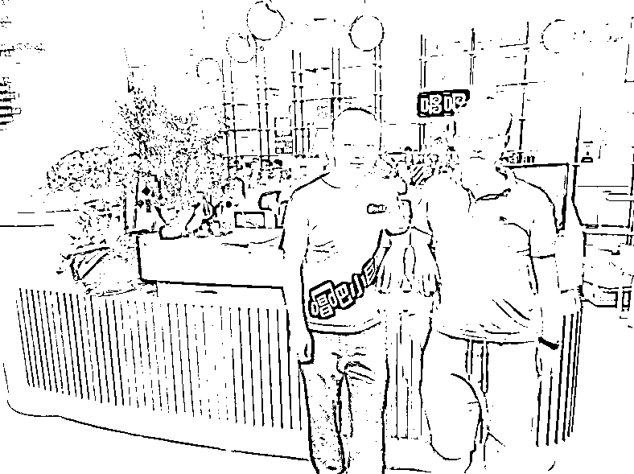
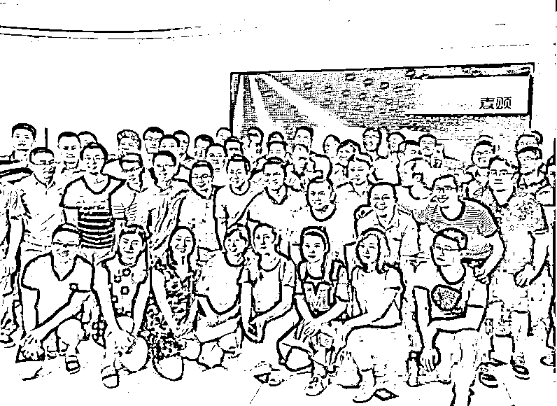
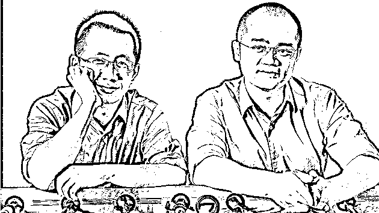
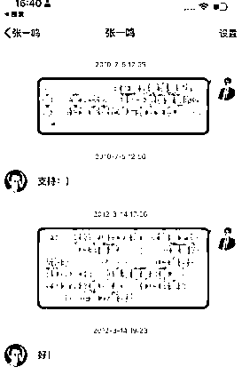
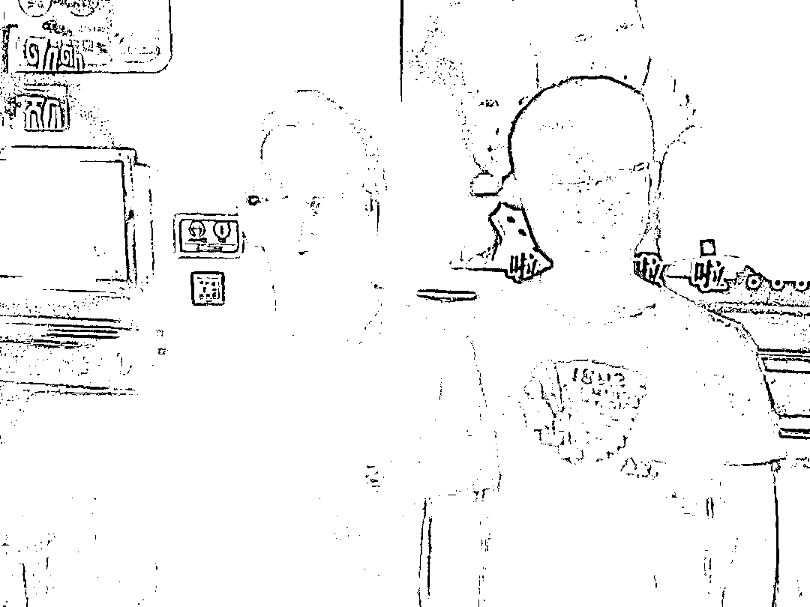
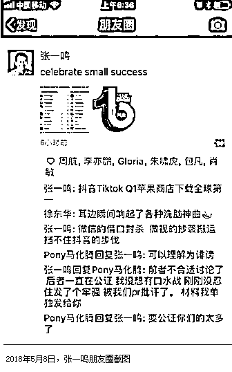

# 半年酷讯，一世记忆：那些关于张一鸣的旧事
作者：龙哥

如果按工龄来算，我在酷讯只待了短短半年，远不如在360那两年长。但这半年经历的密度和厚度，却远超很多更长的时期，和部门同事也处出了很深的感情。直到现在，想起那段日子，我还是能记起很多细节。甚至我结婚那年在重庆办婚礼，从北京赶来参加的老同事只有两位，巧的是，这俩人都来自酷讯。

那时候我刚写博客不久，从06年开始，慢慢在网上有了点知名度，在360做推广也做出了一些成绩。07年还在360时，老同事许飞就请我去酷讯市场部做了一次经验分享。也就是那一次，我认识了后来在酷讯的直属领导郭瑞雪。

许飞原本是360新闻搜索的产品经理，之后跳槽到酷讯，当上了机票事业部总经理，那可是当时酷讯最赚钱的部门。之前一起在360做无忧城市的产品经理张海军，也跳了过去，担任产品副总裁。

07年底我离开360，那时候又失业又失恋，双重打击，回重庆歇了三个月。08年初重新找工作时，想到了之前那次分享，又靠着许飞和张海军这两位老同事的推荐，去酷讯面试。因为是直接应聘经理级岗位，面试我的第一人就是创始人陈华。也许看出我过去的成绩还不错，加上两位VP级别的推荐，我很顺利地就入职了。

08年那时候我的徒弟胡忠还专程来酷讯看我，给我留下了我在酷讯的唯一一张照片。

我承认自己是个好胜心很强的人。北京公司一般三个月试用期，但我总希望能提前转正，在360的时候就爱这么干。到了酷讯，却发现老办法行不通了。

我之前在360擅长的是做流量交换，那会儿360门户几乎就是个图片站，有不少打擦边球的内容，只要放上一些火爆辣眼的图片广告，换流量的效果就特别出色。可酷讯是旅游搜索平台，根本不可能碰擦边内容，用那套思路做流量交换完全没戏。一时间我还真有点发愁，不知道怎样才能靠业绩提前转正。

我当时看了一眼同事的工作记录：跟几十个网站互换BD位，来来去去也就带来几百IP，可以说惨淡得可怜。要是我也走这条路，估计很难做出什么成绩。

人年轻时脑子确实转得快。我注意到很多网址导航站首页都会收录一个叫“列车时刻表”的工具，点击进去是第三方网站。酷讯当时还算新站，大多数导航站推荐的其实都不是酷讯的版本。因为我在来酷讯之前就写过TOP50导航站的数据分析，很快就找到了这些导航站的负责人，靠着一张嘴去说服他们换成酷讯的列车时刻表。怎么打动人呢？我的办法是：链接页面头部和尾部还是用他们自己的，只有中间内容换成酷讯的表格。加上产品本身不差，好几家TOP10导航站就这样被我拿下了。

效果是，每天能免费给酷讯带来1万IP的精准流量。现在回头看这个成绩已经很牛了，完全对得起公司给的工资。但在当时，我在360一天都是几十万IP的业绩，所以心里还是觉得远远不够。

说起来，后来我还专程去拜访过陈华。

离开酷讯后，我和陈华一直没断联系。还在酷讯时，我接受过媒体采访分享推广经验，结果一堆人来问陈华“这人是不是你们公司的”，让他有点尴尬。另外，唱吧的另一位合伙人徐微，也是我在酷讯市场部的同事，所以我去北京经常去唱吧公司，可以说看着他们从小办公室搬进了更大的办公室。

导航站的流量虽然不错，但很快到了瓶颈——有流量又愿意合作的导航站毕竟就那么多。能免费从这儿拿到一万多IP已经不容易了。当时我手里没什么事，领导就临时交给我一个任务：负责酷讯各频道的友情链接交换，要求不高，每个频道换20个左右就行。

在交换友情链接的过程中，我慢慢发现，这东西对频道关键词的排名作用还挺明显。于是突发奇想，写了一份针对列车时刻表频道的SEO计划，发给了相关领导，并且立下目标：多少时间内做到多少排名、拿到多少流量。大概拼了十来天，我把“列车时刻表”这个词从百度排名第10位，大概有1000左右的流量，硬生生做到了第3位，流量涨到7000左右。就这一个词，就给网站带来了每天6000的针对性流量。那是我第一次感受到，用SEO做推广，见效比我以前那套快多了。

有了这波操作，我又写了一份覆盖全网的SEO方案。因为“列车时刻表”的成功，高层非常重视，直接让我全权负责酷讯的SEO，还允许我招三四个链接专员，单独成立一个SEO小组来跑这件事。

当时酷讯的SEO是由技术部负责的。我记得跟技术部总监谢欣做了工作交接，而张一鸣那时是酷讯的首席技术官，并不负责具体管理。多年以后，谢欣也去了字节跳动，如今已经是飞书的CEO。

我负责SEO的三个月里，效果最好的时候，酷讯所有主流频道的关键词都冲上了百度第一页，比如“特价机票”“酒店预订”“机票查询”“列车时刻表”这些大词，流量都很可观。算下来每天能新增3万多IP。我自己算过一笔账：如果这些流量靠买竞价排名，旅游类关键词价格又不便宜，3万IP至少值3万块钱，也就是说通过SEO，每个月能给公司省下90万的推广费。

说实话，现在回想起来，我给酷讯创造的价值，远超过公司给我的那点工资。因为这些流量是我去了之后凭空冒出来的，不是拿公司资源换的。

虽然我做出了成绩，但酷讯内部那会儿已经很混乱了。投资方和两位创始人之间矛盾重重。在我入职没多久，吴世春和陈华就先后离开，投资方从外面请了一位职业经理人来做CEO。

具体原因我当时不清楚，现在猜，可能是投资方觉得他们不够拼吧。比如我上篇写过，酷讯作为创业公司，周末居然不加班。后来还听到些八卦，说那会儿老板们爱打牌，其中还有某位歌星WF，经常打通宵。难怪后来陈华做唱吧，这位歌星还来代言过，可见私交不一般。

公司这么乱，我有业绩也白搭，升职加薪基本没戏。所以待了半年，我就跳槽去了当时一家做旅游的上市公司艺龙网。为了走出去，我还跟张海军撒了个谎，说爸爸生病要回去照顾。其实我爸那会儿确实生病，但没严重到要我离职照顾的地步。

那时候的酷讯和去哪儿旗鼓相当，规模和流量都差不多。我加入后，甚至因为SEO的拉升，酷讯的数据一度反超了去哪儿。然而多年之后，去哪儿上市了，酷讯却彻底消失了，连域名都打不开。

公司虽然败了，但酷讯的人很成功。因为倒得早，离开的人正好赶上创业的好时机，走出了好几家独角兽。最有名的，就是张一鸣的字节跳动，还有吴世春的梅花创投、陈华的唱吧、陈驰的小猪短租等等。

张一鸣当时是首席技术官，可以说是公司重量级骨干。要是陈华和吴世春没放手，张一鸣多半也不会出去创业。真要是酷讯撑到上市，最多也就是今天的去哪儿，那我们可能就看不到现在的字节跳动了。

2016年老酷讯人聚了一次，到场的大部分人都已经创业当了老板。

那次聚会让我忍不住感慨，所有离开酷讯的人里，张一鸣后来的路走得最远，也最让我意外。

我和张一鸣几乎是前后脚从酷讯离开的。08年9月，他以技术合伙人身份加入王兴的团队，负责饭否和海内网的搜索；我也是9月跳槽去了艺龙网做推广。

张一鸣和王兴都是龙岩老乡，估计他来北京没多久就和王兴熟了，所以一离开酷讯，就去了老乡那儿。这让我也想起自己刚到北京时，因为一次活动认识了一个重庆老乡杜均，都是老乡自然走动多。我离开北京那天，还是杜均请我吃饭送的别。如今杜均已经是币圈的大佬，长居新加坡。

那会儿我也挺爱玩海内网，那是一个面向职场人的社交网站。因为我在上面比较活跃，还引起了王兴的注意。后来王兴单独请我吃过一次饭，问了一些问题。这段故事以后有机会也可以聊聊。

张一鸣在酷讯那会儿就是埋头写代码，很少社交，也基本不混北京的圈子。这一点跟同样搞技术的王兴、王慧文很不一样。早期我在线下好几个场合都见过王兴和王慧文，王慧文后来也单独请我吃过一次饭。

像周鸿祎、张朝阳、雷军、李彦宏这些大厂老板，以前在北京的会上经常能看到，我身边不少老朋友手里都存有和他们的合影。可字节跳动火起来后，张一鸣依然极少出席公开活动，低调得离谱，很多人别说合影了，连见都没见过他。之前因为28推的活动，我经常接触字节官方的人，我都会问一句“你们见过自家老板吗？”，答案基本都是没见过。

很坦白地讲，在酷讯那半年，我和张一鸣几乎没什么直接接触。去技术部交流，找我的人也都是谢欣。真正对他有印象，是他自己创业以后。那时我在网络推广圈子里还算有点名气，我们很早就互相关注了新浪🧣。他的🧣认证到今天都没变，还是“九九房创始人”。

2010年我在百度，负责百度有啊的官方🧣，经常组织营销活动，会拉身边朋友帮忙转发。有一回找过张一鸣；2012年我自己创业，也找过他转发过一次🧣。印象里这两次他都没推辞。毕竟那会儿他还没现在这样的成就，还是比较好说话的。

后来我们加了🛰️。张一鸣做九九房的时候，在🛰️上让我帮忙推荐SEO高手去他公司，说要是推荐成功就送部手机。我要是早知道他有今天，当初肯定毫不犹豫把自己推荐过去了，哈哈。

2014年，今日头条已经很火了，我在🛰️上问他怎么注册，他回了我一个网址：mp.toutiao.com。这事到现在我都记得。

2015年底，我在筹备28推首届大会，想着头条也算是新媒体平台，就问张一鸣能不能来当分享嘉宾。他很客气地说那会儿人在国外，来不了。要是他真在2016年来参加了，也许今天28推的推广就不至于这么难。

2016年首届大会他没来，不过另一位前“女首富”、币圈一姐何一来做了分享嘉宾，而且一连来了两年。当时何一在一家叫一下科技的公司，创始人韩坤与我早在2006年就认识，之前在聊360周鸿祎的那篇里也提过。所以何一算是代表韩坤来给我们两次分享。

再后来就是2016年底，酷讯组织了08年之前老同事的聚会，地点就在陈华的唱吧。也是那次，我才有了和张一鸣在KTV的合影。每次发这张照片，我总要特意解释一句：这是在量贩KTV，别多想了。

那时候是2016年，抖音刚上线，远没有现在的声量。早在几年前，张一鸣就已经基本不出现在国内的活动上，现在更是常住新加坡，回国内的时间很少。

张一鸣很早就弃用了🛰️。有一年他在朋友圈宣布，以后不用🛰️了，改用飞书，还留了自己的飞书号。当时我没装飞书，就没加他。

他放弃🛰️，是不是和2018年5月跟马化腾在朋友圈那次口水战有关？这个真不好说。

陈华是酷讯创始人，张一鸣是最早的骨干，两人的私交应该不错。有一阵我看唱吧特别为推广发愁，徐微还来请教过我，也安排过同事参加我们的大会和社群。

有次我直接问陈华：抖音火起来后，有没有特别照顾一下唱吧？陈华说，张一鸣是个特别理性的人，不可能给任何特殊照顾，一切还是得靠自己。

这个月底28推要在厦门办视频号大会和私董闭门会，这让我想到另一位定居厦门的酷讯老同事。此人是张一鸣的发小，当年最早那两个域名douyin.com和toutiao.com，就是他替张一鸣去买的。混域名圈都懂，公司要买域名一般不亲自出面，怕对方坐地起价。所以我去厦门，基本每次都会和这位老同事见上一面，一边回忆酷讯往事，一边听他讲张一鸣的趣事。

也是通过他的推荐，我加上了抖音总裁张楠的🛰️。但加上之后，对方几乎没回过我一句话。这也让我悟出个道理：想认识字节跳动的人，级别太高的还是别硬接触，毕竟真的聊不到一块儿去。

这篇文章的骨架上周就想好了，真正动笔只花了几小时，但很多念头已经转了好几天。

从06年写博客到现在，能坚持真不容易，尤其是这几年，我基本处于断更状态。因为发现哪怕偶尔认真写一篇，数据也不好看。

08年正好是我开始写独立博客的那一年。那时一篇文章少说上万阅读、上百条评论，再同步发到十几个平台，单篇曝光接近十万。而现在，困在🛰️👸号里，能看到的人反而越来越少。

说到底，还是年轻的时候什么也没有，写博客是唯一的爱好，所以愿意在推广上花无数心思；如今什么都有了，人也就变得佛系起来。

成文不易，希望大家能多点支持吧。