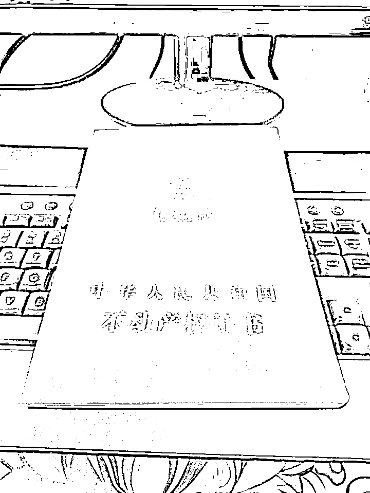
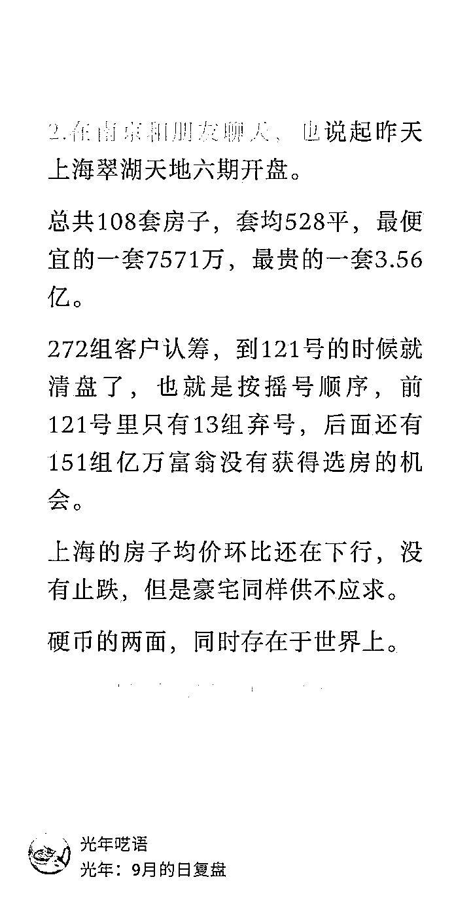

# 投资失误：三年亏损百万的房产交易
作者：龙哥

【2021年入手的房子三年卖出，净亏超百万的真实经历】

光年 / 2024-12-16

前阵子我卖掉在外地的那套房产，过户手续刚办完，今天尾款到位就可以入账了。

买入于2021年，总金额200万，首付80万（占比40%），其余部分120万是银行贷款。那时年利率5.9%，时隔三年现在看来贷款利息负担仍不可忽视。

整个过程是纯投资操作。我当时全程远程选定了大湾区某二线城市新区，这里有完善规划工程，以及正在建成的跨海大桥，能一桥直连港澳。此举看房和收房均未到过现场，请当地朋友代劳。这次成交卖出也不必亲临现场，合同谈判与产权转移完全是线上操作。

售出价才不及120万，而贷款已完全结清，实收款接近零，等于总价抹掉80万以上，加上三年来的利息，总损失超100万。在杠杆操作下，价格下跌时损失会被进一步放大。

借此可以看出，在顶点时刻买入高估资产且利用杠杆，安静持有，很快就能达到大额亏损。产生这种亏损具体时刻，与投入资金量和杠杆倍数密切相关。2024年初流行说法是，只要有进取欲的人，如今都或多或少有债务。在大城市2021年高峰期购入房产的，亏损额往往不止100万。

把亏损经过和避免手段讲清楚了，来谈谈这100万+学来的真诚感悟。

如今回望，2021年那正是房地产经历20年牛市后的高峰期。那段时期从互指愚蠢到普遍接纳的过程，早已深刻影响了大家的投资心智。

财富积累的手段和亲历体验，直接影响如今的思考模式。

在市场负面声音越来越少时，房地产仍旧热闹非凡。之前靠房产赚钱的人，继续追寻相同路线；从未置业的人，惟恐错过上车机会，被完全甩开。盲目买房，在当时被普遍认为是最好的办法。

差异仅在于资金雄厚的重点买改善住宅大平层，而年轻人往往用小钱支持，依仗或挤压未来30年资金，还款压力大。相似点都是加杠杆，但这个比制造业老板的2倍杠杆更激进，首付可低至零。

**杠杆在升势下放大收益，转折时则放大亏损。**

房产价值缩水，而负债金额不变。资产负债表于是出现严重不平衡。2021到2024这波调整，让许多家庭表现在恶化。

回想我们拥有五千年历史，但市场经济普及到深化发展也才经过三十多年。中国成功让我们看到大国风采，不过在市场规律周期认识上仍显不足。我们认定中国独有国情特色，却也难避免走他人走过的路。

周期教育的启示在于，今后降低对单一故事的依赖，减少循旧心理，在配置和选择上多给空间。

**每一次投资，最好先考虑最坏情况，当失去殆尽会发生什么。**

最近国家已重申房地产业支柱作用，不断推出稳定楼市股市的措施。从几个中心城市观察，成交活跃，价格微稳。

但我依旧坚持卖出，短期内没再进的计划。根源是判断，未来楼市会进入显著不同市场格局。

首先城市间会大分化。人口聚集处会保有独立价值，而大部分地区回暖后也不复有实质市场。

其次同一地区各部分也会分开。中心和周边、各新旧房源、各价格段都会单独演变。即便期末，整体大涨也不易出现。

从供需角度看，城市总有大量待售房，多年前土地供应紧就觉得稀缺，如今多数城市土地储备充足。买家那边，当买房紧迫感和升值神话退散后，会更看中居住需求，向品质环境要提升。新一辈要么从好地段长大，所以不接受坏地方；要么更看当得当下，更愿意在租房里爽，不愿背重债接盘旧物。国家政策上把保障住房也列为稳市场文件，最大冲击仍是普通旧房。

至于我继续出售的原因，源自对该片区的看法：那里不会变成热点，附近规划推进迟缓，周边还有大量新供应，产业人口也没增加新动向。我不觉得该房产在反弹后能占优势位置，因此卖出决定已定。

政策能否扭转楼市回升方向，我持保留态度。我认为未来难有全面普涨，也难有快速高升。在盘旋阶段，时间偏向观望者。观望等待不是错误。

若计划置换购房，务必确认真实居住目的，避免受过去市场升值记忆影响。重点考虑提升型需求，比如考虑房龄、面积、社区环境，如果预算有限，可以先考虑租房生活，总比购入后承担长期贬值压力更明智。

租房在财务上常为佳选，只需克服自古以来的拥有房产心理包袱。

以上仅为个人观察分析，不代表任何投资指导。这番话源于当下真实感受，价值紊乱期或成风险或成机遇，最终抉择还得靠自身决定。

* * *

评论区：
小祎：读完分享，我感觉这本书内容很丰富，价值在增加中！