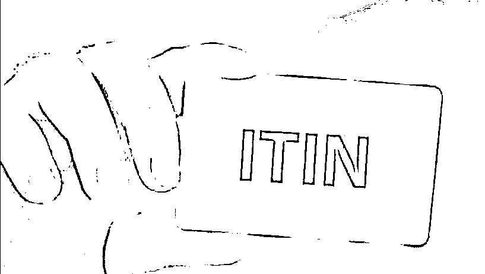
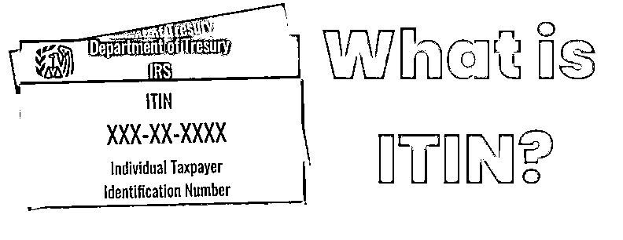
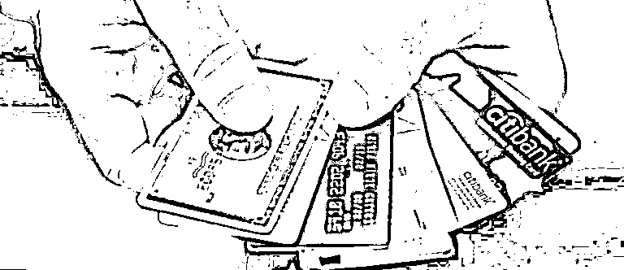
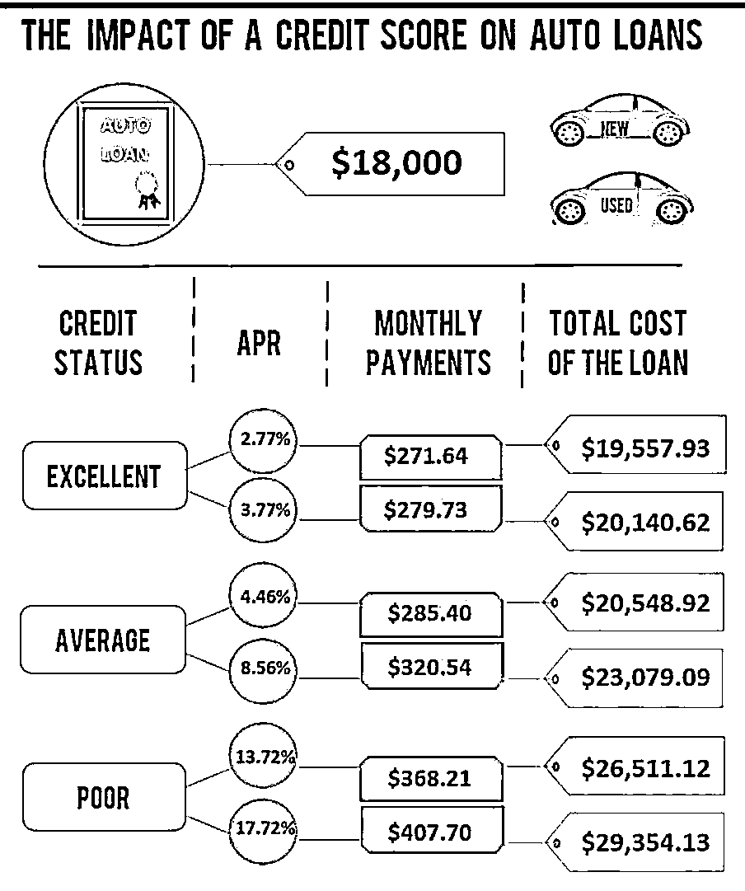
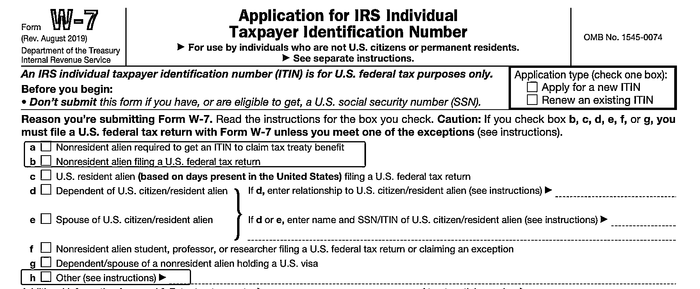
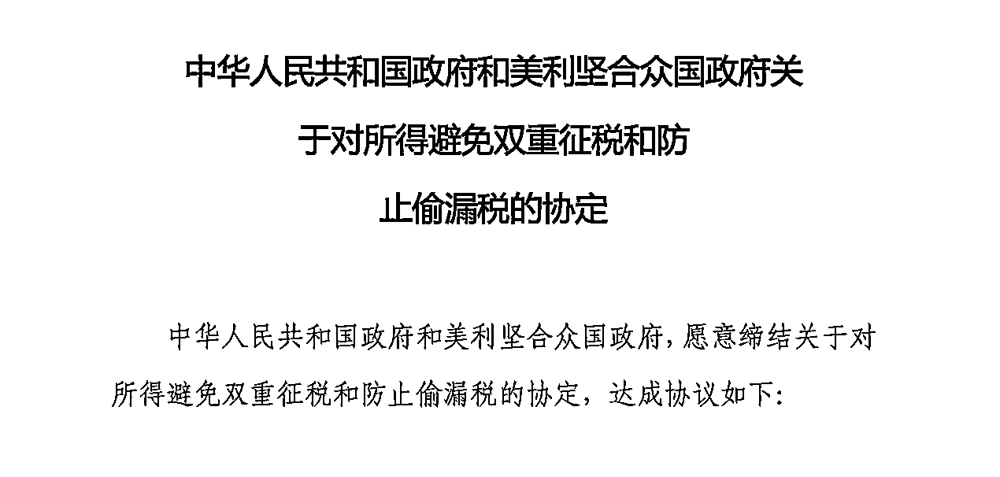
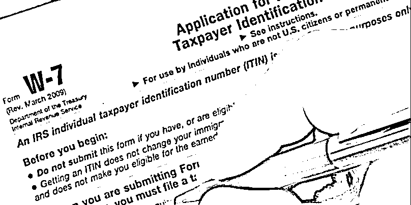

# 出海做跨境，这张“美国税务身份证”你备好了吗？

很多人做跨境电商，总在支付、收款、信用这些环节卡壳。今天我们就来聊一个低调却实用的“通关神器”——ITIN。

## 先看看你是不是也有这些烦恼？

- 海淘下单，付款总是不顺？
- 美区 PayPal 动不动就被限制？
- 独立站想接入 Stripe 稳定收款，却四处碰壁？
- 想要一张美国信用卡，可惜没有门路，只能眼巴巴看着别人拿返现？
- 人在国内，却想提前攒下美国信用分？

如果你中了任何一条，那 ITIN 或许就是你要找的答案。

## 一、ITIN 到底是啥？

ITIN 全称 Individual Taxpayer Identification Number，也就是个人报税识别号码。

它由美国国税局（IRS）发给那些没有资格申请社会安全号（SSN）、但又必须报税的外国人。说白了，只要你有向美国纳税的需要，IRS 就会给你发一个专属税务编号——专门给外国朋友用的。

## 二、拿到 ITIN 能干嘛？好处多到想不到

1. 独立站收款时的各类验证，轻松通过
2. 现在办美国储蓄卡、信用卡，银行基本都要求提供 ITIN
3. 主流的独立站收款平台全都能接入，连刷卡 POS 机申请也需要它
4. 能正儿八经地开始积累美国信用记录
5. 还有很多隐藏用途，等你慢慢发现

举个例子：有了 ITIN，你能申请到真实的美国银行卡。这张卡可不简单——

你可以用它拿到 5% 甚至更高的消费返现，直接“薅美国人的羊毛”。一年采购消费 1 万美元，光返现就能省下 500 美金。很多做跨境的朋友，一年采购几万刀很常见，就算买得少，慢慢凑够 1 万刀也不难。这么算下来，懂的人已经笑了。

再比如积累信用。美国社会极看重信用分，贷款买车、买房、分期买 iPhone，全靠它。信用分高低，直接决定你贷款利率的差距。

图片里那个例子：同样是买一辆 1.8 万美金的车，不同信用分的人最终还款总额，能差出 1 万美金——折合人民币 6.3 万！

所以，如果你以后有投资美国房产之类的打算，提前把信用分养好，就是提前给自己省钱。还有，等以后出国旅游，租车、办各种需要信用背书的业务，这张卡也能帮你省不少心。

## 三、PayPal 收款费率，也能悄悄省下一大笔

做独立站的朋友，天天发愁支付通道不稳定？ITIN 还能帮你解锁一个“完整版美区 PayPal”，不仅收款方便，还能省钱。

如果你是美区 PayPal 用户，提现到关联的美国银行账户完全免费，在线交易费率只有 2.9% + 0.3 美元；而美国以外的国际用户，费率是 4.4% + 0.3 美元。差距整整 1.5%！

别小看这 1.5%——不少独立站大卖的订单体量，省下的钱都够再买辆车了。

## 四、我够资格申请吗？

打开 ITIN 申请表（W-7 表格），你会发现大多数人可以根据 a/b/h 条款来申请。翻译成人话，常见申请理由有这么几类：

1. 基于中美税收协定，比如你有美股股息收入，美国本来要预扣 30% 的税，作为中国公民，你可以找 IRS 申请退税——这么一说，感觉咱平民也和国际税务接轨了。
2. 你在美国有公司，需要向美国政府报税。
3. 其他需要向美国纳税的情况。

问一下自己属于哪种，就知道能不能办了。

## 五、怎么办理？两种路径供你选

### 自己动手

当然可以自己办，但你要把护照原件寄到美国国税局，等他们用平邮寄回来。注意，IRS 的平邮不挂号，丢不丢全看运气。同时还得填一份 1040NR 税表。要是护照快过期了，又想省钱，可以赌一把试试。

### 找代理

代理一般会让你填个简单表格，确认你是否属于 Non-resident Alien 的法律身份，然后帮你走申请流程。

代理也分两种：

- **AA（Acceptance Agent）**：需要你把护照邮寄到美国，价格便宜点，但不太推荐。
- **CAA（Certifying Acceptance Agent）**：直接做视频验证，五分钟就能确认你人证合一，不用寄护照。价格比 AA 贵一点，但省心又安全。

市场价大概在 200 多美金，报价太低的千万别碰。这行跑路的太多了——申请周期那么长，很多平台收款满两个月就自动打给第三方，人跑了你钱没了，还白等俩月，想追回还得漫长投诉。

## 总结一下

护照快过期、愿意折腾的朋友，可以自己申请，记得给个美国转运地址，好歹降低跨国丢件的风险。想省心省力的，直接找代理，优先选 CAA，不需要寄护照的那种。

至于时间周期，看 IRS 忙不忙。快的话两个月，通常三个月，慢的等半年也有。所以千万别临时抱佛脚，早点规划！

ITIN 有效期是 5 年。而且根据 PATH 法案，如果你连续三年没用它报税，号码会自动过期。所以申请下来之后，记得定期安排一次税务申报，给它“续命”三年。

世界变化快，5 年先拿到手再说。以后的事，以后再来。

跨境之路想要走得稳，ITIN 这个坑位，值得提前占好。

