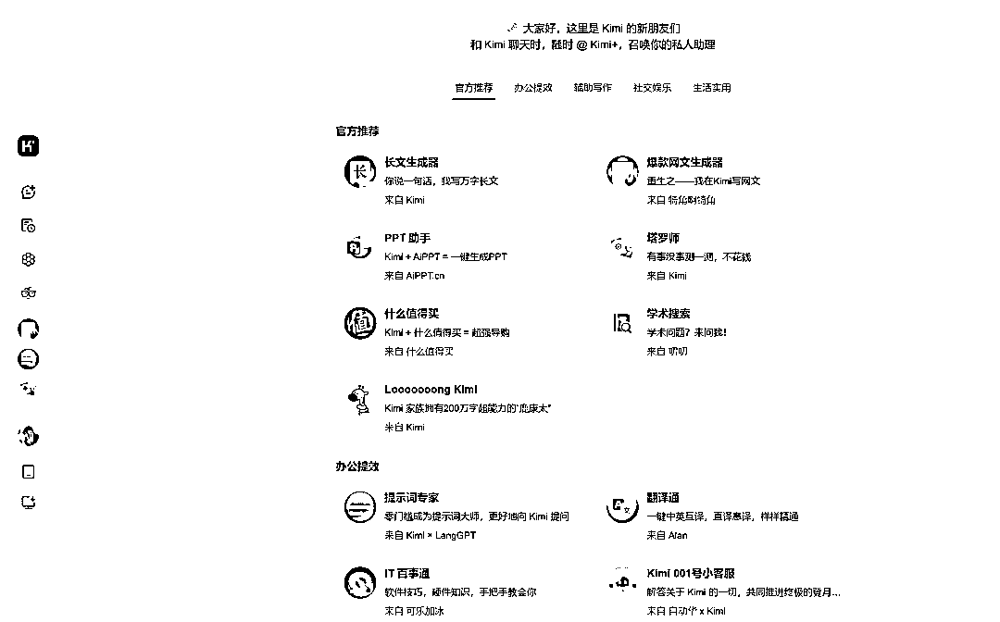
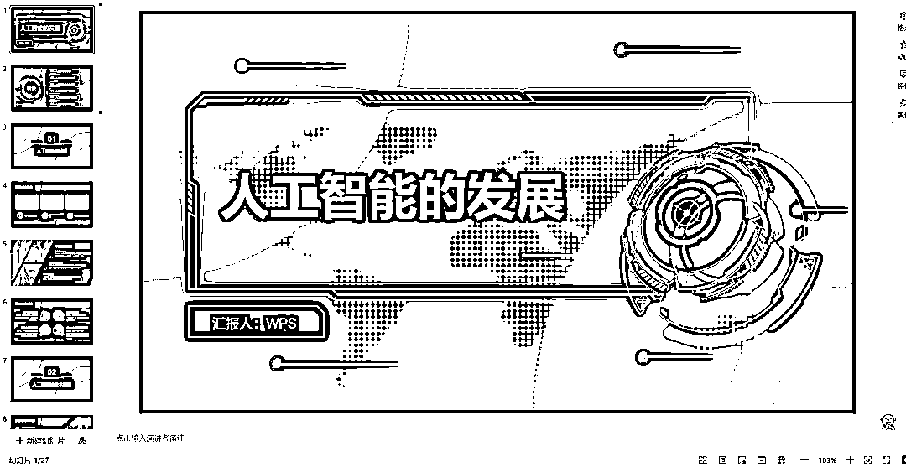
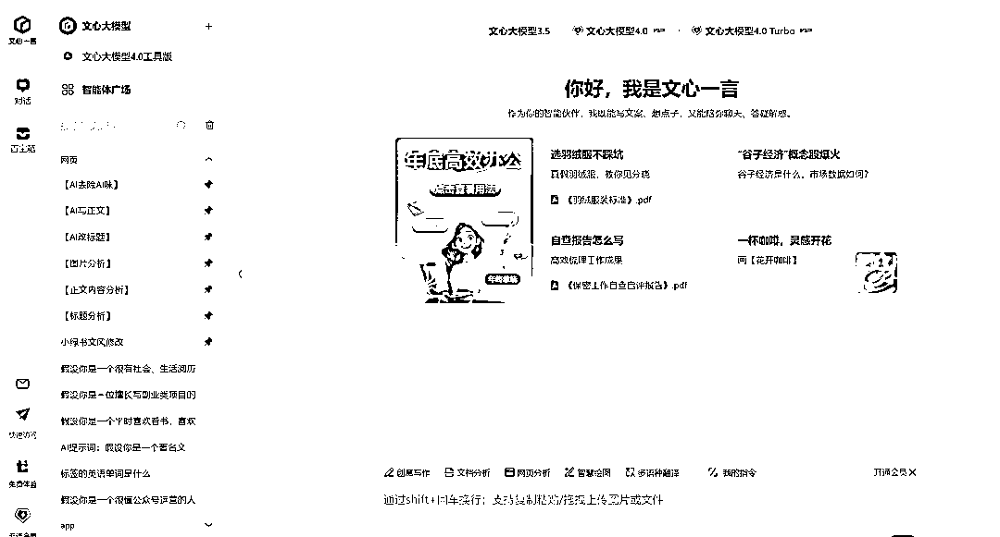
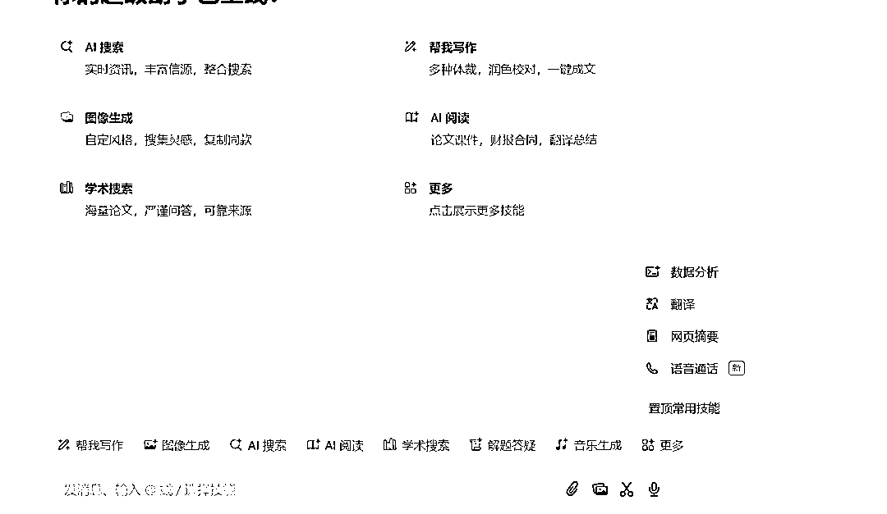
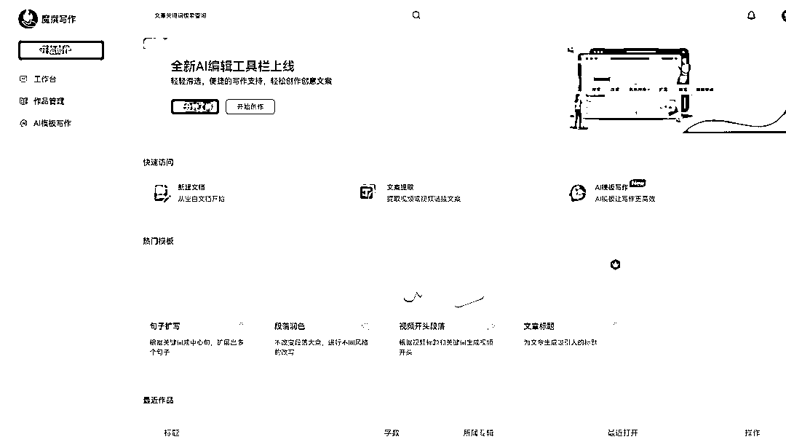
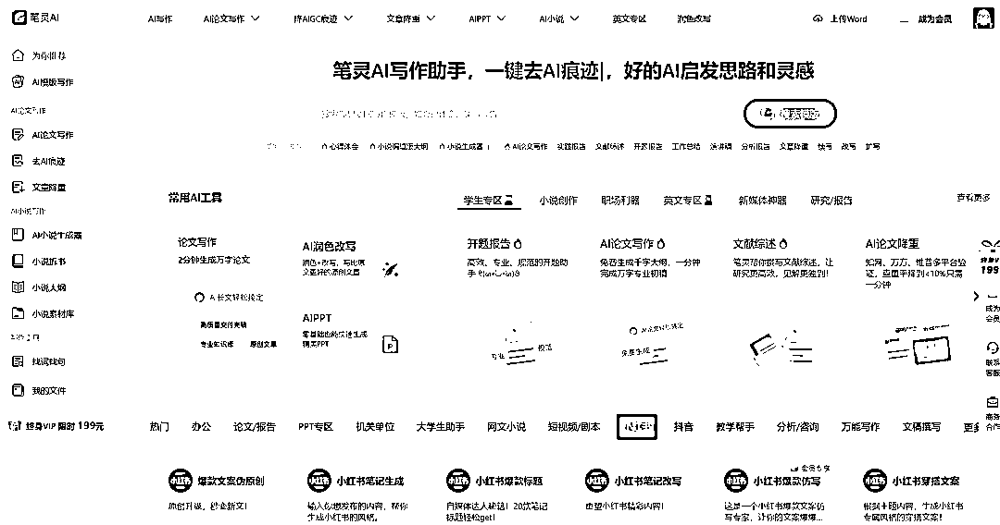
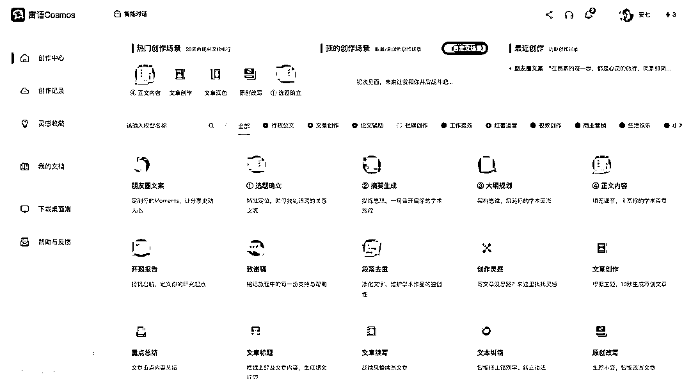
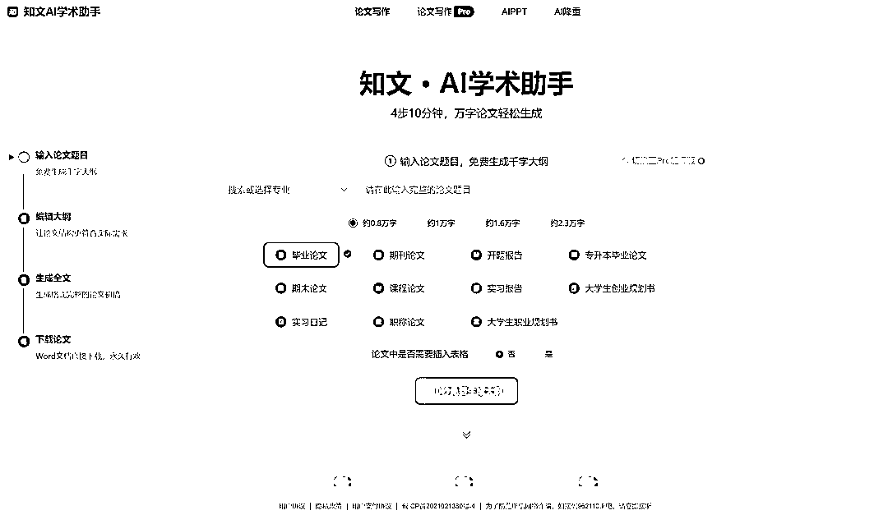
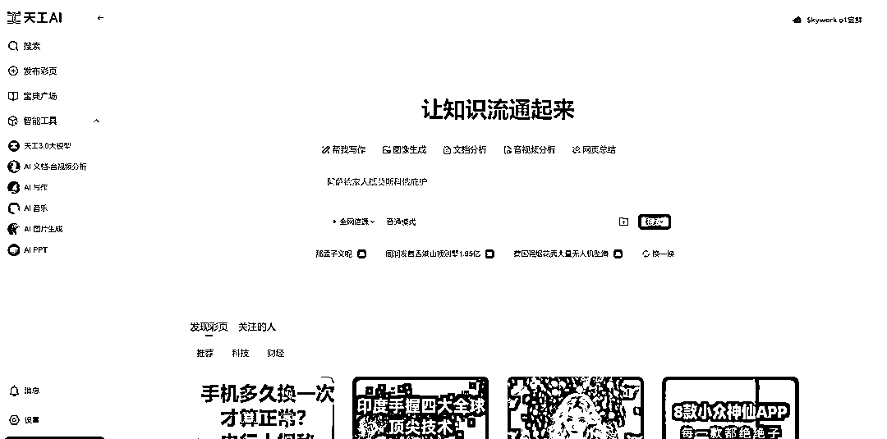
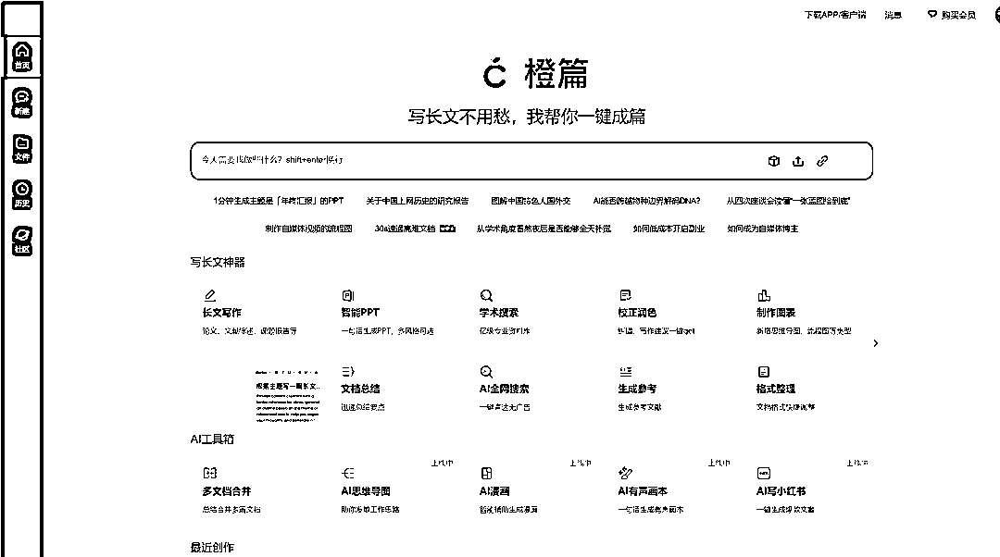

# 2024 年我实测的 10 款国产免费 AI 写作利器

## 2024 年 10 个国产免费 AI 写作工具盘点

作者： 安七

日期：2024-12-09

大家好，我是安七，一直在做 AI 与写作的结合。今天就把 2024 年我亲手试过的 10 款国产、而且可以免费用的 AI 写作神器分享出来，干货满满。

# **01_**

**-Kimi-**

Kimi 出自月之暗面科技，是一款智能对话助手，中英文切换都很顺滑，处理复杂检索类问题也很在行。我的主观感受是聊天体验很舒服，沟通起来很顺畅，人话听得懂。并且它能够识别网页链接、提炼文档核心要点，归纳总结能力在线。比较适合做中英文撰写、内容产出以及信息整理的人群。

官网链接：[`kimi.moonshot.cn/`](https://kimi.moonshot.cn)

# **02_**

**-WPS AI-**

一个我以前总忽略，后来用过就上头的产品。

WPS AI 由金山办公推出，具备文案润色、智能推荐、语法校对等基础能力。但真正让我惊喜的是它的 **AI PPT**。只要丢给它一个关键词或一句话，它就能快速生成提纲，有问题就改，无问题就点选模板，半分钟内在线转成精美演示文稿。

##### 如图，这是它做的，很精美）

上手建议：跨设备办公、需要文档协同编辑的朋友很合适。

官网链接：[`ai.wps.cn/`](https://ai.wps.cn)

# **03_**

**-文小言-**

这是一款我长期在用的写作型 AI。虽然交互流畅度比不上 Kimi，但在纯写作的产出质量上，确实让我印象深刻。提示词写得越清晰，它就能覆盖 80% 及以上的写作需求，表现相当稳定。

官网链接：[`yiyan.baidu.com/`](https://yiyan.baidu.com)

# **04_**

**-豆包-**

豆包的界面干净舒服，很有好感。它内置的 **“智能体”** 可以像朋友一样闲聊，也能给出实用建议。遇到不方便问人的困惑、或者需要一个幕僚出主意时，它就能派上用场。语音通话功能也做得挺好用。

官网链接：[`www.doubao.com/chat/`](https://www.doubao.com/chat)

# **05_**

**-魔撰写作-**

我使用频率没那么高，但功能点很讨喜。提供 AI 智写、AI 润色、AI 改写、智能纠错，并且支持自动从音视频中抽取文案。想要一个全能型写作帮手的同学可以关注。

官网链接：[`x.moyin.com/article?to=aiTemplate`](https://x.moyin.com/article?to=aiTemplate)

# **06_**

**-笔灵 AI 写作-**

笔灵 AI 是国产中文写作工具里界面功能都比较丰富的存在。依托深度学习和自然语言处理，可以实现高效的文本生成、文章优化以及 AI 问答。对于学术论文、营销广告、社交媒体文案创作的需求匹配度很高。

官网链接：[`ibiling.cn/template`](https://ibiling.cn/template)

# **07_**

**-宙语 Cosmos AI 写作工具-**

这款工具主打提升中文写作效率与质量。模板资源非常庞大，超过 200 种格式可供挑选。我个人最常用的是 **“朋友圈文案”** 功能，灵感枯竭时来这里找找思路很解渴。如果你追求快速完成任务且保留个人风格，它是个不错的选择。

官网链接：[`ailjyk.com/pc/creation/model?channel=DVCXBQVT`](https://ailjyk.com/pc/creation/model?channel=DVCXBQVT)

# **08_**

**-知文 AI 学术助手-**

操作简单直观，效率很高。特别适合本科、硕士、博士阶段写论文的学生。它能迅速生成清晰的大纲和完整正文，定位就是学术支持，需求理解得很到位。

官网链接：[`ykoai.com/?user_sn=14440103`](https://ykoai.com/?user_sn=14440103)

# **09_**

**-天工 AI-**

天工 AI 的定位是全能型助手。检索、写作、对话、文档解析、绘画、PPT制作统统支持。可以用来查找资料、多语种翻译、撰写论文、编写代码、制方案、写汇报、做演示、归纳总结。想找一个工具打通所有环节的人很适合它。

官网链接：[`www.tiangong.cn/`](https://www.tiangong.cn)

# **10_**

**-橙篇 AI-**

逛 AI 工具圈子久了，你会发现橙篇出现的次数不少。我体验过它的 AI PPT，顺滑度很高。如果 WPS AI 的操作习惯不合你心意，可以尝鲜一下。功能模块也很全面，按需使用即可。

官网链接：[`cp.baidu.com/`](https://cp.baidu.com)

以上就是我筛选后认为靠谱好用、国内免费的 10 款 AI 写作工具，希望能给你的创作提效。

* * *

评论区：

🌊达师姐 : 学习了太适合我这种小白又不想动脑子的人了

安七 : [呲牙][爱心]

上上签 : 来的及时，正需要