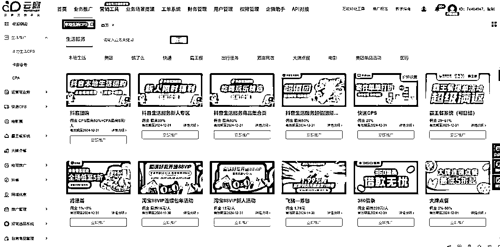

# 中年出局：一个互联网老兵眼里的 35 岁焦虑

> 原文：[`www.yuque.com/for_lazy/zhoubao/iye8uduz5akkzh4q`](https://www.yuque.com/for_lazy/zhoubao/iye8uduz5akkzh4q)

## 中年危机：互联网从业者的失业困境与反思

作者： 牟长青

日期：2024-12-09

前两天在家刷了徐峥的《逆行人生》，看完整个人都不好了，关于中年失业的念头又被勾了起来。于是跑去知乎翻了一堆真实的中年失业经历，越看越沉重，那晚直接失眠了。

我也是个 80 后，正好卡在中年线。上头有父母，下头有孩子。自 20 多岁起我就琢磨过一个假设，万一我到中年没工作了怎么办。那种危机感一直没断，让我始终不敢松懈。

过去我一度觉得互联网是吃经验、讲沉淀的地方，被裁的概率应该不大。可看到知乎上那些案例后才发现想得太天真。里面不少主人公都在大厂待过，带过上百人的团队，履历漂亮得很。被裁后一开始都挺乐观，觉得再找一份不难。结果简历投了上百封石沉大海，才真正体会到中年求职有多难。

今天把思路理成 5 个部分，和大家聊聊为什么 35 岁后找工作变难，自己是不是也有被淘汰的风险，我自己的对抗方式，中年真的失业了还能怎么活，以及最关键的，怎么从起点就把风险降下来。

**1：35 岁以后，求职天平为什么倾斜了**

招人的人算的是账。招一个 35 岁以上的老手，还是招一个刚毕业的新人，哪个更划算？

对企业而言，35+ 的优势看似是经验丰富，但往往也就这一个亮点。随之而来的问题一大堆：管理成本高、薪酬要求高、能不能熬夜能不能常驻外地、家庭牵绊多。因为上有老下有小，很容易被家里的事打断。这种对中年的偏见，和对女性职场人的偏见逻辑其实很像。

大环境紧，活下来比什么都重要。现实就是这样，35+ 成了最容易被优化的群体。年轻时没资历难找工作，资历有了年龄又成了短板，很多人说到这里都一脸无奈。

反观应届生，经验是弱项，但胜在白纸一张好塑形，薪资要求低，身体扛得住，抗压能力强。对大部分公司来说，性价比更高，自然是首选。

**2：照照镜子，自己会不会是下一个**

我的主线工作一直是市场推广、BD 合作。如果当年在北京安稳地只做手上的事情，不做副业不写博客，我现在失业的概率极大。

市场变了，推广需求也在缩水。假设我还在北京，年薪 50 万很正常，但那时候我的精力已经跟不上年轻人，想法也不如 20 来岁的后生。公司一轮优化，工资高、花钱多、冲劲不足的人，第一个就会被考虑。

能到今天还在做社群，很大程度上得益于 06 年就开始写博客。如果我只有大厂履历，基本等于废纸。过去几年我也折腾过实体，亏了上百万，公司也试过几个新项目，基本都是亏。

要是真的失业了，我大概率不敢创业，只能降薪去小公司碰运气。

**3：我的那点个人经历**

22 岁入行，到 35 岁也就 13 年。能真正熬过 35 岁还在岗的人，要么创业成了，要么成了公司核心管理层，这类人大概只占 10%，剩下 90% 都面临中年出局的风险。

我 22 岁才进互联网，之前的日子过得挺混。读的是两年制职高，后来读了个普通专科，学校都很差，基本没听过课，大学就泡网吧通宵学电脑操作。19 岁就毕业了，经家里介绍在事业单位当合同工，又混了三年。22 岁时开始慌了，担心以后连老婆都找不到，才辞职去成都找电脑相关的工作，进了互联网。

从 05 年第一份互联网工作开始，我就一直在做副业。那时月薪才 800，业余做个人网站挂广告，最高一个月能有 2000。06 年北漂后主业更忙，副业收入掉到几百。09 年我在百度月薪 8000，但坚持写了三年的博客有了点名气，杭州一个老板找我做推广顾问，每月给 1 万，副业收入反超工资。

正因为副业积累了经验和人脉，才有了后来创业的基础。如果我像大多数人一样只埋头干本职工作，现在很可能也在中年失业的大军里。

**4：真失业了，还能怎么破局**

说实话我也没什么成熟答案，只能分享一些观察。

在中国，只要能吃饱就不难。但在办公室待惯的白领，让他们放下体面去做苦力，心理关很难过。

比如体力三件套：快递、外卖、网约车，做得好的月入过万，差一点 3-5 千也能拿。

吉祥三宝：保安、保洁、保姆，门槛低，没有年龄限制，温饱问题能解决。

还有按摩行业，愿意放下身段学保健按摩，月入 5000 不难。我常去按摩店了解行情，上了年纪的大妈普遍 5000+，年轻技师月入过万很常见。

知乎上那些年薪几十万的中年人失业后，大多数放不下曾经的体面。宁愿去办公室拿原来一半的工资、从双休变成 996，也不想去干体力活。很多人宁可待在家里做自由职业，听起来体面，也有翻身的可能。

我前段时间带私董游学成都，参访的是一家 CPS 变现平台。老板说一个宝妈跟着他们做月入 2 万没问题，铁杆用户年入几百万。当时我很敏感，直言如果这么容易，你们员工早就离职了。这种平台月入小几千是可能的，但想稳定月入 2 万，需要推广经验和资源积累，不能只靠朋友圈。

为了写这篇文章，我注册研究了一下这个平台。发现里面有吃穿住行各类的 CPS 链接，而且都是头部互联网企业背书，信任度还行。

我之前做过 CPS，抖音、快手极速版的新用户下载返现一直有做。疫情期间我也带学员做抖音极速版，我自己也赚了 1000 多，做的好的学员赚了几千。后来试过游戏 CPS，一个单 10 多块，费时间还容易充钱。

这里不得不提“生财有术”这个圈子。对新媒体老板来说可能看不上里面的小项目，但对普通白领而言，通过这样的社群提升副业成功率是真的。关键还是自驱力强的人才行。我觉得有互联网背景的中年人加入这种圈子，花 3000 多的报名费，比闭门造车强。

生财有术本质是个论坛，里面有人分享项目实操，官方还有大航海等产品带会员做项目。对学习能力强、自驱力强的人来说，小项目做到月入几千上万是可行的。

**5：与其破局，不如从一开始就别掉进去**

看这篇文章的，要么是老板，要么是年轻人。老板们不用担心失业，年轻人却要提早防险。

最好的办法就是从起点降低被淘汰的概率。我以前爱看咪蒙的职场文，有篇讲优秀职场人的行为习惯，我年轻时基本全中，所以我觉得自己这类人不太容易失业。我的危机感不是学来的，是性格使然。

我表弟现在在我公司，28 岁，业务不复杂也不加班。我挺担心他的，这种环境学东西有限。理想状态是让他去 996 的互联网公司吃点苦。现实是自驱力强的年轻人太少了，看到下面的人只会按流程做事，我心里着急但也帮不了太多。大多数年轻人需要一个高压环境才能成长，别总看心灵鸡汤。

我北漂的第一家公司是 360，相当变态，会开到深夜周末加班，同事都在抱怨。但正因为那段经历，后来跳槽到哪里都游刃有余，自信满满。

我也多次劝公司骨干做个人 IP，写文章、拍视频、站台分享，但能坚持下来的一个都没有。上周失眠不是怕自己失业，是怕他们失业。跟了我七八年的骨干要是最后也出局，我脸上无光。所以我在考虑要不要干到 50 岁。

有 28 推的平台和人脉，出来找工作好像不难，之前 5 个员工都进了重庆最大的新媒体公司麦芽传媒。但谁能保证中年后不被自家年轻人取代？年薪几十万的高管都会被裁，任何事都有可能。

我做互联网时是 PC 时代，副业是个人网站和博客，不影响本职还反哺了工作。现在是移动互联网、短视频、AI 时代，年轻人副业可以选短视频、AI 等。我们公司也组织过下班做副业，最后没人坚持。说实话像 28 推这样奇葩的公司，外面很少见了。

千万别让自己闲下来。除了工作就是吃喝玩乐，中年不失业才怪。

* * *

评论区：

cc : 工资越低，越不怕失业

冰是睡着的水 : [强]

小军同学 : 这个确实，反而太多选择[捂脸][捂脸][捂脸]