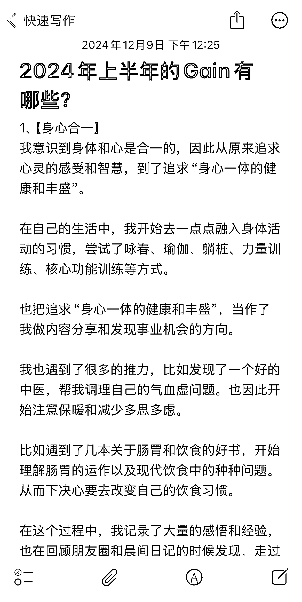
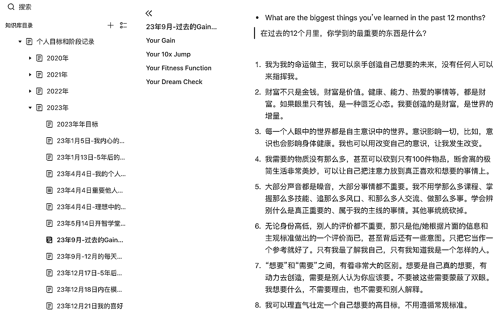
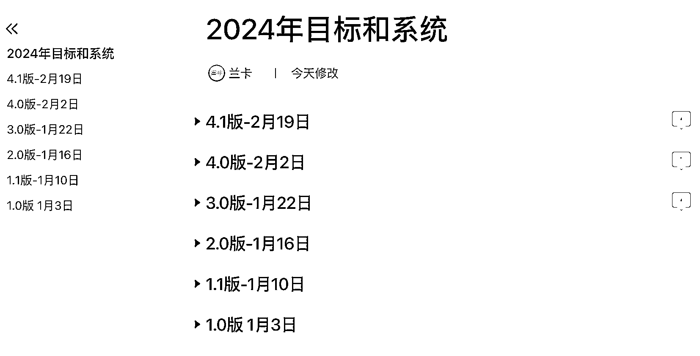

# 用 90 分钟做一次年终复盘，挖出决定幸福感的底层逻辑
作者：龙哥

快到年底了，年复盘的念头想必也在很多人脑中冒头。

一提到年终总结，我的第一反应是发怵。脑子里立刻浮现出：翻遍一年的零散记录、把东拼西凑的信息整理成体系、用掉一堆脑细胞才得出结论的窒息感。

更关键的是，年底本就手忙脚乱，挤出时间做复盘已经很勉强，最后的结论明年能不能用上还是两说。折腾半天为难自己，有必要吗？

于是我收藏了一堆方法后就石沉大海。或者在拖延和自责的拉扯里，姗姗来迟地摊开纸笔，动笔前这事在心里转了两三周。

我自己也卡在这里很多年。最耗神的从来不是写作本身，而是内耗。始终有三件事让我抓狂：

1、为什么每次做年复盘都非要搞得这么复杂、这么折磨人？
2、年复盘写完隔年基本用不上，写它图什么？
3、写完总觉得按部就班说完了，却空落落，好像没挖到点子上也没啥惊喜？

过去两年，这三个困扰都消失了。我摸出了一套自己的打法，短则一小时就能收尾，长则一下午搞定，而且每次复盘都有被点醒和心动的感觉。分享给你参考，希望能松动你一些想法。

PS 本文偏个人复盘，业务复盘可借鉴部分思路。

* * *

想把事做成，先把评判标准想清楚。**标准清晰了，路径自然就顺了。**

那什么算是一份好用的年复盘？

在我这里，一份让人愿意珍藏的复盘，必须同时满足三件事：

# **一、足够轻松**

启动门槛低，过程不煎熬。哪怕没挖出惊天大悟，至少没有挤牙膏般的痛苦。

我就是个普通人，普通人的底色是懒。把事做得简单舒服，比做得完美重要。

所以复盘要找阻力最小的路，而不是追求尽善尽美更高更快更强。启动轻，人也轻松，写完不会气血两亏。

题外话，凡事只盯着更高更快更强，不顾自身承受力，很容易提前耗尽。

80分就够了，给自己留余地，反而能长久坚持。

更关键的是，**一旦连续做两三次，联想到复盘的感受是松弛、满足，那它就极大概率会变成每年必做的复利习惯。**

落实到操作上，就是：

别追求把复盘做到极致精准，很多教程那样教，但现实里记录往往不全，也不想全盘回溯。

抓得到重点、能回想起来的片段就很有价值。

所以，**第一步，先把氛围调松。**

条件允许的话，换个不紧绷的场景和姿势。比如去咖啡馆边喝咖啡边聊聊，在草坪上躺着说，在家沙发上瘫着说，旁边放点茶点。实在不行，先听两首轻音乐再开场。

就一个原则：怎么自在怎么来。

**第二步，用语音随口聊。**

iPhone 直接用备忘录语音输入，安卓可以用飞书妙记或其他语音转文字工具，甚至先录音再转文字都行。只问一个问题：

**“我今年最大的收获是什么？”**

不要停下来想，想到哪说到哪。小嘴一开，几分钟就满了。

一篇初稿就出来了。

备忘录真的贼好用

会不会太粗糙？会不会只是主观感受？

会，但没关系。因为第一，**一旦你开口了，拖延就破了。**

手指一点、说出第一句话，年复盘的收获已经在路上了。

第二，**你随口聊的过程中，很可能会惊觉：天，我今年竟然做了这么多事，有这么多收获？**

这种惊喜像搬家时扒拉出箱底的宝贝，不用把整个家整理干净，只要翻几个高概率的角落就行。

这种惊喜会驱动你再去补一下备忘录，比如打开去年的几个文档，补上遗漏或核对细节。

第三，**直觉比脑子快。**

你靠记忆和感觉口头梳理一遍，再去对照文字记录，会发现80%的重要收获已经讲完了，只剩查漏补缺。那些想不起来没印象的事，反而值得自问：为什么忘了？是不是对我其实没那么重要？

为什么只问收获这一个问题？

因为“今年最重要的事、最高光的时刻、最大成就、最深刻感悟”等精细化问题，基本都被这个大问题覆盖了。逐条按教程回答容易卡壳、重复又纠结。干脆一个问题扫荡记忆。

# **二、能反复使用**

年复盘的价值不止是给明年的参考，更核心的是**提炼规律。**

第一，**一个人的轨迹一定有迹可循。**

把两三年、甚至四五年的复盘并排看，会发现现在轻松完成的事，四五年前是卡点的难题。而现在踩的坑，后悔的事，多半早有伏笔。

过去 5 年的个人成长记录

所以有意识地回看，你会更清楚：

**我反复绕不开的课题是什么？**

**在这些课题里，我重复使用的是哪种模式？**

这点价值极高。

记录少也没关系，现在快速回想重要事件，也是一种回溯，量力而行即可。

举例，前年复盘时，我从五年零散的日记和复盘里看到一个很扎眼的事实：

**我绝大多数的痛苦，都来自关系。**

对待他人的方式，就是对待自己的方式。归根到底是和自己的关系课题。

于是我反复上演类似剧本：

对自己苛刻，不达标就否定整个人；盲目比较，根本不了解自己想要什么；和妈妈经常吵架，事后双输又后悔；忽略自身感受，硬逼自己冲目标完不成就怪执行力；自责情绪高频出现；亲密关系回避型，怕走近怕承诺；对健康漠视，嘴上重视体检后就忘……

当这些事实赤裸地躺在纸上，我才明白，工作和生活的不顺，背后都是内在课题。光靠技术手段已经解决不了，得直面关系。

于是我给自己定下去年的唯一年度目标：**改善与自己的关系质量。**

随后我才开始学成长教练、看心理类书籍、参与身心活动、写晨间日记，直到现在。

**人生百年，从几十到一百次复盘里，能筛出最影响生活质量的深层规律。**比如：

**我反复在追逐什么？**

**我用什么方式喂养欲望，却总感觉不踏实？**

**我在哪反复撞墙，却从未察觉？**

**我靠什么品质和支持渡过往昔难关？**

**高频内耗我的事是什么？**

**做哪些事会让我生命力旺盛，哪些会让我萎缩？**

**什么时候我不用那么努力也能有好结果？**

**哪些回忆每次想起都让我感动、幸福、自豪？我真正看重什么体验？**

**什么明智决定深远改变了生活？是什么促成它？我还能复用这份判断力吗？**

**谁真正影响了我？我为什么会遇到TA？**

**放下什么后，我会豁然轻松并向前？**

**我想做得更多的是什么，做得更少的是什么？阻碍我的是什么？**

**我一直恐惧什么？这份恐惧带来什么后果？**

**做哪些事会让我更有能量？**

……

这些都可以作为每次复盘的提问清单。

具体怎么做？前面两步是：

1、营造轻松氛围
2、语音说一遍“今年最大收获”

再加**第三步：挑几个有共鸣的问题试着回答。**

只挑你想答的，一两个到七八个都行。需要回忆也可能需要翻记录，工作量自定。没灵感就让AI给你抛问题。

比如对我来说，“反复课题与反复模式”是最有价值的问题，我很享受这种反思。而“我在反复追求什么？”我可能不会每次都问，因为已经有了清晰线索，并且在坚定执行。

不必面面俱到，每个问题都答会很累。回到标准：轻松点，放过自己。

# **三、抓住重点**

复盘的收尾通常是总结与展望，我有两个自救经验：

### 1️⃣**“我只说三点。”**

**总结经验、优化点、明年目标，都遵循一个原则：过几个月还能记得。**

几个月就忘的，写了等于白写。

所以只保留最重要的，舍弃80%次要的就够了。无论是经验、优化还是目标，最多三点，是很好的自律。

【经验心得】
最重要的经验，往往满足：出现频率高、对自己影响深、持续时间长。

比如我给自己提炼过两条：“一旦开始创作就有好事发生，停止创作生命力就开始枯萎”“定目标时给自己双倍时间”。

前者直接改写了我的事业方向，后者只是执行细节。起到的作用完全不同。

可以从10条精简到5条，再强制到3条。舍不得的经验另存一个“备忘经验库”，明年再看能不能用。

把精力放在怎么放大这三条的价值上，做少做精。

【优化点与下一步行动】
别写十条优化清单，能真正改三点就已吊打90%的人。

写完后诚实自问三句：**明年我真的能全部完成吗？我承诺时身心一致吗？身体会抗拒有压力吗？**

《精要主义》里说：**如果不是百分百的Yes，那就是百分百的No。**

不百分百想做的，就放下。真正尊重承诺的，会在第一次就做到，信心会大幅提升，后续定目标才会有画面感和动力。

【明年目标】
问自己：**明年发生什么事，会让我觉得这一年无比满足？**

目标不够打动人就先放下。你也可以另开文档专门写目标。

我在复盘时只写个初步方向就够了，因为定目标的核心价值是让现在行动更有劲，而不是必须精确完成。情况会变，实践会产生新知，没必要被死板目标捆住。

我 2024 年小幅迭代的年目标

### 2️⃣  **肯定自己占七成**

**复盘不是自我批判，而是觉察与接纳。**

应是70%肯定，30%优化空间。

我们活了这么多年，每年都在解决新问题、经历新事情，怎么可能没有两把刷子。拿出来表扬一下，不然怎么知道自己已经这么棒，怎么强化优秀品质？

欣赏自己，也是一门功课。

### 3️⃣  **庆祝很重要**

复盘做完，给自己一个仪式感。耶！我完成了！我发现了这么多优点，我好厉害！

然后高调犒劳自己：按摩、大餐、和家人朋友分享。

**庆祝是完成闭环的最后一环。**

它是一种情绪印记，能强化“复盘-优化-行动-达成”的回路。像宝宝学走路，迈第一步就被庆祝，潜意识里走路就和愉快绑定，会更愿意一直走下去。

如果你看到这里，大概已经在脑中过了一遍流程。脑中过一遍，启动就完成20%了。

* * *

整体思路总结：

**先启动：**
1、营造尽可能轻松的氛围
2、语音备忘录回答“我今年最大的收获有哪些？”——做到这一步，已算一次完整复盘

**再追问：**
3、从有触动的问题里挑一到八个，提炼影响人生质量的深层规律

**后总结：**
4、总结今年最重要的经验，最多三点
5、总结下一步行动与优化点，最多三点
6、提出明年目标，最多三个，也可另行撰写

**收尾仪式：**
7、大力肯定并好好庆祝自己

我的方法很个人化，建议你从中挑出适合自己的那一丢丢，自由组合。只要比上一次更轻松一点点就很好了。

祝你能写出让你爽的年复盘，年年岁岁都能从复盘里挖到宝藏，年年因为复盘而更幸福。:)