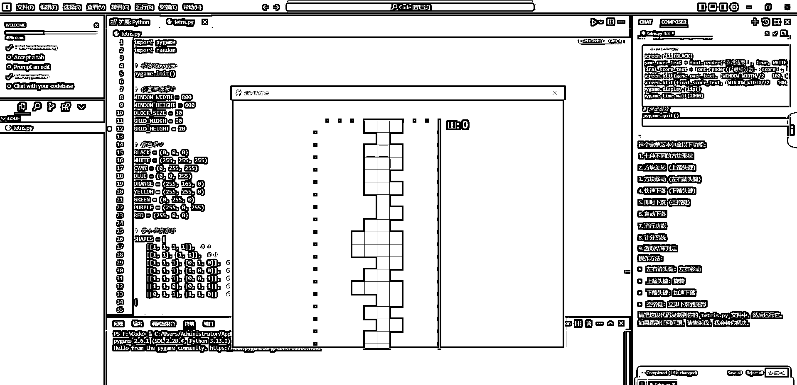
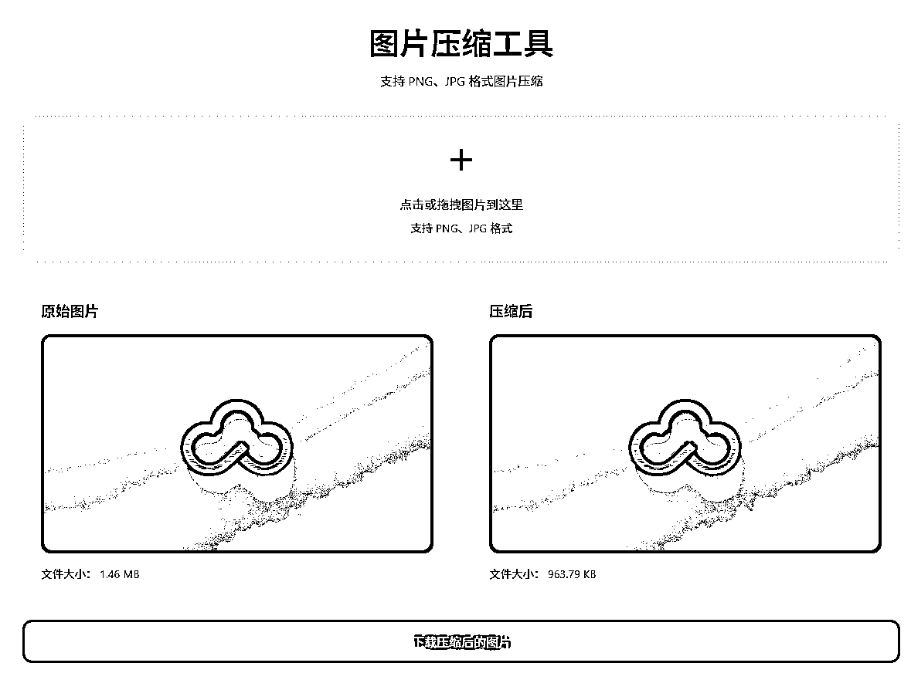
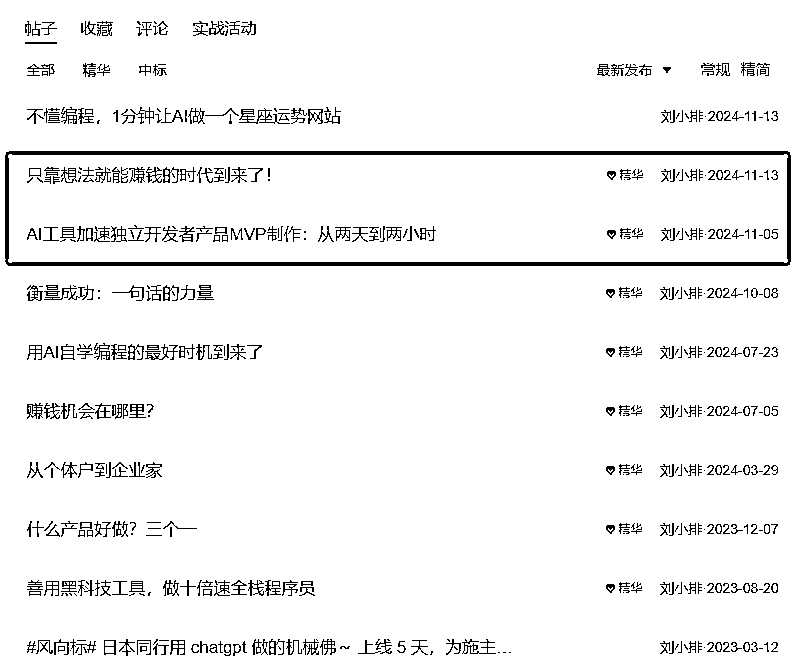
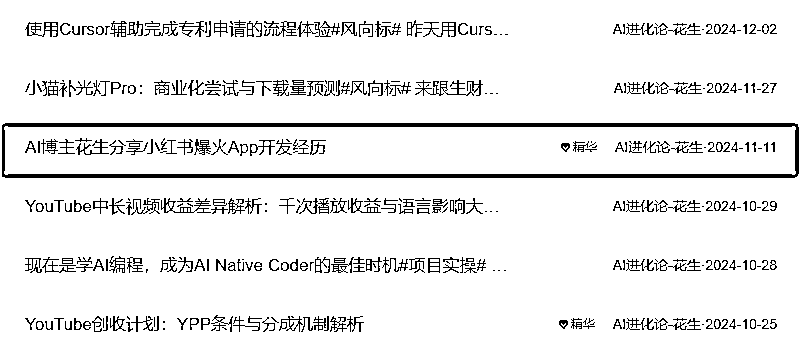
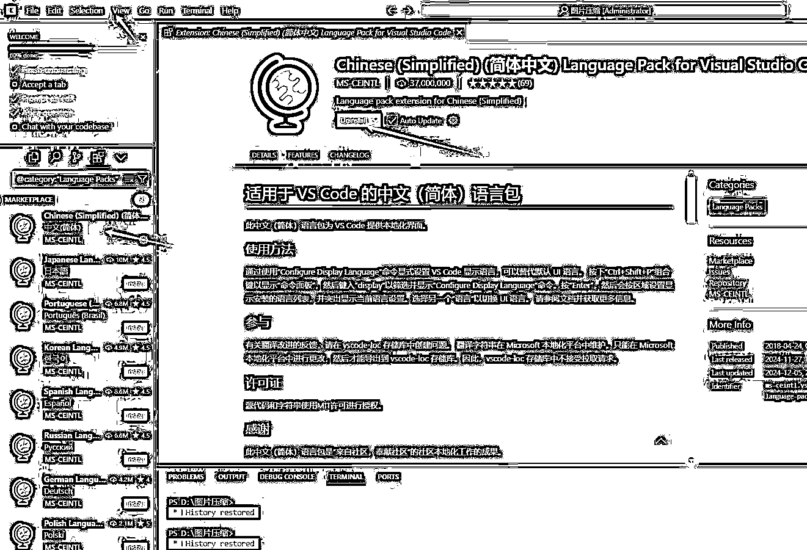
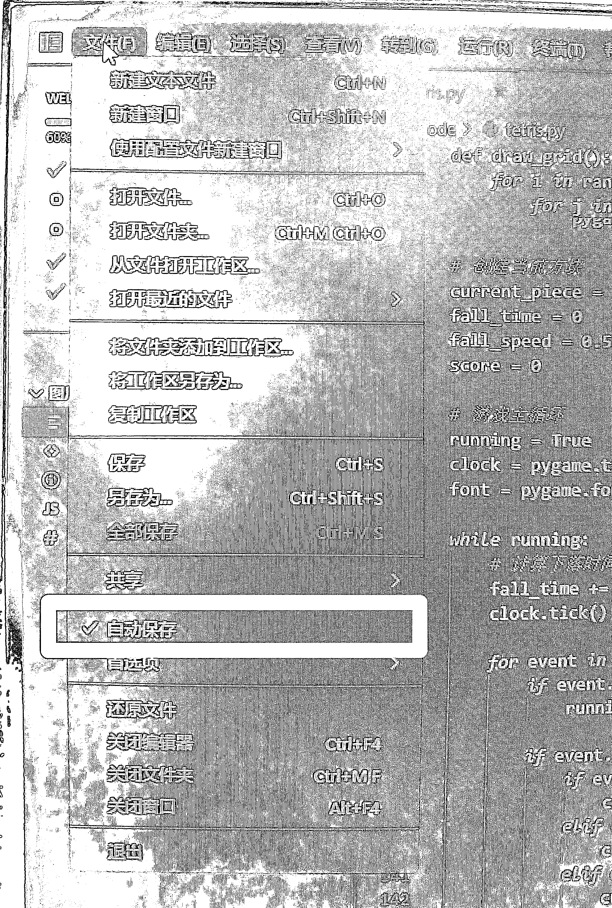
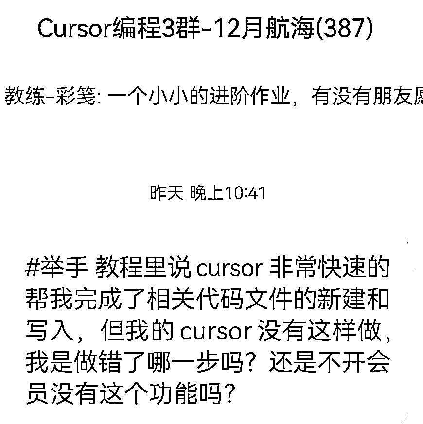

# 新手小白用 Cursor 快速开发俄罗斯方块游戏和图片压缩网页

零基础玩转Cursor：1.4小时做出俄罗斯方块和图片压缩网页

大家好，我是龙哥。

以前说到编程、做网页，我完全是个门外汉，代码没写过几行，网页怎么来的也不清楚。但最近，我突然被Cursor圈粉了：先花了40分钟攒出一个俄罗斯方块小游戏，接着又用45分钟（这里包含了我在群里问问题的时间）做出一个图片压缩网页。前后大概1.4小时，对零基础的人来说，这个体验实在太惊艳了，于是赶紧来和你们分享。

先看成果。

俄罗斯方块游戏长这样：它是可以正常操作的，我用方向键就能控制方块移动，那一刻真的很有成就感。

再看图片压缩网页：我拿自己的图片试了试，一张1.46MB的图被压缩到963KB，效果肉眼可见。从今往后，再遇到压图需求，我不用去别人的网站看广告了，打开自己做的工具就行。虽然理论上还能用GitHub+Vercel把它部署成一个链接分享给朋友，不过我暂时没这个打算，所以也就没有实际操作。

你可能会问：一个啥都不懂的小白，怎么会想到去学Cursor的？

主要是有两个契机。一方面，我在赚钱看到了刘小排老师关于AI编程的分享，瞬间来了兴趣。另一方面，花叔那篇“小猫补光灯”复盘太有说服力了：他仅用Cursor花1小时开发的App，靠📕成了百万爆款，还登上了AppStore排行榜Top20；接着他又做了“小猫补光灯Pro”收费版，上线6小时就冲上所有付费应用榜第1名，安卓那边还冒出一堆盗版。更夸张的是，📕官方账号“数码薯”也推荐了他的内容和账号。花叔这个案例，是我下决心去学的最主要动力。

学起来真的很轻松。其实在翻开《Cursor 12月航海手册》之前，我特别忐忑，总觉得自己会学不会、会到处碰壁。但真正动手后才发现，并没有那么多难关。我把自己的上手过程分成三天：

第一天，先把这份教程完整过了一遍：https://scys.com/view/docx/YIvBdL38ConF89xdBvAckZBPn5e#QnYXdIPxxoHUlPxkCFLcDpB0nng

第二天，照着教程注册了Cursor。中间有一点小波折，但很快解决了。同时，我还把软件界面改成了中文。至于代码保存，可以点保存图标，也可以用Ctrl+S，甚至开自动保存，三者任选一个就行。

第三天，就轮到动手实操了。这天我合计只花了1.4小时，就把俄罗斯方块和图片压缩网页都做完了。

很多人会担心：遇到报错怎么办？代码卡住怎么办？说实话，我也遇到了不少“小白式”问题，但全部靠问Cursor解决。

比如他让我下载某个软件，我连下载都不会，只好把问题丢给Cursor，他给出的步骤细到不行，我照着做就装好了Python。再比如界面上出现红色报错，我虽然看不明白，但直接把那串字符复制过去问，他会告诉我是哪里错了、该怎么修。还有些教程里提到的步骤我根本没遇到，就直接跳过了。遇到要装插件的时候，我还会先问他“为什么要装这个”，他的解释也让我把原理搞明白了。总之，想不懂就问，Cursor随时候着。

做图片压缩网页时，我还碰到了三个小插曲。第一个是，教程里说代码会自动生成，但我这边就是没有。后来在群里一问，原来是因为我用的是Chat输出指令，得换成Composer才行。

第二个是，压缩完图片反而变大了，我赶紧问Cursor，他帮我改了，但错误还是在。第三个则是网页提示“当前PNG图片已经优化，无法进一步压缩”，我继续把问题抛给他，他再次修改，这次终于成功了——1.46MB变963KB。

回头盘点，从注册到完成两个项目，我全程只在群里问了那一句，其余都靠自己参考教程+问Cursor搞定。它真的没有想象中那么困难。

所以，如果你也担心学不会编程，不妨试试这条路。对我来说，用AI做东西已经变成了兴趣，强烈建议你也去感受一下用AI编程的快乐。