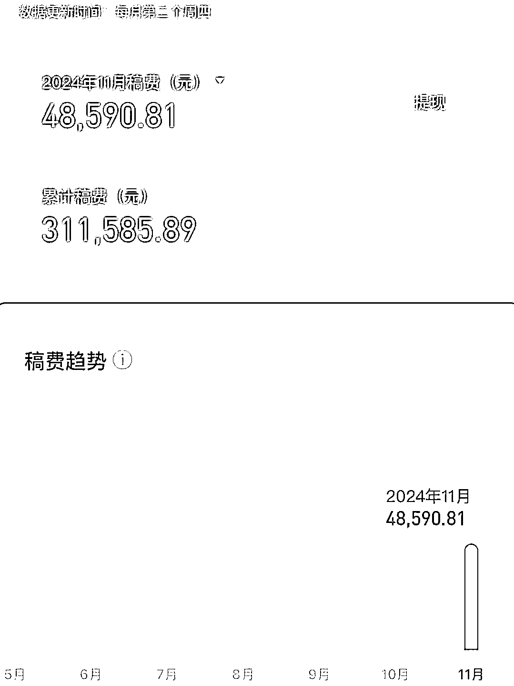

# AI 流水线写短篇，首月 100 篇签约到账，4 位数收入已实现

## 39 赞 · AI 自动化创作小说实战复盘：一个月签约百篇短篇，月入破千

作者：AI 联盟
发布于：2024-12-13

又来同步进展了。上个月我发过一篇关于靠短篇小说做被动增收的分享，没想到反响这么大。

最近私信里反复被问到百家号付费订阅的玩法，我也都逐条回复了。只是过去半个月一直在忙着跑新的自动化测试，消息堆积导致回复有点慢，在这里先说声抱歉，今天统一给大家一个阶段性成果汇报。

按照惯例，先上硬数据，本月短篇小说签约与稿费情况。

由于截图和表格信息量比较大，整理好的完整版我放到飞书文档里了，方便查看：

[`szxb4qbve7.feishu.cn/docx/ArZHdgfKdozG8ExxHeOconZLnQb?from=from_copylink`](https://szxb4qbve7.feishu.cn/docx/ArZHdgfKdozG8ExxHeOconZLnQb?from=from_copylink)

* * *

评论区精选：

翻斗花园 : 真的很强，我也按这个思路开始动手了，就是效果暂时还没拉到你这个水平

行者阿吉 : 想请教一下，百家号是每个账号都要单独实名认证吗？