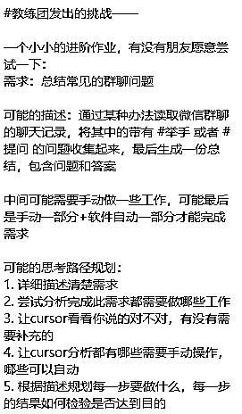

# 如何用 Cursor 开发提取聊天记录问题的工具及解决 BUG 的方法
作者：龙哥

各位朋友们好！我是致力于21天内打造21个实用工具的积极探索者，目前航海进度已推进至第五项。这篇文章主要分享了我运用Cursor开发出一款专为解析聊天记录问题的工具，以及在调试BUG时总结出的一些实用技巧。

项目起源来自前不久Cursor航海群发起的挑战活动。

顺利完成那次挑战之后  我突然想到自己此前从事线上教培时，在直播间里遇见过海量学员提问的情况，讲师的时间和精力往往有限，无法做到每个问题都详细解答。假如能将这些提问集中起来进行整理，给出高质量、专业完整的回答，不仅能有效提升学员的学习成果，也能为后续学习者提供方便的参考。

于是我便着手开发了一个专门的问题采集小助手，但交付完成之后我发现它实际上远不止这个用途——只需稍加提示词调整，即可应对任何类型的文本分析。所以这个工具最终从问题采集小助手，进化成了通用信息采集分析工具。

原贴详细阅读链接：https://www.yuque.com/for_lazy/zhoubao/bgdh4cim32eru659