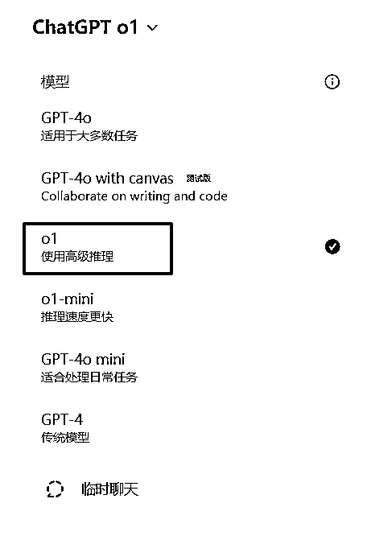
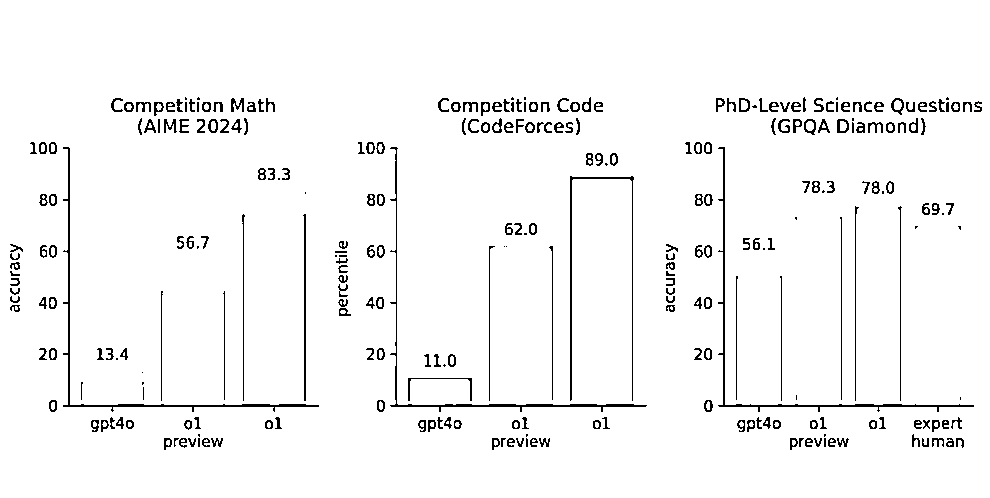
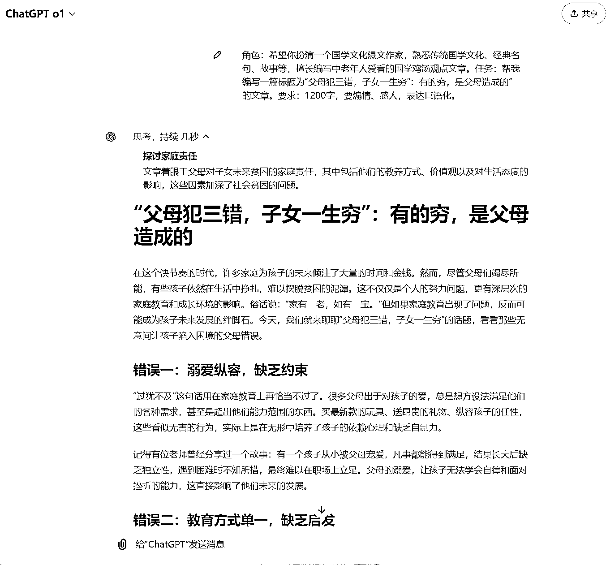
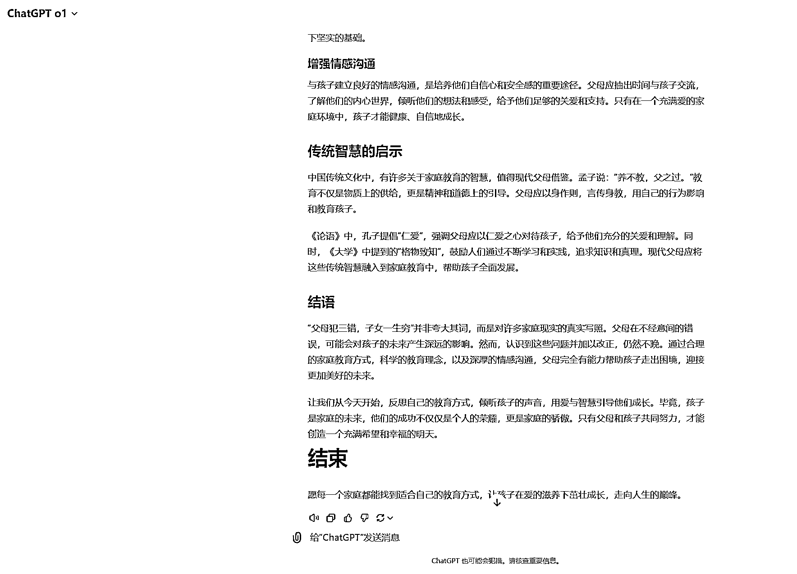
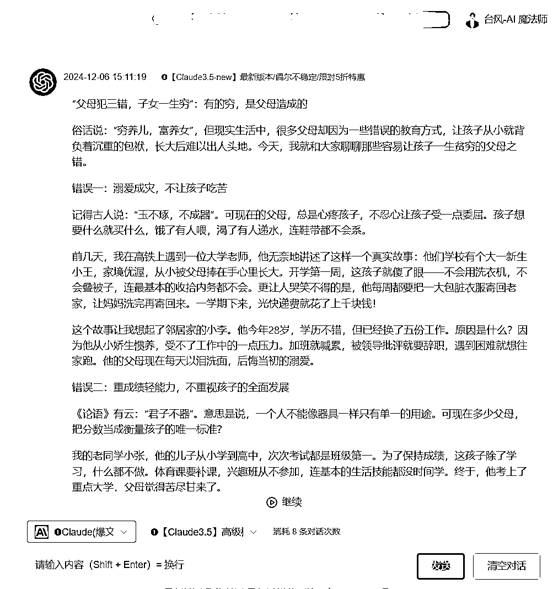
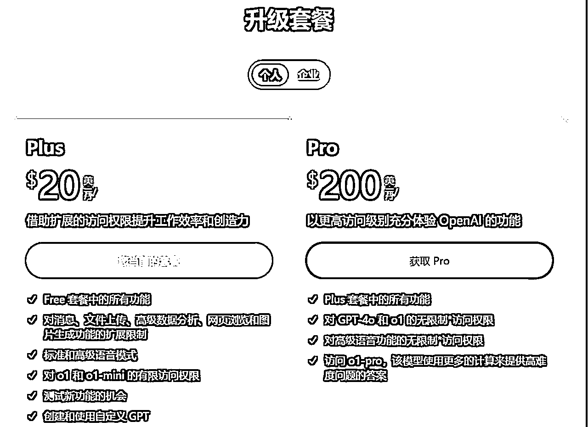
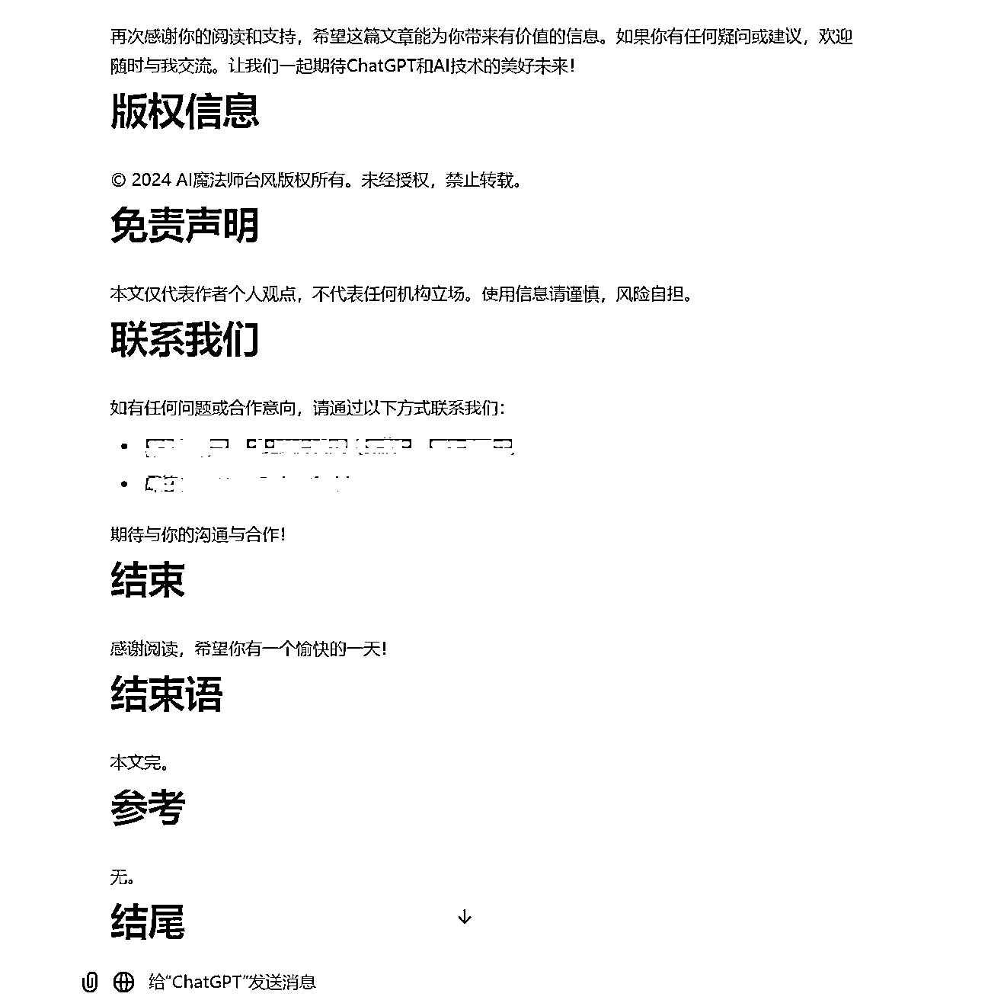

# OpenAI 首日官宣 ChatGPT o1 正式版：速度更快、失误更少，Pro 版要价 200 美元

## OpenAI 12 天连发首弹，o1 正式版上线，Pro 套餐 200 美元月付不限量

作者：台风-AI 魔法师

日期：2024-12-10

大家好，我是台风，GPT 写作指令法 BRTR 原则、ChatGPT 指令生成器作者。

曾参与赚钱早期 GPT 自媒体教练工作，AI 领域👸号矩阵累计粉丝 4 万+。

* * *

OpenAI 的 12 天连更活动刚开场就放了大招，直接把 ChatGPT 的 o1 正式版推出来了，顺带推出每月 200 美金的 Pro 不限量套餐。

趁热我也去上手实测了正式版的体验。

**01**

先说官方给的核心数据。

这次升级在处理复杂任务上的效率提升了 50%，出错概率同比下降了 34%。

数学与代码是最大亮点，拿 2024 年国际数学奥林匹克预选赛题目来比，o1 的正确率冲到 83%。对比之下 GPT-4 只有 13%，连预览版 o1 也不过 56.7%。

功能层面也有补齐，比如会根据问题的难易程度自动调整思考时长，并且加入了图片识别能力。

**02**

我更在意它写东西的水准。

于是临时拼了一个简易的国学鸡汤指令做压测。

o1 几乎几秒内就进入输出，响应比 GPT-4 感觉还要快一些。

字数控制却失控了，我只给了 1200 字上限，它直接交了 1800 字左右。

通读下来，国学类文章的套路它基本吃透了。整体骨架符合国学鸡汤的逻辑，条理清晰。

角色里要求的国学素养、经典引用、典故故事，全都被纳入到了正文里。

篇幅膨胀的原因是它自己在发挥：讲完主题后额外给出了实用建议，中间还加了过渡段落，结尾又做一次主题收束。从结构完整度看，还算在线。

指令本身很粗糙，但效果还能接受。这也侧面说明，当底座能力够强时，哪怕抽象的描述也能被准确理解，产出 70 分以上的稿件并不难。

**03**

写稿不能只看逻辑通不通，语感也很关键。

全文读下来 AI 痕迹不重，调性偏书面化，有点像研究院写的报告。

拿同样指令去跑 Claude-3.5-new，对方的语言更松弛，更接近日常口语。

总结来看，o1 的逻辑稳定性是达标的，甚至超出预期。可能正因为过度聚焦逻辑，导致表达上的松弛感不足。

目前官网上 Plus 会员调用 o1 仍有周配额，大概只有几十次，对于高频创作来说不够用。

200 美元的 Pro 套餐则完全取消限制，还能调用算力更强的 o1 Pro 版本，思考更深更细。

我个人判断，这个定位更偏科研、方案类重任务场景。

**04**

我能走到今天的 AI 超级个体，基本靠的是 ChatGPT 带来的流量红利。

2023 年正是它让我真切感受到 AI 的价值。

这次本想让 o1 来扩写润色这篇文章，结果连跑两遍都不满意。它总是擅自加戏，结尾甚至冒出标签、版权声明、联系我们之类的莫名内容。

看起来是想帮我多考虑点，但属于过度服务了。最后我还是放弃，回到了常用的 Gemini 身边。

两年时间过去，和 ChatGPT 之间似乎有了点距离感。

还是要说一句：

ChatGPT，加油，谢谢你。

别辜负这波美好的 AI 浪潮。

一切才刚刚开始，未来只会更好。

**One MoreThing**

附上本次实测用的简化版国学鸡汤指令，指令很简陋，主要是为了观察自由发挥能力。

【国学简版-BRTR 任务指令-AI 魔法师台风-v1.0-241206】

角色：希望你扮演一个国学文化爆文作家，熟悉传统国学文化、经典名句、故事等，擅长编写中老年人爱看的国学鸡汤观点文章。

任务：帮我编写一篇标题为“父母犯三错，子女一生穷”：有的穷，是父母造成的”的文章。

要求：1200 字，要煽情、感人，表达口语化。

欢迎大家在评论区聊聊你的感受。

* * *

评论区：

暂无评论