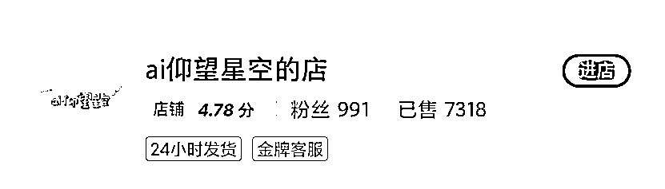
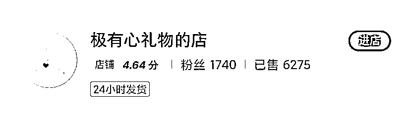
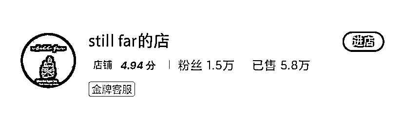
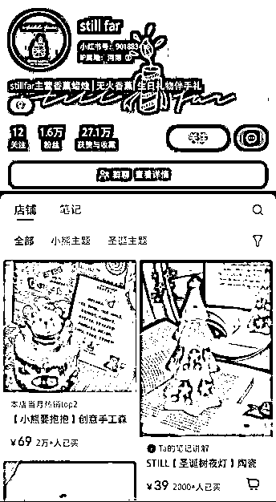
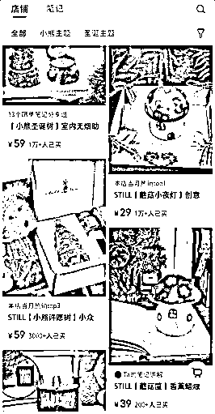
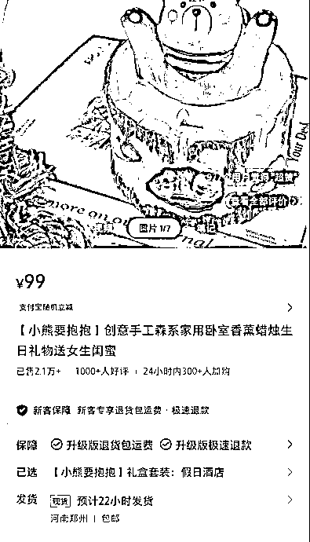
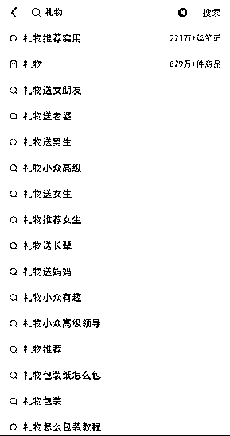
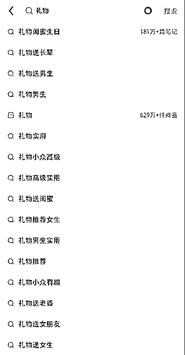
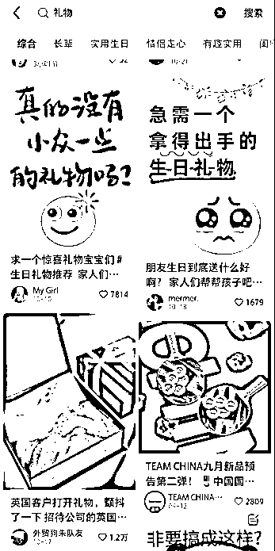

# 📕礼物赛道：为什么它成了平台特供的蓝海
作者：龙哥

## 📕礼物赛道的独特优势与市场潜力

作者： 古辛

日期：2024-12-10

📕的电商逻辑和淘宝、拼多多并不一样，后两者以关键词搜索为主，📕则叠加了强大的内容分发，因此平台上诞生了独有的机会。今天分享的就是📕专属的蓝海——礼物赛道。

古辛本人也在操作这个赛道，也在星球里跟大家讲过。赛道体量足够大，能容纳大量商家。如果你在做📕还没找到合适方向，礼物赛道值得重点考虑。

为什么📕做礼物如此吃香，核心有两点。第一，平台用户以女性为主，而礼物的决策者和购买者高度重合。第二，📕是种草型社区，很多新奇礼物在传统电商很难被看见，但在📕通过内容触达，即使用户没有明确需求，也会被推荐种草从而下单。

📕的礼物市场足够大，且门槛友好。举个例子，下图这家垂直做礼物的店铺，粉丝991，订单已达7318单。

这家也是礼物垂直店，1740个粉丝，成交6275单。

今天重点拿上图这家店拆解，它具备很强的可复制性，是典型的参考样本。

礼物垂直店的打法是品类聚合，并非单品爆款。把一个大类下的细分SKU全部收纳，店内商品数量自然会非常多。

这类店铺在价位上覆盖很全，从入门到中高端都有，专注高端线操作也完全可行。

核算利润时不能看单个链接，这类店的SKU体量庞大，关键看整体毛利总和。

每个平台都有自己的特色赛道。礼物垂直店就是📕的代表型赛道。如果要做礼物生意，📕是国内最合适的阵地。

想做📕礼物赛道，要注意三件事：

**1. 用好搜索栏下拉联想词**

选品和做笔记都要吃透下拉联想词。它既能帮你判断品类热度，也能指导内容方向，带来额外曝光。

比如搜索“礼物”，下拉会出来一大串高频长尾词，每个都值得挖掘。

需要注意的是账号性别会影响联想结果。上图账号性别为男，所以第一条是送女朋友，第二条是送老婆，明显是男性视角，和📕主流用户画像不符。

换成性别为女的账号搜索，联想词就合理了，第一条是闺蜜生日，第二条是长辈，第三条才是送男生。

只用女性账号得到的联想才有参考价值，男性账号的联想容易误导方向。

**2. 找准下单者的痛点**

礼物类目和别的品不一样，购买者与收礼者通常不是同一个人。所以洞察对象必须是下单者。

这类买家的核心困扰是：不知道送什么。很多人在选礼物时会产生决策焦虑，而📕恰好能通过内容帮他们解题。

这也是📕礼物比其他平台好做的原因。淘宝必须用户先有明确搜索词，商品才会被看见；📕即使用户没有明确想法，内容也能主动推送到她面前。

另外，送礼人群普遍追求差异化和惊喜，不想送烂大街的东西。这也解释了为什么一些小众创新品能在📕卖爆。

**3. 贵=好的心理暗示**

礼物赛道能放大“贵即好”的潜规则。自己买会倾向性价比，送人则更容易接受高价，因为大众潜意识里价格与品质挂钩。

即便对产品不了解，消费者也会默认“贵的东西不会差”。因此送长辈等场景，提升客单价往往比走低价更易成交。

在古辛看来，📕礼物目前仍是纯蓝海。很多在淘宝月销几百的品，在📕上几乎搜不到，这背后意味着巨大的增量空间。有电商经验的人都懂这代表什么。

如果你靠📕礼物赛道赚到钱，记得回来给古辛点个赞，哈哈。

* * *

评论区：

上上签 : 要不在讲讲具体的操作，喂个饭

古辛 : 这是核心机密，护城堡垒。。。。。得加钱[旺柴][破涕为笑][破涕为笑][破涕为笑]

阿路 hh : 因为我有个朋友是这个赛道的，📕 top10，我 11 月份导过数据，发现 7 月份过后数据反馈不太理想，一开始以为是礼物赛道上半年优于下半年，但环比 23 年，确实整体数据下滑挺大，感觉这个赛道消费的模式有所转移

BLUE : 喂饭到掌勺

小花 : 📕应该是从 8 月份开始调整了流量政策，所有行业都受影响，要投流了。

老彭 : 啊啊啊啊！！！快到圣诞节了，看了一晚上📕，还是不知道要送女朋友什么礼物！！要死了