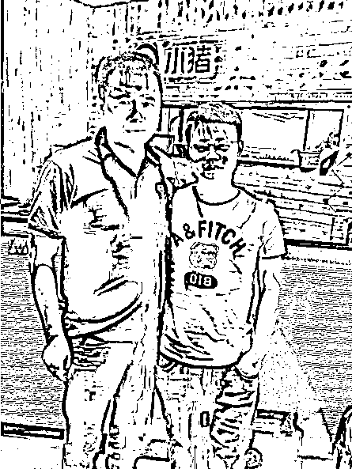
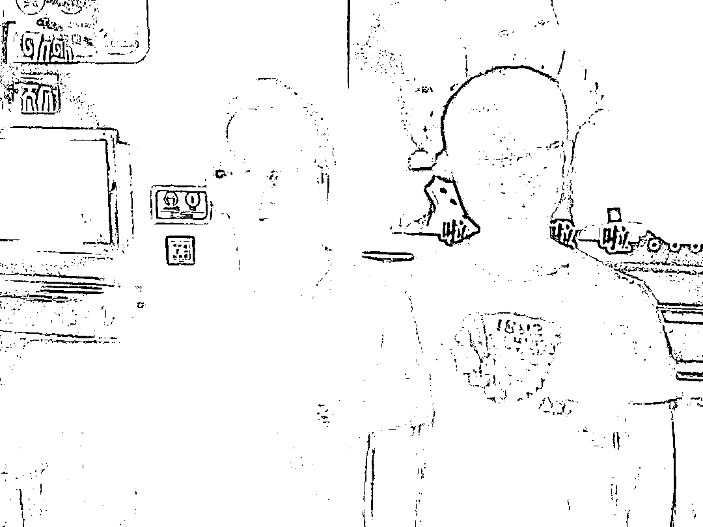
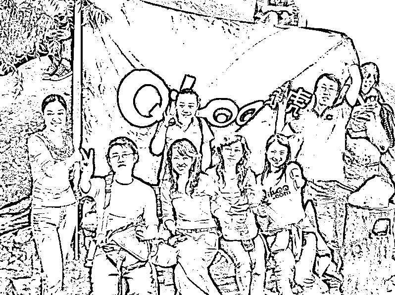
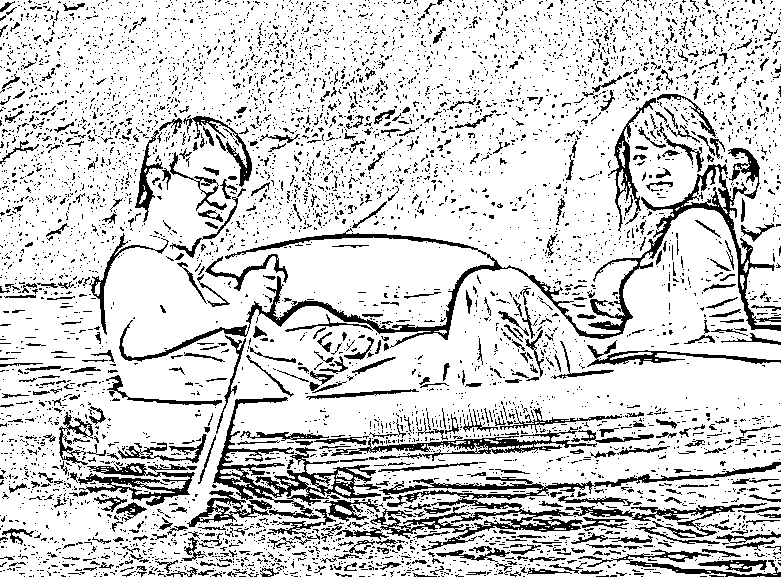
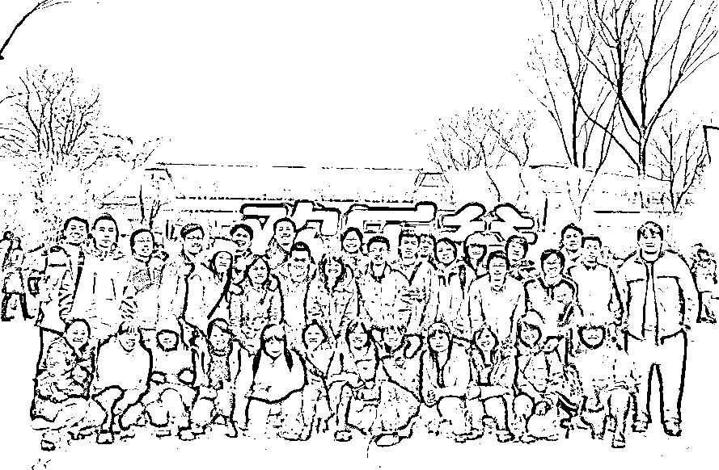
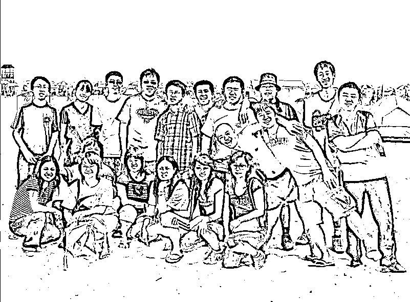
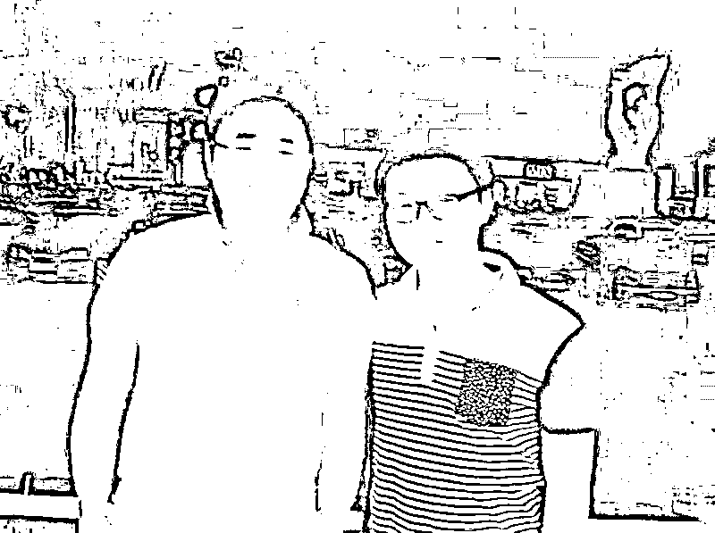
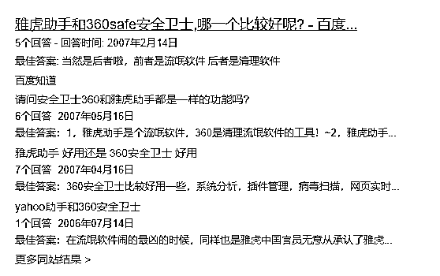

# 360 那两年，以及我眼中的周鸿祎

2006 年我北漂，第一份工作就落在了 360，并且整整待了两年。这两年我换了五次岗位，见过公司野蛮生长期的种种面貌，也和周鸿祎有过几次直面接触。

最近红衣大叔又成了热搜话题，还跨界拍短剧。看完后我脑子里全是当年在 360 的碎片。最近打算重启写作，就把这些亲历和观察和大家聊聊。昨天看到一篇梳理周鸿祎 54 年经历的文章，阅读量很高，但作为早期员工，我知道不少细节和事实并不一致。

## 进 360 的缘分

05 年底我在成都结束第一份互联网工作，开始做全职个人站长。机缘巧合在站长论坛认识了当时 360 联盟负责人胡少宇，她把简历递给了副总裁王航。

王航当天就打电话，随后安排两名负责人用 QQ 视频面试。06 年 1 月让我来北京面谈，并承诺报销卧铺车票。

那时我才 23 岁，没走过远门也没坐过飞机，为了面试特意买了人生第一张机票。到了北京才发现机票没带上，又折回暂住地取了票去公司报账。心里怕的只是不及时报销吃亏，更怕人家不录用。

06 年 2 月春节后，我拖着行李箱报到，成为公司前 150 号员工之一。来得匆忙，连房子都没找好。王航让我先和各区域销售总监合住。西南区总监陈驰也是四川人，相处得更近。后来陈驰和另一位销售总监王连涛一起做了小猪短租。

## 百人公司里的派系

刚入职我只做了半年的互联网，完全想不到百来人的公司内部已经有明显的派系。

起初我在论坛搜索组做产品专员，后来高层觉得我有想法，想培养成产品经理，转去搜索引擎测试组。王航当时说过，网推到哪都能做，但搜索产品经理只有 360、百度等少数公司有机会。我曾写过中年失业的主题，看到产品经理是最容易被行业淘汰的岗位，还好自己最终没走那条路。

每个副总都有自己的嫡系。我是王航招进来的，按说属于王航系。但屁股还没坐热，王航和胡少宇就离职创业去了好大夫在线。胡少宇是联合创始人，也是当年在公司里对我最照顾的姐姐，后来去北京还会约见。

从此我成了无根的闲人。王航在上岛咖啡请我吃饭，想拉我一起创业。我当时犹豫着没答应。当时测试组不太受待见，曾被周鸿祎或齐向东在群邮件里点名批评过。王航的意思是先等等，如果组被裁掉，再过去就顺理成章。后来我和王航关系一直不错，2016 年 28 推大会他还录了祝福视频。

医疗方向不是我的兴趣，我婉拒了。测试组的工作让我很难受，提出了离职想法。

也是这时 CEO 齐向东把我叫进去，说知道我想做网推，问我愿不愿意去联盟部门。半年时间没发挥专长，我不甘心就走，便答应了。他还大方给了几天假让我回重庆散心。

入职后我就开了博客。当时优酷、酷 6、土豆很火，我写了不少短视频行业分析，被酷 6 创始人李善友看到，安排副总韩坤来谈。为了让我融入，韩坤还邀我参加了酷 6 在呼伦贝尔的三天团建。

08 年我还参加过优酷在上海的活动，机票住宿都是对方安排，活动后还和创始人古永锵在 KTV 唱歌，他唱了张惠妹的《听海》。

后来韩坤让木蚂蚁杨波对接，我感觉他并不想让我过去，我们都是草根站长出身，彼此太了解，最终放弃了酷 6 的机会。

正好 360 上线了短视频搜索，我发邮件给产品总监陈杰谈了行业看法并表达想去的意愿。当时我在联盟的业绩很好，陈杰愿意接收，但联盟不肯放人。事情闹到周鸿祎那里，我被单独面谈，在他同意下转到了产品部门。

那次我才明白换部门本质是换领导。联盟归齐向东管，产品归副总石晓虹管。

## 能力好却不被重用

年轻时只懂埋头干活，不懂职场潜规则。陈杰后来升到高级副总裁，但当年产品组里大部分产品经理都不待见他，觉得他没啥真本事，唯一强项是听话，老板说东他就东。

后来那些产品经理陆续离职，陈杰却一路上升。创业后我才懂，听话能盖住很多短板。

我在短视频搜索组负责推广，陈杰每月给各组定流量目标，大部分组都觉得不现实，只有我们组完成了。靠的是流量互换的套路：找到土豆、优酷、酷 6、56 等站做互相导流，形成闭环，每天能拿到 30 多万 IP，典型的空手套白狼。

合作顺畅也得益于写博客攒下的关系，我的行业分析让各大短视频平台都主动找过我，包括还没成立的爱奇艺。当时优酷高管私下说过，我的文章影响了他们的融资节奏。

表现不错后我被安排负责门户全网流量互换，当时门户老大是副总裁刘峻，他后来成了字节早期投资人。

对比才有伤害。短视频组就我一人，看不出差距；到联盟和门户，同岗几个人，我一个人业绩顶他们总和的两倍。但那时没有奖金机制，待遇一视同仁。我拼业绩只想找极限，没想别的，却让同事不舒服。

最离谱的是，我业绩太好导致另一位经理被降薪。那位经理转岗后业绩只有我四分之一，公司认为配不上经理薪资。

王航走后，我的大领导换了齐向东、石晓虹、刘峻，但我始终是基层员工，不会经营关系。

王航离开基本注定了我在 360 的天花板。虽然业绩突出，每半年申请涨薪也都批了，三次涨加起来才 1000 元。核心是周鸿祎当时并不重视推广，认为产品才重要。老同事贾健强产品天赋强，很快成为核心内容产品负责人，待遇翻了好几倍。

在 360 快两年，比我早进来的普通员工分了期权，后进来的管理层也分了，我既没期权职位也没动。说实说，当年全公司推广能力没人超过我，学习劲头也足，常凌晨三点给领导发长文档。除了管理短板，业务上当个推广总监都绰绰有余。

## 我眼中的周鸿祎

和别的互联网大佬比，周鸿祎更接地气，几乎每天在办公区转悠，看进度。不像我在百度两年，几乎没见过李彦宏。

但这也给中层很大压力。年轻时的周鸿祎脾气暴躁，传闻只有齐向东没被当面骂过，其他中高层都挨过骂，有些女管理层被骂哭。

圈子里当年称他为顶级产品经理之一。现在回头看，早期产品除了 360 安全卫士意外成功，其他基本都失败了。是不是好产品经理，我保持怀疑。

他有个怪癖，外面夸 360 的邮件他不看，提 bug 的反而重视。我去百度后给周鸿祎发邮件指出了 360 导航的问题，没多久负责导航的老同事就找我，说以后直接找他，他又被老板批评了。

年轻时的周鸿祎是个斗士，不怕得罪对手。曾同时惹上雅虎、百度、腾讯，后来的 3Q 大战大家都知道。安全卫士起初就是为了恶心雅虎助手，想把雅虎助手清出去，典型的无心插柳。

我不认为他是顶尖产品经理，但他一个理念一直影响我：好产品是在同行基础上做更多创新。我后来做项目都按这个思路，少走了弯路。但他那种不怕得罪人的风格，我始终学不来。

## 周鸿祎身边的人

在 360 待过能知道些人际关系。王航传闻是周鸿祎小学同学，石晓虹是大学同学。首席技术谢耿是大学学弟，首席架构师李钊是方正时期的同事，曾是周鸿祎的上级，后来成首席科学家。APUS 创始人李涛在 3721 时期跟过周鸿祎，2009 年回 360 任副总裁，传闻是小舅子。我在重庆见过他一次。

还有个细节，网上报道周鸿祎祖籍湖北，确实，但出生地是河南驻马店，小学到高中都在郑州，算生在河南长在河南，后来上西安交大。我猜是不是当年地域偏见明显，07 年我在北京谈过一个河南女朋友，她说因为河南身份经常被议论，心里难受。

## 几次和周鸿祎的直接接触

06 年底公司搞全员捉虫活动，找 bug 排名有奖励。当时我在联盟，有测试经历，找 bug 更在行，多次拿第一。在一次全员大会上，周鸿祎点名表扬了我，全公司都知道了这个人。

调岗那次是我唯一一次进他办公室单独谈话。因为一边不放人一边要人，最后闹到他那里。

周鸿祎喜欢看 IT 博主，公司一些产品经理就是写博客被他发现挖来的。但他不喜欢在职员工写博客，怕被挖角。

06、07 年我写网络推广博客最热情，周鸿祎先后三次发邮件劝我少求虚荣，少写博客，多做事。但我内部也在写大量文档分享，只是他看不到。当时正热爱写作，没理会。现在想想还好没听，后来否则可能中年失业。一边不让写，一边又没给发展空间。

我写过一篇关于站长统计的文章，提到论坛统计的想法，被他看到，直接打电话让我和前端负责人左文健沟通。那次我存了他的电话，离职后每年春节发祝福，他也回过几次。

调到产品部门后每周六有产品例会，周鸿祎、齐向东、石晓虹、刘峻都在。我人生第一次 PPT 分享就是在会上，当着两位高层的面讲论坛推广，后来还做了百度和 360 视频搜索的对比。这段经历让我每周和高层近距离交流，受益很大，只是作为专员常坐角落不敢发言。

最近一次接触是 2018 年，我做社群最火时，掌握大量公众号资源。加了周鸿祎微信介绍创业情况，他第一句话是能不能让这些号推 360 产品。当时我脑子空白，以为是想白嫖。现在想想反应太慢，当时就该说可以，价格合适就行。

本月 28 推杭州短剧大会，360 旗下鲁大师赞助了活动，我又赚了老东家的钱。周鸿祎自己拍短剧，十有八九是为旗下短剧公司造势。

## 360 很变态，但我感激

360 加班文化很重。周鸿祎在大会上说过，别人看世界杯时我们工作，别人过年回家时我们加班。

测试组基本每天加到 10 点半后，产品上线时凌晨 1 点半下班都正常。有次因为 bug 当天 10 点就走，第二天被全公司通报批评，经理吓得要求以后没事也要留到 10 点半。

那时我 23 岁，正值壮年，但高强度让我开始眼花头晕。于是提出离职，才有转去联盟的机会。

门户组领导明确说每周至少加班两天。同事怨声载道，觉得公司变态。但我没感觉，因为我本来就 9 点半后才走。公司 8 点提供晚餐，9 点半后打车报销，我把公司当免费餐厅和网吧。单身时回出租屋也是上网，在公司效率更高。

开会永远排在下班后或周末，比如周六例会。很多人抱怨没时间陪女朋友，但我很享受。心态决定体验。

这种强度只有离开后才懂价值。再也遇不到这么变态的公司了，从 360 出来的人到哪都能快速适应。我去酷讯后，第一个周末想加班发现大门锁着，无法理解创业公司周末没人。可能酷讯倒闭的种子就那时种下了。

有机会再聊聊酷讯和张一鸣的故事，那段经历让我后来和首富合影。

## 360 的人性化

话说回来，360 很早就学谷歌文化，全天提供早中晚餐，小部门每月有团建预算，季度大部门会周边游，加班晚还有临时宿舍。

临时宿舍我一次没住过。当时不懂，要是多住几次，说不定就升职了。

部门组织的那次爬山，我当时拿了第二名，算下来就是男选手的第一。现在回想起来，腿都会发软，真的再也不敢上山了，唉。

在 360 待的那段时间，和同事们的交集特别多。我前后辗转过五个部门，基本把公司里的人都认了个遍。可以说早期在的那批老员工，我几乎全都熟悉。比如在测试组的时候，和前端、技术后端、美工那边打交道特别频繁。

还记得和部门里的重庆老乡组队去划船，当时我们被同事们戏称是公司公认的第一美女。

最开始去论坛组的时候，身边同级别的基本都是刚入行的应届生，反倒是我年纪最小，但手上已经有半年的互联网经验。所以那阵子和部门里的人很难找到共同话题。真正能聊得来、能同频的，反而是各部门的产品经理。不是刻意攀附，只是自然而然就往公司里更优秀的人群靠拢了。

后来和产品部的同事一起去过欢乐谷。

在北京我一共换过四家公司，在百度待的时间反倒是更长的，但和 360 的老同事感情是最深的，认识的人也最多。后来去了酷讯，市场部每个月都有小团建，大家感情还算不错，但公司没搞过大型团建，所以对其他部门的人基本不熟。在百度就更夸张了，工作两年，我印象里一次全部门的大型活动都没有，市场部就那么几个人，偶尔一起吃吃饭就算了。而且我们市场部有三个人，都是以前 360 的熟人，这也是我后来选择去百度的重要原因之一。

曾经和 360 联盟部、编辑部的同事一起去过河北的海边。

**

**9：关于网上报道的一些误读**

昨天刷到一篇讲周鸿祎履历的爆款长文，从出生、求学、工作到创业几乎全盘梳理了一遍。

外行看热闹，内行看门道。至少就我亲身经历的那个阶段，文章里不少描述和我记忆中的事实差距挺大。

文章说周鸿祎离开雅虎，是因为马云突然收购了雅虎中国，他才辞职去 IDC 做投资合伙人，然后 2006 年才投了奇虎。

其实圈内人都清楚，奇虎这盘棋周鸿祎早在 2005 年就布好了。奇虎前身虽然是重庆的一家创业公司，但 2005 年时它已经是周鸿祎的阵地。我 2005 年底去 360 面试，周鸿祎不可能 2006 年才去投资吧：）这里面还有不少不为外人所知的细节，我就不展开了，都过去了。

文章还提到 360 安全卫士刚开始只有 4个人。我记得很清楚，当时安全卫士的工位就在我旁边，人早就超过十个了。那会儿公司有个活动室，里面有健身器械，还有一张乒乓球台，我和傅盛经常在那里切磋。

后来几年在北京的一家酒吧门口，和傅盛偶遇了一次。

**10：360 与雅虎中国的恩怨**

在做 360 之前，周鸿祎的代表作是 3721，老互联网人应该都记得。2003 年底，33岁的周鸿祎以 1.2 亿美元把 3721 卖给了雅虎中国。出售前马云也代表阿里巴巴出价 6000 万美元想收。

33岁，在 2003 年房价还便宜的年代，基本已经财务自由。2004 年 3 月，周鸿祎正式担任雅虎中国总经理，到 2005 年 8 月雅虎中国被杨致远悄悄卖给阿里巴巴，周鸿祎随后离职做了投资人。估计在他心里，给马云打工是接受不了的。

从那时起和雅虎中国，或者说和马云的梁子就结下了。为什么这么说？因为我在 360 时亲历过一件印象极深的事。有一次员工大会上，齐向东在台上激烈抨击马云，说他就是地痞流氓，根本不给 360 留活路。但同时也放话不怕雅虎中国，也不怕马云。正是在那段时间，360 安全卫士和雅虎助手打得不可开交。

具体过程我记不清了，但结果大家都看到了，360 安全卫士越做越大，雅虎助手早就不见踪影。

我后来在百度搜了一下，关于雅虎助手的讨论基本集中在 06、07 年的百度知道里，当时的舆论环境，雅虎助手明显处于下风，被贴上了流氓软件的标签。

再后来的 3Q 大战，我已经在百度上班了，算是站在了 360 的对立面。记得在百度，办公电脑是禁止安装 360 卫士的。那时候百度更多像个看热闹的，在旁边喊加油，主要还是 QQ 和 360 在硬刚。

写到这篇的现在，从早上一直写到快 6 个小时，我尽力做到真实客观。希望大家能从另一个视角，认识早期的 360，和如今的红衣大叔周鸿祎。

有机会的话，下次再聊聊我在酷讯的工作经历，以及和张一鸣相关的一些故事。

* * *

评论区：

周彦充 : 哈哈哈，刚刚看了你写的一篇吃瓜的文章，1.2 万字，关于赚钱，群响，山顶会的[呲牙][呲牙][呲牙]，没想到就看见你在赚钱发帖了。

牟长青 : 赚钱内容官说，我这些文章也可以来赚钱分享下[呲牙]

牟长青 : 那你说说 1.2 万那篇吃瓜文，分析得可对

周彦充 : 很对，很深刻，也中肯，哈哈，我没加私董，加的会员。

周彦充 : 这些内容都挺有意思的，我喜欢，哈哈，真实

星辰君 : 吃瓜文章在哪里看啊？

周彦充 : 大佬公众号文章

牟长青 : 我发现你在小红书的软文，下次提到付费社群的时候，麻烦把我们也加上..