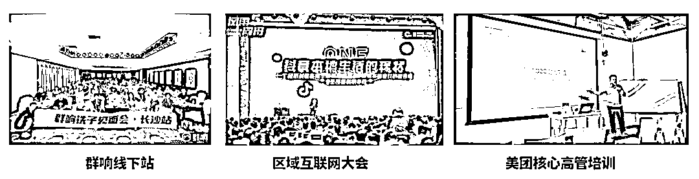
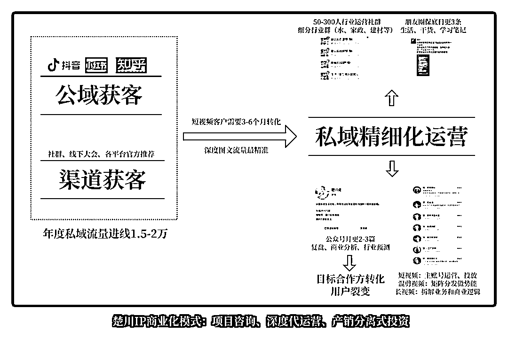

# 老板们，靠IP卖课翻身？我亏了100多万才想明白

现在什么生意都不好做，于是2024年，不少老板发现了一条感觉可行的新路：亲自出镜做IP，卖课教人创业、教人做生意。听起来既性感，又像是一步好棋。但作为一个亲身踩过坑的人，我想用自己的经历给你提个醒。这篇文章，尤其适合年利润500万到1500万的老板们看看——至少能帮你少走100个弯，少亏100万。

## 一、做IP卖课，既发不了财，也翻不了身

先说说大佬们的例子。分众传媒的江南春，早就财富自由了，照样签约博商去做IP卖课。哪怕他的出发点是想传递中国企业家精神，还是被各路博主喷成筛子。但我的看法是：敢站出来的老板，已经超过了中国99%的企业家，做了很多人不敢做的事。问题在于，视频里的话全是服务公司写好的，文案和视频没有灵魂。传递出去的声音空洞乏味，对自己企业的品牌和销量毫无帮助，说白了就是给第三方卖课公司做了嫁衣。

那靠这个能东山再起吗？我的答案依然是不能。很多大佬过去的成功，是天时地利人和的结果。现在天时地利都变了，光靠IP和粉丝，根本不足以再赢一次。做一个成功的IP，概率比考清华北大还低，想靠卖课变现，更是难上加难。麻辣诱惑的韩东，冲击IPO失败，从18亿身家变成负债5亿，想靠做IP、卖课、走穴找翻身机会；太子奶创始人李途纯、安琪月饼创始人梁翰辉，这些商业远古大神也都在用IP破局。但说实话，成功率几乎为零。因为当下一个IP要起势，必须有高能量、高付费的团队操盘才可能拿到大结果，这对曾经的大佬来说，几乎是不可能完成的任务。

## 二、我这个互联网原住民，也逃不过这个坑

也许你会说，那些大佬过气了，但你是互联网原住民，又一直在行业里拿结果，总该行吧？我用直接损失100多万的经验告诉你：也不行。

2021年，在服务了差不多5000个客户之后，我第一次站出来做行业分享，享受到了流量带来的追捧。接着，我又以本地生活专家和大佬的身份，在美团、群响、区域互联网大会等场合分享。那是我创业以来的高光时刻，也让我产生了一种幻觉：我已经是大佬了，是穿越周期的创业者了。

既然都是大佬了，那我是不是也能搞知识付费、卖课？

于是2022年，我第一次尝试做社群，开始输出内容。结果可想而知，还是被不少人喷。哪怕我用心写，依然有人看不惯、看不懂、不满意。那段时间，我真正意识到自己有多不成熟，对知识付费的理解太片面，也高估了自己的能力。团队拍视频时，总鼓励我对着镜头讲“如何创业、人生观、财富观”这些，可30岁的我根本说不出口。搭建社群和付费产品，更是让我有种在收割市场的愧疚感。这种照葫芦画瓢的IP操盘，连我自己都无法相信能继续下去，于是很快叫停、止损。

那个阶段，我想明白了一个深层次的问题：我虽然是行业运营专家，但不是拿到了大结果的商业IP，甚至还没真正穿越过创业周期，凭什么教别人赚钱？流量放大，就是个伪命题。于是我又回到用心做短视频和👸号的状态，在沉淀中写出了第一本运营笔记。后来这本笔记在几个大厂流传开来，反而让我的影响力持续做大。

2023年9月，我们接手天鹅到家、心理咨询、求职辅导、门窗建材等细分赛道，都做到了行业TOP1。这时，身边朋友又一次劝我：楚川，你该出来卖课了，前面收学费，后面接代运营，钱不就来了吗？说实话，我内心又骚动了。这似乎是一条最优解，或者是让团队赚大钱的唯一通道。我内心深处很抗拒，总觉得创业者就该低头做事，真刀真枪穿越周期，而不是靠什么虚无缥缈的影响力。但最终，因为一些内外部的复杂情况，还是被推着往前走。我们专门找了一个成熟的IP运营团队来操盘，把IP包装、内容调性、服化道，再到私域运营和商业化变现，一条龙规划得明明白白，钱自然也砸了不少。

2024年5月，我们正式开始冲刺个人IP，做私域引流、主推线下课。结果历史重演：团队里的年轻操盘手对我的商业价值判断失误，内容和打法都流于表面，没有触及内核，营销环节自然做不深。数据其实不算难看——6、7两个月，线下课门票收了50万，后续代运营合作又签了100多万。但我一点也不开心。我能强烈感觉到，👸号内容没人看、没人转发，因为所有人都觉得那是卖课广告。朋友圈被折叠的次数也越来越频繁，很多内容我写着写着就没欲望了。还有朋友跑来问我：楚川，你这是要转型做卖课了？主营业务不做了？

大家的核心疑问是：放着好好的主营业务不做，去搞卖课收割，哪怕我们的初衷是想通过线下课找到合作伙伴，也逃不出这种“想当然”的指责。但现实就是现实——我们这一年在这方面的成本已经高达120万，小两个月的折腾，就吃掉了10%的利润。8月，我再次主动叫停，带着团队反思了两个月。那之后，我们开始用数字人做内容，搭起了IP矩阵，从公域往私域导流；👸号重新更新，专注写深度商业分析；我还经常出门交流，到处取经。慢慢地，私域又重新被激活了，我的状态也恢复了，公司的运营体系和方法论被深度梳理了一遍。

但很难接受的是，这个踩坑周期，足足持续了将近一年。

2024年10月，客户和合作方重新找了回来。那是大获全胜的一个月，我们业绩冲到全年最高，而且增速看起来还能延续很久。

复盘那段经历，我反复追问自己：做IP，究竟是为了什么？

很多机构的初心都是好的，想帮创始人变现。但所有打法都大同小异：前端卖课卖资料，把流量引到私域流量池，再持续转化。大多数IP操盘手，其实根本没搞懂创始人的初心是什么，核心竞争力在哪里，更看不清IP和公司之间的商业关系。

## 三、一条创始人IP的避坑方法论

如果你还是决定要试，我总结了几个关键教训。

**第一，支持所有老板参与视频、知识付费和网红经济，流量确实意味着商业机会。但出路背后，一定要做好整条链路的合理科学规划。**

创始人站出来做IP，最难的就是第一步。你得克服心魔，习惯拍剪短视频，学会表达，刻意练习。其次，想清楚流量到底拿来做什么。从各大平台拿到流量后，要做好流量线索漏斗的数据跟踪，再导入私域做长期转化。这个过程里变量太多，对团队的考验极大，尤其是初期人手稀少的阶段。我当时起盘时内部只有5个人，外部有单独的拍剪团队，任务量依然超负荷。如果没有全盘合理科学规划，项目扑街的概率接近100%，因为赛道早已白热化。

最后，千万不要立虚假人设。不需要刻意用外部元素显示自己有钱有地位，而是要用真正有价值的观点、诚挚的想法、更高的认知来做输出，这样吸引来的流量和私域用户才是同频的人。否则，可能聊5分钟，就能看穿一个IP在吹牛撒谎。这也是为什么现在越来越多IP不断塌房的原因。

**第二，IP起盘一定要先定位，再运营多平台，同时借助AI全面提效。**

首先，创始人做IP必须有定位环节，就像品牌定位一样。老板和团队要亲自分析自身内核，找到市场里的独特之处，再针对性地梳理要卖的产品，做成体系。再者，各个平台的内容口味各不相同，前期一定要多平台铺开，才能让短视频的营销效率最大化。还有就是，要善用AI给IP加速。用AI来找爆款、拆解爆款，再到写文案、理素材、剪视频，全流程提效。接着用数字人做场景克隆，靠矩阵号持续发布，把IP势能做起来。这样既提效，又能把老板本人从繁琐的执行里解放出来。

最后，我用100多万、以及自毁私域流量的惨痛代价，换来一个结论：创始人做IP，本质上是给现有业务打开一扇放大窗口。不管什么打法，都要回到原点——把商业价值和公司业务放大，这是唯一目标，不存在任何曲线救国的方法。千万别掉进那个IP漩涡：你以为自己做的是业务创新，是在做大流量，最后再为自家公司赋能——这个概念，从一开始就是伪命题。