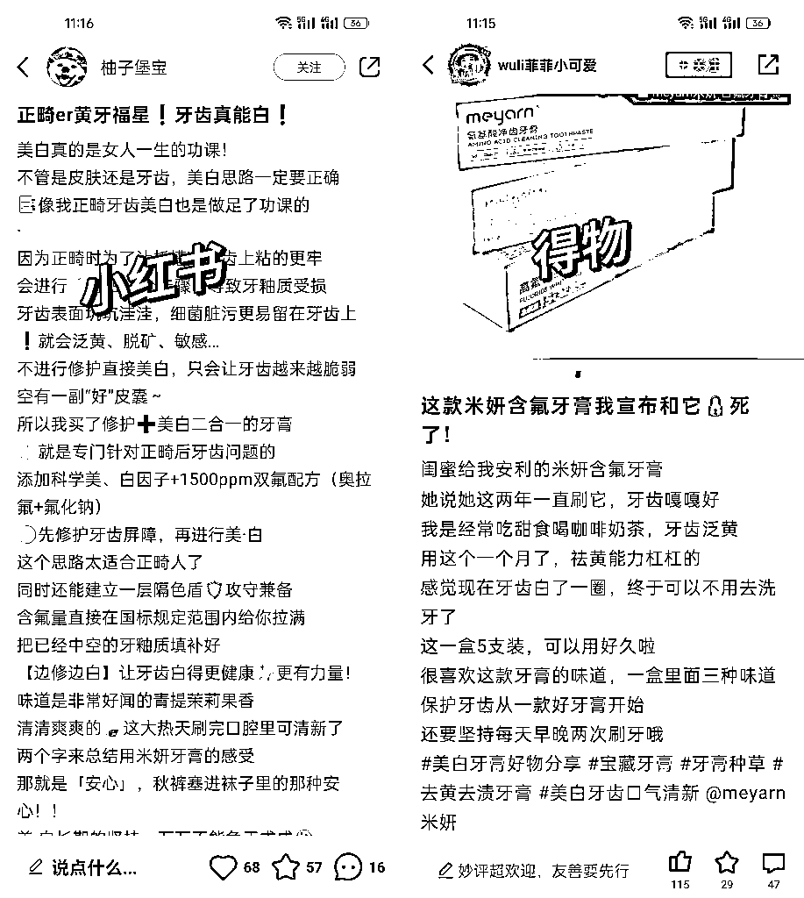
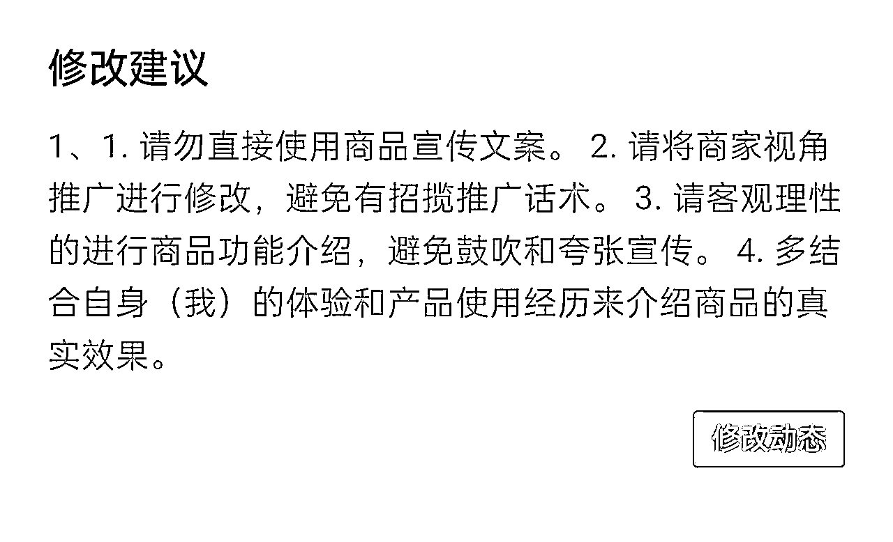

# 碎片时间也能变现？我用半年把得物做成了稳定副业

> 原文：[`www.yuque.com/for_lazy/zhoubao/gtvgn6lf07uw8fdb`](https://www.yuque.com/for_lazy/zhoubao/gtvgn6lf07uw8fdb)

不用出镜，不用囤货，对专业背景也没有要求——只要愿意把碎片时间用起来，就能逐步做出收益。我花半年时间专注经营得物，累计入账超过一万元，其中实物礼品折算约九千多，直接佣金三千出头。而且图片拍摄和文字写作逐渐熟练后，每月的收益都在稳定增长。

为什么得物对普通用户这么友好？核心有两点。

第一，起步要求真的很低。新注册账号在零粉丝的状态下，就能参与种草返利、拿视频分成。运营满两周，只要期间有12条内容的浏览量超过500，就能解锁品牌商务邀请。

第二，内容形式很亲民。它并不期待你像专业测评师那样输出严谨的评测报告，你只需要站在买家视角，把自己用过的真实感受讲清楚就好。

关于这一点，有个很直观的对比：同一款商品，在红书平台可能需要更专业的呈现方式，而得物平台的种草门槛明显友好许多，普通用户也很容易拿出合格的内容。

比如，要种草一款氟化物牙膏：

如果照搬红书上那种成分分析式的严谨科普，放到得物反而没人买账，商务审核也很难通过。平台更偏爱那些像朋友聊天一样的口语化表述，比如随口聊聊用了两周的感受。

所以说，得物平台要的内容并不复杂：真实、口语化、像熟人推荐。

那么，哪些人适合做这件事？

时间比较零散的高校学生、需要照顾孩子的妈妈、工作节奏稳定不常加班的上班族，都值得纳入考虑。

每次合作的体量也很轻：一般是4到8张实拍照片，配上不超过300字的小段文字。图片拍得快的话，半小时即可交付一条。每天抽出一两小时来打理，长期积累下来，收益曲线相当可观。

关于选品方向、拍摄模板、审核心得和提现细节，我整理了一份更完整的操作文档，放在这里：[`uiok1bi2iw.feishu.cn/docx/HN33d3tu3ovQdcxMMoUcngIonZe?from=from_copylink`](https://uiok1bi2iw.feishu.cn/docx/HN33d3tu3ovQdcxMMoUcngIonZe?from=from_copylink)

留言区也有不少同路人分享了自己的近况：有人做了一个多月还没赚到钱，心态有些焦虑，但还是决定继续试下去；作者回复建议多去广场参与话题活动、把平台的曝光福利用起来，再搭配发一些当下的热门商品动态，浏览数据很快就会起来。也有人关心成本问题：做视频内容，或者发图文笔记，商品都需要先花钱买回来吗？这通常要看待合作方有没有寄样政策，未必非得自己掏腰包。