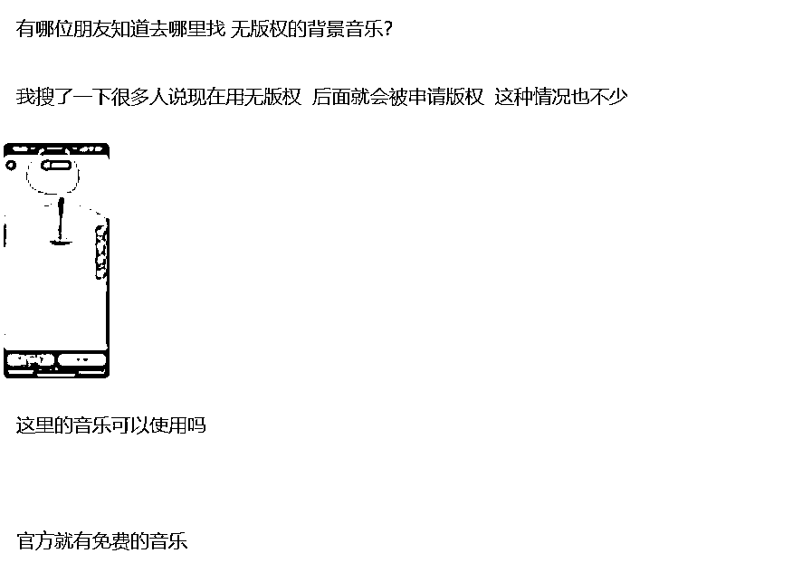

# 你的视频踩了音乐版权雷区，该删还是该换？
作者：龙哥

## 使用了有版权背景乐的视频，到底怎么处理最稳妥

作者： 书情小跟班

日期：2024-12-09

先设想一个很常见的困境。

你已经发布了一条带背景音乐的视频，目前后台风平浪静，没有任何提示。但后来你才查到，这段音乐其实受版权保护。

这时候心里就会打鼓：要是有一天真的来了一条版权主张，我只要把音乐换掉或者静音就行了吗？还是说干脆把整支视频下线更保险？

先把一个说法理清。大家常说的“版权警告”，在平台语境里更专业的叫法是“版权主张”。关于这个机制，我在《油管公式》里第一部分平台篇，YouTube 生态系统章节专门提到过版权问题，有兴趣可以回头细看，会对整个逻辑更清晰。

回到核心判断。发现音乐有版权，其实不用等到事后才处理。除非那首歌已经过了保护期限进入公共领域，否则它始终就是有版权的。我们现在频繁使用的 Creative Commons 知识共享许可，重点就在于“许可”，它代表版权方允许在特定条件下免费使用，并不等于音乐本身没有版权。

所以“免费”和“无版权”完全是两码事。市场上存在既免费又无版权的音乐，也存在免费但仍有版权的音乐，而绝大多数商业音乐都是有版权且不免费的。

安全的做法只有一个：对版权来源不确定的音乐，保持怀疑。默认它是有版权的，直接选用那些明确标识为免版权，或虽然有版权但已获得免费使用授权的曲目。

一旦确定音乐受版权保护，正常逻辑就是需要付费取得授权。如果这首歌被收录进了 YouTube 的版权库，系统在你上传时就有可能匹配命中，直接生成版权主张。

版权主张发生后，最常见的处理结果是，这条视频产生的广告收益会全部转给版权方。更严格的情况是，版权方不收钱但要求限制播放范围。最极端的情况是，你已经靠这段侵权音乐赚到了可观的商业利益，对方就会跳过平台主张，直接走法律途径起诉索赔。比如你用这段音乐剪了一个广告片，赚了 500 万，对方完全可以向法院主张侵权赔偿。

说回平台主张的时间点。一种情况是上传时就被系统识别，立刻出现主张；另一种情况是像你现在这样，上传时一切正常，后续才被发现。当这是一段非免费的版权音乐时，迟早有被主张的风险。

这里有个时间差很关键。主张生效前的收益，原则上归你；主张生效后的收益，就会归版权方。

很多人会问，如果视频已经赚得不多，能不能事后把音乐替换掉或者静音来解决问题。

理论上，如果平台提供了“在线替换音乐”的功能，你确实可以操作。但这个功能并非所有视频都支持。当背景音乐和人声解说高度重合，系统往往会判定无法替换。

更重要的是，即便能替换，也存在隐性损失。替换前视频可能稳定产生收益，替换后算法可能重新评估，推荐量和播放量出现断崖式下跌。虽然不一定每次都会发生，但这种风险真实存在。

从长远看，事后补救不如事前规避。用版权清晰、授权明确的音乐，一劳永逸，避免后续的收益分割、限制播放甚至法律风险。

当然刚起步的创作者可能对这些规则并不敏感。

如果你真的收到了主张，你有两条路可选：接受主张，把收益让给版权方；或者直接删除视频。两种选择都合理，看你对这条内容的价值判断。

最后说一个例外策略。如果你一开始就是冲着蹭热门版权音乐的流量去的，目的就是借势涨粉，那也是一种主动选择。主张来了就配合，把钱让出去，换来的是曝光和粉丝增长。简单说就是借别人的版权赚钱，给对方做宣传，自己拿流量。这种打法可以，但属于高风险高回报。

我的核心建议依然不变：用版权清晰的音乐，少踩坑。

* * *

评论区：

酷拉皮卡 : 请问，不是开通以后官方会优先分一部分收益给版权方吗？是全部啊？[发呆]

书情小跟班 : 音乐版权是别人的，难道音乐版权的收益不是别人的？