# 弱者翻盘的真相：所有胜局都是在更高维度上变强

## 以弱胜强只是表象，真正的底层是变强后碾压

作者： 兰陵王

日期：2024-12-02

​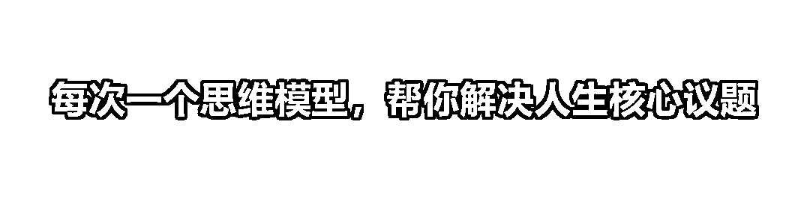

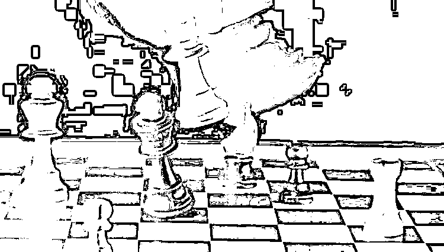

**我们看到的每一场以弱胜强，本质都是以强胜弱。**

这是兵家铁律，也是商战铁律。

大四那年我开始拆解竞争，归纳出四套打法：深耕细作、与众不同、错位竞争、做成第一。用这套思路，我在学习方法赛道扎根下来，成为那个赛道里的小巨头。

当时我还没有“生态位”这个词。

毕业后才接触到生物学，生态位这个概念一出来，立刻把我过去的四套打法串成了一条线，看似豁然开朗。

后来我才意识到，生态位并不是竞争的根，它只是自然选择下物种为了活下去摸索出来的**最优策略**。

最优解不是真理，它是一种现象，一种做法，一种方法论，只不过是生命给出的解法。

生态位到底指向什么？

一次偶然的机会，我读到兵法，答案很直接——**以强胜弱**。

兵法研究的就是“如何赢”的本质，它贯通战场与商业。

这篇文章就聊聊，兵法的内核是什么？能给我们什么启发？赢的本质是什么？竞争的本质又是什么？

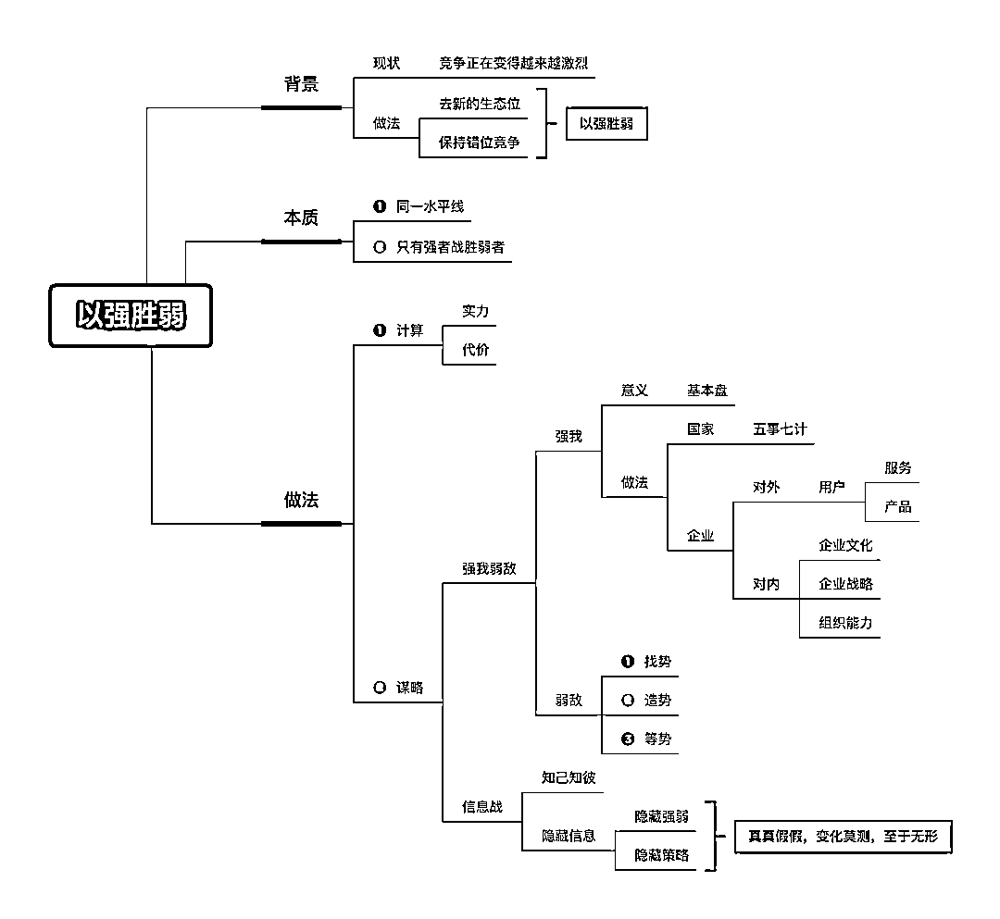

## **竞争在加剧，人该怎么活**

最近几年“内卷”成了高频词。

它形容的是一种劣质竞争：大家都更拼了，社会整体产出却没涨。典型就是昔日的教培行业，学生补课后成绩可能提升，但录取名额不变，从考大学这个结果看，收益是零，这就是卷。

但把内卷等同于所有竞争是片面的。

我们今天很多竞争是良性的，它逼着企业进化，提升整体效率。

明白归明白，焦虑仍在。

**因为竞争确实在变烈，活下去的难度在变大。**

**  **

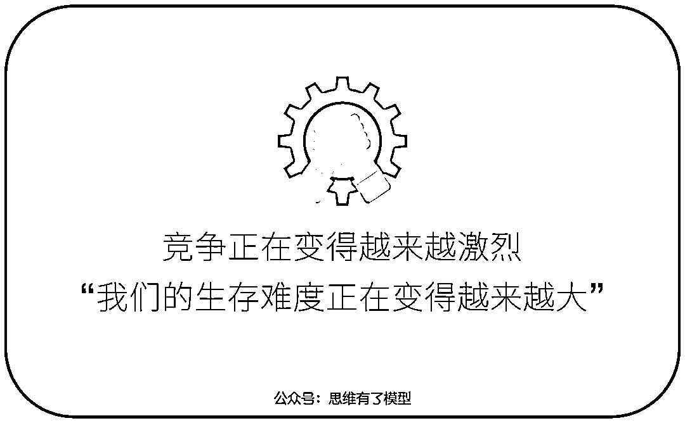

为什么会这样？

这不是谁故意设计的，是演化的自然结果。每个人都在求生求好，合力就把局面推向了这一步。

更棘手的是，这条曲线似乎**不可逆**。

未来竞争只会更凶，除非出现新资源、新能源、新宜居星球这类全新赛道。只要资源有限，争夺就永远存在，这是铁规律。

有点像递弱代偿。

竞争越激烈，活得越难；想守住优势，就得提升能力；能力普遍提升后，竞争又更激烈，难度再上升；难度上升又倒逼能力再提升……

**……**

你看，这是一个死循环，无解。

所以竞争只会越来越激烈，这是一条单向路。

那怎么办？两条方向：

**1、人类的层面：** 必须开拓新生态位，比如清洁能源、火星移民、深空探索。竞争的根在资源有限，就要从源头破局。

**2、个体的层面：** 别扎堆硬刚。每个人去找自己的生态位，做错位竞争，能有效降低个人压力。

针对个人生存与竞争，我后续写过《成为第一》、《深耕细作》、《与众不同》、《生态位》这些思考。

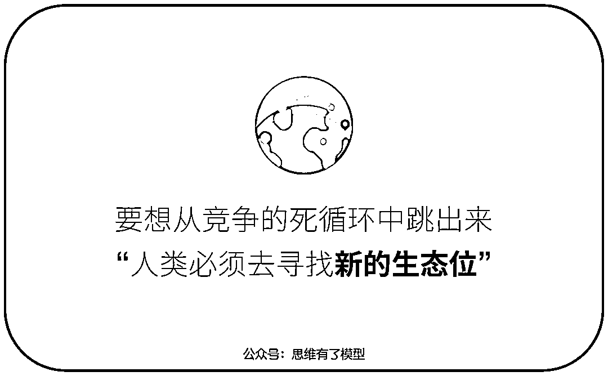

但我慢慢发现，错位、生态位这些，只是竞争的工具箱之一。

竞争的内核在兵法里，孙子两千五百年前已给注解，藏在《孙子兵法》里。

答案就是**「以强胜弱」**。

## **竞争的本质，就是把自己做到更强去赢**

世界上根本没有纯粹的以弱胜强。

**因为所有看似以弱胜强的案例，内核都是以强胜弱。**

人们爱看弱者逆袭的传奇，赤壁、官渡、巨鹿，谈笑间樯橹灰飞烟灭，很过瘾。

可惜，历史上找不到真正意义上的以弱胜强，逻辑上，生命史上也不存在。

**所有被称作以弱胜强的事，逻辑上都是以强胜弱。**

我的推演很简单：

假设A和B两股力量，A大于B，两者在同一赛道正面碰撞，谁会赢？

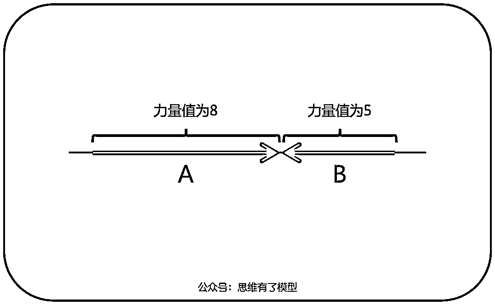

答案显而易见：A赢。

那历史上那些弱胜强的案例是怎么来的？

**关键在于弱者找到了或制造了一个新“势”。在这个势所决定的维度上，弱者比强者更强，所以弱者实则为强者而胜。**

看两个经典：

**1、官渡之战**

兵力对比：曹操两万，袁绍十一万。

损失对比：曹操八千，袁绍十万。

数字上是典型的以弱胜强，但真的弱吗？

**曹操强的点：**

**①兵力集中：** 不分兵扼守黄河南岸，而是集中兵力卡住要道，以逸待劳，后发制人。类似企业的深耕细作。

**②正当性：** 挟天子以令诸侯，名义占优。像正规企业打灰产。

**③情报优势：** 许攸投奔，带入情报与计策，曹操偷袭乌巢，断袁绍粮道。

**④将才归附：** 张郃、高览闻讯投降。

**⑤声东击西：** 分散袁绍兵力，致使颜良被斩，袁军崩溃。类似企业的错位竞争，我聚焦，你分散。

**袁绍弱的点：**

**①决断无能：** 决策屡失，沮授的良策被一再否决。像资本充足但创始人失能的企业。

**②人才流失：** 许攸带走机密，张郃、高览投敌。

**③主将阵亡：** 颜良、文丑、淳于琼相继被灭。

**④补给中断：** 乌巢被烧，粮草断绝。

**⑤军心瓦解：** 连败、断粮、将领叛逃，士气跌到谷底。

……

由此可见，兵力不是强弱的唯一标尺。

企业也一样，不能只看资本，创始人、战略、组织力、产品、服务都在里面。曹操兵力少，但在综合维度全面占优。

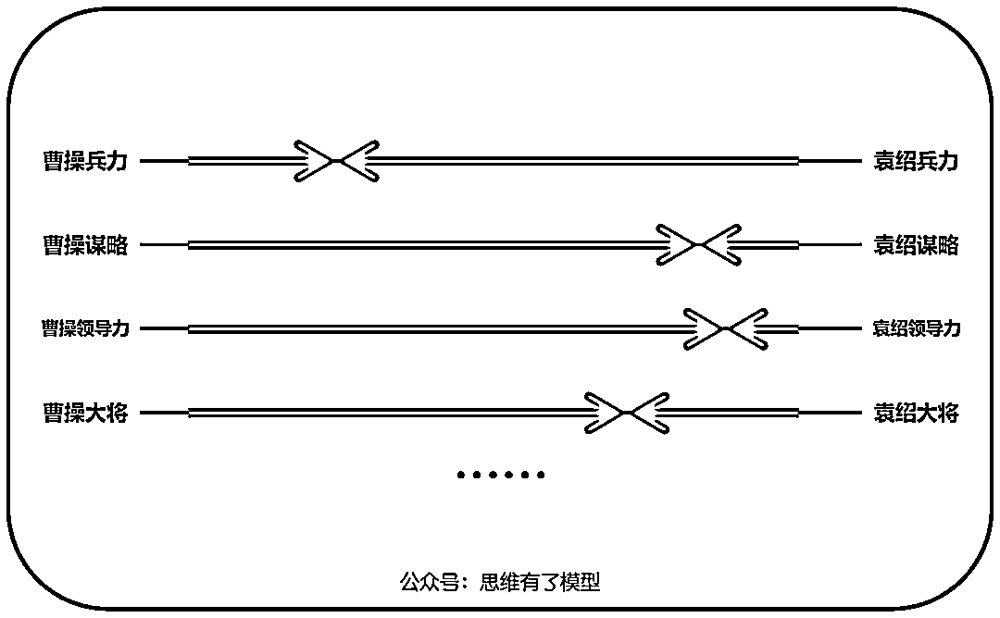

**2、赤壁之战**

兵力对比：孙刘五万，曹操二十万。

伤亡：曹军战死数万，病死十余万。

**孙刘强的面：**

**①以逸待劳：** 孙权部队休整充分，体力完胜长途跋涉的曹军。

**②地利：** 水战熟悉，长江天险加持，为火攻创造条件。

**③信息差：** 曹操熟读兵法却不懂当地气候，周瑜清楚洞庭湖一带会起东南风，信息占优。

**曹操弱的面：**

**①舟车疲惫：** 远征征战，体力透支。

**②水土不服：** 正值瘟疫，北方军不适应，死伤大半。类似健康是根本。

**③磨合不足：** 新收编刘表部七八万人，未经磨合即上阵，心存疑虑。

**④水战不熟：** 北军不善舟行。

**⑤士气低落：** 连战不利、船被烧、疫病、饥寒，信心崩塌。

综合来看，曹操看似庞大，实则多处虚胖。周瑜识破其虚弱，信息与谋略进一步失衡。

核心仍是，强弱不是兵力一项，也不是主帅一人的谋略。

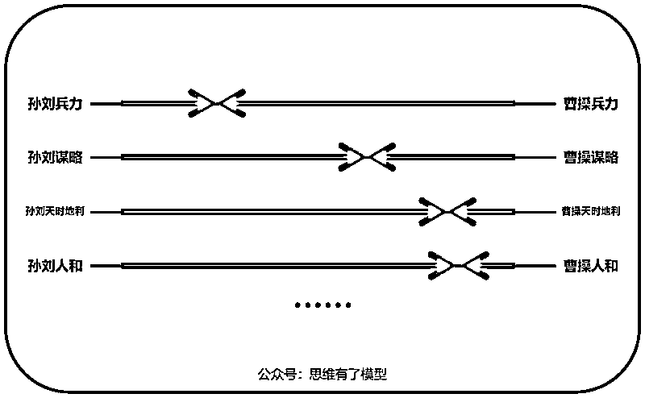

所以曹操官渡胜、孙刘赤壁胜，看起来弱胜强，实则是强胜弱。

**而且这种强，有的是天生具备，有的是靠谋略制造出来的。**

比如曹操声东击西分散袁绍兵力，以强击弱；孙权用诈降、火攻、借东南风焚毁战船。

这就是胜利的本质**「以强胜弱」**。

它在逻辑上无懈可击，是不证自明的公理。

回到前面那张图：

**  **

**在同一水平线上，不可能出现弱者取胜。若有人赢了，那他就是强的那一方。**

这就是逻辑，这是宇宙法则。

没有这条法则，强弱将失去意义，世界会乱套。

再想想逻辑的重要性。西方哲学家甚至认为，只有逻辑才是绝对真实的。感官会骗人，眼见未必为实。

**只有逻辑能抵达真理。**

西方演绎思维的核心是，必须从绝对正确的起点出发。起点如何保证？靠逻辑。

以正确的逻辑为起点，才能得到稳固的演绎。

比如**「在同一平面，两点之间线段最短」**，就是绝对正确的起点。

从这样的起点推演，才能建立稳固的知识体系，否则数学错了，建筑、航天都会崩塌。

「以强胜弱」就是类似欧几里得公理的逻辑，而且被孙子、曹操反复验证，具有极强的现实性。

它不仅适用于战场，也适用于商业竞争；不仅适用于地球，也适用于星际对抗。总之，所有对抗都遵循这条法则。

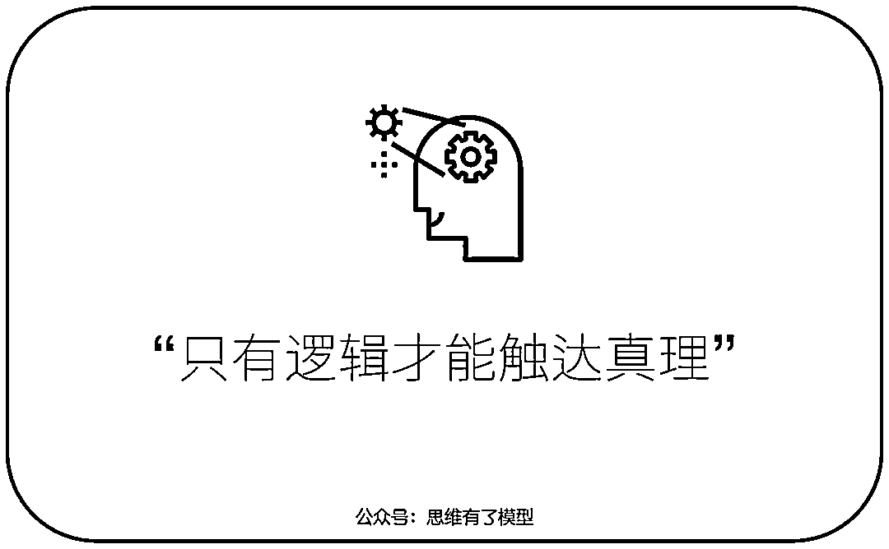

但前面那段逻辑有个前提**「同一水平线」**。

**现实里很难找到完全同线对抗的力量，力量往往分散在多个维度。**

此时第一原理还有意义吗？

更有意义，它是所有延伸的基础，掌握它就能解决相关问题。

比如现实中为何会出现“以弱胜强”？

**因为弱者找到了或制造了一种新势，这就是一条新水平线。在这条线上，弱者变强，强者变弱，于是“逆袭”发生了。**

但本质仍是以强胜弱，只是换了赛道。

声东击西就是典型：

正面硬碰必败，因为在这条线上对方更强。

怎么做？分散敌人力量，各个击破。正面打不赢，先把对方力量拆散，再在新的维度上打击其软肋。这条新线上我更强，就能赢。

**归根到底，还是以强胜弱。**

**  **

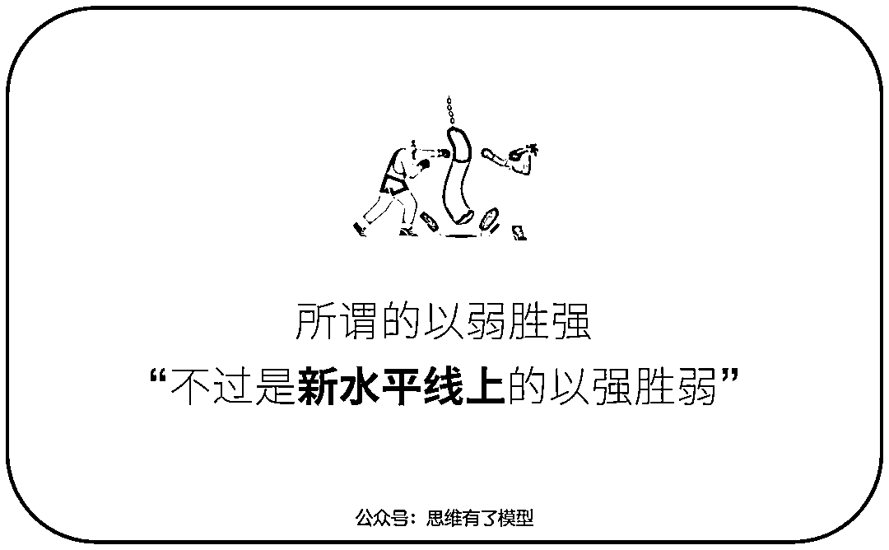

这就是战胜的本质，也是《孙子兵法》的核心。

《孙子兵法》开篇讲“计”，这里的计不是计谋，而是**计算**。

算什么？算双方的力量是否满足以强胜弱的条件，满足才打，不满足绝不打。

当然也可以打，但怎么打？靠谋，通过谋略创造出以强胜弱的条件。

注意，即使是谋，也要算。谋后计算仍不满足，那就不能打，要等条件成熟。

所以《孙子兵法》不是奇技淫巧的集合，打是最次的，谋在其次，核心是计算，计算是否满足以强胜弱。

这就是**「先胜而后战」**。

意思很清楚：先把自己做到强，条件具备了再开战。

孙子的智慧在于，他不仅是军事家，更是逻辑学家。他看透了**逻辑上根本不存在以弱胜强，开战前有强弱，开战时一定是强胜弱，这是自然铁律**。

所以，必须先满足以强胜弱的条件再战。

此谓先胜而后战。

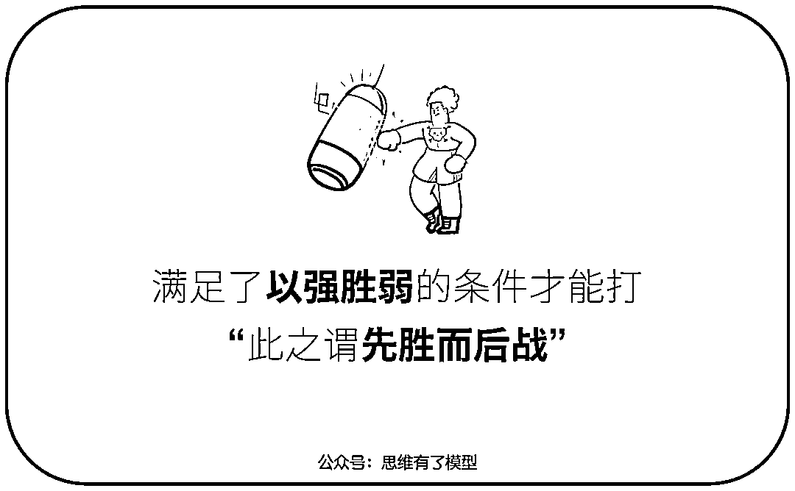

太精彩了。

建议用模型树去细读《孙子兵法》，思想极深刻，对今天极有启发。

正如英国战略家李德哈特的评价：

**世上只有两部军事战略著作超越一切，就是《孙子兵法》和克劳塞维茨的《战争论》，而《战争论》与《孙子兵法》相比，已显过时。——英国著名战略家李德哈特**

## **怎么做到以强胜弱**

那么，如何才能做到以强胜弱？

如果我现在不够强，怎么赢过他？

如果我已是第一，如何守住这个位置？

先说那条最底层的逻辑：**“在同一条水平线上，强者赢，弱者输，没有第二种可能。”**

把这句话焊死在脑子里，后面的一切都好办了。

想赢，本质上就一件事——在各个维度里，想办法让自己成为更强的那个。

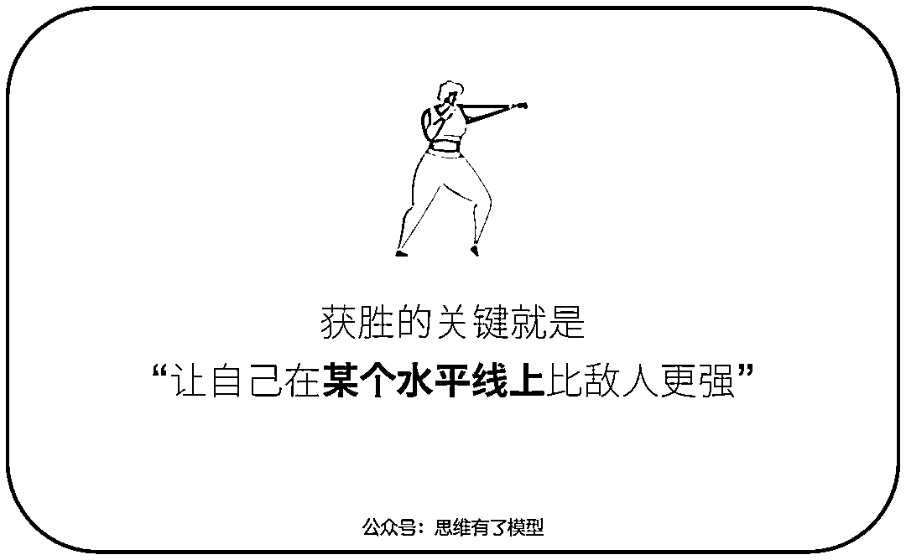

但《孙子兵法》的高明之处在于，它告诉你，“谋”之前还有一道工序，叫“计”。

### 一、计

我们总说“计谋”，好像是一回事。但在孙子那里，“计”是“计”，“谋”是“谋”，两码事。

《孙子兵法》开篇就在讲“计”。这里的“计”，不是诡计，而是**计算**。

算什么呢？把你和对手的力量摆到桌面上，逐一核算，看能不能凑成“我强敌弱”的局面。能凑成，才动手；凑不成，坚决不动。

也不是说完全不能动，想动，就得靠后面的“谋”——用策略制造出以强胜弱的条件。

但哪怕你谋了，还是要回头再算一遍。算完之后发现还是干不过，照样不能打。只有“以强胜弱”真正成立，才有出手的资格。

**所以，“计”是谋的前提，更是打的前提。**

别瞎谋，更别莽撞地冲上去。先把敌我双方的局势摸清楚再说。

“知己知彼，百战不殆”的真正含义不是说你了解对方就一定能赢，而是说，你了解完之后，能判断出这场仗到底能不能打。能打就打，不能打就撤，这样你就永远不会输。

孙子把这层意思浓缩成了五个字：**“先胜而后战”**。

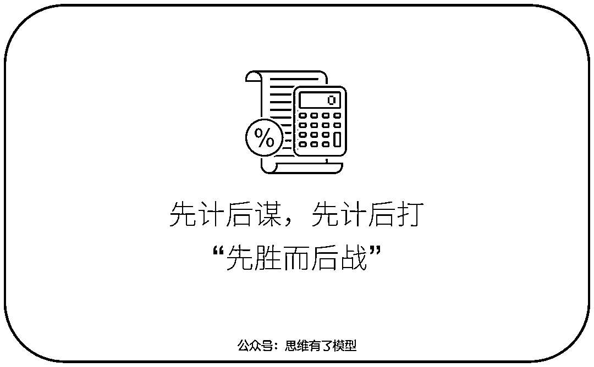

那怎样才算“先胜”？靠的就是“计”，把双方的实力算清楚。

**1、计算实力**

但这个算，不是乱算。你得始终盯着那条第一原理：**“同一水平线上，强的赢弱的。”**

所以，你首先要看清，对方到底存在**多少条水平线**。

赤壁之战，周瑜就没把目光锁在兵力一条线上。他看天时、看地利、看人和，各种维度都扫了一遍。

这就是周瑜和那些劝孙权投降的大臣的区别。别人只盯着“兵力悬殊”这一条线，周瑜却看见曹操在兵力之外的软肋。

他在别的水平线上，找到了自己可以“以强胜弱”的机会。

真正优秀的军师，强就强在能看到别人看不见的维度。

有了这个基础，你才有资格谈强弱对比。

**请记住：所有脱离水平线去谈强弱的行为，都是耍流氓。**

放到今天的商业战场上，就是要看遍对方的每一个生态位——领导人、组织架构、战略方向、产品力、服务水平、品牌势能、资本储备、供应链、渠道网络……一个都不能少。

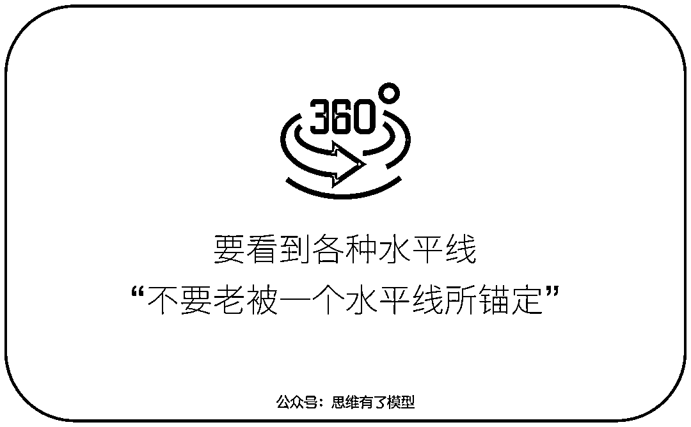

看清楚之后，再逐条判断对手在每条水平线上的强弱，这就是孙子说的**“虚实”**。

只要对方在某条或某几条线上比你弱，你就能从这里切进去，实现以强胜弱。

这就是“避实击虚”：躲开对手的强项，专打他的软肋。

一句话总结：**计，就是把自己和对方放到每一条水平线上，看自己在哪些环节占了上风，哪些环节处于下风，然后从占上风的地方下手。**

那要是摸不清对手的虚实呢？

这就麻烦了。打仗这件事，信息就是命脉。信息不够、信息有误，判断必然跑偏，很容易演变成以弱打强。

所以《孙子兵法》也给了补救招数：先虚晃一枪，看对方怎么反应，再根据反应推测虚实。

拳击场上也常有人出虚拳，目的不是打人，是试探对方的反应，从而判断他的破绽。

另外，斥候和间谍也是常规动作。尤其间谍，一个好间谍的价值，绝不亚于一个好军师。

巧妇难为无米之炊，手里没有信息，再多谋略也使不出来。

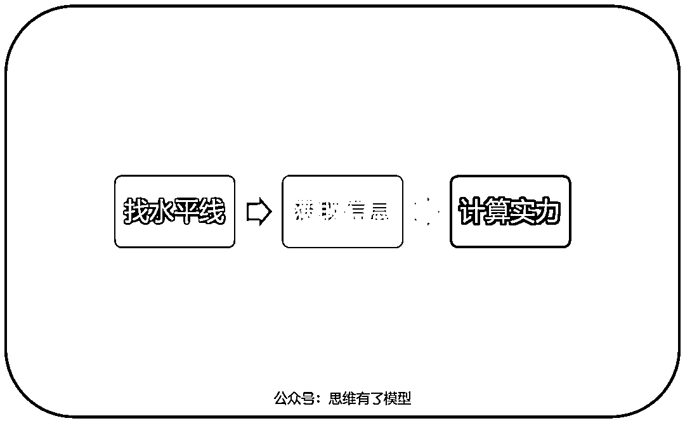

到此为止，是“计算实力”最关键的几点。但光算实力还不够，还得算另一笔账——代价。

**2、计算代价**

不是满足了“以强胜弱”就能打。

**你还要算代价。如果打赢要付出的远远大于收获，那这笔买卖就别做。**

古人讲“穷寇莫追”，为什么不追？你把人家逼到绝路，他连命都不要了，你硬去啃这块硬骨头，代价太大了。

但也不是绝不能追，得巧追。

东南西北给他留个口子，让他忙着逃命，消解掉跟敌人同归于尽的心思。等他跑累了、泄气了，再找个机会设计歼灭他。

总之，核心就一条：**想尽办法降低获胜的成本。**

这里面有一个很重要的原则，叫**求全思维**，孙子非常看重。

什么是求全？能不打就不打，**“不战而屈人之兵”才是上策**。

把对方的财产和人民都保存下来——人家投降了，他的财产就是你的财产，他的人民就是你的人民。与此同时，你自己的军队和财富也毫发无损。

项羽就不懂这个。打进城第一件事就是杀人放火，烧了阿房宫。《史记》里写“烧秦宫室，火三月不灭”，大火烧了整整三个月。泄一时之愤，败万年之局。

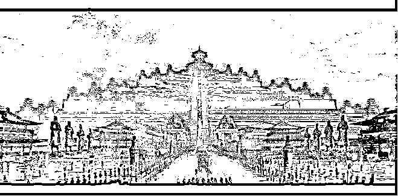

关于“计算代价”，核心就这些。

说穿了就是：不管用什么办法，把战争的损耗压到最低。代价太大，哪怕你占尽优势，也别轻易开打。

就算真要打，也尽量“求全”，最好能兵不血刃地让对方投降。

王阳明晚年就把这招用得极漂亮。每次剿匪前，先给匪徒写一封信，对方看完信，直接就降了。

这就是用兵的最高境界。

总结一下，“计”就两块：**算实力** + **算代价**。实力占优，代价可以接受，那就放心去打。

但如果条件不满足呢？那就要用到“谋”了。

### 二、谋

谋是什么？就是大家常说的谋略、计谋。

谋的核心，还是那四个字——**“以强胜弱”**。换句话说，就是找到或者制造一种势能，让自己在同一条水平线上盖过对方。

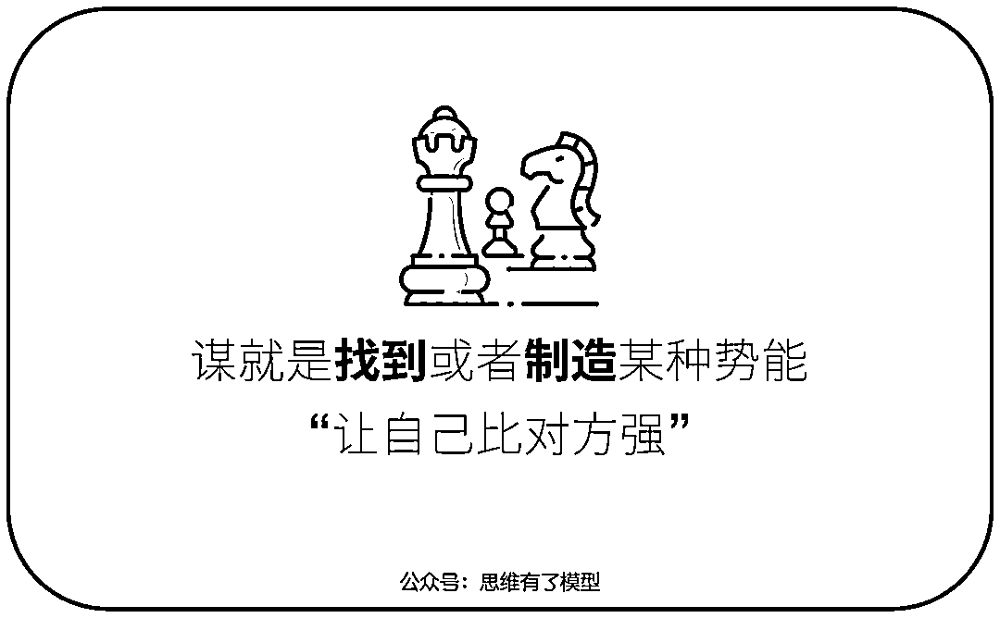

怎么做到？拆开看，就是两件事：**强我 + 弱敌**。

**1、强我**

强我是第一位的。说白了，就是守好“**基本盘**”，就是“**打铁还需自身硬**”。

很多人爱耍小聪明，沉迷于“虽然我实力不行，但我脑子好使”的错觉。

这是用兵的大忌。

越王勾践够聪明了吧？卧薪尝胆回到越国，也没敢立刻打吴国。为什么？实力不够啊。

这也是《孙子兵法》和《三十六计》的根本分歧。

《三十六计》那些花活，多数是“弱敌”之策，属于二流水平。什么是一流？一流的谋，是**先强我**——先把自己搞强，先站到不败之地上。

“昔之善战者，先为不可胜，以待敌之可胜。不可胜在己，可胜在敌。故善战者，能为不可胜，不能使敌之可胜。”——《孙子兵法》

这句话说白了：

**真正的高手，先把不败的局做出来。**

原因也很简单——你管得住自己，管不住别人。

管别人要天时地利人和，还要看概率；管自己却永远最容易。所以第一步永远是管好自己。

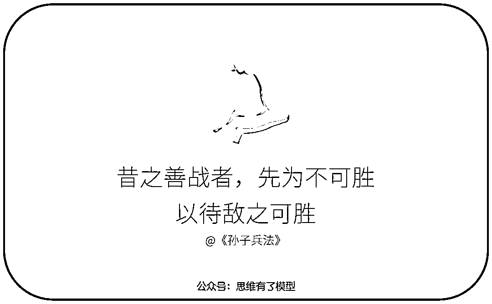

赤壁之战，曹操要是不让士兵得瘟疫，或者早一点摸清东南风的门道，历史怕是要彻底改写。

杜牧那句诗说得也直白：“东风不与周郎便，铜雀春深锁二乔。”没有那场东南风，铜雀台里就该多两个名字了。

所以孙子反复强调：**先让自己强大起来，这才是基本盘。**

“善战者，立于不败之地，而不失敌之败也。是故胜兵先胜而后求战，败兵先战而后求胜。”——《孙子兵法》

《道德经》讲的也是同一个道理：

“夫不争，则天下莫能与之争。”

这就是谋的基本盘——先强我，先让自己立于不败之地。

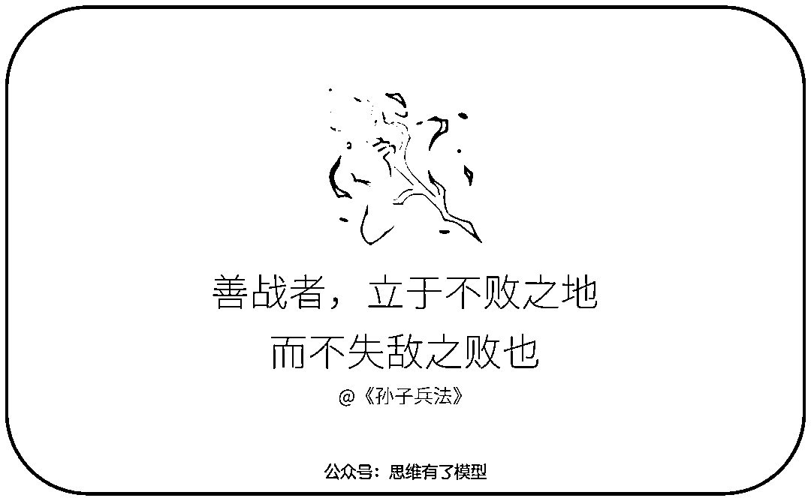

具体怎么强我？《孙子兵法》给的答案是**“五事七计”**：

“兵者，国之大事，死生之地，存亡之道，不可不察也。故经之以五事，校之以计而索其情：一曰道，二曰天，三曰地，四曰将，五曰法。道者，令民与上同意也，故可以与之死，可以与之生，而不畏危。天者，阴阳、寒暑、时制也。地者，远近、险易、广狭、死生也。将者，智、信、仁、勇、严也。法者，曲制、官道、主用也。凡此五者，将莫不闻，知之者胜，不知者不胜。故校之以计而索其情，曰：主孰有道？将孰有能？天地孰得？法令孰行？兵众孰强？士卒孰练？赏罚孰明？吾以此知胜负矣。”——《孙子兵法》

翻译过来就是：

道，是政治；天，是天时；地，是地利；将，是将帅；法，是法制。

主孰有道，看军民是否一心；将孰有能，看将帅有没有本事；天地孰得，看天时地利在谁那边；法令孰行，看纪律是否严明；兵众孰强，看谁兵力更强；士卒孰练，看谁的兵训练有素；赏罚孰明，看谁赏罚分明。

这就是孙子眼里的基本盘。放到今天，对应一个国家，就是**政治、经济、科技、军事、文化、教育**，把这些做实了，就能立于不败之地。

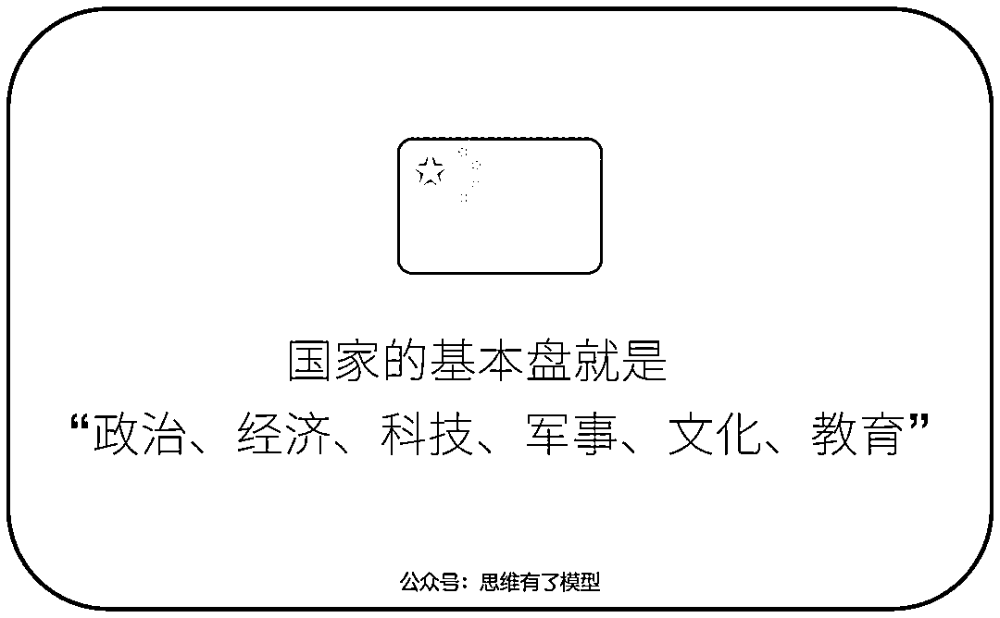

诸葛亮就是反例。政治和经济这两条命脉没搞定，阿斗扶不起硬要扶，六出祁山，劳民伤财，硬生生把蜀国拖垮了。司马懿骂他逆天而行，说白了就是没认清基本盘的底线。

基本盘不稳，再聪明都是空中楼阁。

放到企业身上，我觉得可以分成三大块：

**（1）对外：用户**

用户就是企业的“**道**”。

很多企业整天盯着竞争对手，这是大忌。企业的道是用户，不是对手。

那用户看什么？**产品**和**服务**。

有的公司是产品驱动，比如苹果；有的是服务驱动，比如海底捞。走哪条路都行，本质都是一样的。

但有些企业想歪了，以为营销万能。如果你的产品是个垃圾，营销越猛，只会让越多的人知道它是垃圾。

可口可乐常年以营销为主，那是因为可乐本身就是无敌的产品。这么多年来，没有任何产品能真正撼动它，可见产品本身就是深不见底的护城河。

在我眼里，营销只是产品的放大器。营销是一串0，产品是前面的1。没有那个1，后面再多0也没意义。

服务也同理。如果你的公司以服务为核心竞争力，那服务本身就是你的产品。

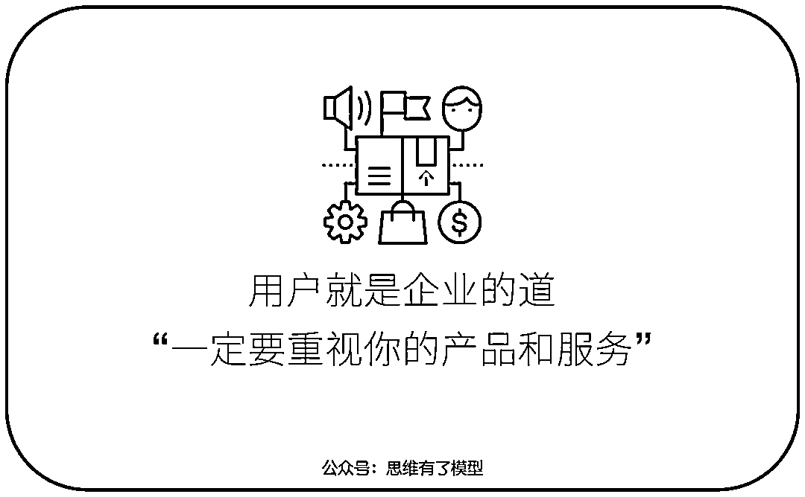

**（2）对内**

对内这摊事更复杂，涉及企业的方方面面。

比较核心的有这几个：

**企业文化：** 决定凝聚力和企图心，相当于国家的政治。

**组织能力：** 包括管理、制度等，对应孙子说的法令孰行、兵众孰强、士卒孰练、赏罚孰明。当然，现代管理学比这精细多了。

**企业战略：** 核心是生态位，决定你做什么、不做什么，是一切的根基。

**企业创始人：** 精神领袖，战略制定者，相当于军队里的将帅。

**（3）时机**

时机拆开看，也有三层：时代趋势、国家政策、欲望发展。

**时代趋势：** 理论在迭代——牛顿力学、电磁学、相对论、量子力学；技术在迭代——蒸汽机、电、计算机、手机、互联网。

**国家政策：** 改革开放、碳中和，都算。

**欲望发展：** 人对美好生活的追求，对懒惰、快乐、速度的追求。从书籍到碎片化文章，再到短视频、虚拟现实，这是一条清晰的欲望进化线——人永远在追逐更快更强的刺激。

时机这东西，早一步不行，晚一步不行，必须刚刚好。

贾跃亭当年提出来的很多概念后来都应验了，但他提得太早，时机没到，硬生生给拖垮了。

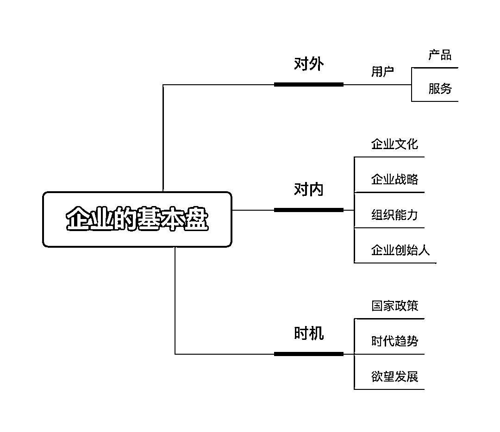

当然，他的失败也离不开“贪”。做的东西太杂，没有一块深耕细作的。要是专注做好一件事，乐视未必不能成为一家伟大的公司。

这就是“强我”的另一个超级关键点——**“深耕细作”**。

《孙子兵法》管这个叫**“集中兵力”**。毛主席当年也讲过一句特别像的军事战略：**“集中优势兵力打歼灭战”**。

为什么深耕细作这么重要？

别忘了前面那句：脱离“同一水平线”谈“强弱”，都是耍流氓。

**哪怕你整体实力很强，但只要力量被摊薄，放到每一条水平线上，你都有可能变成那个更弱的人。敌人一个一个击破，最后你会输得干干净净。**

乐视就是最好的反面教材。

**所以，力量必须集中，这是你变强的前提。**

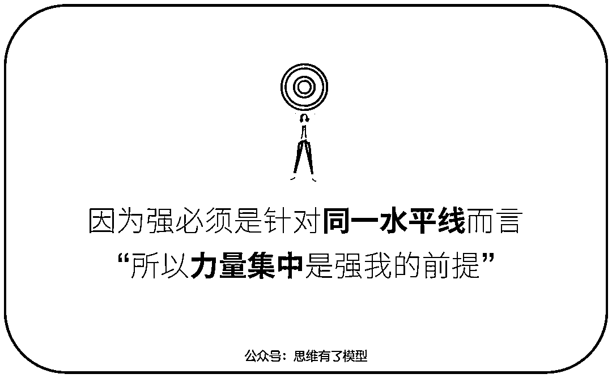

放到企业身上，就是要找准自己的生态位，在里面深耕细作，把护城河越垒越高。

护城河可以是规模优势、先发优势、主场优势、渠道优势、经验优势……只要你一直在这条路上挖，这些优势会越攒越多。

这些优势，这些护城河，就是你立于不败之地的底气。

放到个人身上也一样。一定要找到自己的生态位，然后一头扎进去，日积月累。

千万别“这里干一下，那里干一下”，到头来最可能的结局就是四个字：一事无成。

**2、弱敌**

强我说完了，来聊“弱敌”——很多人最爱听的部分。

先给一条原则：**“不管你强还是弱，都要想办法削弱敌人。”**

为什么？**因为我们要尽量降低获胜的成本。**

我小时候不懂这个理。为了在同龄人面前装硬汉，打架时老爱用拳头硬碰别人的拳头，自以为很勇，其实就是个大冤种。

李叫兽从小就明白这事。他说过：“打架的第一原理，是拿自己最硬的地方打别人最软的地方。”

你看，人家小时候就懂了《孙子兵法》。

强者要弱敌；弱者更要弱敌——当然，前提是“强我”的基本盘不能丢。你本来就比对手弱，再不设法削弱他，就真的一点赢面都没有了。

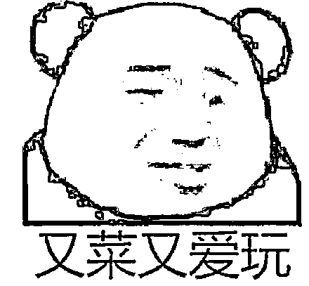

那怎么弱敌？我把它拆成三种：找势、造势、等势。

**（1）找势**

找势，就是找“**我强敌弱**”的那个点。

翻译成兵法语言，就是**“避实击虚”**——找到对手的破绽。

“夫兵形象水，水之形，避高而趋下；兵之形，避实而击虚。”——《孙子兵法》

水是往低处流的，打仗是朝敌人软处打的。

《虚实篇》是《孙子兵法》里特别核心的一篇，一定要反复读。

唐太宗李世民对它评价极高：

“朕观诸兵书，无出孙武。孙武十三篇，无出虚实。夫用兵，识虚实之势，则无不胜焉。”

说白了：兵法书里最好的，是孙子那十三篇；十三篇里最狠的，是虚实。只要你能看清虚实之势，就没有打不赢的仗。

所以，用兵的第一原理就三个字：**以强击弱**。

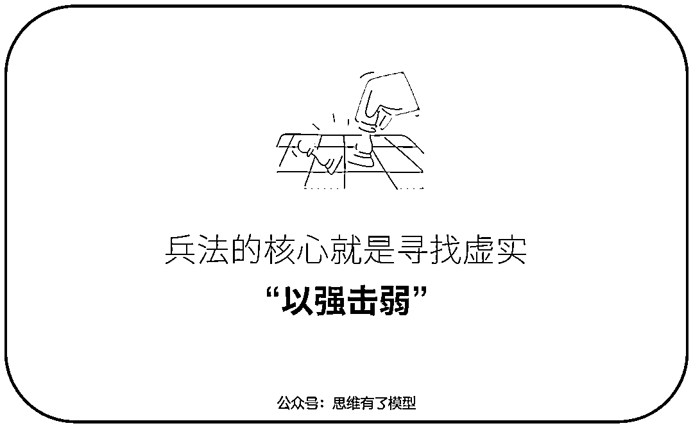

《三体》为什么那么燃？因为罗辑他们在一场看起来毫无胜算的对决中，硬是摸到了敌人的虚实，在一条全新的水平线上完成了以强胜弱。

三体人有什么弱点？

第一，不会撒谎；第二，对宇宙社会学的洞察不比地球人高明；第三，在歌者文明面前，三体人和地球人同命相连，没有区别。

就靠这三点，罗辑们把战场从“拼科技”这条线拉到“拼宇宙社会学洞察”这条新线上，完成了一次悬殊到绝望的“以弱胜强”。

真的漂亮。

不过，“以强击弱”本身不算秘密，懂兵法的人都懂。难的是——怎么准确找到敌人的软肋。

前面提过几种方法：火力侦察，虚晃一枪看反应；斥候，派探子摸情报；间谍，直接打入内部拿一手消息。

冷兵器时代靠这些手段。到了现代战争，基本就是拼科技了。二战时图灵靠计算机破译了德军大量情报，为盟军胜利立下头功——这就是现代信息战的雏形。

放到商业竞争里，我觉得创始人的认知极其值钱。

你要是能洞悉人性、看透商业本质，就能顺着对手的业务布局，一眼戳中他的死穴。

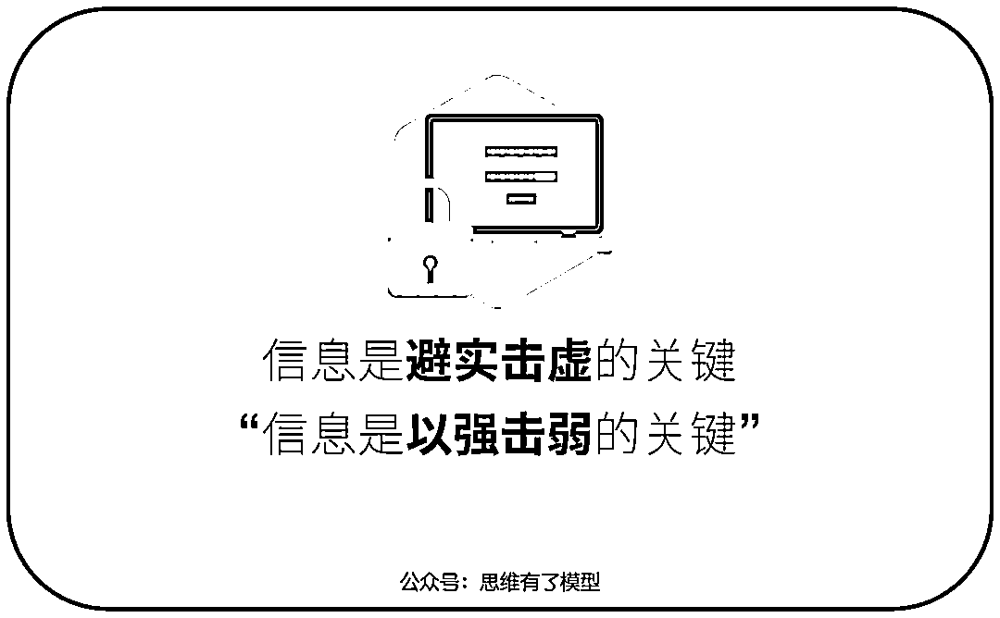

当然，竞争要良性，别碰违法的事。

什么是良性竞争？我给一条计策——**“错位竞争”**。

现在大家天天说错位竞争，什么意思？

说白了就是《孙子兵法》里的“避实击虚”。看清对手的生态位，哪些地方是实的，哪些地方是虚的，然后避开他的实，拿他的虚当自己的生态位。这就叫错位竞争！

举个例子：

京东就是典型的错位竞争。淘宝早期什么都做，鱼龙混杂，品质没保障。品质没保障就是淘宝的虚、它的软肋。

刘强东精准抓住这一点，做自营。就这一招，从淘宝手里抢走了大量看重品质的用户。

黄峥如法炮制，做拼团，抢走了淘宝上追求性价比的用户。

当然，这也不能全怪淘宝贪。它是最强者，最强者的天性就是占据最肥的生态位。但它的宿命就是四面受敌，被不同的对手一台一台拆掉。

现在“得物、唯品会、小红书、抖音”等平台，也都对电商虎视眈眈。

**我个人的观察是：商业的天花板永远在往下细分。市场不断细分、玩家不断深耕、后来者不断另辟蹊径。**

这是大势所趋。

因为后来者只有用这个打法，才能对强者完成颠覆式创新。

所以，先来者，最强者，你必须学会自己革自己的命，自己颠覆自己，自己去分化新公司、做新市场。

李善友教授把这叫“边缘创新”。我觉得本质上不用说得那么玄——**不过是在新的水平线上，对大公司完成一次“以强胜弱”罢了。**

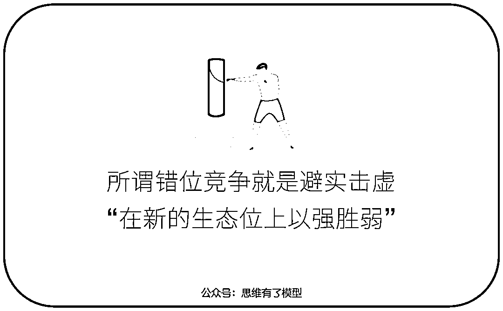

OK，找势的部分讲完了。

但如果你已经想尽办法，还是找不到敌人的弱点呢？

又或者，找到了弱点，可对方就算弱，也还是比你强？

那就得造势了。

**（2）造势**

如果说找势是被动的、佛系的弱敌，那造势就是主动出击的弱敌。

什么是造势？

**用尽所有手段，去制造一种势能，让“我强敌弱”在这股势能下成立。**

造势具体有两个方向：

1. **削弱敌人的整体实力**

2. **分散敌人的整体实力**

制胜的第一性原理，不是硬碰硬，而是制造局部碾压。更进一步说，碾压多半靠情报差实现：对方看不清你的底牌，你却能洞见其破绽。下面我把这条法则拆开来看。

### 一、先剪除对方的优势

**消耗。** 你提前到达战场休整，等赶路者疲惫后再动手；或战术骚扰，让对方连安稳觉都睡不上。军事家总结过十六字心得：他进我退，他驻我扰，他疲我打，他退我追。核心始终是，不让对方舒服。

**断指。** 用离间计拆掉谋士与将领的信任，或直接斩其主帅。汉楚相争时，项王团队内部分崩离析；官渡前线，关公快马取了颜良首级，大军顿时失了主心骨。商业上则表现为挖角，把核心技术骨干全部带走。

**麻痹。** 重复刺激会让人习惯。隋朝一位将领在江北频繁调动部队，大张旗鼓，陈国起初如临大敌，后来见多了，只当是日常惯例。等到真正渡江那天，陈军几乎没有反应，南徐州就这样易主。警惕性就是这么被“习惯”磨平的。

**引蛇出洞。** 若对方占据险要，正面强攻毫无胜算，那就打他舍不得丢的地方，逼他离开有利位置。好比游戏里，趁敌人抱团推进时偷家，他只能回头救援，阵型随即露出破绽。

**磨锐气。** 两军初遇，士气最盛，曹刿主张等对方再三擂鼓后再追击。对于败逃之敌，也别把活路堵死，否则他会拼死反扑；留一道口子让他逃，待其跑散跑疲，再收网。兵法讲得明白，正在退兵的部队别硬拦。经商同样要留余地，逼急了伙伴反而双输。

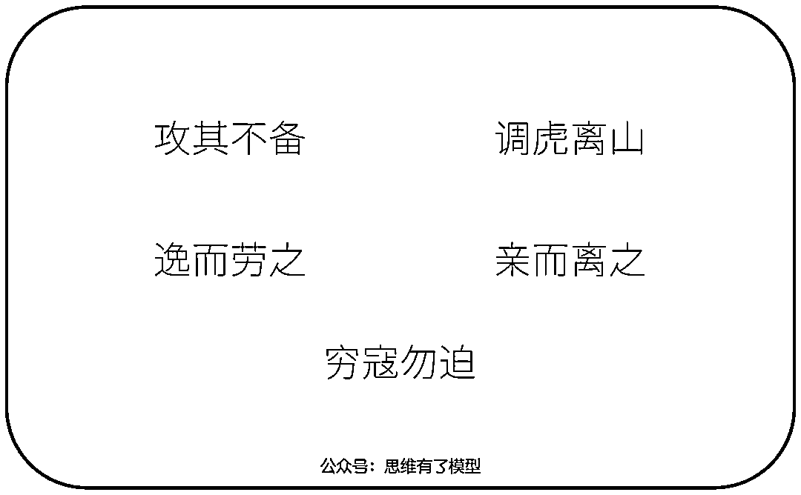

以上是减法，接下来还有更高级的拆解。

### 二、拆分对方的力量

胜负不取决于总量，而取决于同一根赛道上的相对强。哪怕敌方总体储备更厚，只要他无法集中投入，你就能汇拢所有火力，打穿他最薄弱的一点。商战中的说法，叫差异化角逐。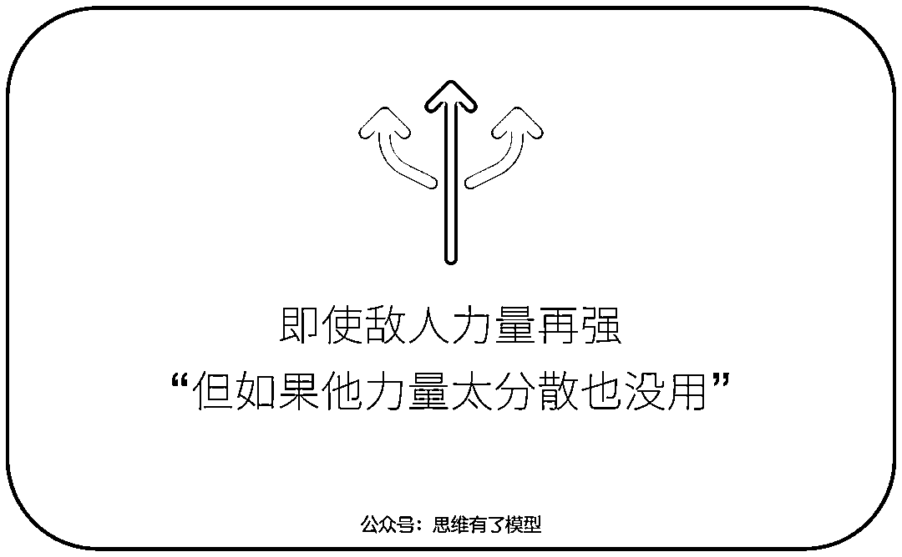

经典案例是齐国公子与君王赛马。公子的三匹坐骑都逊一筹，正常比注定全输。谋士献计：用第三档马去顶对方第一档，先弃一场；再用第一档对第二档，第二档对第三档，连胜两场。规则限定每局只能由一位选手出场，恰好把对方的整体优势切成三段，使我方两次形成局部压制。差异化角逐的本质，就是制造这种“赛道上的错位”。

商业中还有两个相近说法：边缘革命与新增长线，内核与此同源。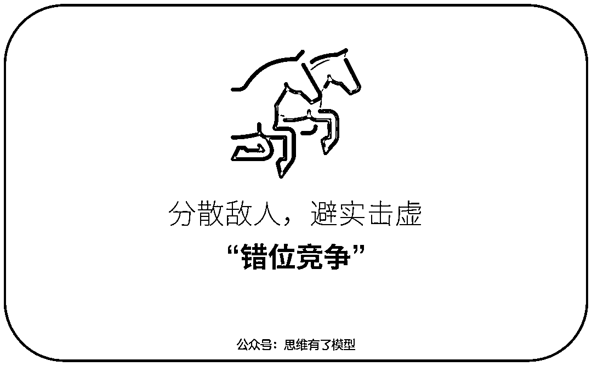

可惜人性贪婪，总想四处下注，结果每条线都平庸。与其等别人来拆，不如先把自己拆了。所以真正要紧的是：让对方散开，让我方聚拢。假若对方也聚拢呢？那便虚攻甲处、实取乙处，或围住他要害逼其分兵，再乘虚而入。具体典故不再展开，有兴趣者可自行查阅。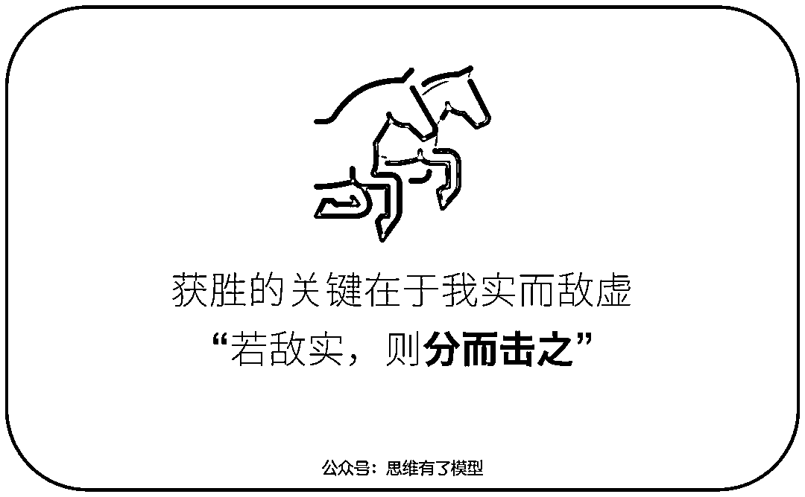

### 三、等势的智慧

削弱与拆解之后，还差一个“等”字。时机未到便抢跑，往往前功尽弃。

**等自己强起来。** 积累需要时间，总想找速成秘籍，却不肯打磨基本功，注定成不了事。越国君主忍辱负重十年，才攒下复国本钱。成大事者，必须熬得住漫长的准备期。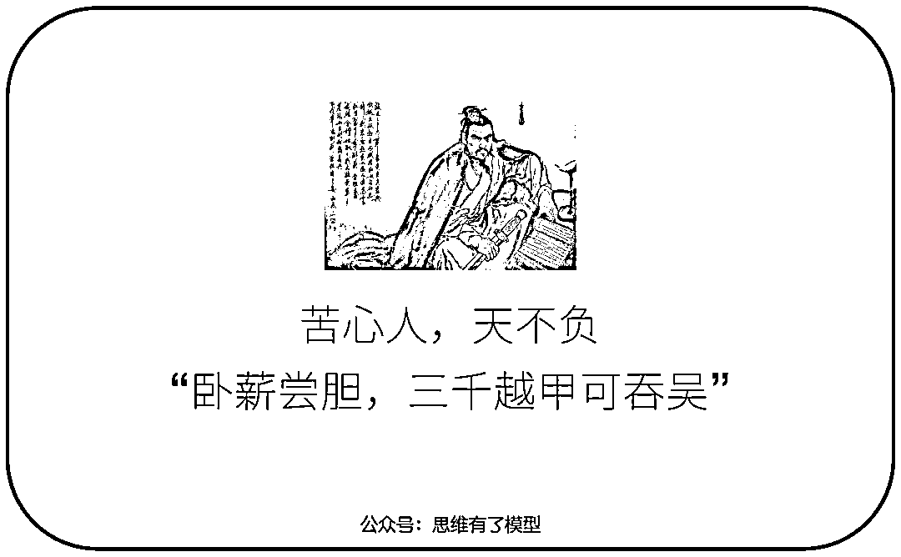

**等对方弱下去。** 对方锋芒正盛时别迎击，等他疲惫、松懈、露出破绽。没有人能永远维持满格状态，你可以等，也可以故意制造意外引他出错。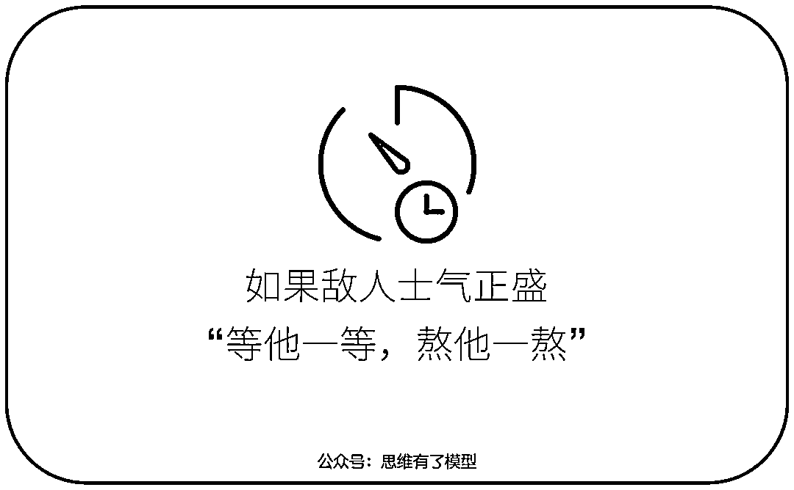

**等那阵风。** 赤壁那场大火，既要等瘟疫在曹营蔓延，也要等东风吹起来。一切就绪，只差那阵风，等风来，便能点燃胜局。有些事，多等一会儿，结果完全不同。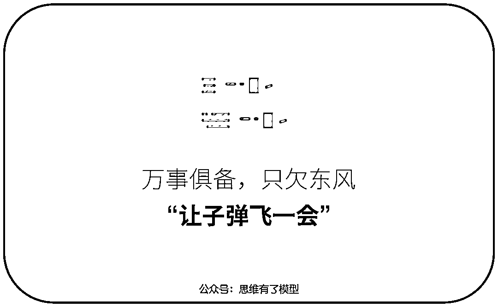

### 四、信息是暗线

上述动作要成立，还藏着前提：对方看不透你的真实意图。你懂战术，他也懂；你找软肋，他也找。若他提前察觉你要打哪里，把弱点补上，你便白忙一场。因此，我把这个前提称为“信息屏障”。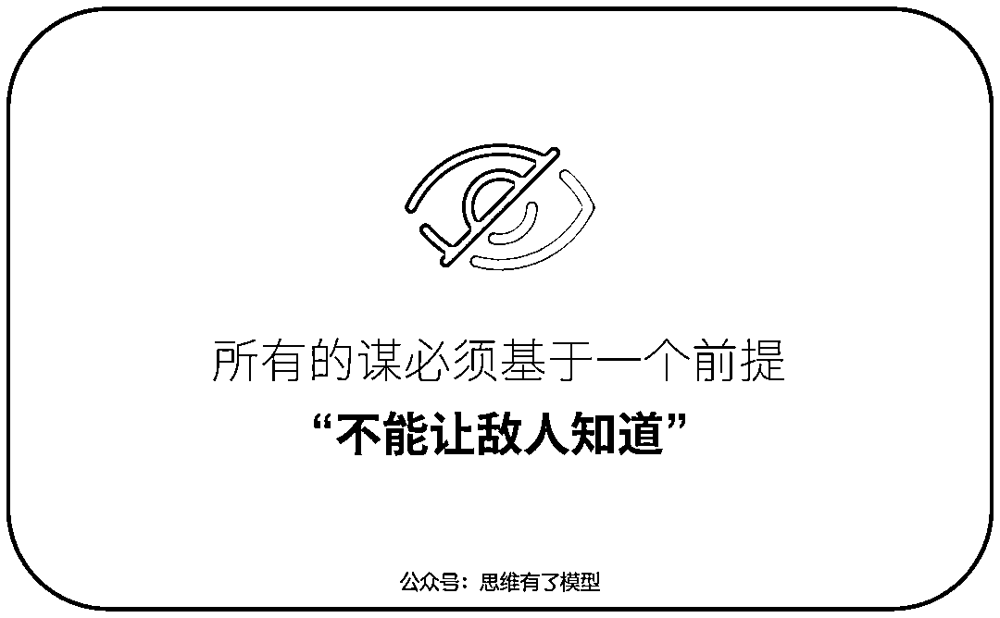

要护住的只有两点：自身虚实，与行动计划。

**第一层，封口。** 连内部成员也不必全盘告知，只交代任务，不解释全局。即使有间谍渗透，也只能看到碎片，拼不出全貌。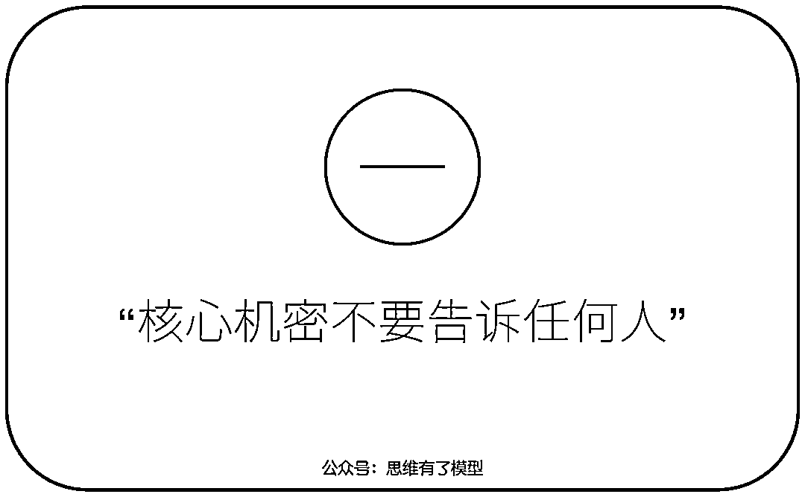

**第二层，迷惑。** 足球和拳击里的虚晃一枪，都是为了骗过防守重心。能打者示弱，强者显弱，弱者显强；要打近处，却摆出远攻姿态。虚实颠倒，敌方就会误判。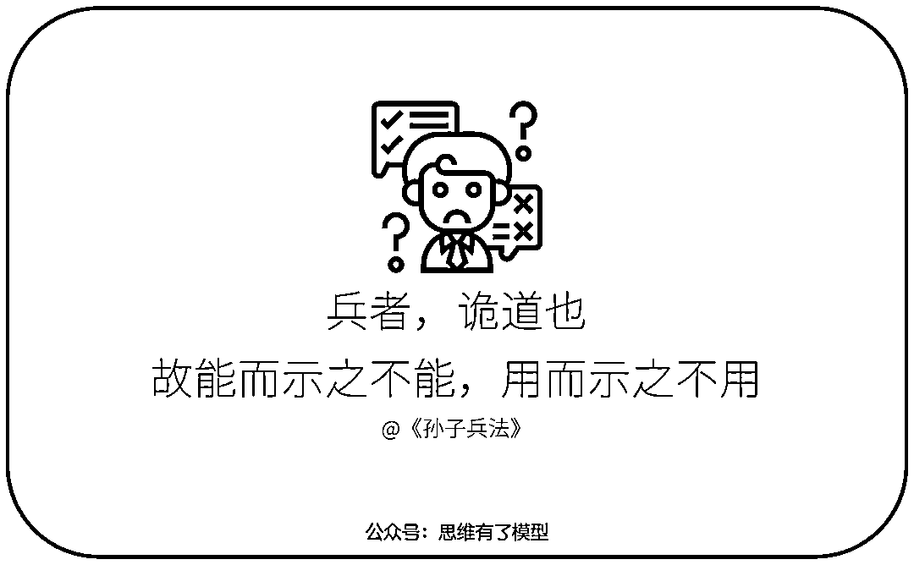

**第三层，博弈循环。** 高手会看穿你的伪装，你便利用他的看穿：假装攻东，实际取西；他预判你会骗他，你则预判他预判到的下一层。城楼抚琴退兵那一幕，正是多轮心理推演的结果。但此类玩法有概率风险，若遇上横冲直撞之人，计谋反而失效。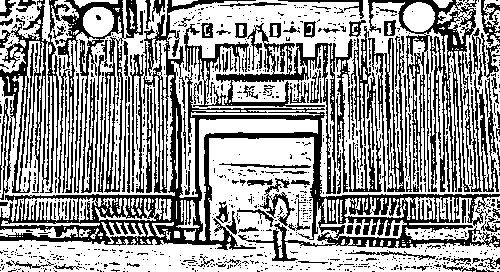

**第四层，变化无常。** 将真假混在一起，不形成固定规律。做到这一步，哪怕你把情报主动递出去，别人也拿不准该不该信。兵法所谓最高境界，就是无形：间谍窥不破，智者无以设谋。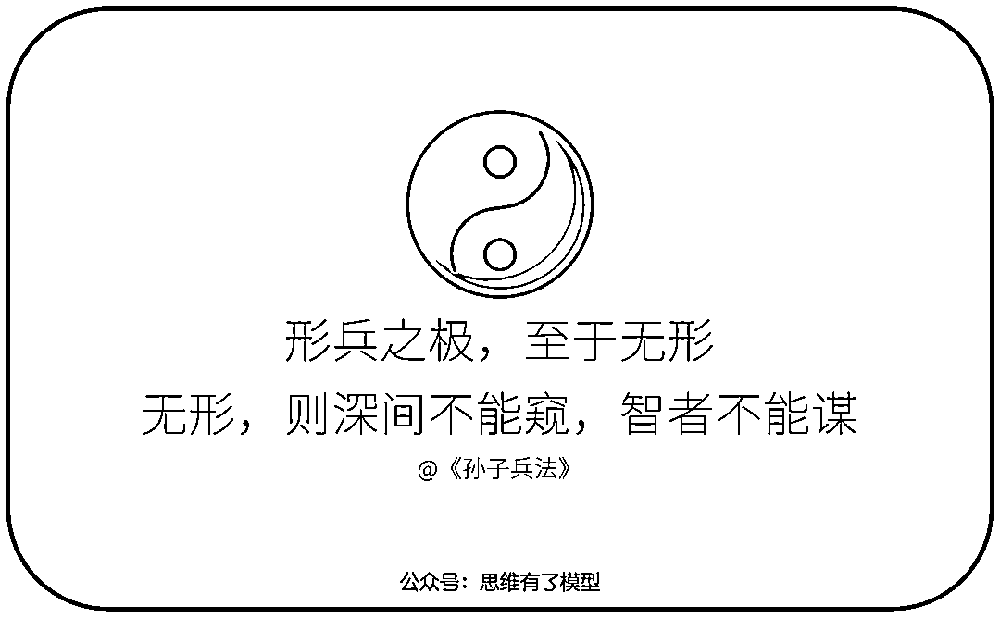

### 最后，三条提醒

**一，要抢攻。** 被动防御时，你撞上的往往是对方最强的一面；抢攻才能挑选自身最长的刀刃，去切对方最薄的缺口。拳赛同理，一味挨打赢不了。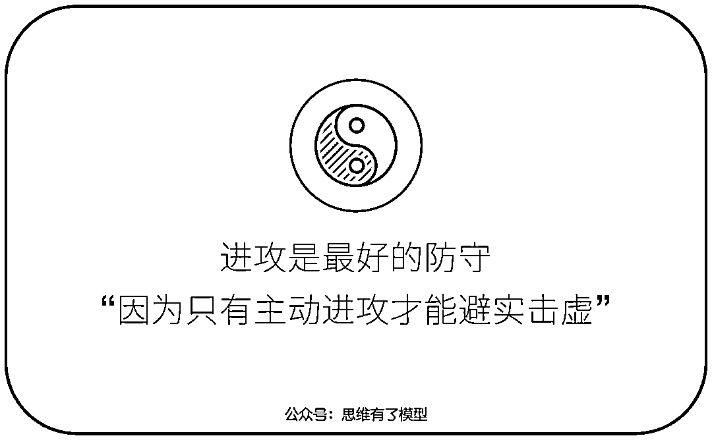

**二，用刀锋切软柿。** 不要拿拳头硬碰硬，尽量让自身长项对准对方短处。当然，不要越界违法。

**三，分清楚战争与商业。** 战争目标在于毁灭，商业目标在于获利。因此商业霸主不必差异化，占据最肥美的生态位即可；但弱者会借差异化成长为威胁，所以强者要深耕主业、主动自我更新，或直接买入潜在挑战者的股权。另外，战争没有退路，商业可以重来，所以商业不能完全隐藏实力，反而要适当亮出肌肉，劝退潜在竞争者。

说到底，沙场也好，商场也罢，赢家做的都是同一件事：靠信息差制造局部优势，再把优势变成胜势。这篇长文若有一句话能帮到你，就不算白写。

对于那些死缠烂打、执着于跟你正面硬刚的人，既然你早已准备好方案，就可以施展此前针对他们的策略作为反制手段。

一旦如此，就能令制胜法宝发挥出无与伦比的威力。

面对处于劣势的一方，也不必沮丧懊恼。

因为商业活动不同于战争的零和博弈，所以每个人都并非被迫被单一道路所束缚，每个人都能像自然界里的物种一样，找到属于自己专属的生态位。

当我们在这个独特的生态位积累起强大实力，甚至有可能颠覆看起来强大的对手。

这便是错位竞争，亦称颠覆式创新。

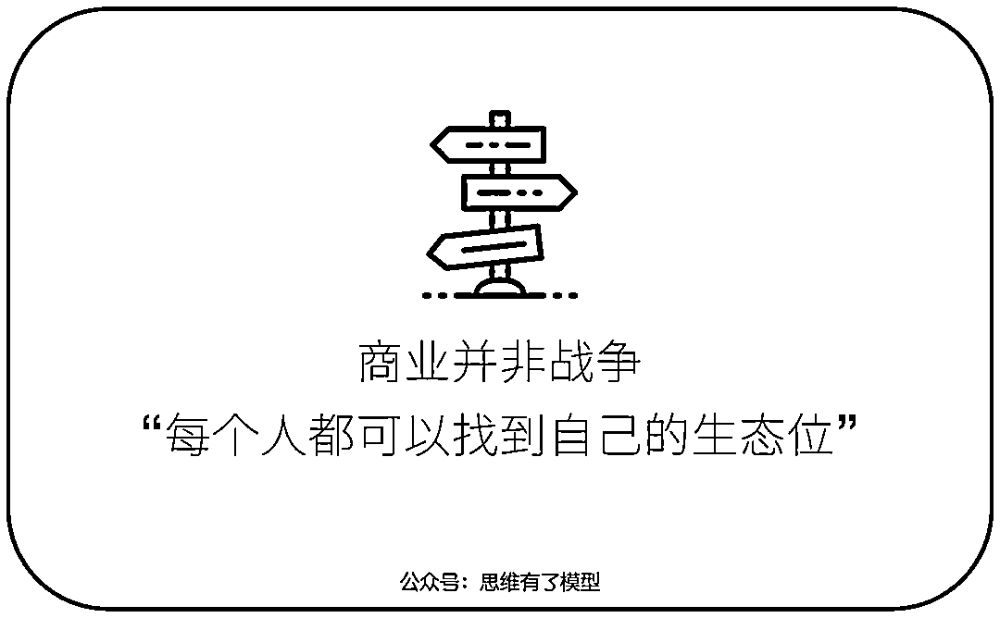

OK，此文写到这里基本上算是告一段落了。这是我今年最大的感悟之一，分享与你，希望能够对你有所启发。

最后，我再总结一下：

**所谓战胜之道，无论从战争角度还是竞争本质，归根到底就四个字——以强胜弱。**

愿诸君获得这份兵法精髓，切记明辨善用。

创业者的使命贵在推动社会创造价值，让国家实力更强大，让人类文明前行得更美好。

勿要忘记这点，我们的视野不应局限于一城一池的局部争夺，而是通向星辰大海、千秋万代的宏大格局。

* * *

评论区：

暂无评论