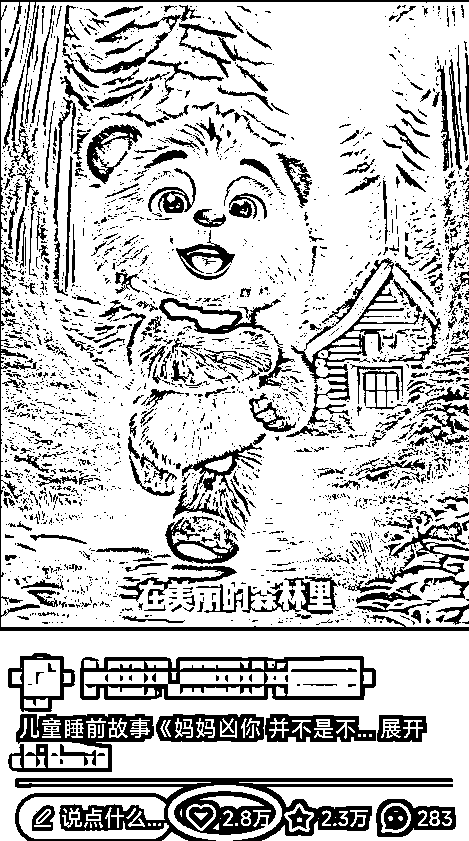
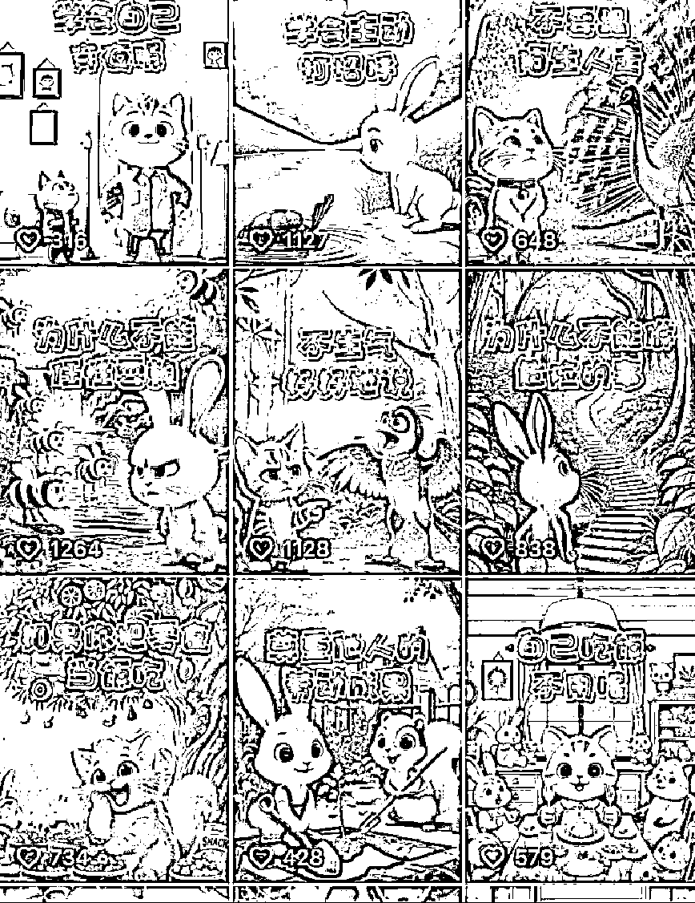
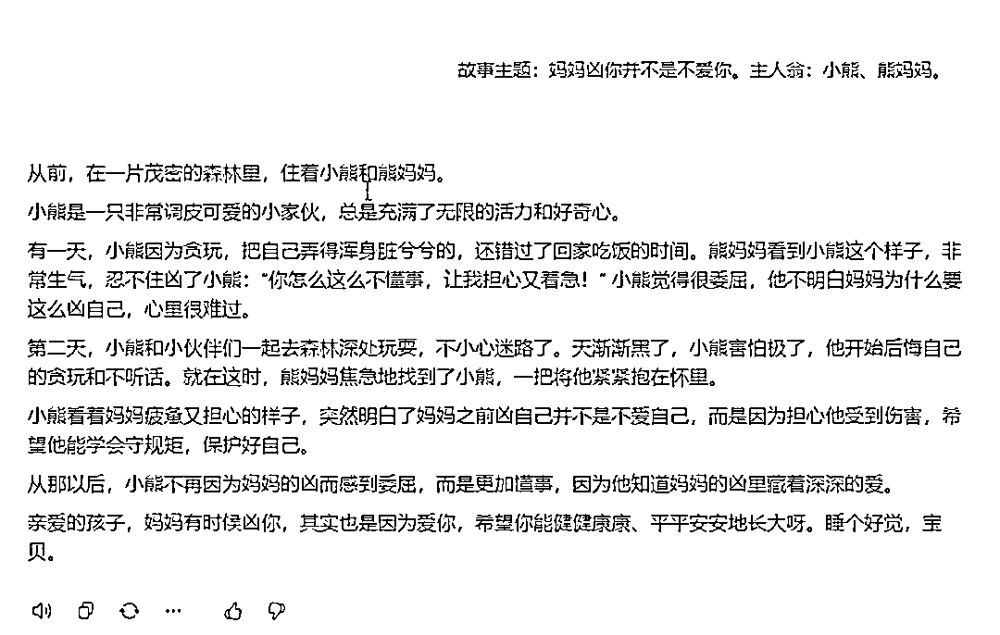
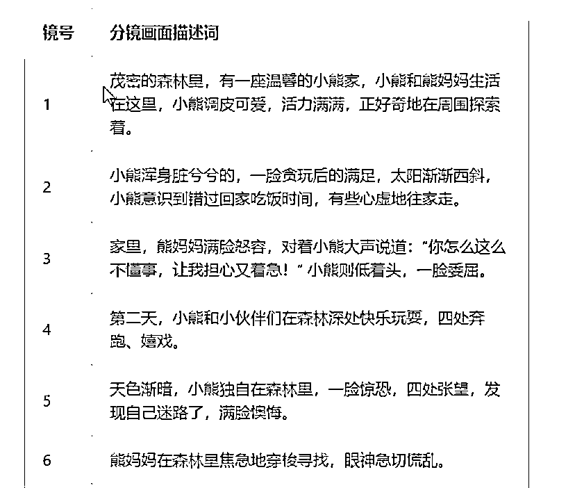
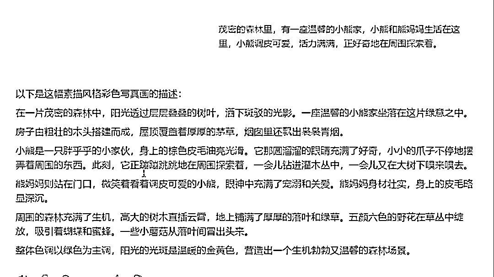
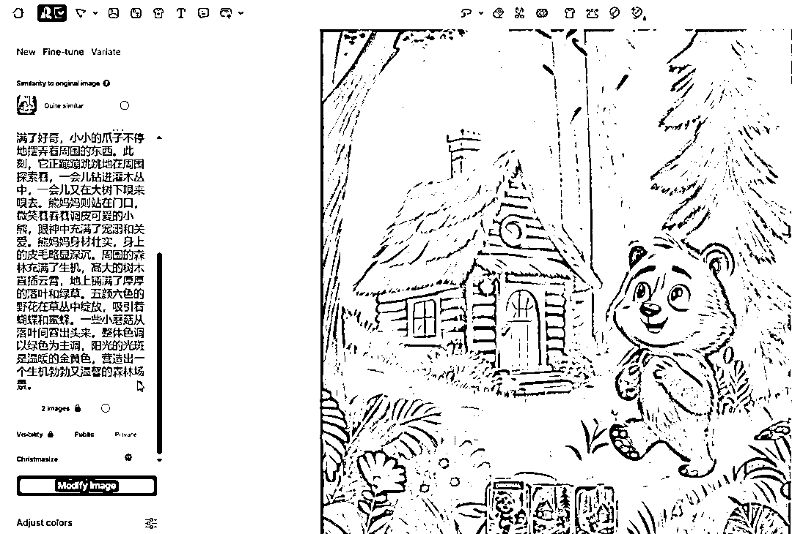
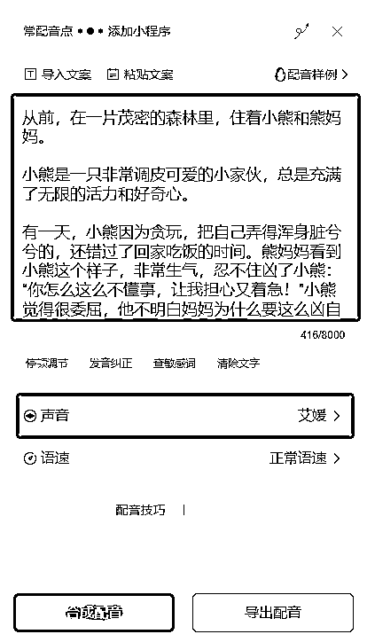
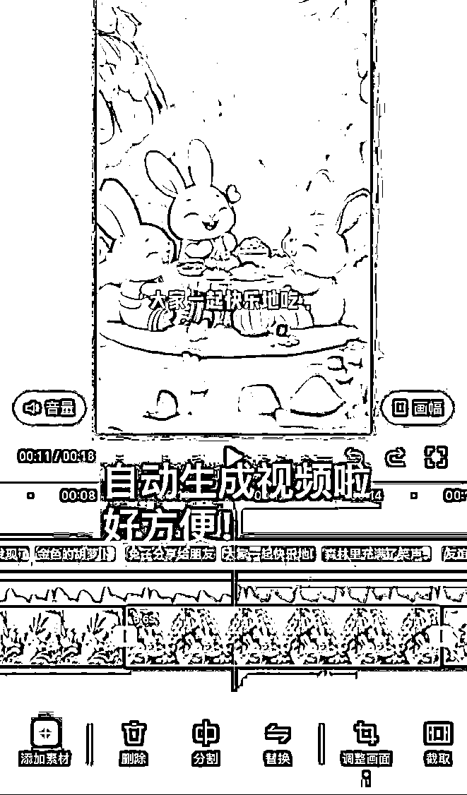

# AI 制作的儿童睡前故事视频：选题与制作指南

最近，AI 辅助生成的哄睡短视频正在母婴圈快速走红。这类短片把童话情节和温馨画风结合起来，大人愿意让孩子看，孩子也常常看得入神，在生活方式社区里传播效果格外突出。

这类内容的优势，是既有教养价值，又具备很强的观赏性，所以不只是家长买单，小朋友本身也很喜欢。

更关键的是，从编写故事到配图、配音、后期合成，整个流程基本都能交给电脑完成，不需要太高的技术门槛。如果想把这种玩法跑通，只需抓住几个核心节点。

第一，定方向。动手前先去找那些已经被市场验证过的热门作品，看看别人的选题长什么样。这个环节需要明确两个点：故事想传达什么样的道理；故事里的核心角色是谁。

之前看到一个高赞例子，主角是森林里的一对熊母子，故事围绕“妈妈偶尔严厉，心里却装满爱”展开。这种题材既有代入感，又方便延伸到亲子教育场景，很容易获得推荐流量。

确定好方向和角色后，用专为儿童童话写作而训练的 AI 模型来产出文字稿。我常用的做法是，把主题、角色和大致情节关键词交给它，模型会自动补全成一篇有起承转合的小故事，省去大量构思时间。

拿到文字稿，下一步要把每一段内容拆成可供绘图参考的视觉说明。我让模型这样做：“请从这段哄睡童话里拆出每一幕的场景说明，以表格形式输出，并附上原文。”几秒钟后，它就能返回一版清晰的场景列表。

不过，模型给出的视觉说明通常写得很简短，直接作为绘图输入可能不够细腻。因此还需要第二个专用模型，负责把这些简短短语扩展成更具体、更具氛围的 prompt，再从中挑选合适的画面设定继续下一步。

绘图阶段，用到的是我之前介绍过的 AI 绘图工具。先打开垫图功能，上传一张参考底图，再把细化好的 prompt 粘贴到输入框，点击生成，系统会给出两张候选图，挑出更贴切的一张进行后续处理。

图片准备妥当，接着将文字稿变成旁白。配音时建议选择温柔的女性音色，语速适中，语气放轻，像母亲在床头轻声读童话，这样更容易建立沉浸感。

旁白导出后，把它和所有画面素材一起拖入剪辑工具，让声音和画面逐段对齐，检查一遍节奏，就能导出成片。

等账号做出了成绩，就可以考虑两条商业路线。第一条是绘本带货：在账号店铺上架相关童书，靠视频吸引来的精准流量直接转化。我注意到一个同类账号，店铺里挂着一套几十元的儿童绘本，已经卖出了 3600 多套，数据相当可观。

第二条，是在项目跑通之后做经验输出，把自己的玩法打包成课程或社群，带想入局的新手一起操作。

这套玩法来自高鹏。我做了九年的网络项目拆解，这是第 698 期案例分享。如果你对其他项目也感兴趣，欢迎随时交流。