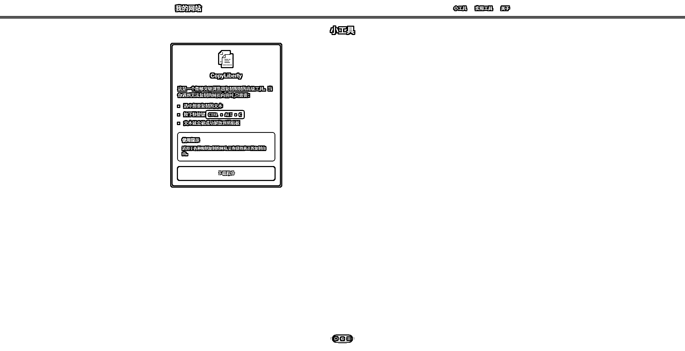

# 从零到上线：我用 Cursor 搭了个网站，还顺手发布了
作者：龙哥

大家好，我是龙哥。这期航海最大的收获，就是登上了 Cursor 这条船，用它做出了人生第一个能解决实际小问题的工具。工具做完后，我很想分享出去，于是萌生了一个更有趣的念头：干脆让 Cursor 帮我建一个分享工具的小网站，顺便手把手教我完成部署。

就这样，本着“动手实践，行胜于言”的劲头，我顺利把网站搭了出来，并且正式发布了。今天的文章就是这次完整经验的记录。

读完这篇文章，你能学到两样东西：

1. Cursor 的基础用法；
2. 如何把自己的网站发布到线上。

下面是我网站的实测效果图，访问地址在这里：https://my-website-six-drab.vercel.app/ （注意：需要魔法才能打开）

目前评论区还没有动静，如果你想交流，欢迎第一时间留言。

（本文作者：大臣 | 日期：2024-12-06）