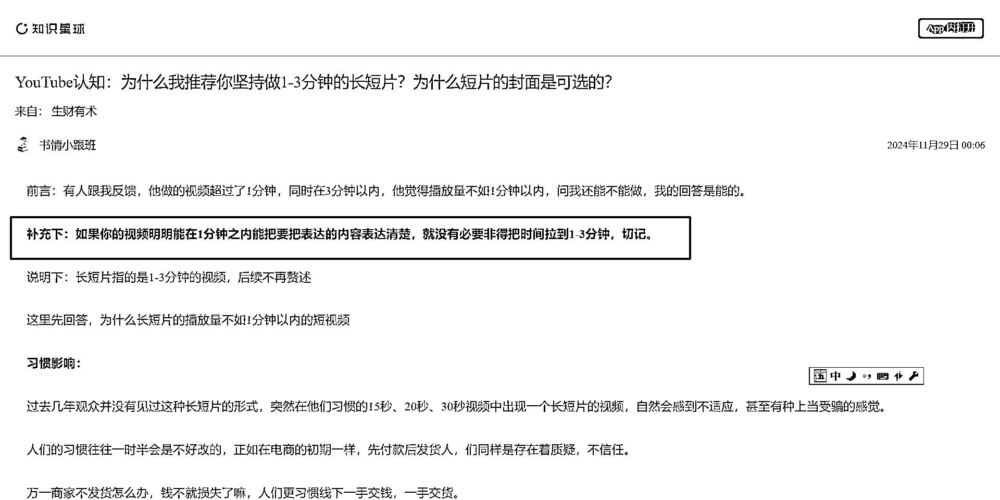

# ('短视频时长选择：从 6 秒到 1 小时，平台策略与用户需求的变化', (2, 34))

很多人都在纠结：短视频到底该拍多长？6秒够吗？还是必须凑满3分钟？其实这个问题，不能只看平台规则，更要看内容本质和用户习惯。

看看短视频时长的演变——从最初的6秒，一路放宽到15秒、30秒、1分钟、3分钟、10分钟，如今TikTok甚至允许上传长达1小时的视频。平台为什么一次次突破自己？说白了，是竞争逼的。YouTube一直以长视频为根基，曾经对短视频嗤之以鼻。可TikTok下载量节节攀升，YouTube再不跟进，用户就要跑光了。于是它只能被动推出短视频功能，起初还犹犹豫豫——毕竟担心短视频会分流自己核心的长视频观众。好在YouTube家底厚，几十亿用户摆在那里，而让长视频观众接受短视频，本质上是顺着人性走，所以转变起来并没有想象中那么难。

这里我想先放一个关键提醒：

补充一下：如果你的视频内容明明1分钟之内就能讲清楚，千万别为了凑时长硬拖到1-3分钟，切记。

为什么“短”是短视频的命根子？想想微博就知道了。博客之所以被微博超越，核心就是微博限制了字数，这种克制天然契合人性。一旦人们习惯了短平快，再让他们回到长篇大论，几乎是不可能的。所以现在的YouTube上，有人只刷短视频；而以前那些只看长视频的观众，因为平台上没有短视频，只能跑到别的App去看。如今YouTube自己也提供了短片，大家倒是不用来回切换了。再看一个数据：27亿月活用户中，大约两到三成是完全不看短视频的，其余超过70%的人都有观看短视频的习惯；而在这些短视频用户里，接近一半几乎只看短视频。这个群体的体量，远比你想得要大。

这里有个微妙的点：如果你本身就在做几秒钟的超短视频，而且做得不错，那我建议你继续深耕短内容，别轻易转型去做1-3分钟的“长短片”。在短视频平台上，用户刚刷完一个30秒的爽视频，突然跳出一个3分钟的内容，观感会打折扣——除非你的内容精彩绝伦。同等质量下，观众几乎永远倾向更短的那一个。

那么，什么情况下才建议做1-3分钟的长短片？主要针对原本做长视频、但播放量始终不理想的人。比如你有一个知识类长视频，正片10分钟，数据却惨淡。这时候，你可以把精华内容反复浓缩，剪出一个1-3分钟的版本。这个长度既能传递一个完整知识点，又不会劝退观众。

参考TubeBuddy发布的数据，在YouTube最赚钱的15个利基市场中，网上赚钱类内容CPM高达13.52美元，数字营销、个人理财也表现抢眼，教育类目则有约9.89美元的CPM。但像教育这种内容，几秒钟的碎片化根本讲不清任何知识，所以反倒适合做1-3分钟的“长短片”——把长视频里的干货反复提纯，做成精华版。与此同时，YouTube后台有个“前30秒”的指标，对教育类频道尤其关键：你要在几十秒内抓住人，剩下的时间才有意义。

换句话说，愿意看1-3分钟内容的观众，往往不是纯粹找乐子的娱乐党。他们能接受一点点信息密度，你有足够时间讲清一个概念、拆解一个专业名词。这就是长短片存在的价值。

总结一下：短视频的“短”，是基因，是方向，别逆着来。如果超短内容能做得好，就别强行拉长；如果长视频做不动，那就试试把精华剪到1-3分钟。找准自己的位置，比盲目追赶时长重要得多。