# 出海创业：流量获取与支付工具选择的关键挑战

国内市场的竞争已经卷到飞起，越来越多人和团队把目光转向海外，想靠出海赚美元来打破僵局。无论是做亚马逊、Temu、TikTok这类平台型电商，还是自己搭独立站，或是做B2B外贸、开发App和浏览器插件，似乎只要走出去，就能找到新的增长空间。

但真到了出海路上，除了每天头疼怎么搞流量，还有一个绕不开的大坑——怎么把钱收回来、怎么结汇上岸。海外市场不像国内有微信和支付宝这样统一的环境，支付方式可以说是五花八门：欧美用户偏爱PayPal和信用卡，东南亚习惯现金或本地转账，南美、日本等地又各有各的本地支付偏好。刚出海的人很容易被这套组合拳打懵，完全不知道该选哪种工具。

我自己在跨境电商和独立站圈子里摸爬滚打，PayPal、Stripe、空中云汇、派安盈都用过，账号被封过不少，坑也踩了无数。今天就从跨境电商、独立站、外贸、开发者四个角度，把从收款到结汇的路子完整捋一遍，帮大家排排雷。有些渠道我没有亲测过，是查资料整理的，如果有错欢迎指正。

## 一、做跨境电商平台，资金怎么流转？

先看亚马逊这类平台卖家。整条资金链是这样的：消费者在平台下单付款——平台先把钱收下，压一段时间（通常14天左右，主要是预防退货、换货和客户投诉）——然后卖家发起提现——钱转到支付服务商手里——服务商帮忙结汇——最终进入国内银行卡。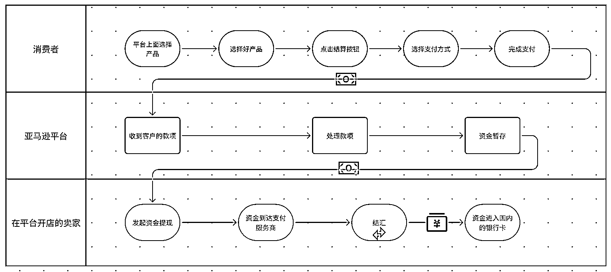

这就是为什么卖家能操作的其实只有两步：提现和结汇。账期到了以后，你可以通过亚马逊合作的Payoneer、万里汇、连连、PingPong这类服务商把钱提出来。提出来的一般是美元，想在国内花，还要换汇成人民币。这一步同样是找第三方结汇平台，它们在汇率和手续费上通常有优势，操作也比较方便。整个过程中，钱基本都是美元形态，只有经过服务商结汇，才能真正变成人民币进到你国内卡里。

## 二、独立站收款，跟自己搭摊子一个道理

再来看独立站。流程上跟电商平台很相似：消费者在你网站上选品、结算、选自己顺手的支付方式比如信用卡或PayPal——你的独立站得先绑定一个收单工具，工具会验证订单信息，异常就拒绝——然后钱先暂存——等满足提现条件后，你发起提现，钱转到外币账户或支付服务商手里——最后结汇成人民币。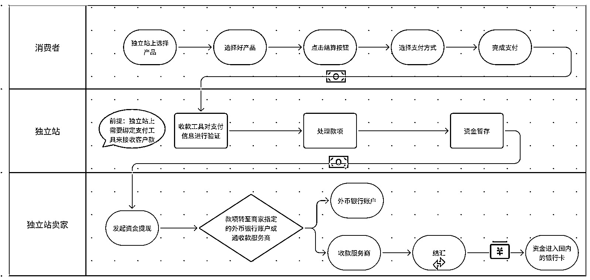

别看大框架差不多，关键区别在于：做平台，收钱的事平台替你包了；自己建站，收单必须自己搞定。海外消费者可没耐心直接给你银行卡打美元，那太麻烦，一般只有B端外贸客户才愿意这么操作。

所以独立站卖家必须先搞定“收单”这个环节，备选的工具有PayPal、Stripe、派安盈、空中云汇等等。选哪个要综合考虑很多因素。

首先是目标市场习惯。欧美用户习惯PayPal和信用卡，东南亚习惯现金，南美爱用本地银行卡，日本偏好便利店加信用卡，台湾地区用户喜欢本地卡和信用卡……然后是产品属性。比如你卖的是订阅型软件，类似腾讯视频会员那种，或者客单价很高用户想分期付款，不同的产品对工具有不同要求。再看资质门槛：PayPal拿大陆营业执照就能开，Stripe基本得是海外公司。费率也要算清楚：PayPal大概是4.4%加固定手续费，Stripe是2.9%加固定手续费，有些工具还会收月费或开户费。

没有任何一款工具能全部满足这些要求，所以大家一般会按需多开几个，全部绑到网站上，让不同地区的用户自己选。收单之后，钱会进入支付工具账户。因为都是外币，通常没法直接提到国内银行卡，除非你有海外银行卡。这时候就需要再选一家结汇服务商。好在派安盈、空中云汇、PingPong、连连这些基本都支持结汇。更省心的是，这类服务商往往既能收单也能结汇，甚至还能给你放贷。你只要在它们那儿开个海外账户，然后把那个账户填到收单工具里，提现的钱就会自动过去，之后直接在工具上操作结汇，人民币很快就到你账上了。

## 三、外贸收款，手续最简但水深

先简单看一眼外贸收款到结汇的完整链路。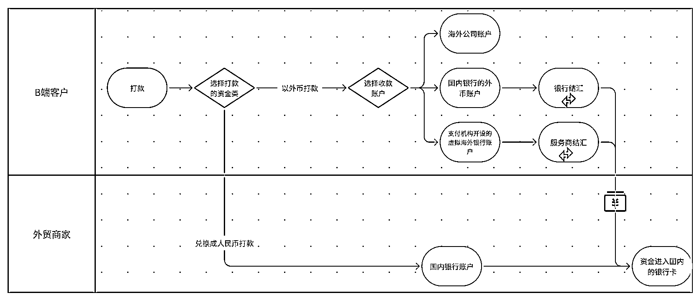

其实外贸的钱款流程是最简单的一种。因为面对的都是B端客户，理论上你可以要求客户直接打到你的人民币账户。但这样客户会觉得麻烦——他得先把外币换成人民币。所以比较常见的操作是注册一个香港公司和香港银行账户，让客户直接打款到香港，因为香港账户能收外币。

当然，国内很多银行也支持开外币账户，但资金进来后必须结汇。现在还有一些支付服务商，拿大陆公司的资料就能帮你开出海外银行账户，并且可以直接结汇。相比传统银行，这些服务商开户简单、支持的外币账户更多、结汇手续也更便捷，常见的有万里汇、XTransfer、PingPong（是不是很熟？还是这几家）。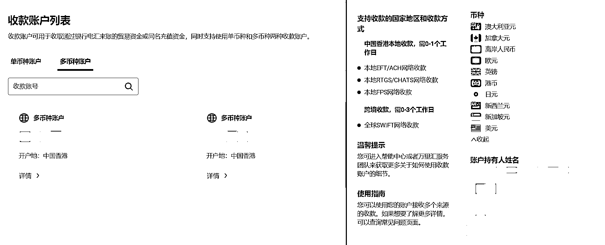

注意，上面只是最基础的收款说明，实际操作中外贸还要涉及报关、退税等一堆麻烦事。

## 四、开发者怎么收款？

开发者可以做的产品有网站（独立站）、App或浏览器插件，不同产品形态对应的支付场景和收款方式也不同。

如果你做的是SaaS这类网站产品，就参考上面独立站的收款结汇流程。唯一要叮嘱的是，选支付服务商时一定要确认它支不支持你的产品，因为很多国内支付服务商是不接软件类产品的。

如果是做App，那就按照Google Play和Apple App Store的要求来设置收款账号。据我查到的资料，这两家都会收一笔开发者费用，支持大陆银行卡直接收款，但抽成相当狠，大概在15%到30%之间。

## 五、其他出海方式的收款路子

除了上面四种，还有很多野路子。比如当自由职业者在Fiverr、Upwork接单；比如做YouTube频道、TikTok赚播放量佣金和广告分成；再比如搞跨境平台的本土店铺。这些方式怎么收款，完全取决于平台性质和要求。有的能绑服务商账户，比如Fiverr可以绑Payoneer收款；有的支持国内银行账户；有的则必须用海外银行账户才能收。总之，得按具体平台去单独搞定。

## 六、独立站常见收款方式盘点

不同国家和地区的用户，付款习惯可以粗略归纳成六种：PayPal、信用卡、本地支付、现金支付、国际汇款、其他付款方式。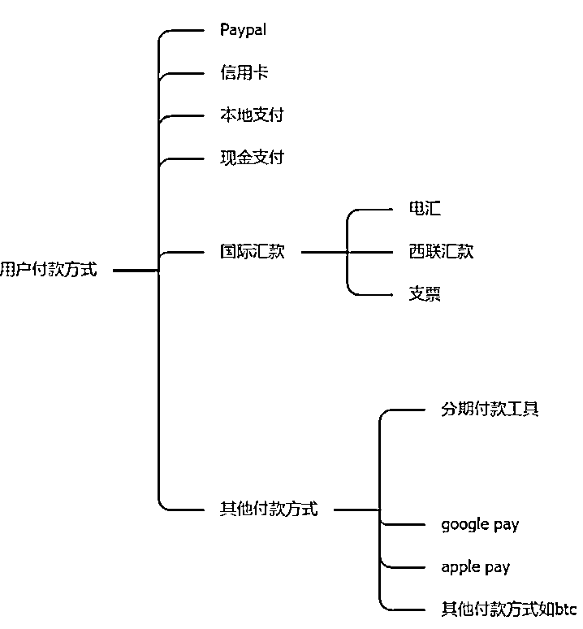

你越了解用户的付款习惯，收款工具越能覆盖他们的偏好，下单转化率自然越高。想象一下，如果国内有人搭了个购物网站，却不支持微信和支付宝，就算页面再精美、产品再牛，转化率也一定惨不忍睹。

所以，接下来逐个聊几个常见的收款工具。提醒一句：很多收款工具都是全能型选手，可能既能收单、又能结汇、还能绑定电商平台，前面提到的那些服务商就是典型例子。

### PayPal

PayPal在欧美使用非常广泛，基本相当于海外的支付宝。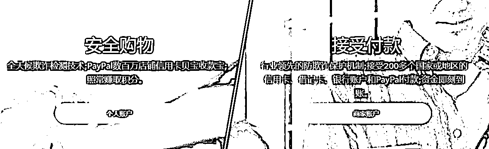

用大陆企业营业执照就能开通，没有开户费，只有交易手续费：3000美元以下按4.4%加0.3美元；3000到1万美元按3.9%加0.3美元；1万到10万美元按3.7%加0.3美元；10万美元以上按3.4%加0.3美元。优点是自己在官网就能申请，很方便；缺点是费率偏高，风控特别严格。一旦客户纠纷多、退款率高，或者出现可疑交易，账号很容易被封。PayPal也支持客户直接用信用卡付款，所以如果你主要做美国市场，一个PayPal基本就够了。

### Stripe

Stripe由爱尔兰兄弟Patrick和John Collison于2010年创立，总部位于美国旧金山。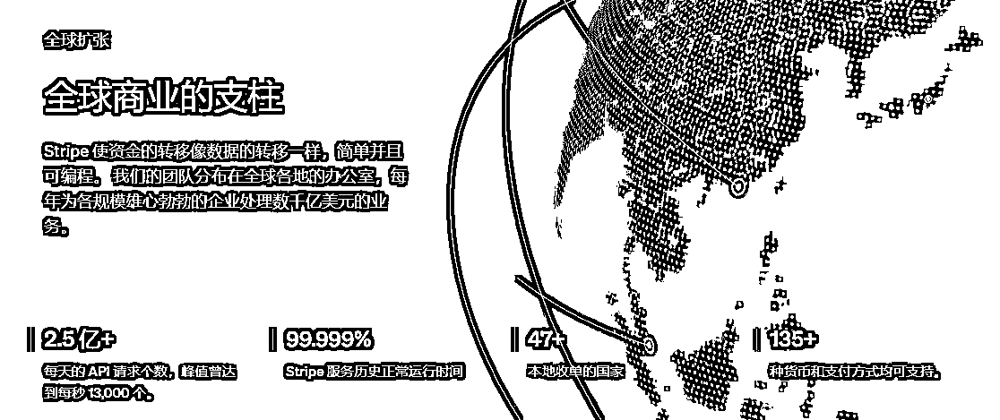

它的支付流程特别简单，消费者拿一张信用卡就能完成付款，不需要注册账号或额外账户。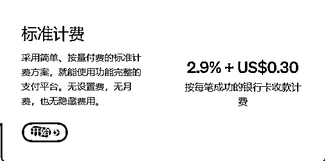

Stripe的费率一般是2.9%加0.3美元。优点是用户付款方便、主流信用卡全覆盖。缺点则是必须用海外公司注册，而且风控也比较高。有条件的独立站卖家，一般会注册个海外公司开Stripe，再配合PayPal，欧美市场的收款就基本稳了。

### Shopify Payment

Shopify Payment是Shopify平台内置的支付服务，和Shopify系统深度集成。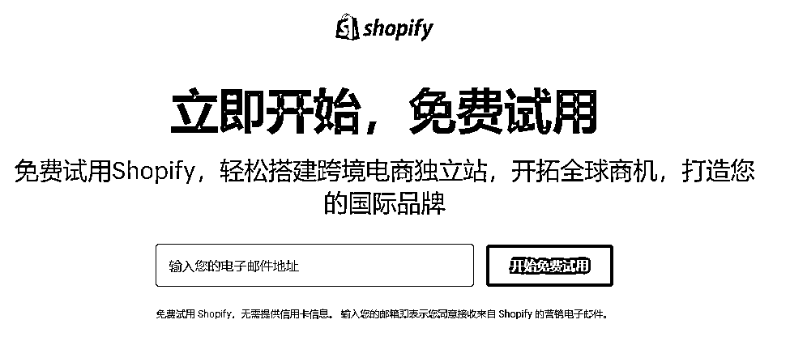

费率大概在2.9%到3.9%之间。它的优势很明显：如果使用这个收款工具，就不用再付Shopify的佣金（用其他收款工具，Shopify会额外抽0.5%到2%）。同时支付流程非常顺畅，支持信用卡、Google Pay、Apple Pay，还有Klarna、iDEAL等多种本地支付方式。

缺点是只限Shopify建站用户，不是Shopify搭建的网站没法用它。另外，不支持大陆公司注册，风控也很严格。

### 2Checkout

2Checkout支持87种货币、覆盖200多个国家和地区，1999年由Alan Homewood创立，是美国一家老牌的在线信用卡支付方案商。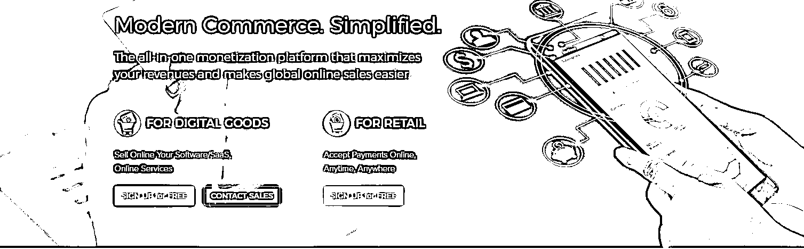

费用上，每笔订单收3.5%加0.35美元，比Stripe略高。优点是和Stripe一样，不收开户费、年费，而且国内企业信息也能开户。缺点是没有中文客服，遇到问题只能发邮件用英语沟通。

### 派安盈、空中云汇、PingPong、连连

这四家放在一起说，因为它们比较相似。它们基本都支持国际信用卡渠道和不同的本地支付渠道。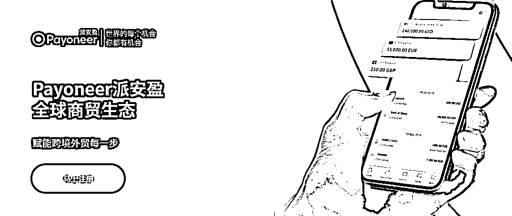

优势是部分工具用国内企业资料就能开户，风控相对温和，不容易动不动封号。缺点是开户费用往往不低，费率偏高，回款周期也长一些。适合没有海外公司、但又想让顾客用信用卡付款的卖家。

### Payssion

Payssion是一个主打全球本地支付的平台，支持200多种本地支付方式，几乎覆盖全球所有国家和地区。独立站买家可以通过银行转账、电子钱包、现金支付等方式完成付款。

如果你想做的是相对小众的市场，比如中东、南美、日本、俄罗斯、台湾等地区，就很有必要接相应的本地支付。在本地支付这块，Payssion比较专业，也更有优势。国内企业可以开户，具体要求和费率会根据国家和付款方式变动。

### COD货到付款

中东、东南亚有些地区线上支付不发达，买家更习惯用现金。如果目标市场是这些地方，就可以考虑用COD货到付款。这个方式需要依赖物流服务商：你把货发出去，物流商送货时收款，再把钱汇给你。

好处是不需要海外公司，而且非常符合当地用户习惯，能增加信任感。坏处是费率比较高，而且客户有拒收的可能。

### 国际汇款

国际汇款是非常传统也通用的方式，适合大额交易和传统外贸。买家可以直接把钱汇到你指定的银行账户。常见的有电汇、西联汇款和银行支票。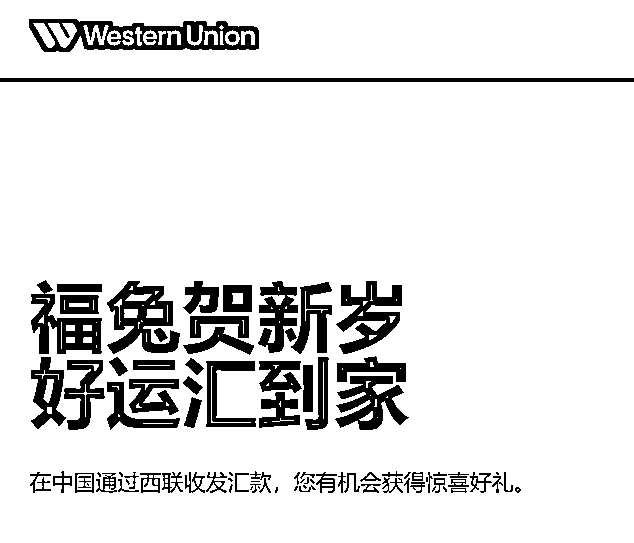

电汇最常见，买家通过自己的银行把钱汇到你的账户，安全可靠，但处理时间较长，通常要几个工作日。西联汇款更快速，尤其适合紧急或小额交易，网点遍布全球，方便快捷，但费用通常比电汇高。银行支票则是偏传统的选择，适合喜欢纸质交易记录的客户。

### 分期付款

分期付款在高客单价产品里越来越流行。它能有效吸引价格敏感的消费者，同时帮助独立站提高转化率和客单价。常见的分期服务商有Klarna、AfterPay、Sezzle、Affirm等。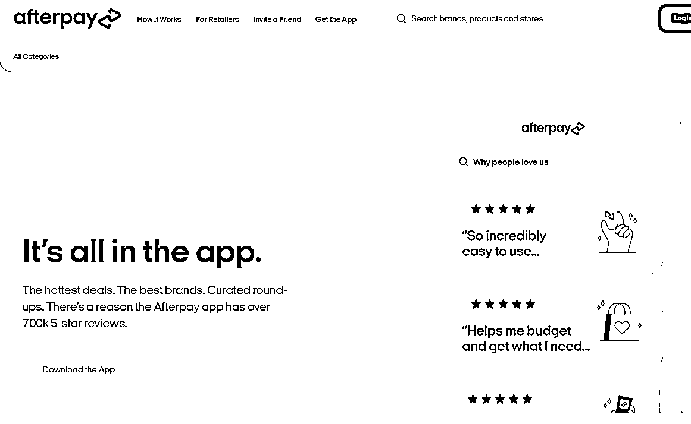

## 七、独立站收款推荐

最后再给点实操建议。

如果你的目标用户主要面向欧美，最简单的做法是开一个大陆版的PayPal账号。零成本，既能收PayPal也能收信用卡，而且现在PayPal已经支持直接结汇到国内银行卡。注意一定要用宽带网络注册，好好养号。一个PayPal可以绑多个网站，但风险是：如果某个网站出了问题连累账号被封，其他网站也跟着没法收款。

如果你有海外公司，那就尽量开一个Stripe。虽然风控高，但真的好用，能明显提升付款成功率。

如果你想提供分期付款，可以用空中云汇。

总而言之，记住这几点：

1. 选收款方式前，先调研目标市场的用户支付习惯。
2. 再结合自己的公司资质、产品类型、收款费率等综合判断。
3. 独立站上收款渠道越多，用户可选的支付方式越多，转化率就越高。
4. 不同收款工具对产品类型有各自限制。比如卖虚拟产品的网站，国内信用卡收款服务商一般都不接。
5. 任何收款工具都有自己的风控。客户投诉和纠纷一旦太多，超过阈值就可能封号、冻结资金。所以平时的采购发票、物流单据一定要留好，关键时刻能救你。
6. 收款账户最好多备一两套，万一某个账号被投诉或风控没法用了，还能马上顶上，不让生意停摆。

做跨境这件事，有一个环节往往被新手低估——钱怎么收得顺、退得快。

如果你的业务已经开始触达海外用户，强烈建议你有条件的话就提前布局海外银行账户。

比如香港的银行账户，很多机构现在去香港走一趟就能完成开户流程。美国的银行账户也同样实用，像华美银行就是不少跨境从业者常用的选择。

为什么要这么做？很简单，实操起来会顺畅很多。海外客户付款时更习惯本地账户路径，你收款效率会明显提升；另外在客户服务层面，比如需要给客户做退款、返佣、结算时，有一个海外账户在手，操作会快很多，也更专业。

以上经验希望对你有启发，觉得有用就点个赞支持一下吧~

————————

我在赚钱的一些精华沉淀

[跨境创业？新手下场前必看的赚钱指南！](https://articles.zsxq.com/id_n97vrpiahx5w.html)

[一个工具管理 100 个 facebook、ins、tiktok 社媒账号？指纹浏览器使用全攻略！](https://articles.zsxq.com/id_u2ub0iv60p1g.html)

[【赚钱技能】如何分析产品/项目的海外市场体量与机会](https://articles.zsxq.com/id_wwkanemt57gt.html)

* * *

评论区：

蓝大虎 : 很详细，谢谢分享[强][强]

希声 : 谢谢😄

嘉应岛主 : 感谢分享，收款太重要了～

希声 : 😁😁