# 大促季节的烟火与暗涌：一位运营负责人的复盘手记
作者：龙哥

## 促销季热潮下，商家面临的真实考题

作者：梁小伟

日期：2024-12-03

促销季一到，无论是头部大卖、中小卖家还是刚入局的新手，几乎都被裹挟进这股旺季洪流里。这个节点确实是转化变现的绝佳时机，但同样也是拼杀最为残酷的竞技场。

外人看到的是晒不完的订单截图，但拆开来看，真正能跑出量的卖家，拼的是后端供应链的扎实程度、达人资源的持续铺设，还有敢烧钱的投放底气——这是一盘提前布好的棋局。

你手里有能接住这波红利的底牌吗？

投放费用哗哗往外流，月底一合计，稍有不慎，利润就全被吃掉。旺季嘛，所有人都在抢量，推流的成本自然会水涨船高，自然流量被稀释在所难免。有人笑，就一定有人愁。

说到底，卖家每天反复琢磨的，无非就是那几个流量渠道。

这篇文章想聊聊这次促销季里踩过的坑和悟出的理，也算是一篇随性记录的复盘流水账。

**旺季高压之下，团队如何陷入无效忙碌**

01

上周，我们代运营的某个店铺，小组每天要产出**10-20 条**新素材。

从**构思拍摄、后期剪辑、内容发布到广告投放**，全程的工作量都拉到双倍。

每天都熬到深夜十二点。

表面看氛围感拉满，组员士气高昂，一切都在向好。

可尴尬的是，订单数纹丝不动。

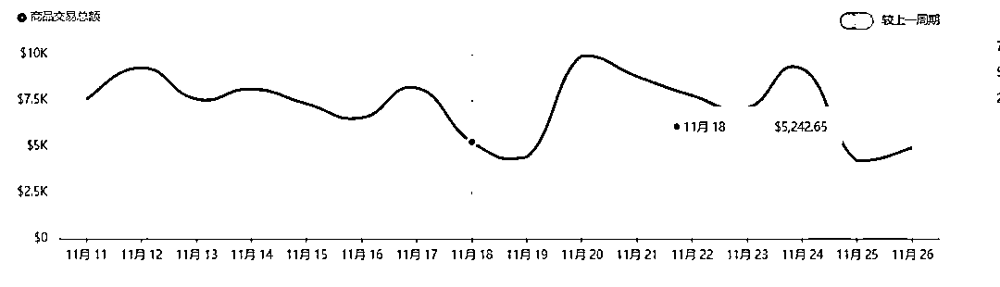

到了夜晚，我开始独自盘算项目的整体走向。

GMV：**34.2W** 美金，其中 10 月因断货停摆了半个月，11 月才全力追赶

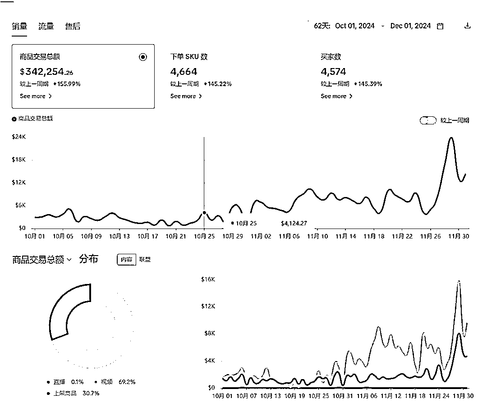

**一、投放侧**

广告盈亏平衡设定在 2.2，勉强持平。近两个月投放总消耗**4.7w 美金**

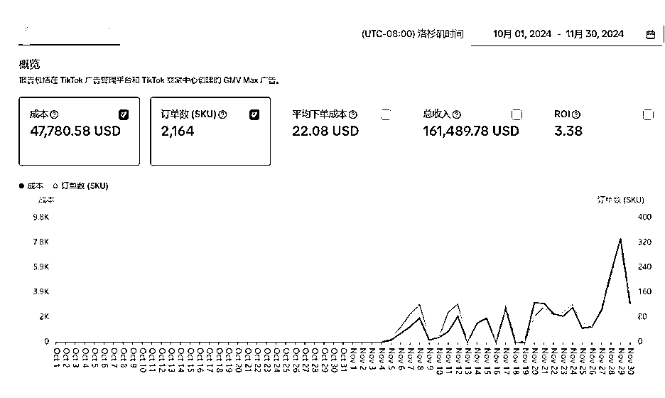

Ads 渠道两个月用掉了**2 万美金**

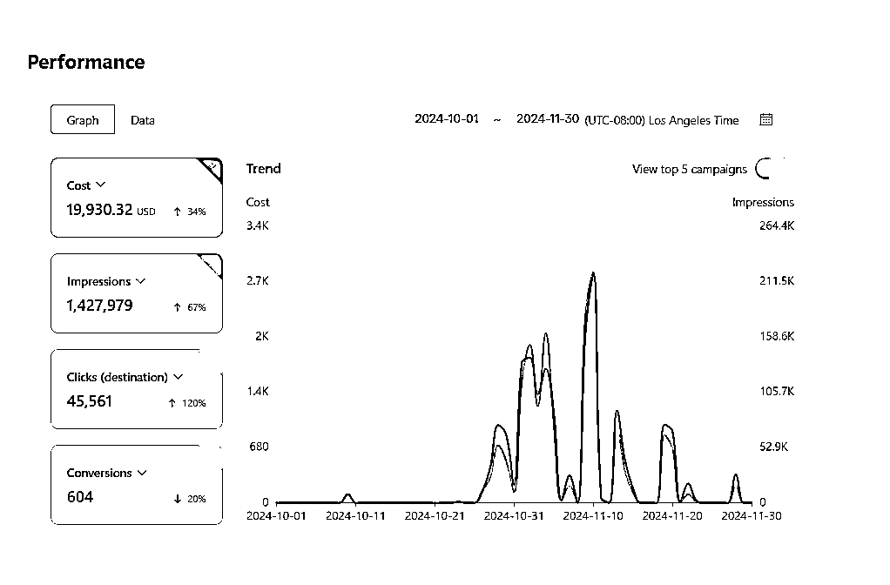

**达人侧**：

两个月下来合作的达人屈指可数，大概四五个。

**直播**：这个板块处于空白状态

**自然流量**：准备了十个账号分发，每号每天发 3-10 条不等。

**人员配置**：整个店的核心运营只有三个人。

并且这三个人并非只盯这一个店，还要抽出精力处理公司其他事务和中视频项目。注意力被拆得七零八落。

一段时间后，增长明显卡住了。

回看 10 月到 12 月这段时间

原本定下的**100w 美金**目标，截止到 12 月 1 日，实际完成仅 34w 美金。

刚开始我还在给大家打气：旺季流量本来就紧、竞争又凶，多投点钱把量拉起来很正常。

这家店是从 9 月起一天出几单慢慢做到现在的。

11 月以前，**70%** 的订单靠视频带来的自然流量成交。

到了 11 月，投放预算加码到每天**3000 刀-5000 刀**。

同样的 GMV 盘子，投放成本却多花了 40%，利润空间被狠狠压缩。

我开始一个问题一个问题地排查。

**复盘结论一：**

**看大盘数据 pipiads** 上的投放风向，和不少同行交流下来，发现买量最凶猛的集中在

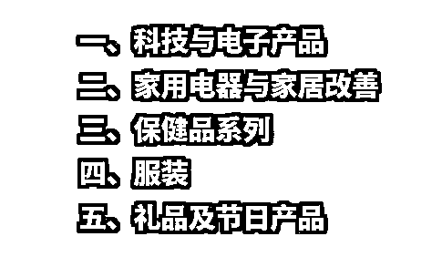

同时梳理出这家客户的品类，整体消费决策偏理性，这类目其实在淡季反而更容易跑出优势。

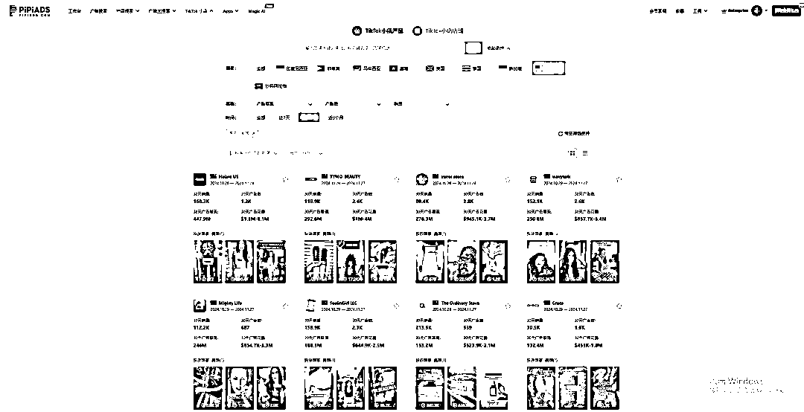

**复盘结论二：**

**团队陷入事务性忙碌，缺乏梳理和迭代，属于盲目硬干**

有件事让我挺意外的，素材数量确实翻倍了，但质量肉眼可见地在滑坡。

随手抽查就看到不少问题：标题、封面、灯光构图、脚本框架，几乎都有硬伤。

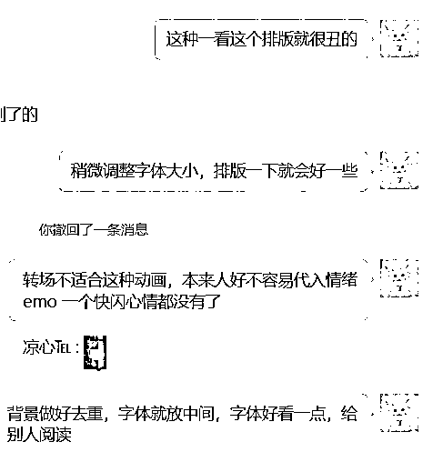

照理说 SOP 那么清楚，这种低级错误压根不该出现。结果负责人A跟我解释，带新人花了他大量时间精力，他头上也压着业绩指标。

我非常理解这种处境，也一直在安抚他们。带新人确实是件吃力不讨好的活，但团队要扩大规模，就必须持续做好传帮带，不能一直靠硬扛。要不断**打磨一套更完善的 SOP，定好集中的培训时段和固定的答疑窗口**，让新人自己也能有钻研和精进的空间。

越是这种时候，越要沉住气，多分享点实战小技巧。

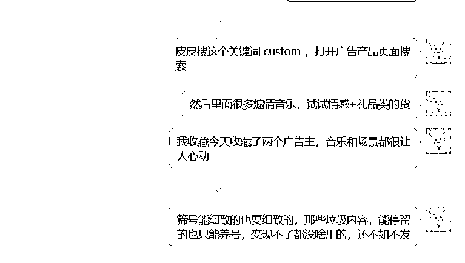

再把方法交代清楚

重点提醒：

**冲突并不等同于危险，它其实是推动改变的能量来源**。这是我们内部资料库收录的每日一句

我把那篇内容又读了一遍，收住情绪，转而安慰和接纳大家。

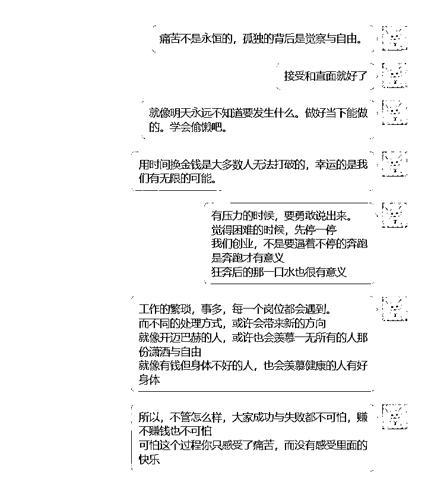

等帮团队把问题理清楚之后，我着手主抓这几块

第一，把脚本创作流程重新梳理优化了一遍

第二，调整了拍摄节奏和账号内容的整体定位

第三，重点恢复店铺的评分健康度

第四，对视频内容做整体提质升级

关于做一个项目究竟需要什么，其实真正决定下场那一刻，这几个问题就得想清楚。

能做和做好完全是两码事。能做，也许只是因为产品踩中了需求、赛道竞争还没那么卷，加上基础运营能力过关，就能撑起一个团队的收入。可想要做好，就要往细节里钻。下面聊点具体的，分享一下我最近的思考。

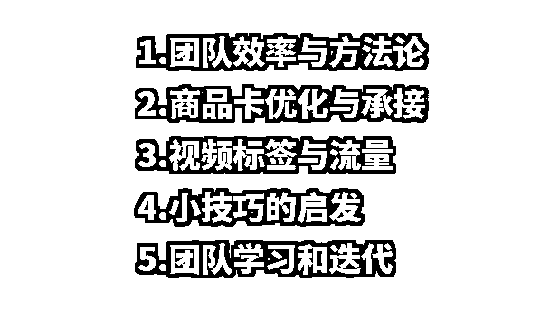

**1.团队效率与方法论**

我意识到最可怕的事情，是团队进入了无脑硬干的状态，彻底没了自己的思考。

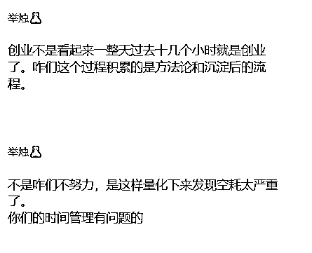

我是怎么发现的？翻看他们每天提交的剪辑素材，发现脚本内容一直没有变化。

大家都掉进了一个思维的迷宫。

只愿意挑简单省力的事情做，或者一直在原地重复，逐渐进入停滞期。

归根结底，近期的市场调研和竞品拆解做得太少了。于是我让所有人停下手头工作，休息一天，然后做了几项调整：

**1.1 每天花半小时刷对标账号的案例，并整理出总结**

**1.2 每天例会打开 pipiads，把同行打得好的投放素材逐帧拉片分析**

我几乎是逼着大家把基本功重新捡起来，做到足够细

**1.3 换了一批拍摄场景，增加布景道具和灯光布置**

**1.4.尝试更多脚本类型（叙事型-卖点直给-颜值展示-轻喜剧路线）**

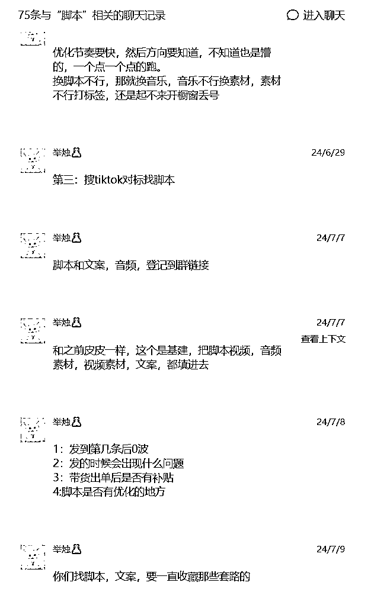

**1.5.把 SOP 和工作文档真正落到日常**

尤其是工作文档和 SOP。要是 SOP 没有更新，我会直接发火。因为这说明团队没有在沉淀和积累。

这样一来，团队的进度和思考方式我都能一目了然。

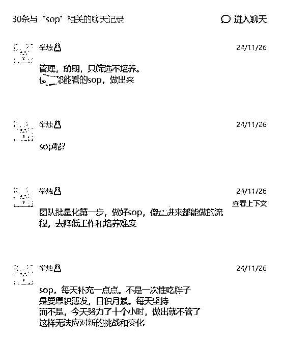

店铺评分：之前一直都是走亚马逊仓发货的路子。

九月份的时候评分掉到了**2.5 分**，好家伙，再这样下去连黑五活动都差点报不进去。

我们用三周时间做了以下调整：

1.下架所有从亚马逊仓发货的商品
2.用低价高复购的产品冲销量
3.把客服响应速度提上来

评分慢慢拉回了 3.9，自然流量也跟着回涨。

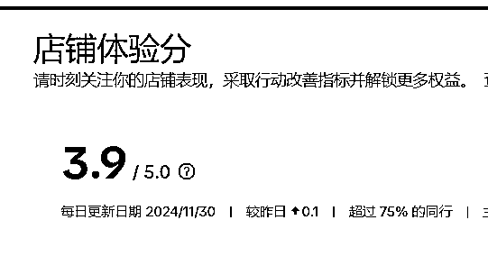

这一连串动作做完，投放成本几乎砍半，**花 2000 刀就能出 200 单，单量不仅没往下掉，利润还直接翻了一倍。**

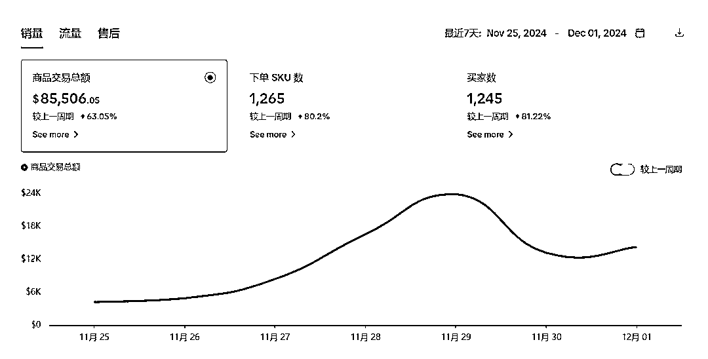

但有意思的事情又来了。

一边解决问题一边继续复盘，我开始细看店铺流量页的数据。

商品视频曝光做到了**700 万+**，可点击率却跌得厉害。

我再一看，好家伙，团队又连最基础的活都没干好。第二天一早，我又忍不住去说了一顿。

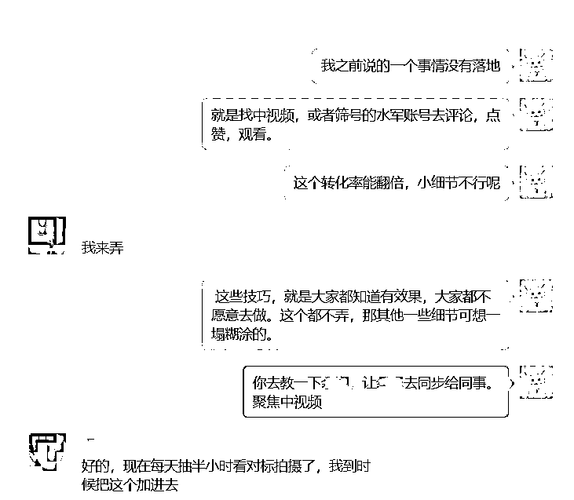

商品卡那边的流量数据，我也看了，直接沉默。

这么大的曝光量，转化率却只有**0.09%**，辛辛苦苦引进来这么多流量，结果比**5%** 的同行还低，真的太浪费了。

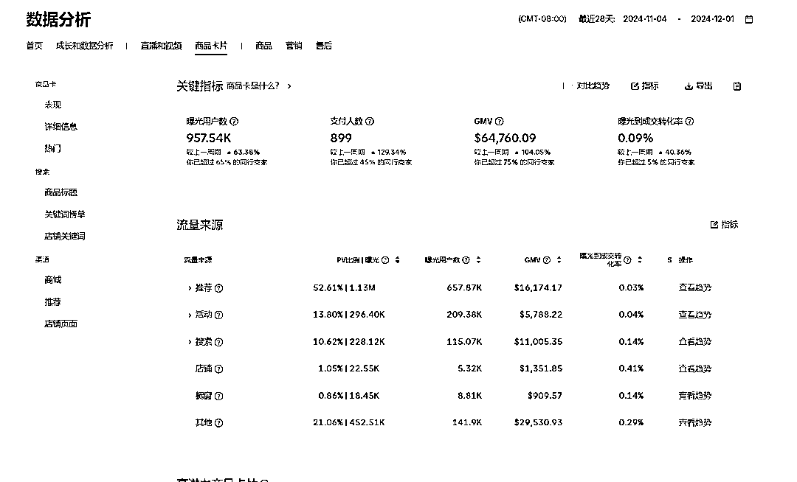

对应的调整方案：

**1.明年打算新增 5-10 个 sku 把这些流量接住**

**2.继续调优视频的标签体系**

**3.加强引导用户行动的设置**

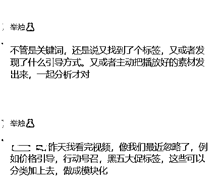

回到当下的进度，目前团队的 GMV 做到了**32 万美金**左右，不提**100w**那个目标了，哪怕完成**60%** 也还差得远，意味着 12 月至少还要再拼**28w**

我也意识到，执行力强并不等于事事都冲得快，真正的强执行体现在面对新事物、需要学习才能掌握的领域，能不能快速拿出结果。

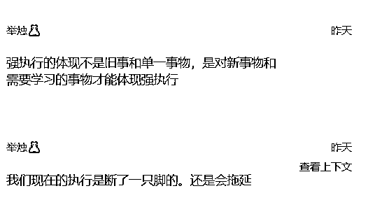

关于团队的竞品拆解方法。

我特别推荐用**pipiads**带着团队一起看

因为团队平时看素材容易先挑自然流的看，但如果直接盯广告素材，反而能避开很多播放量高但不产生成交的内容。广告属性更强的素材，也许播放数据没那么惊艳，但转化效果往往会更实在。

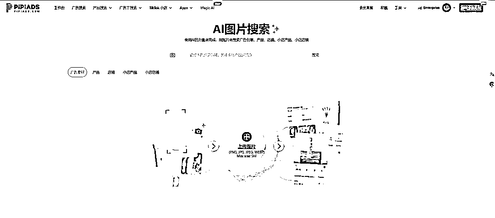

我是梁小伟，咱们下一期再聊。要是喜欢这类复盘分享，记得点赞+关注~

* * *

评论区：

🛰️用户 : 分析总结逻辑性很强，从根本出发解决实际问题，学习到了👍🏻

梁小伟 : [呲牙]谢谢认可