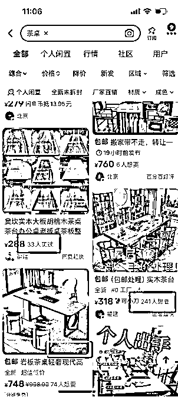
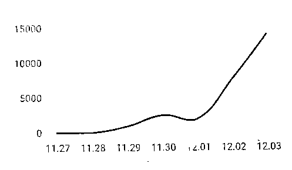
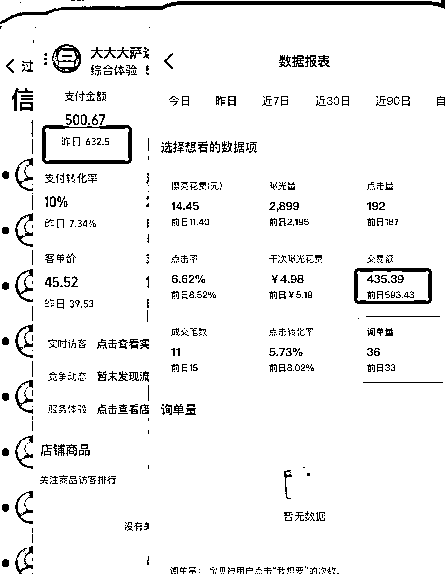

# 闲鱼付费推广实战复盘：花钱买来的曝光，能不能赚回来全看你自己

作者：杨小六  
日期：2024-12-05

大家好，我是杨小六，2019 年就在闲鱼上“扑腾”的老玩家。

最近不少圈友都在聊闲鱼的付费推广，我们团队干脆花了两个月时间，真金白银地做了一轮系统测试，踩了不少坑，也总结出一些能直接上手的方法。今天把这些经验一次性分享出来，每条都是实打实的“买教训”心得，比较适合那些已经在闲鱼上能稳定出单、想进一步放大规模的朋友。

如果你觉得有用，**点个赞** 支持一下哈。要是反响一般，那这篇就当是我的“年终总结”了，下次再聊可能就得等明年啦！

## 先搞懂付费推广的底层逻辑

说白了，付费推广就是用钱换曝光，但用户点不点、买不买，完全取决于你自己的本事。

闲鱼不是给你一个固定的广告位，而是靠算法来分配付费流量——你的产品能出单、能转化，位置就继续留给你；要是表现不行，马上换人。

所以，推广费买到的只是“被看见的机会”，最终成交还得靠产品优化和运营功底。想赚钱，必须吃透这个公式：

**交易额 = 访客（曝光 × 点击率）× 转化率 × 客单价**

- 曝光：靠推广买；
- 点击率：靠封面图和价格拉；
- 转化率：靠产品、评价、定价撑；
- 客单价：靠单品利润和连带销售提。

接下来，我就按这条逻辑展开讲讲实战中总结出来的经验。

## 流量从哪里来？搜索才是主战场

一开始我们也以为付费推广的流量主要来自“猜你喜欢”的推荐位，结果实测完全不是这样！

**真正的流量大头在“搜索”**——这也是闲鱼上最常见的用户行为路径。

- 怎么判断对方是否开了推广？
  - 搜索结果里显示“XX 人买过”，基本就是付费推广带来的流量；
  - 显示“XX 人想要”，属于闲鱼的自然流量；
  - 偶尔能看到标注“广告”的，那是从淘宝直通车跳转到闲鱼的。

## 权重与推广匹配：爆款优先，权重高就是王道

闲鱼的推广策略会明显偏向“爆款”和“潜力款”。

你开启推广后，系统会自动评估产品的权重，并标注出哪些是“平台推荐”“潜力款”“爆品”或“新品”。

为什么会有这些标签？因为闲鱼不想让一个烂产品占据好的广告位。所以系统会帮你筛选出那些适合平台、平台喜欢的产品，你照做就行——把爆款交给它，充值就完事了。

- 适合推广的品类：
  - 高利润、高转化的产品；
  - 刚起步的潜力款，靠推广快速起量。

推广不是无脑烧钱的工具，它是给产品起飞助推的。产品本身有潜力，推广就是加速器；如果产品毛病一堆，投再多钱也可能只出不进。

## 适用场景：新号福音，养号周期大幅缩短

实测下来，付费推广对新号、新品特别友好。

以前我们养号往往要花半个月，现在配合推广，养号周期能压到 3-7 天，效果非常明显。新号最大的难题就是起步难，而推广正好能帮你快速打破这个瓶颈。

## 自然流量也被带动：推广带来正向循环

付费推广不只是直接带来成交，还能拉动一部分自然流量增长。

- 我们这边的数据是：付费推广带来的成交约占 70%，自然搜索成交占 30%。
- 也就是说，推广不仅帮你出单，还会提升自然搜索的排名权重，形成流量上的正向循环。

## 成本与利润：选品精准才是王

不同品类的推广效果差别非常大，投入产出比的差距可以说是天壤之别。

我们摸出来的规律是：

- 曝光量大的类目，钱花得快，但不一定赚钱；
- 高转化率的产品，能花更少的钱获得更好的成交结果；
- 如果能找到那种曝光又大、转化又高的产品，那基本上就赢了。

**核心打法：**

- 优先选 **转化率高** 的产品做推广，最好是用户一搜就想买的；
- 控制单品利润率，确保推广之后依然有得赚。

举个例子：买衣服可能挑半天也下不了单，但买盐是为了做饭，该买就会买。所以卖“盐”这类刚需高转化品，推广效果自然更好。

## 推广前的必修课：基础准备做到位

在上推广之前，下面这些基本功必须先做好：

1. **图片**：清晰、吸睛，能在海量商品中一眼被抓到；
2. **文案**：简洁有力，把卖点和价值讲清楚；
3. **价格**：合理且有竞争力；
4. **评价**：提前打下基础，可以找熟人走几单，积累信任背书。

**注意：** 推广上线后，就进入精细化运营阶段了，转化率是唯一衡量标准！

## 理解平台规则，才是推广成功的核心

闲鱼的推广位置有限，不是花了钱就能一直保住流量。

只有在高点击、高转化的情况下，系统才会持续给你分配流量。

搞懂这个规则后，我们总结了几个关键点：

1. 曝光是花钱买来的，但转化率才是决胜关键；
2. 优化图片和标题，是提升点击率的核心；
3. 优化价格和评价，是提升成交量的关键。

**干货公式：**

- 曝光靠推广；
- 点击率靠图片和价格；
- 转化率靠产品和服务。

## 两种推广玩法：单品爆破 vs 批量覆盖

通过反复测试，我们摸索出两种有效的打法：

1. **单品打法：**
   - 挑一个高转化率的产品；
   - 做好基础优化后，集中预算推爆它。

2. **批量玩法：**
   - 准备多个产品，逐个上线测试推广；
   - 多账户同时操作，把规模效应做到最大。

**终极目标：** 通投全覆盖，彻底跑通模型，“别墅靠海”就不再是梦！

闲鱼推广本质上不是“花钱买流量”那么简单，它更像一场以点击率和转化率为核心的运营战。

- 如果产品基础差，砸再多钱也可能颗粒无收；
- 但如果运营扎实、优化到位，推广完全可以让你的业务实现指数级增长。

希望这份实战干货能帮你少走弯路，尽快在闲鱼赚到第一桶金！

有任何问题或想深入交流的朋友，欢迎加鱼丸来找我——多交流才能有进步，而且聊钱不伤感情～

* * *

评论区：
暂无评论