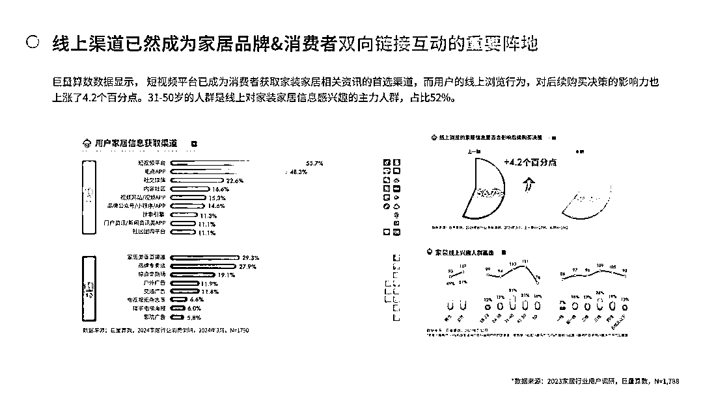

# 低投放也能吃到大流量：家装品牌如何卡位本地生活红利

> 原文：[`www.yuque.com/for_lazy/zhoubao/pyx1n19i0465i4sl`](https://www.yuque.com/for_lazy/zhoubao/pyx1n19i0465i4sl)

## 低成本打爆本地流量的赛道：家装企业该怎么吃到本地生活红利

作者： 楚川

日期：2024-12-02

**Part1**

**家装内卷到临界点，找新流量是自救刚需**

2024 年以来联系楚川的家装企业明显增多，并非我们在家装品类拿到了爆款案例，而是整个行业已进入极度内卷、必须转型的拐点。真正有自救意识的中坚企业，都在四处寻找新的流量洼地。

与 50 多家年交付量 300 套以上的家装公司深度交流后发现，这个赛道的现状很残酷：要么被流量裹挟，要么被渠道绑架，突破口极其狭窄。

在豪雅门窗与南北旺全铝家居的项目中我们看到了局部突破，但多数品牌对流量变化的反应迟缓。家装自媒体的二次跃迁已经慢半拍，行业因此陷入「价格战加剧、综合成本攀升」的怪圈。

以下是对家装自媒体第二增长曲线的拆解，一家之言，仅供参考。

此前文章：[建材行业如何找到第二增长点？门窗工厂云连锁增长复盘](https://articles.zsxq.com/id_feb760rkrabg.html)

**Part2**

**家装必须拥抱短视频与自媒体，否则基本无路可走**

家装当下困境，从三点就能看清。

**第一，存量用户池被互联网大平台强行截胡。**

贝壳孵化被窝家装，继而收购圣都、爱空间，率先突破百亿营收；阿里、字节、京东也在加速布局家装赛道，瞄准千亿级市场。中腰部家装企业的生存空间将在 2-3 年内被大平台严重压缩，过去靠直接买量赚钱的模式很快会失效。

**第二，信息流获客越来越贵，抖音本地生活红利正当时。**

楚川调研显示，家装公司主流获客仍以线上信息流为主：百度、抖音、小红书、腾讯系投放，以及线下公交、地铁、楼宇广告、电台电视等。三线及以上的城市，单客获客成本已超 1.5 万元，且持续抬升。

广州无忧美装的公交车广告

与华东华南区域老板交流后发现共识是：大家都清楚自媒体下半场靠内容力，但团队专业度不足、耐心不够，一直难以下定决心在短视频上做深。

现在以信息流为主的投放本质是线索买卖，短期还能跑，长期必死。

**关键的信息差是：老板与团队尚未真正get到以抖音为核心的本地生活流量红利。过去信息流的痛点是无法沉淀品牌资产，只能靠实体广告做曝光。**

很多企业尝试做 IP 后发现流量太泛、本地占比太低，投产效率直线下滑。

**而抖音本地生活的算法逻辑是围绕区域成交，天然契合「线上种草、线下签单」的闭环。**

数据显示，2024 年一季度，短视频已成为用户获取家装家居资讯的第一入口，**使用率超过 60%。**

年中数据更明显：短视频平台上「家装家居」关键词搜索量同比翻 6 倍，「全屋定制」话题播放量累计 231.3 亿次。背后既是用户习惯迁移，也是品牌内容供给在放大。

**这种微观变化带来的行业级机会，还没被大多数家装老板看见，未来增量极具想象空间。**

**第三，消费人群换代，必须在线上场域触达。**

35 岁以下人群已占家装家居消费主力超 60%，且超 70% 的装修信息来自自媒体平台。对年轻客群而言，短视频已是品牌与用户双向奔赴的主战场，做不做已经不是选择题。

**Part3**

**获客成本逐月上行，闭眼赚钱时代已结束**

信息透明时代，核心是用户为中心、降本增效。

**第一，消费降级下毛利承压，线索买卖模式走不通。**

经济环境下用户捂紧钱包，家装毛利被持续压缩。短视频与表单带来的线索需求不精准，会导致转化差、成本高，生意无法滚动。

转向本地生活流量的逻辑就在于此：从区域切入，人群有天花板、流量红利期 2-3 年、打法更匹配，成本可控。

**靠短视频矩阵实现人群全覆盖，利用自然流+搜索流筛选高意向客户，再用本地推+直播放量，在区域内容体量打足后，获客成本往往能降到之前的 50-60%，甚至更低。**

基于门店定位的本地生活推荐机制，单店累计 2 万条以上内容后，可形成一年以上的长尾效应，这不是一次性买卖，而是可复利的流量资产。

**第二，新一代消费者的决策逻辑变了，内容是生命线。**

过去信息不对称，消费者吃哑巴亏。现如今用户都是互联网原住民，能迅速比对多家信息、评判企业实力与服务水准。

**所以内容必须做深，而非只投不建。**

我们在服务 6000 多家实体企业时发现，抖音付费流量中 80% 以上为新客，意味着这是图文时代和付费投放阶段未触达的人群。

**本地生活流量带来的基本都是对品牌陌生的新用户，他们只能通过短视频判断一家公司靠不靠谱。这就要求品牌必须走进自媒体阵地，用内容讲清服务与产品力。**

把原来投在户外与销售的资源，迁移到本地生活流量池，用内容打动用户，让消费者清楚你能解决什么问题。

**解决这两件事，家装企业完全可以在本地生活赛道完成二次腾飞。**

**Part4**

**要在本地生活持续拿结果，未来 2-3 年有增长，必须全员拥抱短视频**

如何理解全员转型？

过去只做信息流投放或养一个品牌 IP，基本等于 90% 的员工与抖音无关，长期结果不可持续。

随着本地生活权重提升，领先企业已建立起全员创作体系。家装公司必须让老板、高管、设计师、项目经理、工程部都参与创作与分发，建立与消费者长期在线的连接。用户在哪，服务者就该在哪。

**举例：一个 100 人的团队，人均每天发 5 条，半年就能产出 9 万条内容，播放量轻松破千万。** 以这种饱和覆盖的方式持续占据区域心智，客户选择你的概率自然提升。

**抖音是无限发传单的基础盘，负责持续占有率；小红书与 B 站是补充增量，吃余量。** 这样才能完整吃到自媒体下半场红利。

**最后，线上归根到底要回到线下。**

自媒体建立信任后，邀约到店就是关键一环。必须避免线上线下体验断层，展厅、销售话术、环境、签约流程都要丝滑，才能把流量真正转化为低成本成交。

* * *

评论区：

暂无评论