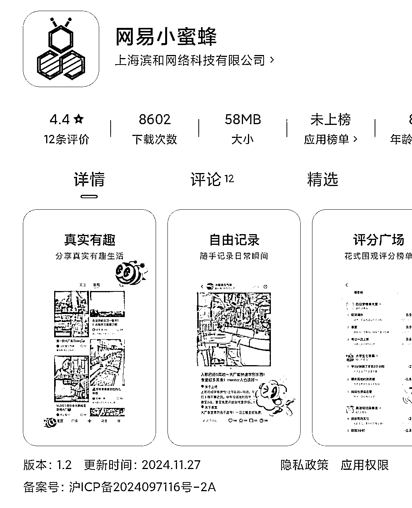
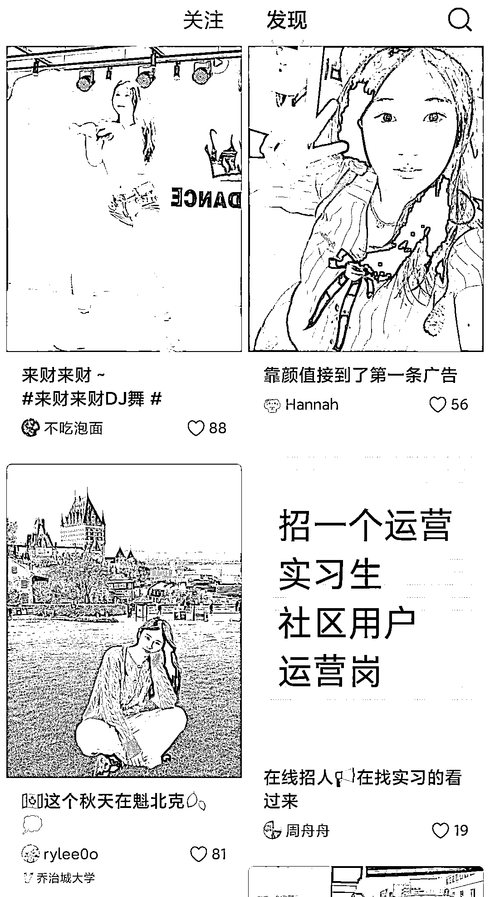
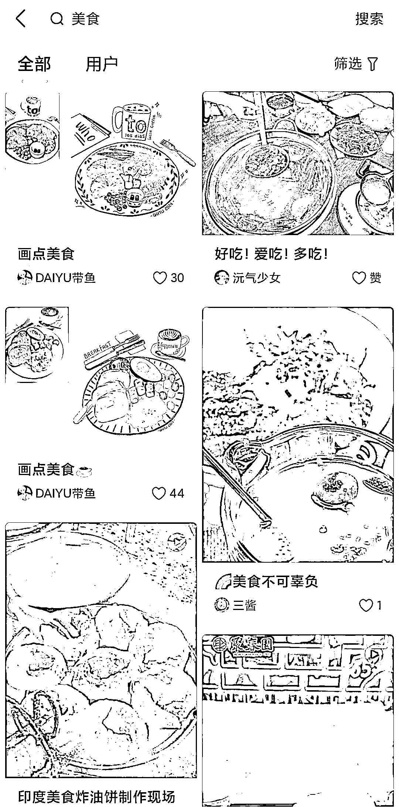
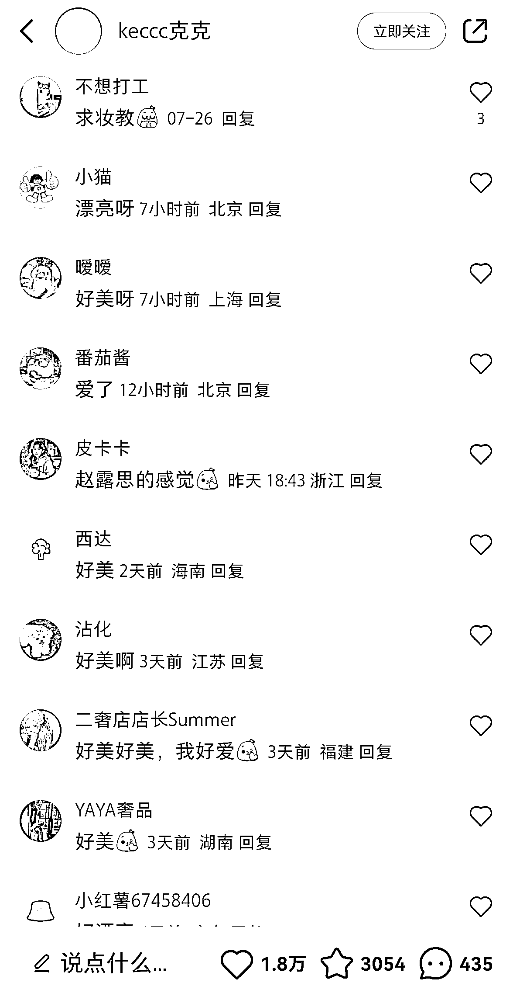
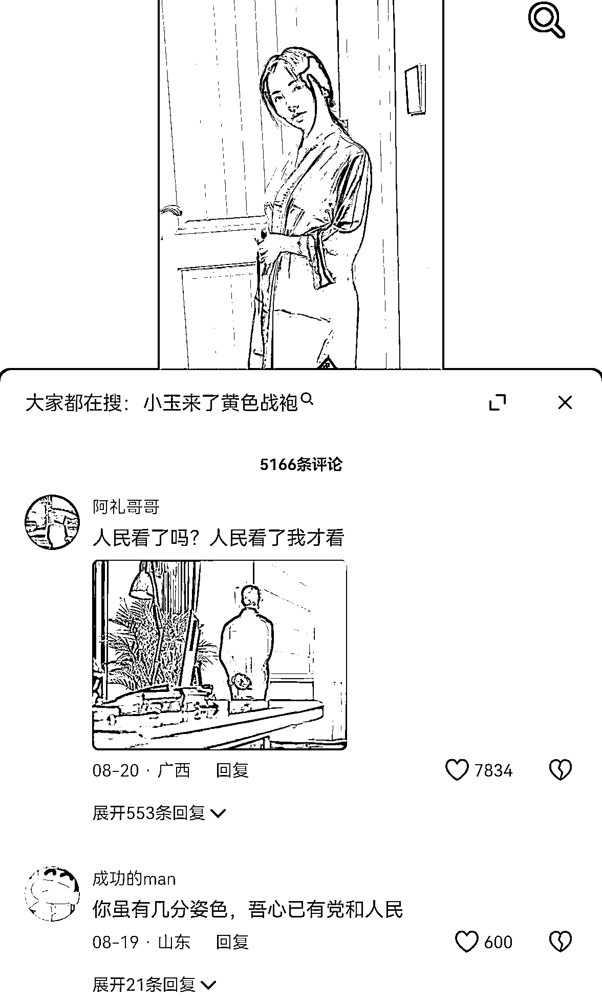
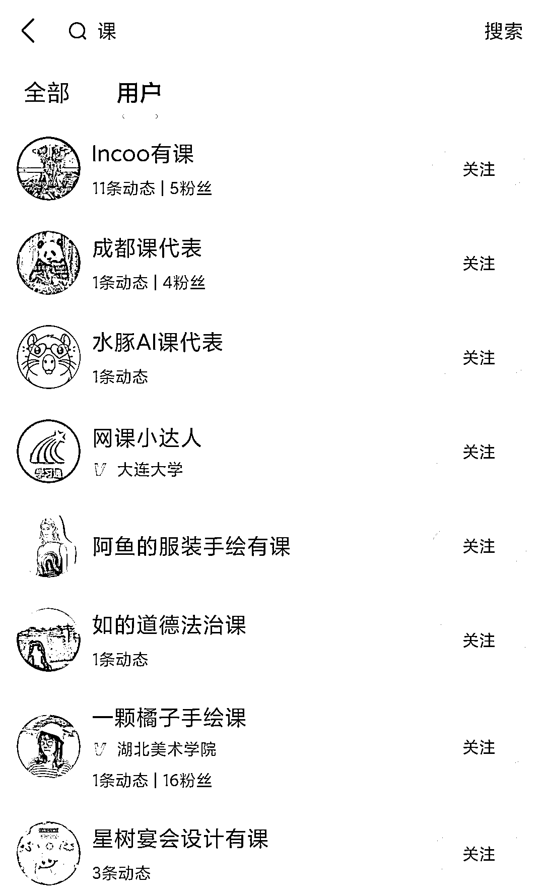
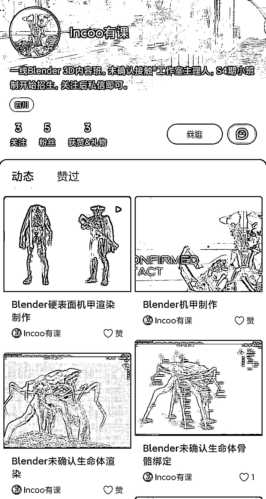
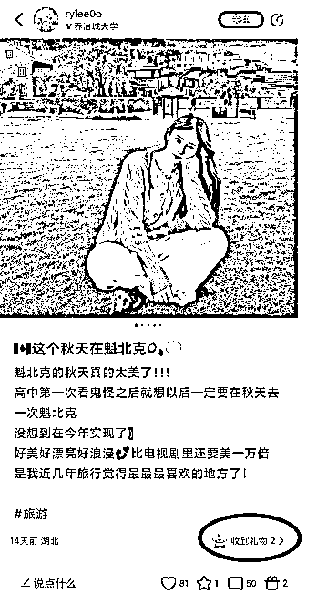

# 用“小黄书”来做一次拆解，新平台到底值不值得现在冲？

## 以“小黄书”为例，判断一个新平台现在是否该入场

作者： 古辛

日期：2024-12-02

说到底电商选品本质上就是选赛道，而选赛道不止是选品类，选平台同样关键。古辛过去更习惯直接告诉大家哪个平台能做，以及在该平台上怎么选品、怎么找对标号，很少系统讲过一套“如何判断平台值不值得入场”的方法论。今天就拿网易推出的那个内容社区做个实操案例，来演示一下新平台的评估思路。

这个产品叫小蜜蜂，是网易做的一个对标📕的社区，App 主色调偏黄，圈内就顺口叫它“小黄书”。目前迭代到 1.2 版，整体还非常新。

古辛判断一个新平台能不能现在就去做，主要看两件事：第一，用户体量够不够大，有没有做生意的临门人流；第二，能不能把流量变现成钱，无论是平台内开店还是导流到私域都算。

**先看人有多大**

**1. 安装量**

国内的应用商店高度分散，每个手机厂商都有自己的渠道，只看单一商店不算完整，但作为一个初步参照是可以参考的。

比如小蜜蜂在小米应用商店的下载次数显示是 8000+，单位是“次”而不是“万次”。就算这个数字有失真，也足以说明目前下载并且使用的人基数并不大。

**2. 内容互动量**

对于内容型社区，最直观的流量体感就是点赞数。随便往下翻小黄书几页，点赞最多的一批笔记也才 80 出头，这就很能说明问题，活跃用户确实稀少，整体声量很弱。

怕是推荐机制把内容刷歪了，也可以直接搜大盘词去验证，比如“美食”、“美女”。这类词在任何内容平台都是顶流，如果连这些词下的内容互动都低得可怜，那流量判断就站得住脚了。

做到这一步其实结论已经出来了，小黄书现在的流量规模撑不起商业化，当下入场性价比不高。但为了把评估流程走完整，我们还是继续看第二部分，变现是否通路。

**3. 中青年女性人群是否充足**

做电商的人都知道，消费决策的核心人群就是中青年女性。平台里这个比例越高，生意就越好做；男性占比过高，电商项目就要慎重。

📕被各家平台抄作业的核心原因之一，就是它牢牢抓住了高价值的中青年女性用户。

市面上对头部平台的人群结构，基本都有第三方机构的公开分析。没数据的情况下，也可以用评论区做粗筛，比如搜“美女”，点开头部内容看评论风格。

女性为主的社区，美女笔记下的评论通常是这种调性；

男性为主的社区，视频下的评论往往是这种画风，辨识度极高。

想做正经的生意，平台的中青年女性占比必须过关。

**再看钱能不能赚回来**

**1. 能否直接开店卖货**

小黄书目前没有开放店铺功能，平台内直接成交这条路是堵死的。

**2. 能否做引流**

判断能否引流，古辛习惯搜“课”。做课程的账号是全网研究引流最极致的一批人，他们到哪都能想办法导流。直接搜索一下就能看出平台的引流环境。

不过小黄书现阶段流量本身就很小，就算能引流也没规模可做。

**3. 是否有别的变现路径**

除了带货和引流，还有广告、打赏等模式。虽然小黄书现在既不能内购，也基本引流不出量，但它有一个亮点：内置了打赏功能。

这是它和市面上其他📕类平替的一个本质差异，也可能是未来的差异化机会。

只要能变现就能给创作者持续动力，打赏这个设计，既区别于📕，也让小黄书在同类仿品里多了一点独特性。

流量评估做完，变现评估也做完。综合来看，现在去入场小黄书并不是好时机。平台目前处于非常初期的冷启动阶段，没有流量红利，投入产出比太差，甚至平台本身能否存活都是未知数。更稳妥的做法是先观察，等它成长到一定体量再做二次判断。

* * *

评论区：

更绪 : 直接从公司的逻辑判断，网易的产品就大概率不值得做

朱小童 : 我觉得也是，丁三石的产品活下来都挺难

px : 网易家的 app 就直接放弃吧