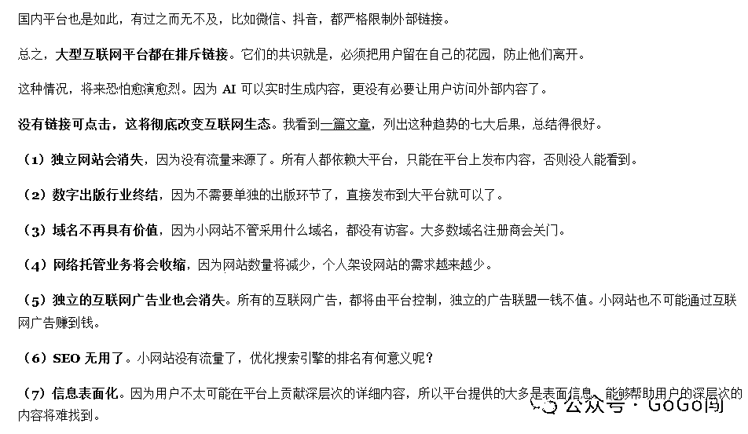
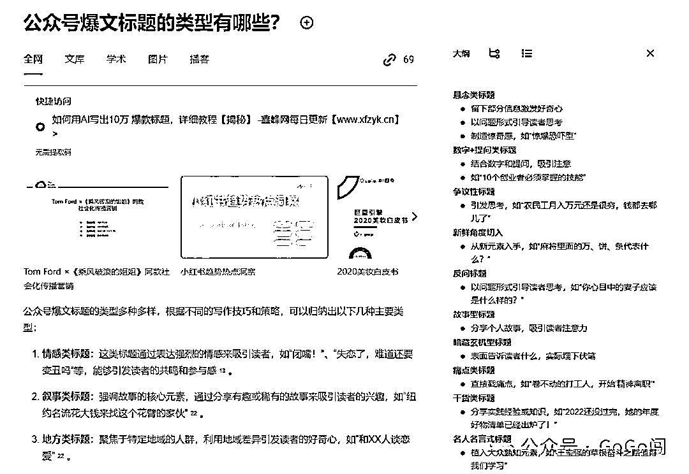
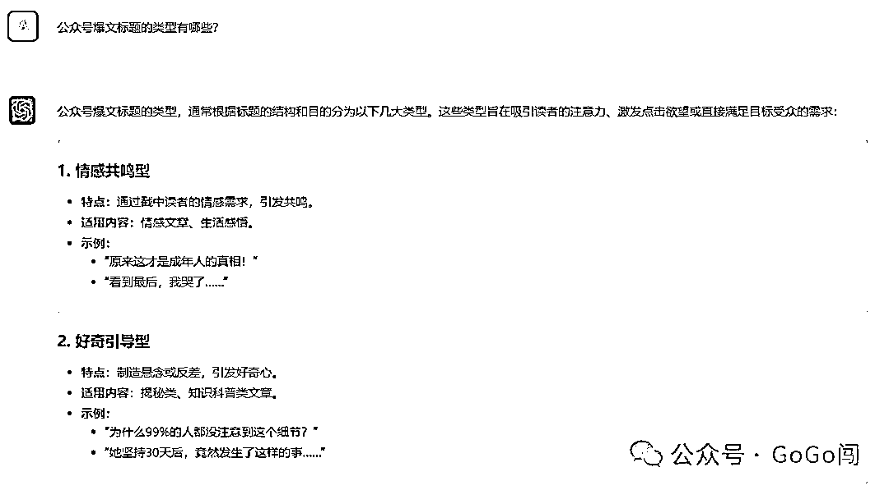
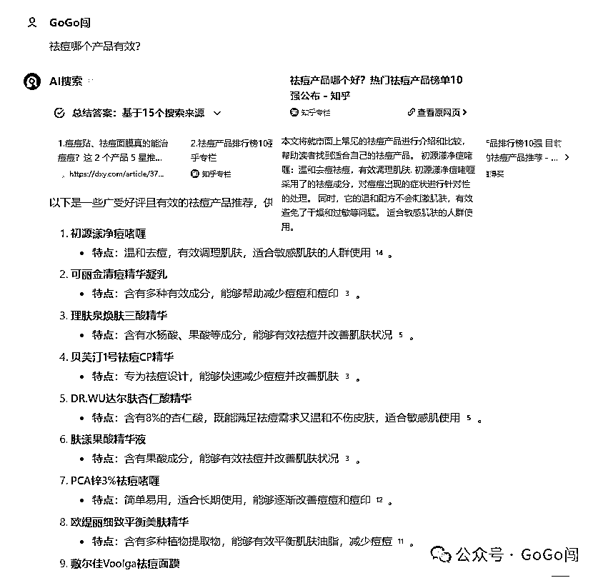
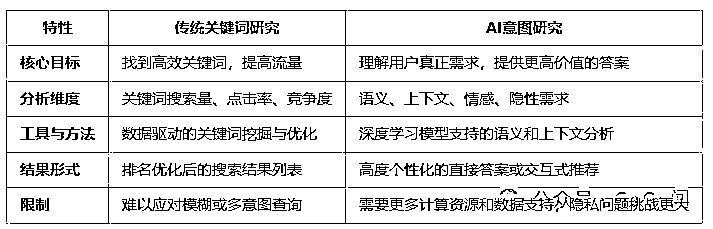

# AI 搜索正在改规则，SEO 还有几张底牌？

最近，圈子里又有人喊：SEO 完了。

这个声音的源头，是阮一峰《科技爱好者周刊》里编译的一篇海外文章，题目叫《没有链接的互联网》。那位作者的判断，简单概括就是：

ChatGPT 以及秘塔这类基于大模型长出来的 AI 搜索，已经可以跳过链接、直接给出答案。用户问完就走，根本不用跳转。这种体验让大平台慌了神：都这么玩了，用户还怎么留在站里？于是，各家平台一边收紧外跳路径，一边加速自研 AI 产品，想尽办法培养用户在自家 AI 里的使用习惯，先把地盘圈住再说。

用行话讲，这就是流量分发的底层逻辑变了。AI 搜索把用户留在答案页里，不再给网页导流；传统平台则把围墙越砌越高，流量优先喂给自家的生态。SEO 这个依附搜索流量而生的角色，自然被推到了风口浪尖。

眼下国内 AI 搜索还会展示引用链接，所以一个很实际的问题是：在这种新玩法里做 SEO，跟当年做百度、谷歌 SEO，到底有什么区别？GoGo 闯从三个角度聊了聊自己的观察。

## AI 搜索里，排名还有多少存在感？

传统搜索引擎的核心是“排序”：把一堆网页按相关度排好，让用户一页页翻。AI 搜索完全不是这个套路——它直接把一段答案怼到你面前，最多在句末给你一个角标。用户压根看不到网页标题，自然也谈不上对第几名有什么感知。

比如秘塔 AI 搜索的呈现方式是这样的：

再看看 ChatGPT-4o，答完题连链接的影子都找不到：

过去在百度、谷歌拼排名，拼的是四个条件：网页标题和关键词的匹配度；网页的用户体验和访问数据；网站本身的权威性与可信度；平台在流量分发上有没有给你的站点“暗箱操作”的机会。前两项，正经 SEO 都能做；第三项，黑帽选手偶尔能靠伪装蒙混过关；第四项，纯属平台特权，SEO 无从插手。

到了 AI 搜索时代，前两个条件的价值一落千丈——用户不读标题，引用链接也少有点击，自然就无所谓“我排第几”了。与此同时，后两个条件的权重并没有消失：AI 依然更信任权威网站，依然会受到平台生态倾斜的影响。

## 个人小站：正在被 AI “选择性遗忘”

AI 搜索的工作流，通常是先读网页，再提炼出答案，最后把来源以角标附上。如果你留意过这些角标，八成会发现它们翻来覆去就是那几个熟悉的大名字——知乎出现的频率尤其惊人。

原因也简单：AI 不想翻车，就得优先采信那些有口碑、有影响力的站点。大量个人小网站，很可能连被“读”的资格都没有。换句话说，AI 在给你答案之前，已经悄悄把小网站过滤掉了。

所以在 AI 搜索里推销自己的产品，光靠自建站基本等于“隐身”。更可行的思路，是把内容做进大平台，靠平台的权重去争取被 AI 引用的机会。整体来看，个人网站 SEO 的退出，几乎是板上钉钉的事；能留下来的，只有平台 SEO。

## 正文的地位，正在赶超 title

传统搜索引擎从诞生起就格外重视标题。基于倒排索引的那套机制里，title 承担着召回和排序的关键任务，关键词出现在标题里，比出现在正文里管用得多。

但 AI 搜索把这个逻辑颠倒了过来。

过去做 SEO，总在研究怎么把关键词塞进 title；现在，研究用户搜索意图才是正经事。过去强调 title 里的关键词匹配；现在，正文能不能精准呼应真实需求，才是被 AI 选中的关键。

举个例子。你对 AI 搜索说：“今天跟女朋友吃完饭后我打算求婚，帮我推荐八王坟附近合适的餐厅。” AI 听到的不是“餐厅”“八王坟”两个词，而是一个完整的场景：安静、浪漫、有格调、私密性好、适合约会和求婚的地方。然后它会去正文里找具备这些特征的页面，组织成答案。

这说明什么？标题里写不写饭店名称，已经没那么重要了；正文里有没有“安静”“浪漫”“私密”“求婚”这类场景化表达，反而成了 AI 衡量相关性的尺子。

## 机会正在重排，但别急着梭哈

讲完这三层变化，GoGo 闯又往远处看了一眼。每一次流量分发规则的改变，都意味着一轮财富再分配。即便这种再分配大概率只是在存量池子里腾挪，也一定藏着新机会。

他坦言，自己也不是预言家，看不清几年后的具体走向。但他相信，AI 要真正渗透到千家万户，得先产生流量价值，然后才轮得到用户价值。而流量总要有一个入口来承接，未来真正的变盘，或许要等“操作系统级 AI”落地。想到这里，他的反应是：悟了，梭哈 APPL、GOOGL、MSFT！

## 白杨SEO：说得对一半，但别急着唱衰

白杨SEO 看到上面的分析后，先是自嘲了一句：论网站 SEO 的技术优化，他确实不如这位作者。但“SEO 无用”这个结论，他只能认一半。

他认同的那一半是：个人网站 SEO 的大势已经没了。个人站要么拿不到平台权重，要么赚不到钱；即便是出海谷歌 SEO，未来也一定是团队化作战。普通人更应该把精力花在平台 SEO 上，自己的独立站留作一方自留地就好。

他不认同的另一半是：排名不会消失。理由很简单——排名又不只搜索引擎有。电商有商品排名，短视频有内容排名，笔记有笔记排名。除非哪一天用户完全不做主动搜索，或者所有平台都合并成一个 AI，否则排名的需求总归在。百度、谷歌里的 SEO 主要围绕网页排序打转；而在淘宝、🛰️、抖音、📕里，关键词优化照样可以用在商品、文章、视频和笔记上。平台就算推出了 AI 问答，也不会改变用户自己挑选、比较的行为习惯。🛰️搜索上线 AI 问答之后，长尾词流量还能不能做，也还是同一个问题。

更关键的是，SEO 这个词早就该重新定义了。它不再只是“网站搜索引擎优化”的技术，而是一种渗透到所有平台的流量思维。白杨SEO 曾用一篇《白杨SEO：我们说的SEO思维到底是什么？详细举例【推荐】》专门聊过这个话题，有兴趣的可以翻出来看看。

他还提醒大家别高估 AI 的普及速度。随手问问身边人，就会发现还有很多人的日常工作和 AI 毫无交集。他此前了解到，AI 培训、AI 写作等创业项目，当前最主要的付费用户竟然是大学生群体；国内各家 AI 公司还在疯狂补贴换用户，海外看上去热闹，实际也只是一小撮人走在前面。

至于为什么总有人说 SEO 没用了，白杨SEO 觉得，本质是嫌它来钱太慢。SEO 本来就是用优化手段换自然流量的免费渠道，天然比广告投放见效慢；再加上短视频、直播把推荐流量推成了主流，搜索流量就显得越来越“鸡肋”。

但在白杨SEO 看来，搜索流量的价值恰恰藏在“主动”二字里。用户是自己搜出来的，需求已经非常明确，这种精准流量永远是稀缺资源。TOB 业务尤其依赖它，哪怕是培训、美容这类高客单价的 TOC 生意，搜索渠道的转化也比被动推荐更可观。

所以，谁要是真信了“SEO 无用”，白杨SEO 也只能哈哈一笑。在内容过剩、流量红利触顶的今天，他更相信那句“剩者为王”：真正能活下来的，不是追风口的人，而是能把精准流量握在手里、把私域运营做扎实的人。

老话说得好：晴天修伞，饱带干粮。与其听别人说东说西，不如自己下场试一试，学一点，练一点，对自己有没有用，答案自然就有了。