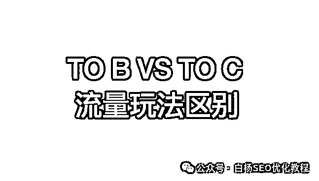
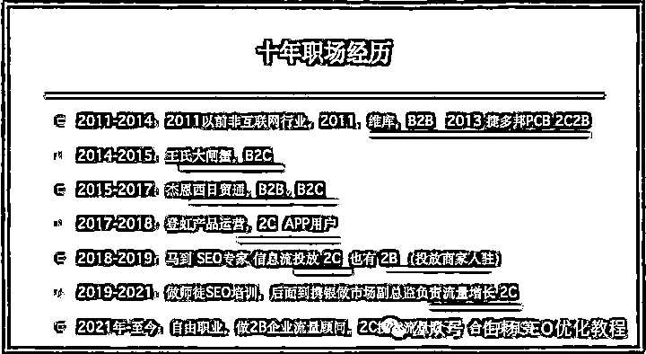
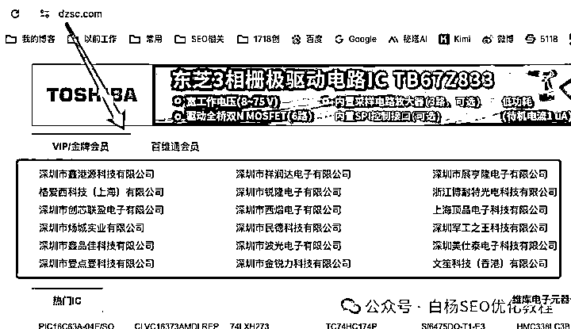
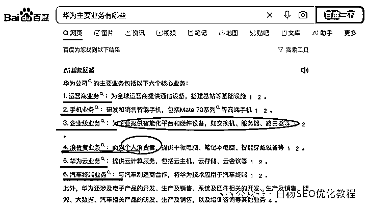
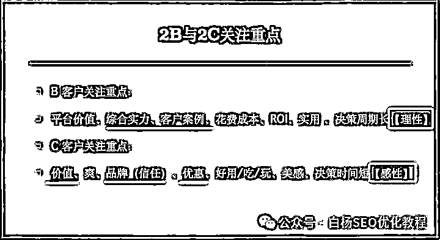
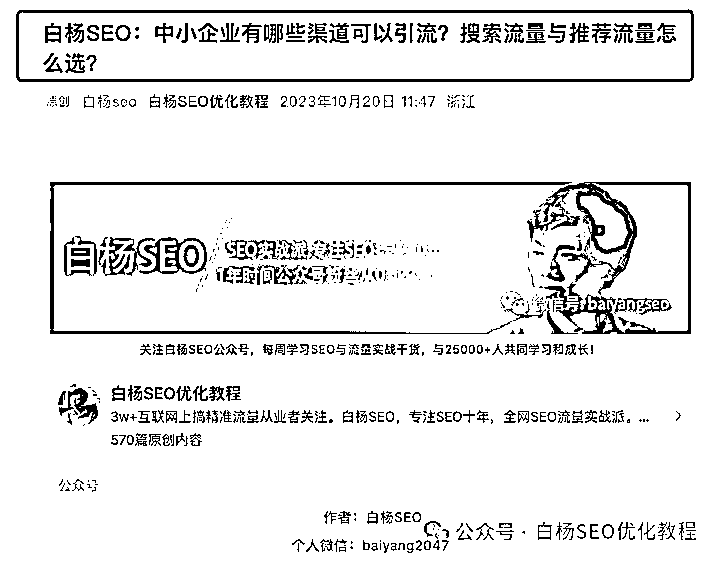

# B端客户还是C端消费者，推广资源应该投在哪？

时常有朋友在🛰️里问我：我做某某生意，到底该去哪个平台做推广？问得多了，就整理成一篇可收藏的参考。

这篇文章的结构如下：
1. 我凭什么聊这个话题？
2. B端和C端的分野在哪？
3. 两类客户各自看重什么？
4. 获客增长，打法哪里不同？（重点）

## 1. 我凭什么聊这个话题？

许多朋友的印象里，我只做网络排名优化。事实上，这不过是我过去十年工作中掌握的一项技能。我最早跑销售，后来转做网络推广，从外链、网站排名到电商搜索排名，一步步做到管理岗；2014年又进入一家知名大闸蟹品牌做运营。如今我自由接单近四年，算是一个人经营一家微型公司，每周都会接到大量关于获客的咨询。理论积累和一线经验都不缺，所以可以聊一聊。下面几张图，是我职业轨迹的简要回顾。

无论你在企业里任职，还是自己创业，都可以参考这套思路。

## 2. B端和C端的分野在哪？

先说B端。B端生意就是客户是机构/公司，付款方是企业。我早年卖过电子元器件平台的会员套餐，也卖过跨境贸易网站的企业会员，这些都属于B端；现在常见的代运营公司和咨询顾问，本质上也全是B端服务。当时的会员产品截图我还留了一些，贴在下面。

B2B平台与B端生意是两回事。B2B更多指电子商务平台，像阿里、维库这类市场；B端则代表业务属性。两者有交集：很多做B端的企业会去B2B平台开店，因为企业采购者已经习惯去那些地方找货源。

一家公司往往同时存在B端和C端。阿里旗下既有面向商家的广告体系，也有面向大众的会员付费产品；华为卖手机给消费者，同时又为大量企业提供解决方案。判断方法很直接：看看公司产品最终卖给谁。下面这张图能看出这种双栖模式。

## 3. 两类客户各自看重什么？

两类客户的决策逻辑差异，我用一张图来呈现。

B端客户做选择时，最关心合作方的实力、案例、可获得的回报、价格与服务。一句话总结：谁在用它？服务体系是否成熟？同时，B端决策天然偏理性、周期长，因为企业任何一笔支出都要有正当理由，有的还要过评审流程；现在企业花钱更谨慎，每一分钱都希望花在能带来收益的地方。

C端客户则要分两类：追求品质的用户看重品牌和产品价值，更大众的消费者看重折扣与性价比。看看京东用户和另一类低价电商平台用户的差异就明白了。C端还有一个特点，就是情绪驱动更强。带货直播能火，不只是因为价格看起来便宜，还在于主播创造了即时互动和愉悦感。

## 4. 获客增长，B端和C端打法哪里不同？（重点）

B端增长可以从线上、线下和团队三条线来看。

线上：产品型的B端生意，可以考虑在大型B2B平台开店铺；服务型B端，把百度搜索投放和自然排名作为基本盘，抖音也绝不能忽视。线下：行业展会、垂直峰会，都是接触高质量线索的好场合。

传统但有效的还有电话销售，现在很多公司已经换成AI外呼来做初筛。老客户转介绍、同行口碑推荐，也是长期稳定的来源。

团队配置上，企业最好有一名能统筹全域推广的人。我认识一个年轻人，在一家游乐设备公司负责整体获客，付费投放和自然搜索排名都管。若没有，就招聘或培养；外包能缓一时，但长期还是自建队伍更划算。

C端增长则侧重快速放大。

最直接的办法是付费投放，包括原生Feed广告和搜索广告。现在个人流量密集的平台主要有🛰️、抖音和📕。🛰️生态里，可以投放好友动态、订阅号文章末尾、🛰️搜索等位置；抖音和📕同样有原生Feed和搜索两类广告。

投Feed广告，重点是广告素材与文案是否能抓住人；投搜索广告，重点是选对关键字并让页面内容与之匹配。前者适合优化师加设计师的组合，后者则要请懂搜索增长的人参详。

不花钱的路径也有，比如免费网络推广和带货直播。免费玩法可以分成两类：一类是依赖平台推荐机制获得曝光，另一类是依赖用户主动搜索获得访问。具体取舍，可以翻看之前的文章。

至于社群传播，这个思路当然可用。但别忘了，最初的用户从哪里来？最终还是要回到推广环节。

总结一下：B端和C端的本质差异，更多表现为平台选择差异。B端重点经营搜索平台和短视频平台；C端重点经营社交平台、短视频平台和种草平台。两边都做的话，短视频平台和知乎这类内容社区可以兼顾。最终只有一个判断标准：你的买家平时待在哪个平台，推广就去哪里。

关于作者：白杨，长期研究企业获客与搜索排名，有十年一线操盘经验，更看重实际可落地的打法。