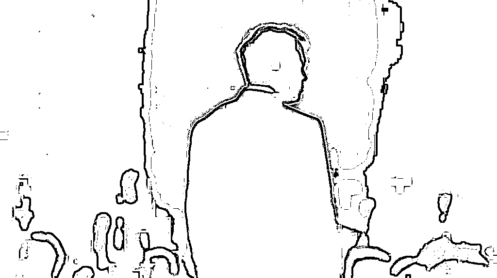
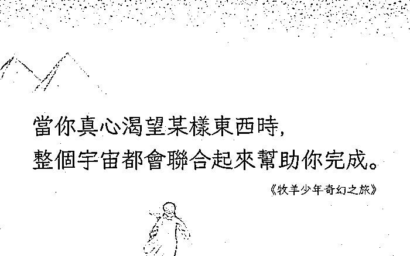
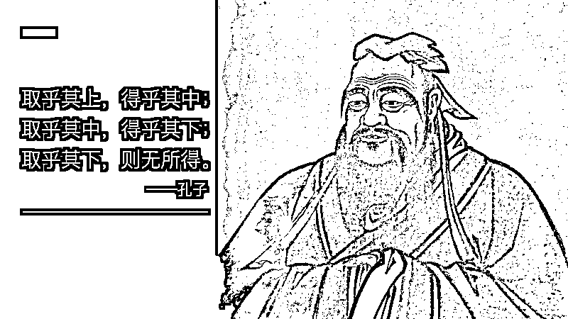
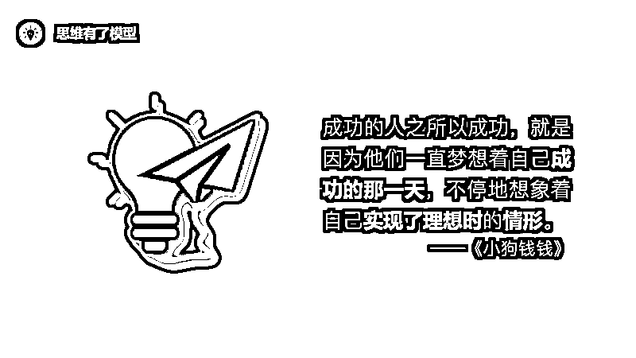
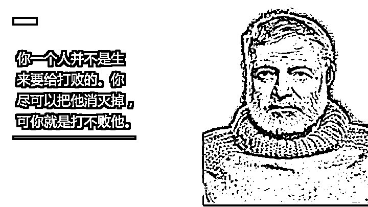

# 企图心：成功的起点
作者：龙哥

## 企图心：成功的起点

作者： 兰陵王

日期：2024-11-25

一篇把梦想本质讲明白的长文。

2021 年 4 月 10 日的那天，我对成事的逻辑忽然开窍，并在朋友圈留下了一条推演：

**巨人之路 = 企图心 × 生态位 × 模型树**

企图心是第一根支点，换句话说就是内在的意向，没有足够的想去做的冲动，后面的一切都无从启动。后续提到的坚韧、爆发、热忱，本质上都是企图心在起作用。

再看生态位。仅有冲劲远远不够，北上广深里奋斗的人群是最渴望翻身的群体，可现实很残酷，绝大多数人穷其一生也难以在那里拥有属于自己的不动产。

根源在于，付出不等于产出，只有把力量投向正确的事，成果才会显现。

选对赛道比盲目苦干更重要。

一个人的上限多大，努力最多只占一半。于我而言，努力与吃苦是最廉价的资源。写字楼里谁不加班？谁不卖力？谁不辛苦？区别在于选择，你是否顺着大势走，是否站在对的赛道上，是否踩在风口上发力。——《写作是最好的自我投资》

最后谈模型树。有了冲劲，有了合适的位置，还缺体系化的认知与技能。模型树正是打开这一切的钥匙。

企图心、生态位、模型树三者形成闭环，成事的路径就完整了，这就是我所说的巨人之路。

上大学时我也曾推导出一个近似公式：**成功 = 努力 × 方向 × 能力**。

那时把努力当成企图心，但企图心的范畴远大于努力，还涵盖坚持、热情等诸多层面；方向对应当下的生态位，当时我还不懂生态位这个概念；能力对应现在的模型树，若早点明白，我的进展会更快。

生态位的主题我写过，《成为第一》《深耕细作》《与众不同》《生态位》几篇都在谈它；今天这篇，聚焦「企图心」。

## 为何企图心不可或缺

写下“为何”二字时，诸多往事涌上心头，我的个人轨迹本身就是企图心最好的样本。

**一、企图心会生长出你所缺乏的一切**

企图心像画笔，有了它，所需的东西会自行生长。

常言“寒门难出贵子”，我不全认同，但我承认命运偶有漏网之鱼，关键是你是否拥有一颗远超常人的企图心，一颗永不熄灭的企图心。

讲讲我的出身。

我出生在贫困的山村，6 岁时母亲突发重病，从此高位截瘫。为医药费，父亲半生的积蓄被抽空。

对农村家庭而言，这接近毁灭。农村人最怕生病，一场大病就能掏空一个家。

因此我 6 岁就尝尽了人情冷暖。有人 18 岁才成年，我的成年礼在 6 岁那年就已完成。

邻里会欺负弱者，他们会找茬说难听的话，还会拉帮结派，以欺负老实人来获得优越感；他们会阻止自家孩子与我玩，我以前的玩伴因偷偷来找我，都被家长训斥过……

这只是童年的一角。

如果你在 6 岁时遇见我，会相信一个出身贫寒、父母不识字的孩子将来能出人头地吗？

如果你在高中时遇见我，会相信一个无论如何努力都进不了班前五，最后只差 7 分过本科线的人，将来能有所作为吗？

如果你在复读时遇见我，会相信我和宇环站在天台上说要改变世界，今天真的在靠近那个梦想吗？

如果你在大一时遇见我，会相信一个平平无奇、毫无特长的男生，写的文章会被上市公司印发给员工学习吗？

……

你难以想象，连我自己当时也不清楚未来会怎样。

但我一直握有一件珍贵的东西——企图心。我不知道要做什么，但我知道我一定要成为一个厉害的人，要改变世界，让世界更好。

正是这股力量，让我从一张白纸变成一幅风景；让我从零认知起，通过阅读、思考、实践，成长为认知较高的人。

很奇妙，企图心似乎懂得我需要什么。我想创业，它让我悟出知识树，具备快速学习任何领域的本领；仅有拼劲和能力不够，于是它又让我悟出生态位，让我刚毕业就找到人生的坐标。

这就是企图心的价值，即便你现在一无所有，只要心里有一团火，你就能一点点长出所需的一切。

**二、企图心是改变发生的起步**

俗话说“叫不醒装睡的人”，更准确的说法是“叫不醒没有企图心的人”。

从前我总想帮身边朋友，告诉他们阅读的重要性，生态位的重要性，把知识树分享给他们。

后来发现根本帮不了。

因为他们缺乏企图心，并不真想改变。

我一个好朋友，她妹妹学习一般，问我有没有办法。我研究学习方法，很想推荐知识树高中版，最后没推荐，因为她妹妹对学习方法没有强烈的渴求。

同样，身边不少朋友嘴上说想改变、想拥有我的认知，可当我推荐书单、推荐知识树时，他们直接拒绝了。

我明白了，他们所谓的想改变，并非真想。

所以我不再好为人师，因为我懂得，企图心是一切改变的前提，没有企图心，再多帮助也只是石沉大海。

**三、丧失企图心是一切平庸的根源**

最近我感受到一种更深的无力感。

一个长期缺乏企图心的人，最终会被现实碾碎，消失在人潮里。

很多人毕业工作一两年后很快醒悟“社会比想象的残酷，我没背景没能力没运气，这辈子大概就这样了。算了，安心工作，找个好伴侣，攒首付买房买车吧”。

观察他们，你会发现激情和目标都消失了。生活只剩下无聊和郁闷，看别人成功也麻木了。曾经的那点艳羡和偶像崇拜，早已不见。

一天到晚机械工作、闲聊、发呆、刷短视频。

心酸吗？心酸。这就是大多数人的结局。

可更心酸的不是结局，而是他们提前向命运投降，对世界不再抱有任何企图心。

就像马戏团的小象，小时候被铁链拴住，从未挣脱，长大后换成细绳也不再挣扎。

这就是人们说的“认命了”。

更准确的表达是“不再对世界抱有企图心了”。

这是人与现实交手后发出的最后通牒，通牒发出，人生就被判了死刑。

## 企图心到底是什么

那企图心究竟指什么？

简单说就是**一个人想把某件事做成的意愿程度**。

这里有两个维度：事情的量级和意愿的温度。

量级决定高度。比如“我要减脂”，这种程度我们叫**愿望**；比如“我要改变世界”，这种程度我们叫**野心**。

温度决定强弱。比如“我要是可以瘦下来就好了”，这是**想法**；比如“我一定会瘦下来”，这是**渴望**。

这是比较学术的说法。

我更喜欢两种通俗的说法，一种是**吸引力法则**，一种是**天命**。分别来自《秘密》和《牧羊少年奇幻之旅》。

一直以来大家都把《秘密》当成玄学，觉得只要对宇宙下单，宇宙就会送货上门。

我有个信教的邻居就说，只要做饭前祷告，米饭就会变多。

我心想，这还能违反能量守恒？

不能怪她，很多人读完《秘密》都是这么理解的。我不否定这种解读，但我想提供另一种视角。

吸引力法则并不是想什么来什么。它讲的是，你得保持一种强烈的意愿，对做成某事保持持续的渴望。

当你对某事有强烈的执念，你会持续朝它靠近，你会自带驱动力，坚持更久。

在这个过程中，成功概率会逐步提升，你的投入也会吸引资源和人脉，最终提高成事的可能性。

就像稻盛和夫说的**「心不唤物，则物不至」**。你若从未想过，注定不会发生；你若开始想，并行动，成功概率就会随成长而升高。

但不是百分百。比如我高中极度渴望考上厦门大学，甚至在能写字的角落都刻上这四个字，最后还是没上。

因为意愿只是前提，还需要方向和能力。有能力且走对方向，才可能成功。

这就是《秘密》对企图心的理解，称之为吸引力法则。另一个我喜欢的解释来自《牧羊少年奇幻之旅》，书里称企图心为「天命」。

每个人都有自己的天命。有人不信，不敢追；有人中途放弃，忘记了它。

书中圣地亚哥梦见金字塔下有宝藏，解梦者让他立刻出发，他却不敢相信。后来老人告诉他，人最大的谎言就是以为自己无法选择命运，应该勇敢追寻天命。

圣地亚哥问：「什么是天命？」

老人答：

天命就是你一直渴望去做的事情。步入青年，你就知道了。那个阶段一切都很清晰，无所不能，人们敢于做梦，期待完成毕生的热爱。但随着时间流逝，一种神秘力量会让你相信天命不可能实现。

并说出那句名言**「当你真心渴望某件事，整个宇宙都会联合起来帮你实现」**。

听完后圣地亚哥出发了。路上遇到挫折、诱惑、多次想放弃，最终他坚持下来，找到了自己的天命。

故事里涵盖了追梦路上会遇到的所有元素：挫折、运气、征兆、行动、诱惑、知识……

这就是《牧羊少年》想说的，勇敢追寻自己的天命。我曾靠它做重大决定，后来发现几乎都对。

我一直没完全明白背后的机制，直到最近才有点顿悟。所谓天命，就是脑海里闪过的梦想，也就是企图心。

大多数人闪过后就否定了，只有少数人相信并行动。这就是书里说的「相信天命，尊重征兆，付诸行动」。

本质上和《秘密》一样，都是在讲要相信梦想并立刻行动，只是《秘密》用了更多玄学包装。

企图心有很多名字：意愿、愿望、渴望、梦想、野心、天命……名字不同，大小强弱也不同。

但我一直没有太懂这背后的机制是什么。直到最近我好像突然有所顿悟，所谓天命，就是那些曾经在我们脑海里一闪而过的梦想，也就是我们所说的企图心。

当这些一闪而过的梦想出现时，大多数人都把它否定掉了，只有少部分人选择相信，并为之付诸行动。

这就是书中所说的“相信天命，尊重预兆，付诸行动”。

其实它跟《秘密》那本书所说的东西是一样，都是在讲要相信自己的梦想，并立马付诸行动，只不过《秘密》这本书讲了很多玄学的东西在里面。

以上就是企图心的各种解释，它有很多名字，比如意愿、愿望、渴望、梦想、野心、天命……不同名字对应的企图心大小不一样，强弱不一样。

## 如何培养企图心

搞懂了企图心，怎么用它来改写命运？

**一、建立企图心**

企图心即「对做成某件事的意愿」。它有大小和强弱之分，一个好的企图心应该是大而强的。

星云大师在《自在：人生哲学》中说「做人要有做好人、做大人、做伟人、做专家的企图心；要有希圣希贤、成佛做祖的企图心，如此才不会白来人间一趟」。

企图心的大小需要现实做参照。比如一个亿对王健林是小目标，对普通人是野心。所以企图心永远是相对现实而言的。

由此可以提炼：**意愿 - 现实 = 企图心的大小**

可惜很多人早早佛系，年纪轻轻就对生活失去希望，很难建立大企图心。怎么办？

我的经验是，改变的意愿取决于「想要的」和「现实」之间的差距，关键是放大这个差距。

我归纳出两种做法：

一种是内在驱动。比较难，需要找到自己的天命，让天命推着你走。

比如我的天命是，让更多人用知识树学习，破解应试教育困局，为中国培养上万名巨人，开启知识革命。

一种是外在刺激。比如一个男生原本不在意身材，某天遇见一个优秀的女生，自己很自卑，差距感就出来了。

外在刺激很简单，出去多看看，多接触优秀的人，自然会产生企图心。

但它不持久，除非你持续接触更广阔的世界，否则容易热情消退。

所以我建议，前期可以用外界刺激点燃自己，最终要找到内在天命，发自内心渴望一件事，并且这件事要远远高于现状，才能持续激励自己前行。

正如孔子所言**「取乎其上，得乎其中；取乎其中，得乎其下；取乎其下，则无所得矣」**。

刘邦、项羽能成事，因为少年时抱负极大。亭长刘邦想一统天下，小屁孩项羽看到秦始皇出巡就说“彼可取而代之”。

当然，企图心也不必一开始就宏大，它会成长和调整。

比如曹操，最初只是想为朝廷效力做个官，后来刺杀董卓失败，加上种种变故，他看到了更大的可能性，企图心才变得极大。

无论哪种，我都希望大家永远对美好事物保持企图心。一旦你对世界不再有企图，就是彻底向命运投降的时候。

**二、强化企图心**

企图心既有大小，也有强弱。

同样的两个穷人，都想出人头地，一个渴望强烈，一个佛系；同一个公司，有的员工进取心爆棚，有的混日子。区别就是企图心的强弱，最后决定了投入和热情。

如何强化企图心？

**1、企图心要足够清晰**

很多人的企图心是模糊的，这会削弱强度。

望梅止渴的故事大家都懂：

曹操行军途中缺水，士兵口渴难耐，他就说“前面有梅林，果子酸甜可解渴。”

你大概听过“望梅止渴”的典故：曹操对前方将士说梅林就在附近，士兵们光是想到酸梅就满口生津，硬是撑着走到了有水源的地方。

这个故事藏着企图心的秘密。那“梅林”不是真实存在，而是一个清晰的目标；那“水”是模糊的渴望。模糊的渴望会让人在途中耗尽耐心与信心，明确的渴望则能让人废寝忘食、一往无前。

多数人其实不知道自己具体要什么，只是笼统地觉得“想要更多”。就像给邮购公司写信，只写“请寄些好东西给我”，注定什么也收不到。愿望也一样，必须清清楚楚地写出你内心真正渴求的那件东西。——《小狗钱钱》

所以，请把你的企图心变得尽可能具体、可描述、能看见。一旦具体，你的动力就会立刻增强。

**2、让企图心“可视化”**

第二种方法：让企图心在眼前活起来。

《小狗钱钱》《秘密》《牧羊少年奇幻之旅》不约而同地传递着同一个心法：想象你已拥有它，把它视觉化，去体会“已得到”的滋味。你甚至可以把它打印出来，贴在每天必经的地方，反复刺激自己。

我自己就做过类似的事——把乔布斯的海报挂在书桌正前方。每次学习一抬头，就想起自己的梦想。这招真的有效，它会像鞭子一样催着你往前跑。

假装它早就是你的。——《秘密》

视觉化是成功的大秘密。每天闭眼几分钟，在脑海中放映你拥有梦想事物的画面，并去感受那份“已然拥有”的喜悦。——《秘密》

建议你做一本梦想相册：把跟愿望相关的照片收集起来，贴进册子，每天翻看几遍。人们用图片来思考，这种练习就叫“视觉化”。那些成功的人之所以成功，是因为他们始终在梦想成功的那一刻，反复想象自己实现理想时的样子。——《小狗钱钱》

这就是视觉化的威力：它能把你的企图心放大到难以忽视。

**三、别等，立刻行动**

企图心不是阿拉丁神灯，你想要的不会凭空走到你身边。

道理谁都懂，但真信的人很少。就像不少人学完知识课，整天幻想自己已经思维升级，却从不真正动手练习。怎么可能变成厉害的人？

别给自己找借口。看到好机会，就扑上去。心里怎么想，行动就怎么做。如果我们只是坐在这儿空想，好运是不会自己找上门的。——蔡志忠

宇宙喜欢快速行动。别拖延、别犹豫、别猜疑；当机会出现，当冲动涌来，当内在灵感发出信号，就立刻去做。——《秘密》

炼金术士说：“这一路你已学会所有该学的东西，只差一样——行动。”——《牧羊少年奇幻之旅》

但行动确实难，人天生懒惰，还容易被犹豫卡住：比如到底要不要跳槽？这时候怎么办？

答案只有四个字：**相信直觉**。

直觉的威力远超你想象。心理学发现，潜意识占据了我们心智的90%以上，它像一台隐形的超级计算机；而直觉，正是这台计算机给出的最终运算结果。

它不一定能说清逻辑，但它是复杂运算后的产物，准确率极高。很多时候，我们凭直觉做的判断，事后都被证明是对的。

所谓预兆，就是直觉在轻轻敲你的肩膀：该行动了。

相信直觉。那是宇宙在给你启发，那是宇宙以接收的频率和你对话。当本能或直觉出现，就顺着它走，你会发现自己正被一股磁力，引向心中所想。——《秘密》

男孩想：原来上帝在我的路上布下预兆。他有点不敢相信——过去他把预兆当成日常琐事，从没想过这是上天在指引方向。——《牧羊少年奇幻之旅》

我也说不清预兆到底是什么，只是常常按它的指示行事。也许它就是直觉的一种形态，而人的直觉，远比我们以为的更强大。

**四、永不向现实低头**

其实每个人都曾有过企图心，我们小时候管它叫“梦想”。

课堂上，老师问“长大后想做什么？”我们仰头回答：“科学家”“宇航员”。可长大后，我们不再相信那些梦，觉得它们幼稚、荒唐、可笑。

我们把那些遥不可及的念头锁进匣子，裹上铁链，沉入深海。只在某个午夜梦回的瞬间，才忽然闪过一个念头：原来我也曾有过梦想。

《牧羊少年奇幻之旅》的开篇就是这样：男孩发现父亲也想云游四方。这个愿望一直留在父亲心底，只是几十年来，为了糊口、为了安稳，他把它深埋起来，夜夜睡在同一张床上。

我曾和朋友聊过：为什么许多人走着走着，就没了梦想？

最后得出的结论是：梦想不是一夜之间消失的。它是在一次次与现实交手的过程中，被慢慢磨掉的。

磨掉它的，是无数次的挫败感，直到某天，绝望了，妥协了。

就像马戏团里的大象。小时候被铁链拴住，拼命挣扎却一次也没挣脱，后来它就不再跑了，彻底认命。

这里我想送你一句很重要的哲理：**没有人能打败你，除非你自己同意。**

这句话来自我很喜欢的海明威。《老人与海》里原话是：「一个人并不是生来要给打败的。你尽可以把他消灭掉，可你就是打不败他。」

海明威对“败”的理解，和军事战略家鲁登道夫如出一辙。鲁登道夫在《总体战》里定义战争时说：「战争以一方失去战斗意志为结束。」

说白了：真正的失败，是意志上的失败。

不管你现在摔了多少跤，正经历多大的难，那都不叫失败。只有当你放弃挣扎、彻底向现实认输的那一刻，你才算真正败了。

在此之前，没人能击垮你。哪怕死神，也不行。

推荐电影：《肖申克的救赎》《当幸福来敲门》《马戏之王》
推荐书籍：《牧羊少年奇幻之旅》《小狗钱钱》《褚时健传》《老人与海》