# 你以为是“运气”的事，其实全是因果

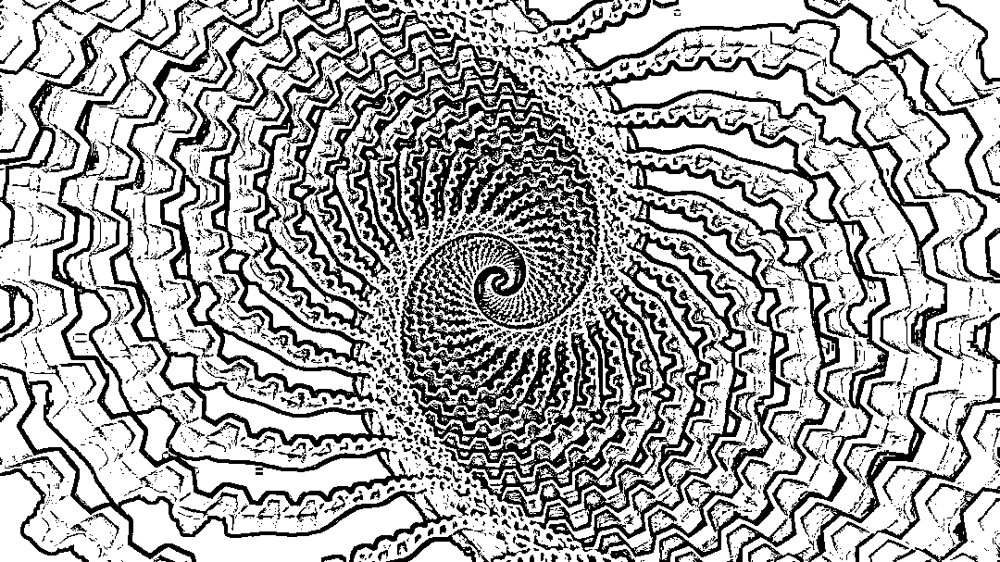

总有人把别人的成功淡淡归结为一句“运气好”。可真有人能靠纯粹撞大运登顶吗？我越来越觉得，所谓运气，只是因为我们还没看清背后的因由。一旦把所有的因由都捋顺了，所有事在你眼里，就都成了必然。

## 概率、运气、因果，其实是同一件事

早年在北辰青年实习时，我参与打磨过一门课程。当时请来一位上市公司老总做分享，问他这辈子影响最大的思维模型是什么，他脱口而出：概率思维。

他那句话我一直记得，大意是说：几十年的经验告诉他，一切都是概率，想明白这一点，世界上的事就会变得异常清晰。

从那时起，我就在反复琢磨，概率思维到底该怎么用在真实生活里？想了一阵子没头绪，但隐隐觉得，它似乎和我们常说的“运气”脱不开关系，甚至概率就是运气本身。

于是我开始追问：运气的本质什么？关于运气，流传最广的说法是——很多成功人士最后都会说：“我能有今天，只是我运气比别人好。”

这句话确实常见，但它也常常被普通人当作平庸的挡箭牌：我还没成功，是因为我运气不好。

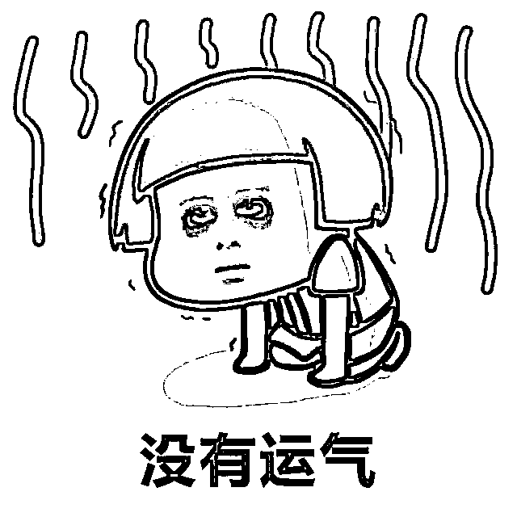

这种说法，我实在难以认同。

运气当然存在，可那些成功的人，绝不仅仅是因为运气才成功。他们身上普遍有一些普通人望尘莫及的素质：抓机会的能力、说干就干的执行力、待人接物的社交力、看问题的认知水平、还有独特的思维方式。

为什么这么讲？我举个例子。我常跟朋友说，有些人我一眼看过去，就知道他这辈子很难有太大成就。这不是算命，而是基于一些基本成功素质的判断。

比如企图心。有成功潜质的人，会抓住一切机会学习、思考、工作；而有些人，哪怕每天有大把空闲时间，也从没想过拿这些时间做点正事，全耗在刷手机、打游戏、追剧上。

再比如好奇心。很多人是本能地拒绝新事物、新观念的。我曾经想帮一些人，把模型树、生态位这类思维工具分享给他们，可他们压根不愿意接受，连花一个小时试试都不肯。

还有太多类似的品质，他们都不具备。按你当下的认知、工作、资源状态去推演，几乎可以直接下判断：这个人将来不会有太大出息，就算机遇来了，他也抓不住。

所以，成功真的不是光靠运气。

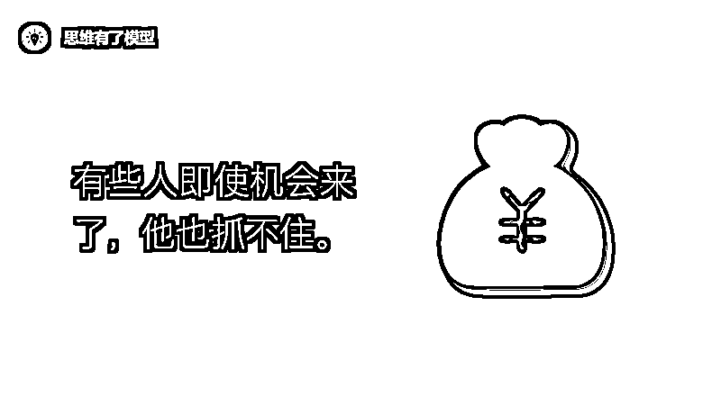

但话说回来，运气也确实存在。它不是玄学，本质就是概率。

比如你明天突然心血来潮，买了一张彩票，结果中了1000万。你可以管这个叫运气，但换个角度，它也可以被看成概率。

而成功的人因为具备企图心、好奇心、执行力、高认知等特质，他们成功的概率本来就更高。普通人的成功概率可能只有百万分之一，但那些有素质的人，可能把概率提升到了千分之一、百分之一、甚至二分之一，无限接近100%。

那么概率的本质又是什么？后来我在打磨第六期训练营，写到第五课《结构思维》时，为了搞清知识本身的结构是树状还是网状，碰上了“因果律”这个概念。顺着因果一路深挖，我突然发现很多事都通了——包括运气和概率。

运气的本质，概率的本质，其实都藏在同一个词里：因果的缺失。

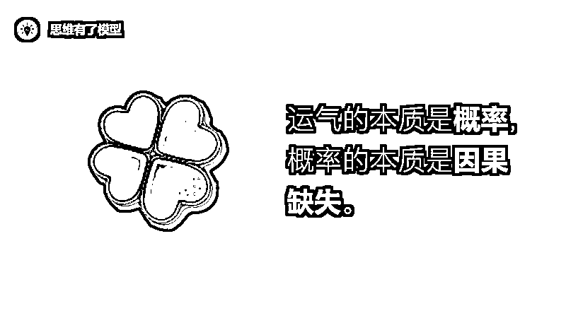

## 一切事物，都可能是被因果支配的

如果你想做一件事Ａ，而做成Ａ所需的因有Ｘ个，那么你只要把这Ｘ个因全部掌控，你就能百分之百做成Ａ。

这时候，既没有运气，也没有概率。

日常生活中之所以会出现运气和概率，是因为我们没有掌握做成一件事的全部因果。而那段没被掌握的因果，就被我们叫做运气或概率。

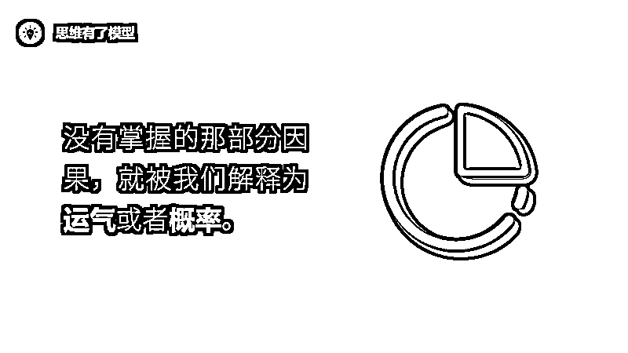

但这个推理要想成立，必须先回答一个哲学难题：这个世界真的是被因果支配的吗？它真的是被决定的吗？

这是一个老生常谈的宏大问题，无数科学家和哲学家争论至今，没有定论。与“决定论”紧紧绑在一起的，还有另一个大问题——“自由意志”。人到底有没有自由意志？

很多哲学家认为，世界是被决定的。他们最大的底气来自物理学：一切事物都按照某种宇宙法则运转。这种世界观也叫“机械论”，世界像一台精密的机器一样运行。

但也有人主张人拥有自由意志。他们认为大脑里存在某种超越实体的东西，比如灵魂，或不服从物理法则的力量，正是这种东西让人拥有自由。

这种看法在脑神经科学面前显得有点苍白。科学家发现，人类所有思维活动都依赖记忆，而记忆本质上就是物理信息和化学信息。这样看来，人很可能是没有自由意志的。

好消息是，脑神经科学还没把大脑完全研究透，所以我们依然有理由期待，人是有自由意志的。

到此，可以暂时下一个阶段性的结论：

第一，宇宙法则是客观存在的，这一点已被经验和科学反复验证。  
第二，人可能有自由意志，也可能没有，但更大概率是没有。

我个人会更偏向决定论，但在自由意志的真相水落石出之前，我愿意保留一种折中的态度：宇宙法则客观存在，人也可以拥有自由意志，这两者并不彼此排斥。

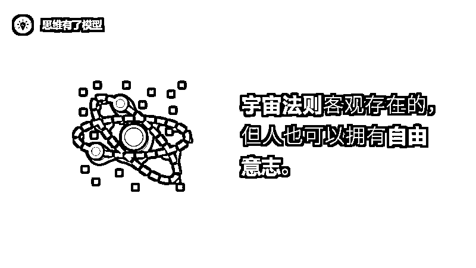

举个简单的例子。三天不吃饭，人就会饿得慌，这是宇宙法则。但我依然可以选择一直不吃饭，直到饿死。

一方面，宇宙法则是客观的：人活着需要能量，不吃饭就会饿。  
另一方面，人也可以有自由意志：我不想吃，宁可饿死，这是我的选择。

当然，这个“宁死不吃的念头”也可能是被决定的，那就是更大尺度的决定论了。这问题恐怕只能留给脑神经科学解决。但在此之前，我们至少可以牢牢锁定一个事实：宇宙法则一定存在。

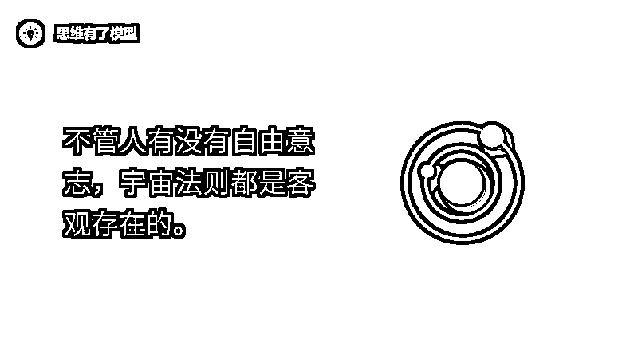

这一点，我想没什么好争辩的。如果宇宙法则根本不存在，万事万物都是孤零零地随机冒出来，那么今天所有的学问——哲学、物理、生物、化学、心理、经济、管理、营销——全都成了废话。

再往深处想一层，还会引出知识的第一原理。这也是我在训练营里的一个哲学性发现：学习不只是记忆，还要匹配知识本身的特点。

那我们学的知识究竟是什么呢？我的答案是：所有知识只分两类。一类是宇宙法则型知识，比如人性和科学；另一类是人为创造型知识，比如单词和汉字。

后一类知识的逻辑常常混乱甚至没有逻辑，直接动用记忆术就能搞定。前一类则完全不同，因为它们就是宇宙法则本身。既然是宇宙法则，它就一定有一种结构特点——我称之为“第一原理的线性发散”。

比如我们今天掌握的力学知识，本质上就是牛顿三大定律和万有引力公式的线性发散。

但这一切要成立，必须有一个前提：因果真的存在，因为宇宙法则必须作用于实体。那么，因果是真的吗？

## 因果真的存在吗？

一谈因果，绕不开一个人——大卫·休谟。

在休谟之前，多数人把因果当成理所当然的常识。比如把一个鸡蛋从十米高的地方扔到坚硬的地面上，你立刻知道鸡蛋会碎，这就是因果在起作用。

所以亚里士多德很早就提出“四因说”：质料因、形式因、动力因、目的因。后来托马斯·阿奎那还把这四种因排了个顺序：目的因 > 动力因 > 质料因 > 形式因。

然而，休谟如一颗炸弹般出现。他尖锐地指出：因果可能根本不存在，它只是人类的一种错觉。

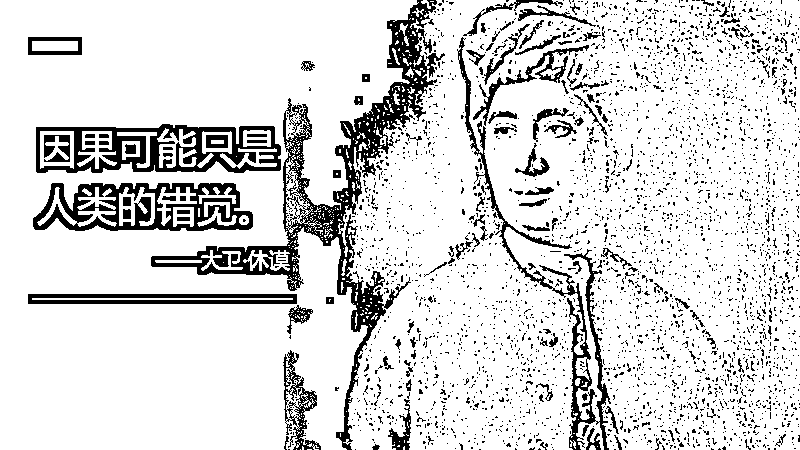

休谟的理由是什么？他说，我们能观察到的，永远只是两件事一前一后发生。我们看到它们总是一前一后地出现，于是便认定它们之间存在某种关联，这个关联就是因果。

但休谟提醒我们：我们从来没“看见”过这两件事之间的联结，我们只是下意识地猜测它们有关联，却永远无法证明这种关联是必然的。

在他看来，这不过是人类的一种思维习惯。为了生存，我们总是期待一件事跟着另一件事出现，喜欢把前后相随的客体扯在一起。所以休谟认为，因果关系可能是虚幻的。

单从逻辑上讲，休谟这套推论确实自洽。但我认为他有个漏洞，就是看待因果的角度。

休谟的角度可以叫“自下而上”——从事件本身反推，发现观察不到因果，于是断定因果可能不存在。

可如果换个角度，我称之为“自上而下”——站在设计者、造物主、宇宙法则的立场去推理，你会发现因果必然存在，否则整个世界会变得极其荒谬。

我们不妨假设：这个宇宙有一位设计者，或者按哲学家习惯的说法，有一位造物主。那他会如何设计世界？

根据物理学的研究成果，这位设计者大概率会创造两样东西：第一是物质和能量；第二是决定物质和能量的法则。

关键来了。法则若存在，就必须作用在实体上，否则这个法则毫无意义。法则作用于实体的过程，恰恰就是因果关系的本质。

打个比方。你是个孩子王，为了让大家玩得开心，你设计了一套游戏规则。但如果没有任何人遵守，这套规则就一文不值。

宇宙也是一样。如果宇宙法则不能作用于实体，它就没有任何意义。

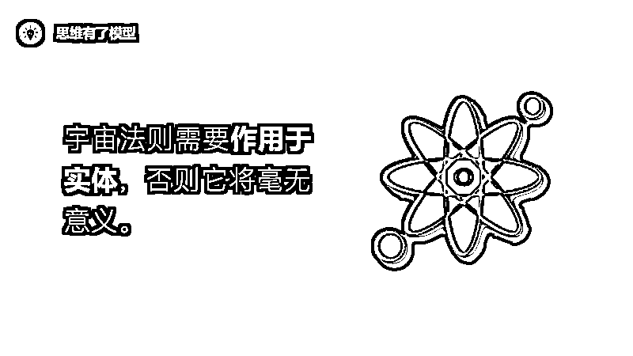

显然，如果真有这么一位全知全能的设计者，他不可能愚蠢到去创造一套毫无用途的宇宙法则。

所以我们可以推出：只要宇宙法则客观存在，因果关系就必然存在。

那宇宙法则真的存在吗？我认为很好证明。物理学早就给了答案：牛顿的万有引力、麦克斯韦方程组、爱因斯坦的质能方程、杨振宁的规范场论，每个都在指向宇宙法则的存在。

但万一，今天所有的知识都是假的呢？物理学、生物学全是幻觉，我们还能证明宇宙法则存在吗？

我的答案是：依然能。

因为如果宇宙法则不存在，宇宙就必须是静止的，物质和能量不可能发生任何流变。但显然，宇宙并不静止：它在膨胀，行星在运转，植物在光合作用，人在经历生老病死……物质和能量一直在流动变化。

既然变化在发生，就一定有法则在支撑。

这也很好解释：假如真有造物主，能创造出宇宙这般精妙的造物，他绝不会蠢到每时每刻亲手捏造每一件孤立物体，再手动处理旧物的消亡。那也太累了，连驴拉磨，也得停下吃点黄豆补补吧？

开个玩笑。这个道理并不难懂：如果真有设计者，他创造宇宙的方式，大概和我们创造人工智能很像。

我们怎么创造人工智能？就是给定一套算法，让程序自己演化。而宇宙法则，就相当于宇宙的算法。

我记得看过一个纪录片，讲的是人类用计算机模拟造物主。程序员创造了一些“程序小人”，再给一套类似自然选择的算法。跑几圈后，“程序小人”自己学会了走路，还学会了攻击别人。

宇宙法则就是这样的存在：它像算法，物质和能量是基础代码，点一下“运行”，世界就自主运转起来。

当然你还可以问：如果造物主根本不存在呢？那这个世界还会有自然法则吗？

当然会有，而且更需要有。因为没有造物主、也没有自然法则的话，物质和能量就只能是静止的。可它们显然没有静止。

所以结论是：无论有没有造物主，自然法则都必须存在。自然法则一旦存在，因果就必然存在，否则自然法则就失去了意义。

那么这个结论对我们有什么用？

用处太大了。想通这一点，你就会明白：一切都是因果在支配，一切都是自然法则在支配。

你也会真正理解知识、思考、学习、复盘、概率思维和坚持的意义。这里只展开说两个小点，其余的你完全可以自己推。

## 坚持，是对运气的对冲

做成一件事的要素很多，但有一个核心要素绝对绕不开：坚持。

为什么坚持如此重要？先把“做成一件事”定义清楚。按照前面的推理，世界被因果支配，只要你掌握了这件事的所有因果，你就能百分百做成。

但问题在于，我们几乎不可能掌握所有因果。受限于认知和视野，总有些因是我们看不到的。于是，概率就诞生了。

假设做成事情Ａ需要10个要素，每个要素权重相同。你只知道其中5个，剩下5个只能靠猜。对你来说，那5个未知要素就是概率事件。

假设猜对的概率是10%，这10%的成功率，就是我们常说的“运气”。

那坚持在这里是什么角色？

坚持的本质，就是对运气的对冲。

这句话怎么理解？还是那个案例。假设成功一次就算赢，那么你只干1次，成功概率是10%；干2次，成功概率会变成19%；干的次数越多，概率就越高。重复到足够多的时候，概率会无限接近100%。

数量小的时候，概率和运气占主导；数量足够大了，成功就成了必然。

坚持的意义，就是把运气一点点转化成必然。坚持，就是对运气的对冲！

这跟掷骰子很像。假设掷出“6”就算赢：你只掷一次，胜率是1/6；掷两次，胜率变成11/36。掷的次数越多，胜率越高。只要你一直掷下去，总有一次会掷出6，总有一次会成功。

这里要特别提醒一句：赌博不一样。赌博不是赢一次就收手，除非你能设计出稳赢策略，否则它就是一条不归路。普通人还是应该踏踏实实找到自己的生态位，在里面深耕细作。

想明白这点后，我特别兴奋，因为它让我真正懂了为什么要坚持。

就拿做小红书来说，我发现坚持的作用惊人。

同样的写作技巧，为什么有的文章爆红，有的文章无人问津？表面看是选题问题，但背后其实也藏着因果和概率。

比如一篇文章刚发出去时，系统会随机推荐。它可能把我的文章推给一堆不感兴趣的人，结果阅读量很低，点赞很少，系统就判定内容不行，停止推荐。

但我没有灰心，继续坚持写。终于某一天，系统在随机推荐时，碰巧把文章推给了一批真正喜欢它的人。点赞、收藏、涨粉一下子来了。

更妙的是，这些新粉丝又会去翻我那些没爆的历史文章，觉得不错就点赞，于是平台又把老文章重新推荐给更多人。大数据就这样把概率给对冲了，让我的文章恢复了正常的推荐量。

你看，这里有个关键变量叫“阅读人数”。人数就是对概率的对冲。坚持的意义，也恰恰在这一点上。

前几天我把这个洞察分享给一个也在做小红书的朋友。他一直没爆，我怕他灰心，就告诉他：坚持是对概率的对冲，方向没错就继续干，爆款一定会来的。

结果两天后，他的一篇文章就爆了。紧接着，他别的文章也被更多人看见，一条条开始呈现爆款趋势。

这就是概率、运气和坚持之间的关系。过去我们只会轻飘飘地丢下一句“运气好”，完全不懂背后的逻辑，也不知道坚持有什么用。但有了因果律的视角，你就会明白：

所谓好运，不过是你用坚持，把概率一点一点地磨成了必然。

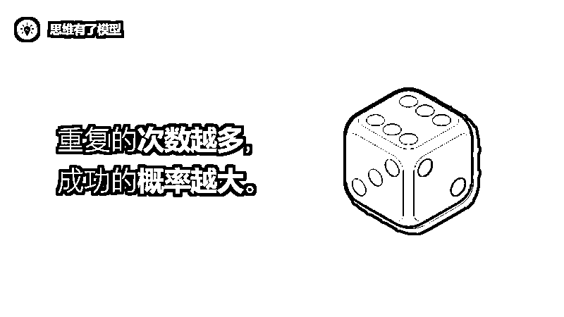

## 认知的重要性

理解了坚持，更要理解认知。

为什么同样的努力，有人一飞冲天，有人原地打转？因为认知决定你能看到多少因果。认知越高，你能掌握的因就越多，做成一件事的概率就越大；认知越低，你连因果都看不见，只会拿“运气”来安慰自己。

认知高的人明白：成功不是一锤子买卖，而是概率游戏。他们知道坚持是对冲运气的手段，知道复盘是为了补上缺失的因，知道学习是为了更接近宇宙法则。他们不迷信运气，只打磨自己。

认知低的人呢？他们拒绝新观念，害怕新事物，不愿花一个小时去尝试可能改变命运的方法。他们就那样停留在原地，眼睁睁看着机会从眼前溜走，然后说一句：“我没那个命。”

其实哪有什么命？所有的必然，都藏在因果里。而认知，正是那把打开因果之门的钥匙。

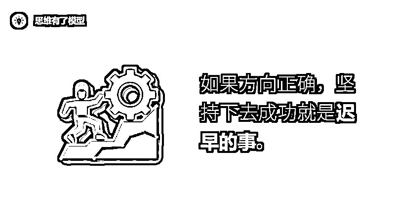

你有没有想过，为什么有些人做事总能成，而另一些人却反复在同一个坑里栽跟头？

很多人把这个归结为“坚持”。但说句扎心的话——**光靠坚持，远远不够。**

真正拉开人与人差距的，是你脑子里装了多少“因果”。

什么意思？就是你能看清做成一件事背后需要哪些条件、哪些环节、哪些变量。你看得越透，掌控得越多，成功的概率就越高，需要试错的时间就越短。

**说白了，认知的本质，就是因果。你掌握了多少因果，你的认知水平就在哪个段位。**

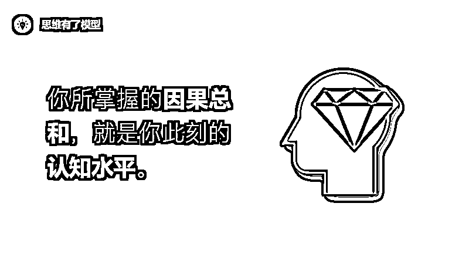

人跟人之间的差别，恰恰就在这里。

有的人掌握的是更本质的因果。什么叫更本质？就是能一眼看到事物的底层逻辑，不被表象迷惑；而有的人掌握的是更多元的因果，也就是能从不同角度看问题，不至于一叶障目。

所以，他们更容易成功。

而学习、复盘、思考，说到底就是在做一件事——**往你的认知系统里加载更多、更底层、更完整的因果链条。**

有一句话你一定听过：你赚不到认知之外的钱，就算凭运气赚到了，也会凭实力亏光。

这句话的潜台词是：你没有掌握的因果，就只能靠运气。而运气是概率事件，只要你一直在牌桌上，失败的概率迟早会落到你头上。

哪怕你靠运气赚钱，本质上也只是暂时还没抽到那张“失败”的牌而已。

认知不是玄学，不是心灵鸡汤，它就是扎扎实实的因果关系网。你在这张网上织得越密、越深，你做一件事的确定性就越高，试错成本就越低，甚至只需要坚持一小段时间，就能看到正反馈。

所以，学习的意义、复盘的意义，说到底就是：**让你的因果关系更底层、更完备。**

说到这里，我们必须得到一个关键结论：**坚持，从来不是傻傻地硬扛。真正高质量的坚持，是在做的过程中不断学习和复盘，把做成这件事背后的所有因果要素一个个补齐，从而把自己的成功概率一点点拉高。**

拿我身边一个做小红书的朋友举例。

他为什么最近突然写出了一篇爆文？是因为运气好，或者坚持得够久吗？

不止。

真正的原因是，他最近把标题改了、封面换了、选题换了、内容结构也调了，甚至连昵称和头像都重新思考了一遍。

每改一个变量，他成功的概率就往上走一点。

但大多数人是怎么坚持的呢？

他们是在用同一种方式反复做，懒得总结，懒得向高手学习，懒得去思考这件事背后到底有没有规律。

于是，他们的成功概率，就像一条平线，始终没有起色。

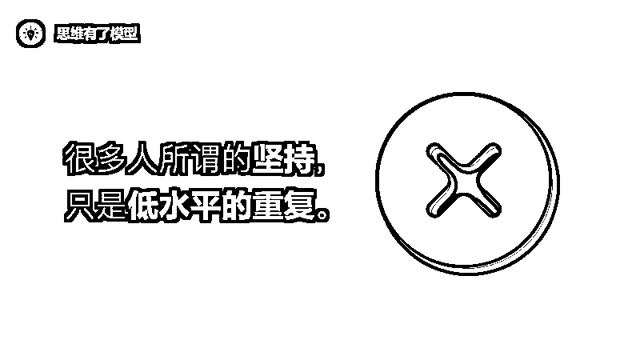

那问题来了：到底怎么提升认知？

两个方向：**跟别人学，和自己学。**

跟别人学，就是我之前反复讲的“巨人思维”。说白了，就是站在高手的肩膀上，用一套系统的方法去吸收他们的精华。我之前分享过一套叫“模型树”的方法，就非常高效，这里不再展开讲，往期文章里有细说。

我们重点讲怎么做自己的老师。

和自己学的核心，其实是复盘。从成功里复盘，也从失败里复盘。

但遗憾的是，很多人压根不复盘；还有一部分人虽然复盘，但复得毫无章法，复完跟没复一样，纯粹走个过场。

我常说一句话：**不会复盘的经验，价值不大；不提炼模型的复盘，价值不大；不放进模型树里的模型，价值也不大。**

所以说，把经历变成养分，不是靠“想一想今天发生了什么”就完事的，它是需要方法的。

那么怎么做复盘才有效？关键就两件事：**第一，把复盘的结果提炼成模型；第二，把模型放回你的认知体系里。**

具体怎么操作，这篇先不展开，后面有缘专门写一篇。

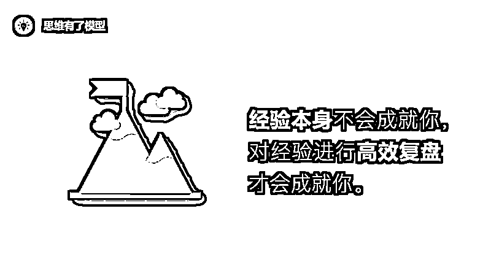

复盘虽然有效，但传统的复盘方式有个很大的毛病——太模糊了。

你从成功里总结经验，从失败里吸取教训，但你说得清楚到底是哪个动作、哪个决策起的作用吗？

很难说。

这就是为什么“事后诸葛亮”和“幸存者偏差”这些词一直在提醒我们：普通复盘，无法帮你精准确认真正的因果关系。

大多数情况下，你只能“大概觉得”，没办法“准确断定”。

那有没有一种方法，能让你像做实验一样，精准定位一件事的因果关系？

有。而且你初中就学过。

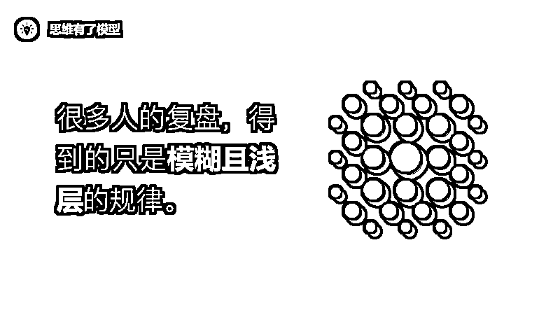

它叫——**控制变量法。**

当年我们在物理、化学、生物的课本上，都用它探寻过事物背后的精确规律。只可惜，一出校门，这个方法就被大多数人忘得一干二净。

明明眼前放着一把锋利的手术刀，我们却偏偏习惯用钝刀子割肉。

为什么会这样？可能是这两个原因——

**第一，多数人没有意识到，复盘的本质就是在寻找因果关系，是在提炼解决问题的方法论。**

**第二，多数人不知道，控制变量法恰恰是精确找出事物因果关系的绝佳工具。**

什么是控制变量法？很简单：把其他变量全部固定，只改其中一个，然后观察它对结果的影响。

就像初中学的那个生物实验：要观察光照对植物生长的影响，就得保证水分、土壤、养分、温度都一样，唯独让光照这个条件变化。这样一来，我们就知道这棵植物的变化到底由谁决定。

发现了吗？这就是找因果的利器。

可惜，我们离开学校后，就把它还给老师了。

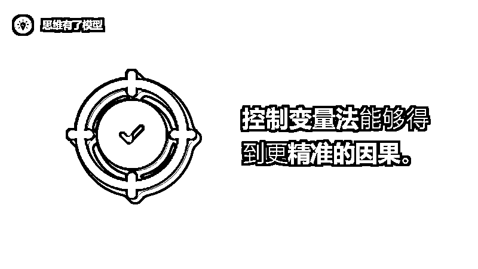

实际上，只要把它用起来，你就能很快看透很多事情的“命门”。

比如，我是怎么判断一篇自媒体文章为什么能火的？

我的方法很简单：把数据指标拆开，看变量。

同样的标题风格，同样的写作手法，同样的思考深度，为什么有的文章读者喜欢，有的不喜欢？我就把爆文和扑街文放在一起对比，很快就发现——问题的关键在选题上。一篇文章能不能火，选题那一刻就已经定了一半。

再比如，我要验证标题到底重不重要。我就做了一件事：文章内容一字不改，封面图不动，唯独反复修改标题，发到不同渠道看数据。结果发现，标题不同，阅读量能差出好几倍。

于是我就确定了：在选题不差的情况下，标题一定是核心变量，值得多花时间去打磨。

又比如，我当初做两个小红书号，小号篇篇爆，大号篇篇沉。我琢磨着，大概率是内容定位不太契合小红书的用户口味。但怎么确认？

很简单——我把小号上的爆款内容，原封不动地发到大号上。结果，果然也爆了。

事实一下就摆在那里：不是我不会做内容，就是账号的选题方向出了问题。

你看，这就是控制变量法的威力。

虽然这不是实验室级别那么严格，但它已经足够让你在一堆模糊的干扰项里，精准锁定那个真正起作用的因素。

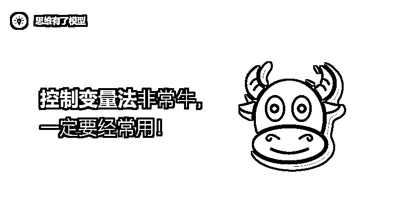

说到这，今天的思维模型也就讲得差不多了。

因果律，是一个非常底层的思维框架。说白了，很多事情的成败，其实在某种程度上是被“因果”锁定的。

那些看起来厉害的人，只是比我们更早、更快地掌握了事情背后的规律。

所以，如果要做一个成事的人，就要练就一种本事：**尽可能找到事物背后的因果关系。**

这就是我最近最想跟你分享的一句话，与大家共勉。