# 「提效利器，写手和小红书做图必备」我在 WPS 里挖到 3 个隐藏功能

## 提效神器，手搓文章和小红书脑图都好用，WPS 的 3 个冷门功能

作者： 一一

日期：2024-11-27

#项目实操

最近在 WPS 里改稿，意外撞到 3 个特别好用的功能，分享一下。

**文章润色这个，对需要手动写存稿的人来说，省时效果很明显**

**  **

**一键生成脑图，用来搭文章框架或做小红书导图，也能快很多。**

**  **

**全文校对也很香，因为常规的 AI 聊天窗口校对都有字数上限，这个就没限制。**

下面详细说说这三个功能，和市面上其他工具有什么差别。

**一、文章一键润色：**

重点在这里，WPS 的润色功能对文档长度不做限制，

不管你丢进去的是 500 字的小段落，5000 字的长文，还是 5 万字的稿子，都能直接处理。

对习惯自己码字的朋友特别友好。

润色时它会自动把识别到的错别字改掉，也会把啰嗦冗余的表达优化掉。

操作入口：

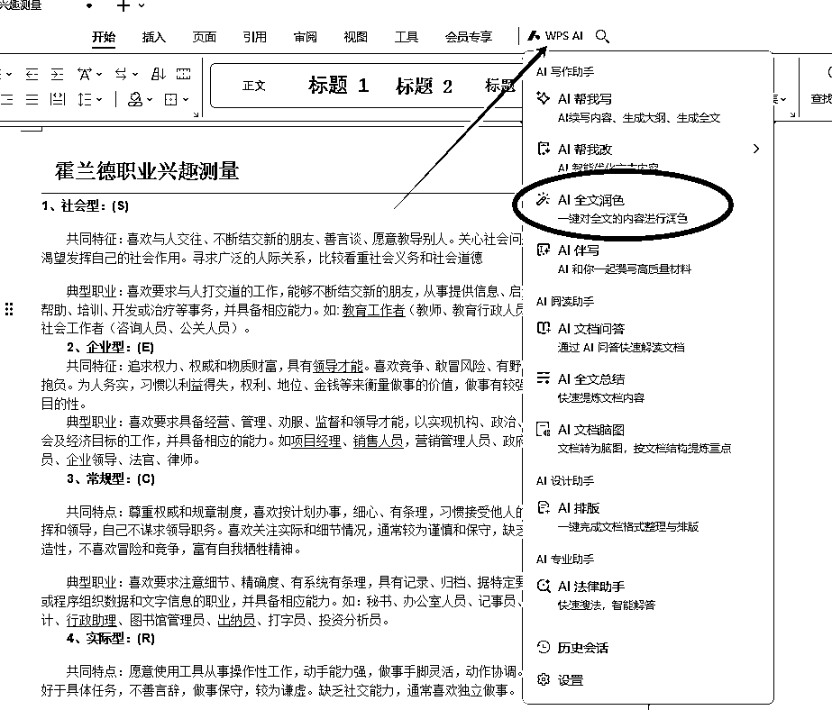

处理完会先弹出这个界面：



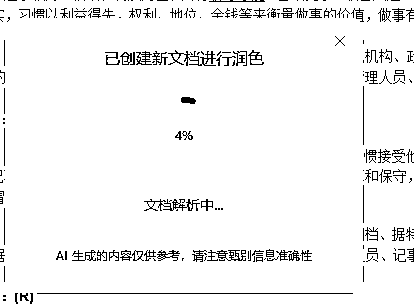

接着屏幕底部会出现进度提示：

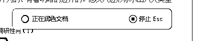

等待时间视篇幅而定，字数越多耗时越长。

最终结果会以右侧修订的形式呈现，可以逐条同意或拒绝。

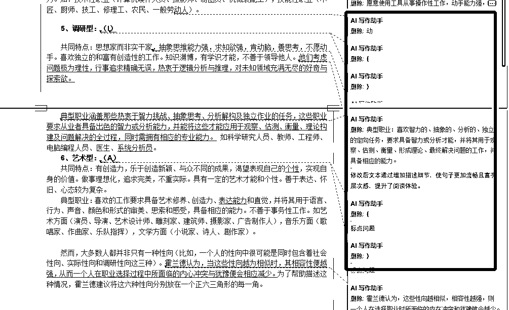

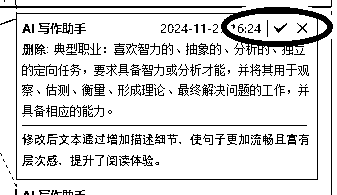

全部确认后点完成即可应用修改。

**二、自动生成思维导图：**

**  **

WPS 的自动脑图生成，相比其他软件更细，枝干和末梢都能保留得很完整。

生成完可以直接导出到别的排版工具，省掉大量整理时间。

目前对文档长度有上限，8 万字以内。

日常使用基本够用了。

支持两种呈现方式：脑图模式和树形图模式。

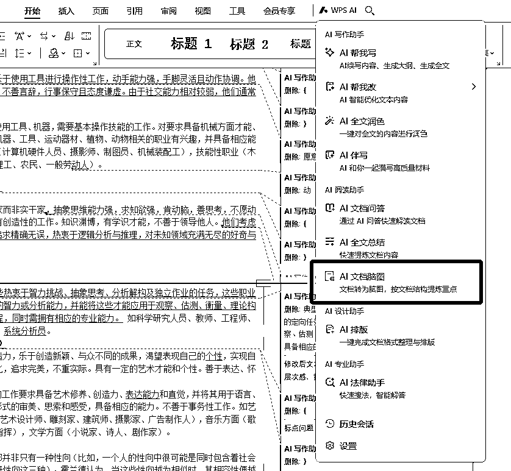

这是我用一篇 2.5 万字文章跑出来的脑图，先看缩略版，细致程度应该能感受出来。

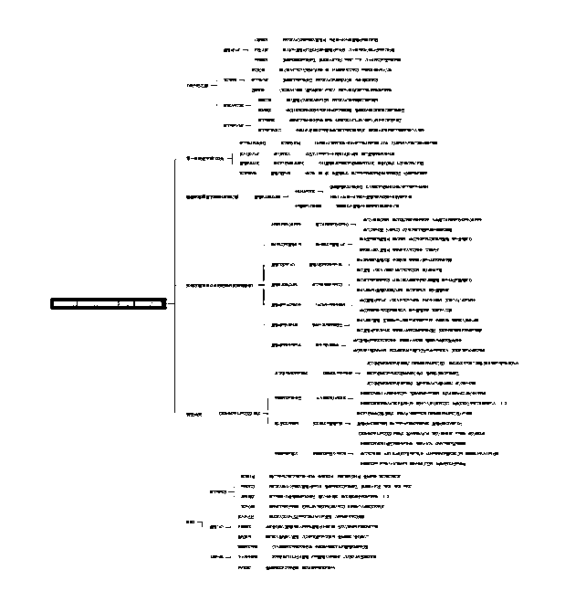

再放大看细节，颗粒度很可以：

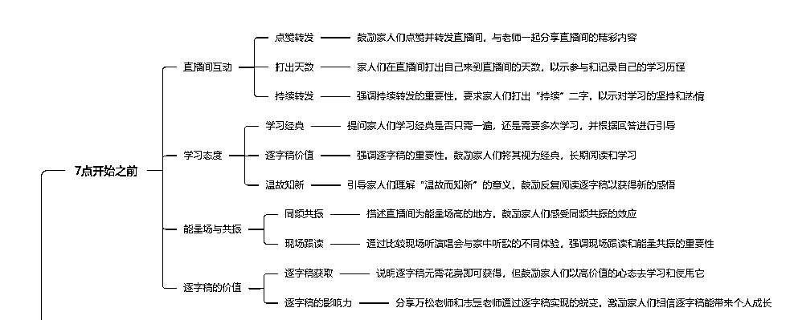

树形图的效果是这样的：

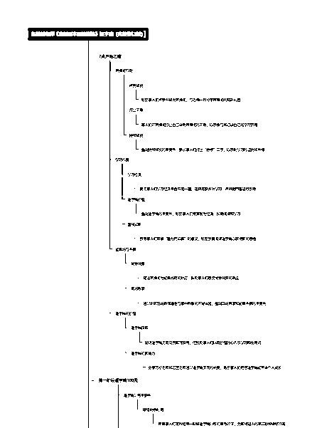

**三、全篇文本校对：**

这个校对功能和别的 AI 工具有什么不同？

它没有任何字数限制，1000 字、1 万字、10 万字都能一次跑完。

不像聊天式校对，字数一大就要分好几轮来回，这个点一下就结束。

具体步骤如下：

点开审阅选项卡

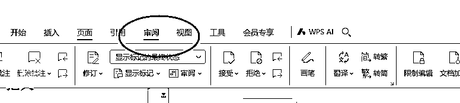

在左侧找到 校对 按钮：

选择通用校对或公文校对，按需求选。右边有个人专属词库，可以把专有名词加进去，避免被误改。

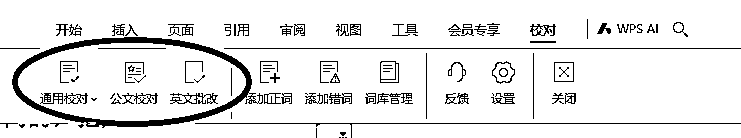

点击开始校对后会弹出结果，速度很快，一般十几秒搞定：

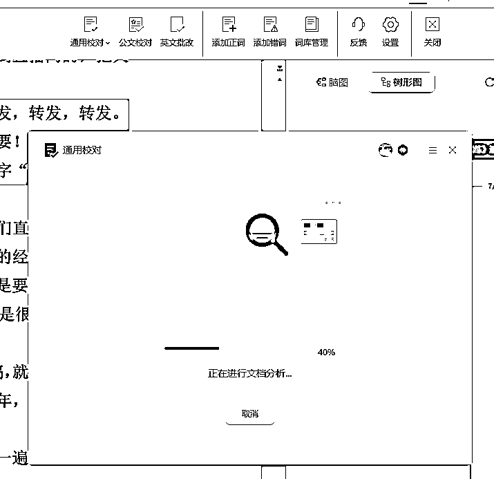

点 开始修改：

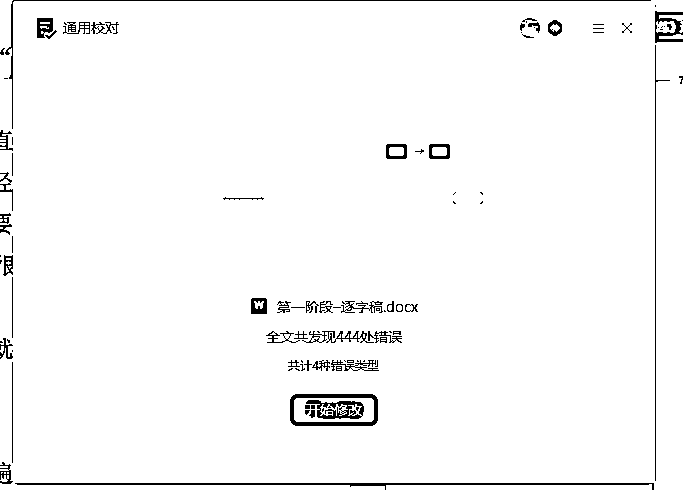

右侧会列出所有建议，根据需要逐条替换，还能点小箭头批量操作，最下面有 一键替换 选项，挺人性化：

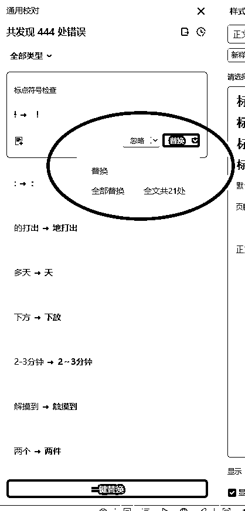

End：

以上三个功能都属于 WPS 会员权益，有需要的话可以去闲鱼找个合适的套餐试试。

实测提效确实到位。

* * *

评论区：

佳文 : 确实不错，为了 WPS 的 AI 功能， 充了 5 年的大会员

七天@龙哥盟 : 本 wps 会员学会了！