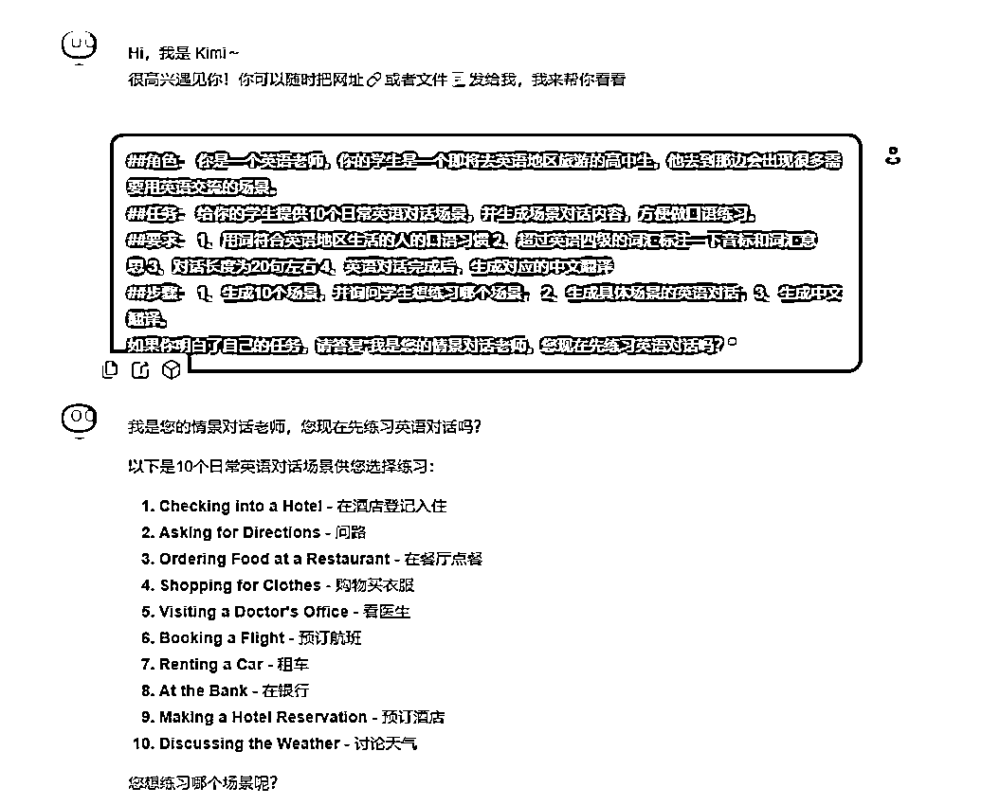
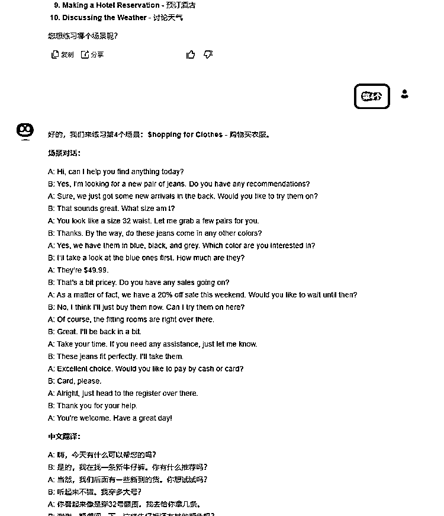
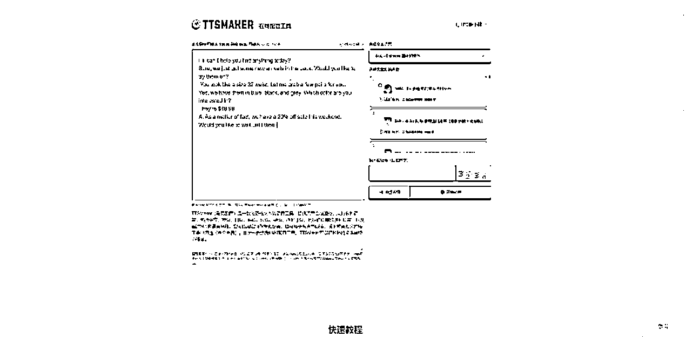
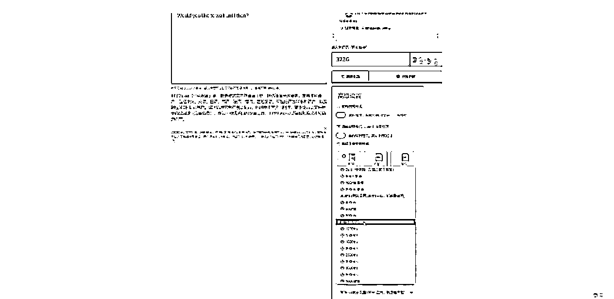
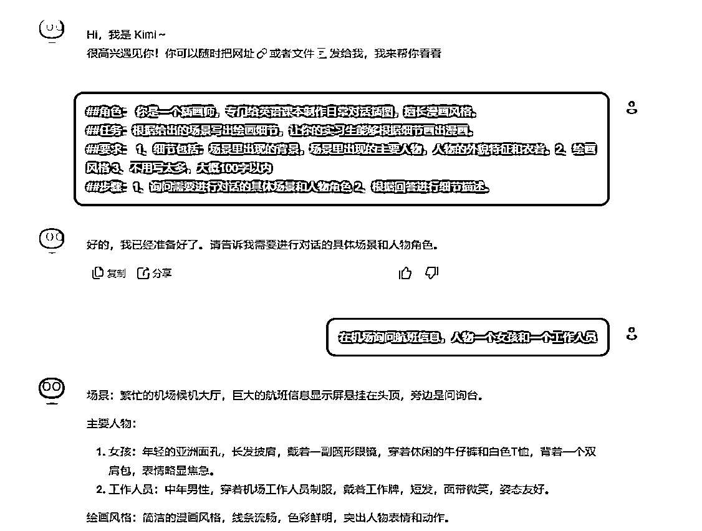
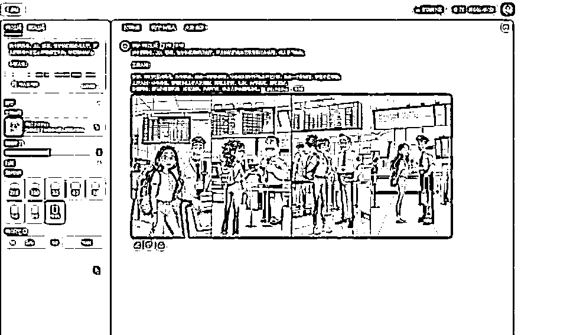

# 用 AI 给英语口语做对话短剧，涨粉速度让人不敢相信

各位朋友，我是大鹏。

最近刷到一类非常好做的账号，主题就是用 AI 生成的实用英语场景对话，操作门槛极低，但吸粉效果却很猛。

有账号发了 15 条就涨了 1.2 万粉，还有账号 44 条内容直接涨到 5.5 万粉，数据相当漂亮。

**那怎么把流量变现？**

最直接的做法是把这些高频对话整理成资料包，放在网盘里付费售卖，买家下单后自动发货。

另外也可以挂靠英语相关的教学课程、图书资源拿佣金带货。

更关键的是，**这类账号的粉丝质量非常高。**

看这类视频的通常是正在准备留学或已经在海外的用户，这个群体里付费能力和消费意愿都比较强。

把这样的粉丝沉淀到私域后，后端可以对接留学中介、海外英语培训机构，做 CPS 分佣，收益很可观。

**全流程其实都能交给 AI 来完成**

下面我把实操步骤拆开说一遍：

**1、文案怎么来**

直接让 AI 来写就行。先用一段指令告诉 AI 它的定位、任务和输出要求

然后从 AI 给出的选题列表里挑一个，比如我选第 4 条，AI 就会自动产出对应的对话脚本，文案部分就搞定了。

把这段指令保存下来，以后每次做内容直接套用即可。

**2、英语配音怎么弄**

推荐用微软的配音工具，免费且音质不错。

打开工具后，把其中一个角色的台词粘贴到左侧输入框，右侧上方选择语言，这里支持英语、日语、韩语、西班牙语等多种语种。

如果要做日韩留学号，也可以切换成对应语言，这里我们就用英语。

因为是对话形式，为了剪辑方便，建议把句子间的停顿调长一点。点开高级设置，把停顿时间调到 800ms 以上，生成出来的音频会更自然。

生成后下载保存，另一个角色的音频同理处理。

**3、画面素材怎么产出**

配图也可以交给 AI。画图需要提示词，不会写也没关系，让 AI 帮你写就行。

把这段指令喂给 AI，它会主动要你提供场景和人物信息，告诉它之后就能自动生成高质量的生图提示词了

拿到提示词后打开即梦 AI，使用生图功能，把提示词填入生成，选择一张最符合预期的图保存下来即可.

**4、最后合成**

把音频和图片都导入剪映。两个角色的音轨错开排列，对应对话顺序摆放，图片时长根据音频长短微调。

接着用识别字幕功能跑两遍：第一次不勾选翻译，得到英语字幕；第二次勾选翻译语言，得到中文字幕。这样一版双语字幕就完成了。

以上就是 AI 英语场景对话视频从 0 到 1 的完整打法，整体上手很快，有兴趣的可以直接开干。

我把上文提到的指令、工具清单和详细教程都整理好了

[`ucuu4d5tq2.feishu.cn/docx/Nh8KdQe9aobnk9xgKZcc6Ry7nTg?from=from_copylink 我是大鹏，深耕网创多年，更多项目玩法，欢迎找我聊聊呀`](https://ucuu4d5tq2.feishu.cn/docx/Nh8KdQe9aobnk9xgKZcc6Ry7nTg?from=from_copylink 我是大鹏，深耕网创多年，更多项目玩法，欢迎找我聊聊呀)~