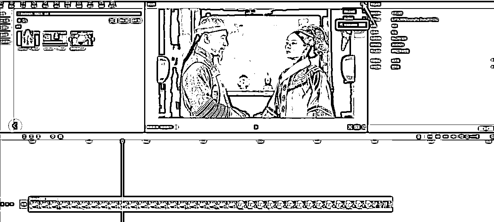
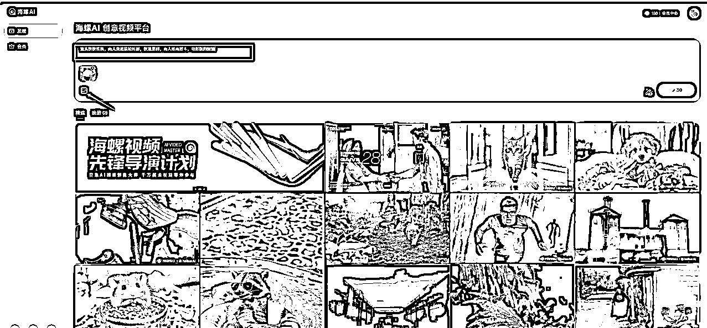
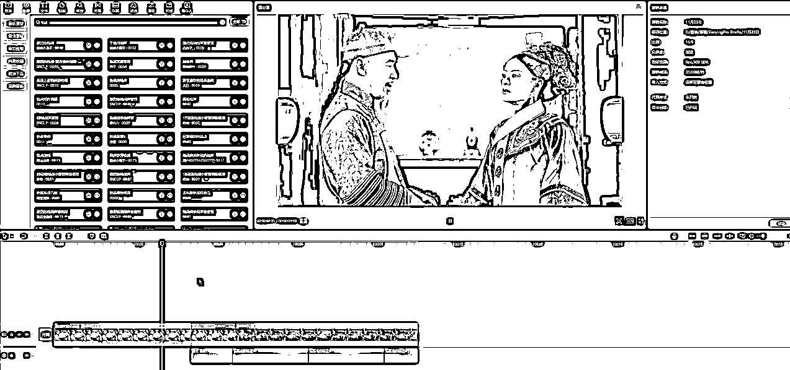
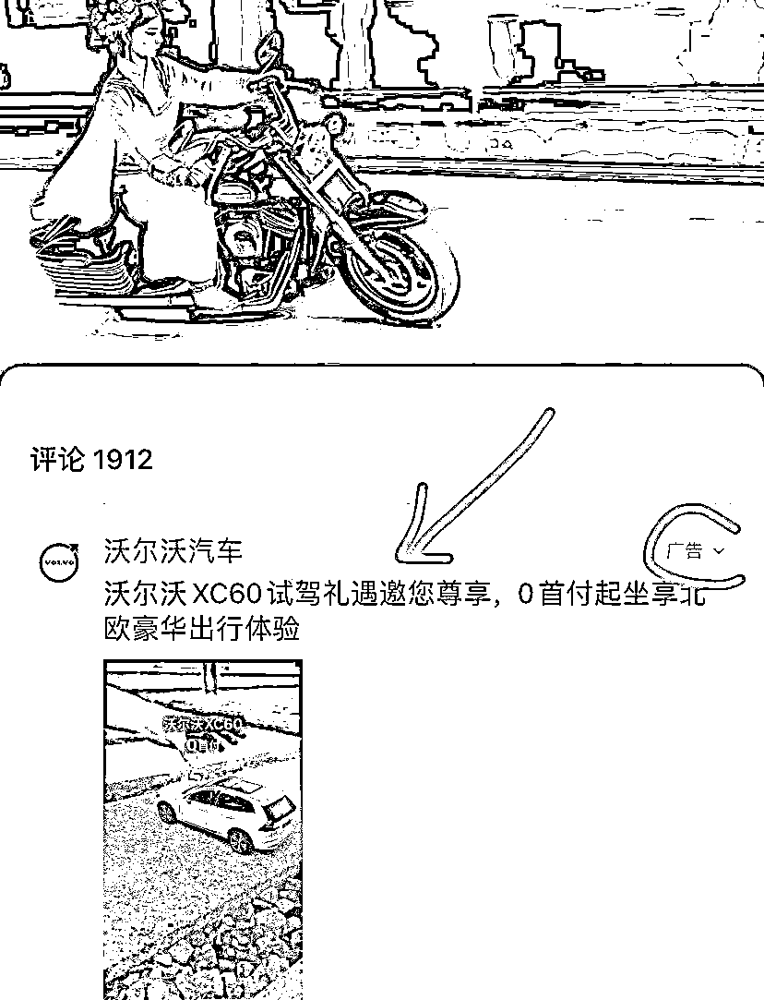

# 用 AI 把正经剧魔改成鬼畜抽象梗，半个月涨粉十万，跟着做就能上手

> 原文：[`www.yuque.com/for_lazy/zhoubao/il5ik73gtedbgal0`](https://www.yuque.com/for_lazy/zhoubao/il5ik73gtedbgal0)

## AI 恶搞影视片段爆火，十万粉不是梦，这套实操流程直接抄作业

作者： 大鹏

日期：2024-11-25

最近刷短视频是不是总能碰到这种魔改片段？

《甄嬛传》里的人物突然掏枪互射、扭打成一团、甚至骑上摩托飙车 images.zsxq.com/FgspdhZGn7sU0JjUN4EoWFsap5pe)

原本端庄肃穆的宫廷戏，被硬塞进各种荒诞脱线的桥段，冲突感拉满，观众根本停不下来。

这类内容现在正处于爆发期，*一条爆火的评论区和点赞数动不动就上万*。

不少博主就是靠这个套路，起号不到三周粉丝就破了十万，靠播放量带来的平台分成就能稳定进账。

**这种抽象魔改到底怎么做出来的？**

后台总有朋友来问我这种 AI 换脸式整活视频的制作门道。实话说，门槛非常低，核心就是三步走，今天完整拆给你看：

**第一步，截取关键画面**

先去找一段有代表性的影视片段，导入剪映里就行，直接截屏也可以。

我拿《甄嬛传》里的双人对峙镜头举例，把视频拖进剪映，找到两人同框的瞬间暂停。点开右上角的菜单栏，选择“导出静态帧画面”，把截好的图保存到容易找的位置。

**第二步，让 AI 把静态图变成动态**

打开海螺 AI，进入“海螺视频”功能，把刚才导出的那张静态图上传。

这一步最考验创意，提示词写好了效果就对了，写不好就要重来。

例如我用的指令是：“镜头切换节奏加快，两人忽然拔枪对射，动作激烈暴力，近身搏斗，电影大片质感”

点开始生成，等待几十秒就能出片。如果画面不理想就回头改词再跑，直到满意为止。

**第三步，拼接还原成完整视频**

回到剪映，把 AI 生成的短片段拖到原视频里原本静态帧的位置，删掉原视频后半段未改造的部分。补一段合适的BGM，整体节奏一调，导出发布即可。

不止是枪战才好玩，打架斗殴、突然亲吻、飙车、大变身等等玩法都一样套用。换的只是提示词，思路完全通用，越魔性越容易火。

**除了好玩，这类内容怎么赚钱？**

**1、接品牌投放**

有流量就有广告位。很多做这个的账号已经开始植入软广了，本来观众就被 AI 乱入的反差逗笑了，再穿插一段创作者手写的广告，喜剧效果叠加，转化意外的好。

**2、卖教程做知识付费**

这类视频猎奇又上瘾，学的人特别多。有人是为了好玩，有人是想打造人设装专业。总之只要有学习需求就能收费。你学会后教别人，就是标准的知识变现。

**3、平台创作分成**

这是最被动的收入来源。视频被推流出去后，附带的平台广告被点击，你就能分到一笔钱。粉丝越多，流水越稳定。

总结一下，整套流程说白了就是信息差带来的红利，工具全是现成的，剪映+海螺 AI 就够了。

看完别光收藏，赶紧找段剧集开整。

我把常用的高成功率提示词整理成了文档，需要的自取：

链接： [`pan.quark.cn/s/48dc3e20165e`](https://pan.quark.cn/s/48dc3e20165e)

我是大鹏，长期研究互联网项目玩法，有兴趣的可以来交流。

* * *

评论区：

心净亦如心镜 : 必须用电脑吗

大鹏 : 用电脑方便点