# 13万/30天，AI驱动的3D写实动漫短片出海套路全拆解
作者：龙哥

最近在研究国外内容赛道时，撞见一个很具反差感的账号。主创方向是把经典二次元角色用AI做成接近真人质感的立体动态影像，投放到YouTube后，单月变现就突破六位数。

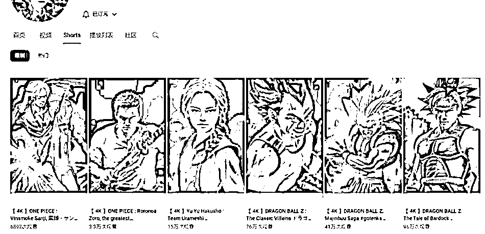
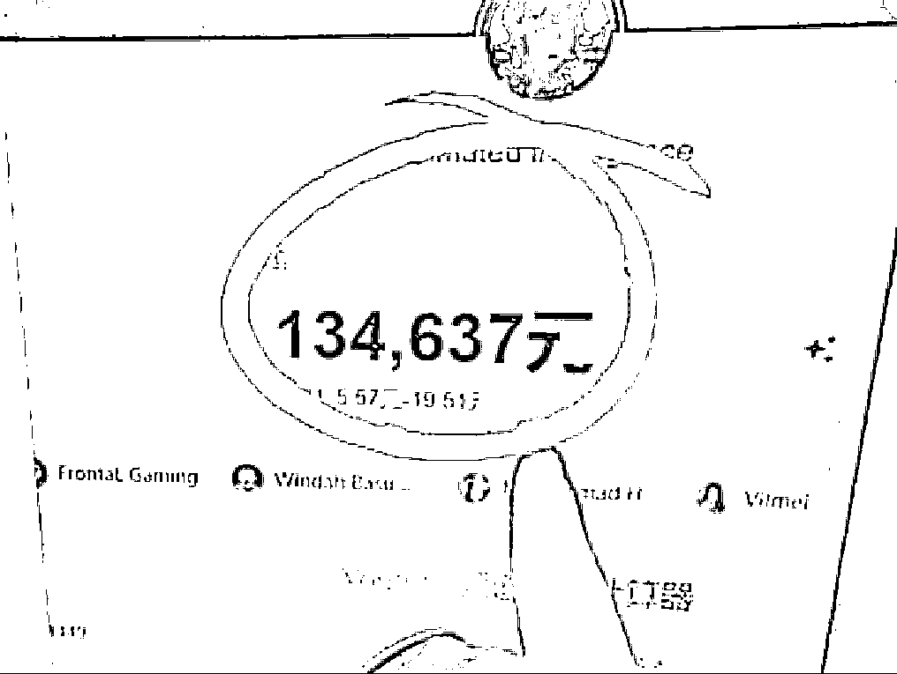

乍看之下很多人会觉得，这类图在网上泛滥，靠运气上头而已。实际拆解后发现门槛不在“会不会点生成”，而在选材标准和呈现逻辑。

细看该账号的作品库，会发现几乎全部围绕高热度动漫IP展开。呈现效果像真人照片，却又明确不是cosplay，也不是手办摆拍。

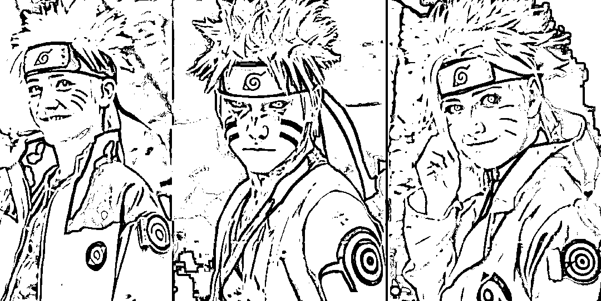

与普通的coser抓拍、手办展示、以及原作纯平面插画都形成明显区分。

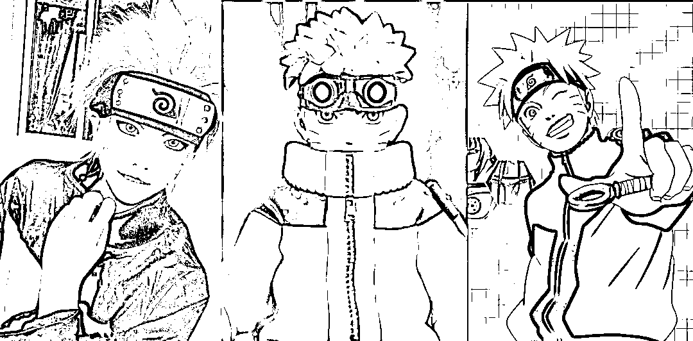

变现路径相对清晰，主要有三条：

其一，海外平台的广告与流量分成，以YouTube为代表的出海渠道单价较高，适合长线积累。

其二，国内图文与短视频的创作者激励，以及平台内的商业分成活动。

其三，围绕角色IP做周边导流，尤其是手办、模型等商品的关联销售。

下面把从零到成片的实操链路展开。

首先要拿到可用的角色描写文本。我的做法是让大模型按三段式来产出：

第一段明确工作意图，比如“用AI绘图软件产出一张火影忍者里某角色的写实设定图，现在需要一段可直接使用的描写文本”。

第二段提供参考素材，会上传一张该角色的参考照，请模型做细致拆解。

第三段给出输出要求，请模型基于图片给出可直接用于绘图的完整描述。

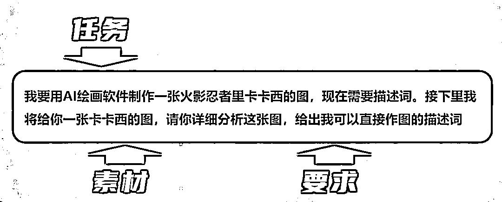

提交参考图后，模型会回复请上传图片。上传完毕后，它会逐项列出视觉特征：发式样貌、头饰、眼部特征、面部细节、服装层级等。

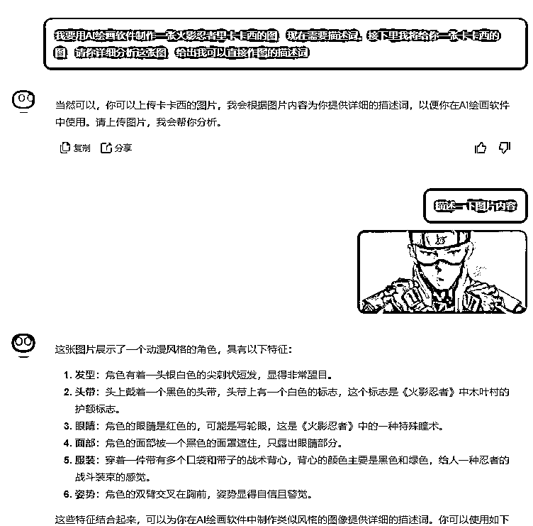

这一步输出是碎片化的列表，并不适合直接投喂给绘图工具。因此需要二次整理。

我会补充一个融合指令，核心是把分点特征合并成自然段落。例如把“发式：银白、尖刺、短发”改写成“人物拥有一头银白色的尖刺短发”。通过样例示范，模型会把所有零散描述整合成一段连贯的文本。

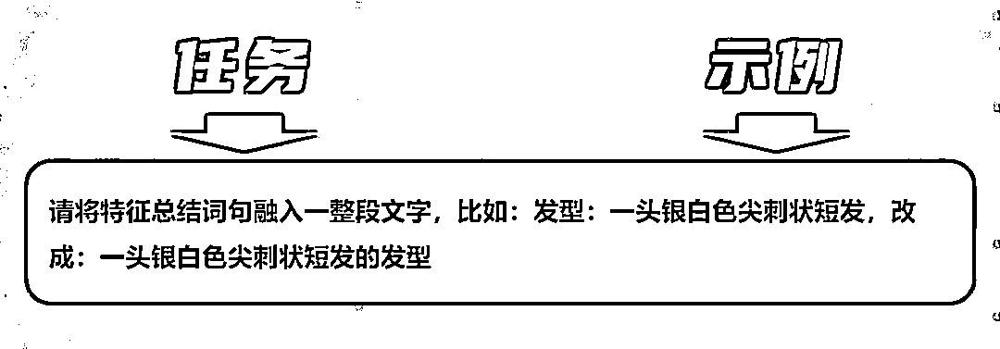

整合后的文本才是可用的绘图指令。

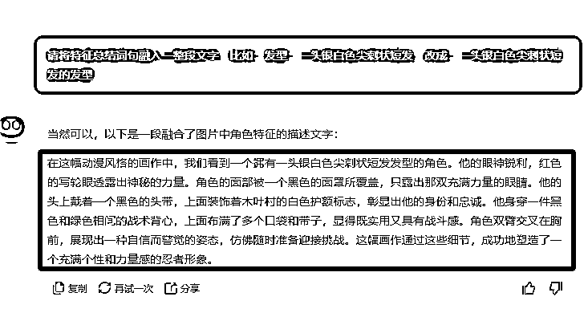

第二阶段是用文本生成图像。

目前测试下来Recraft的综合表现突出，在上周的横评中综合能力被认为优于MJ和SD。将整理好的描写粘贴到左侧输入区，点击生成即可得到两张接近真实摄影质感的角色图。

关键点在于结尾必须强制风格约束，追加“写实风格、接近真人质感、拒绝卡通化”之类的表述，否则容易滑向二次元插画。

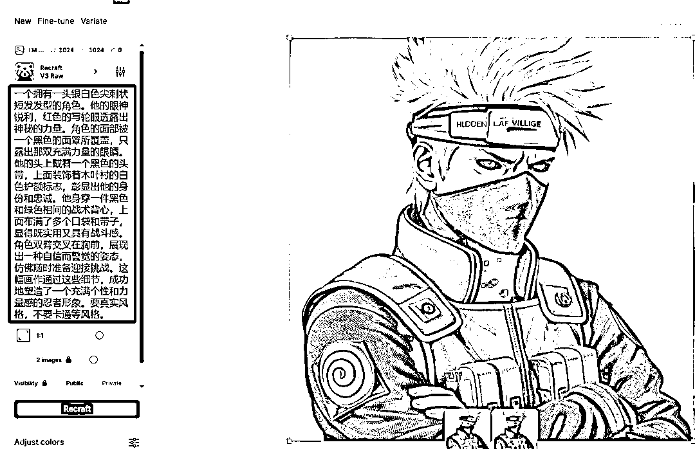

第三阶段是让画面具备立体动态。

工具选用LeiaPix。进入官网后点左上角Upload上传刚才生成的静态图。

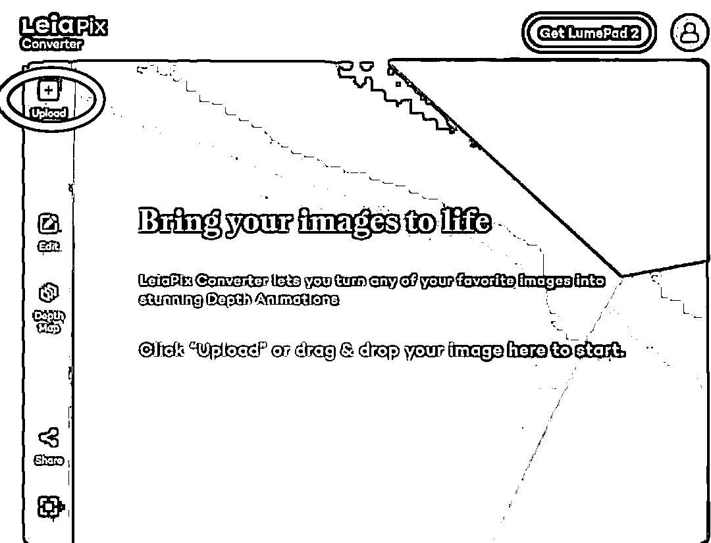

上传完成后右侧会出现动效选项，选用第二项横向水平旋转，即可赋予画面3D翻转的观感。

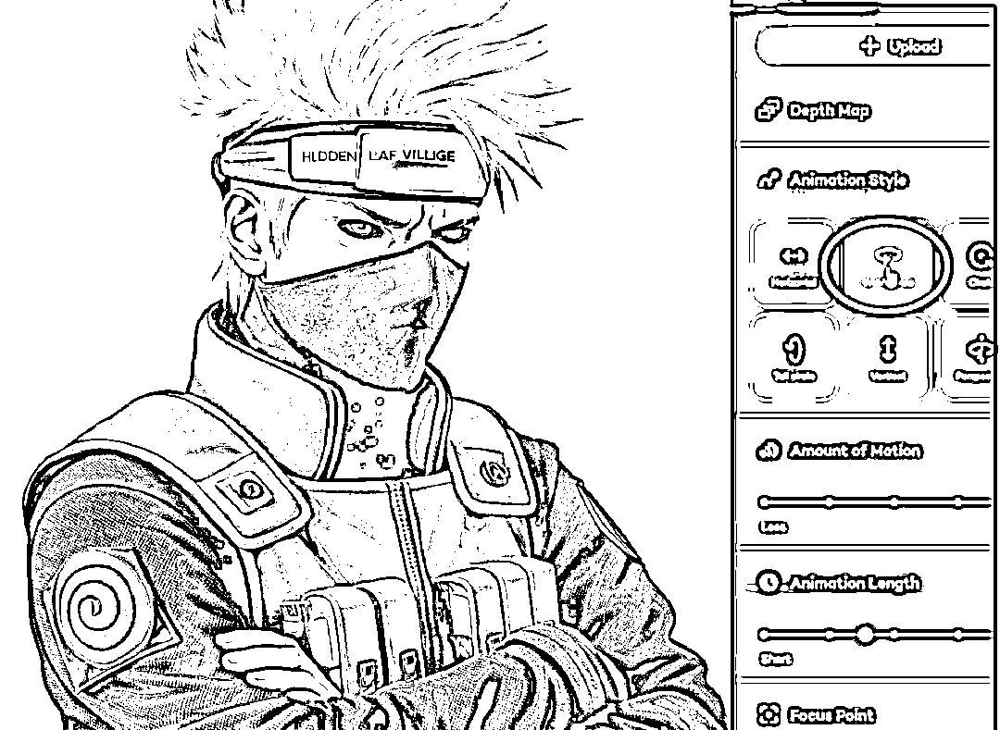

导出后即可得到来回旋转的3D片段，留作素材备用。

最后是成片剪辑。

把多个角色的动态片段导入剪映，按节奏排序并加入转场，分段时长做统一，再植入该IP的经典背景音乐，最终即成一条完整的3D仿真动漫短片。

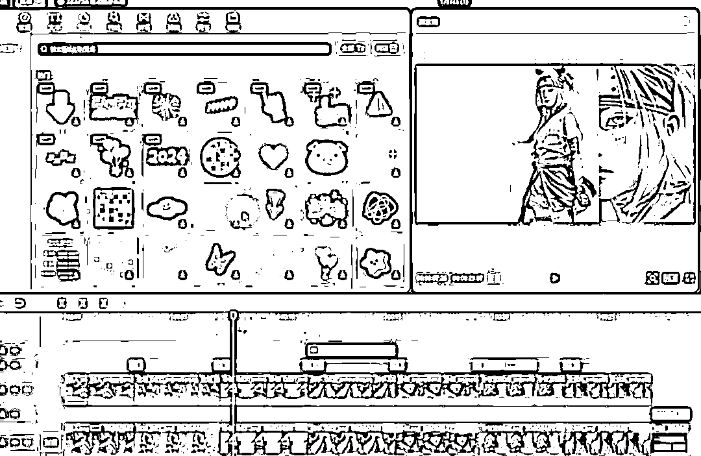

整体流程并不复杂，核心在于工具链的配合和细节把控。角色描述的生成模板、绘图工具、图转3D工具的清单已整理到一份资料里：

高鹏在网创领域深耕九年，这次拆解的是第694个可落地的项目案例。AI内容出海的细分机会很多，核心是找到稳定的内容形态并持续做迭代验证。