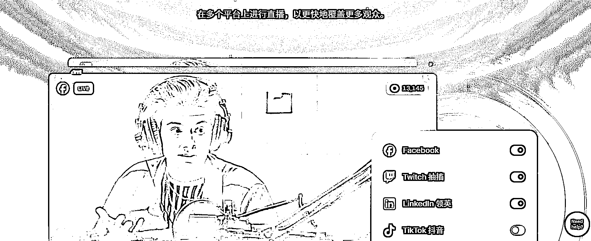
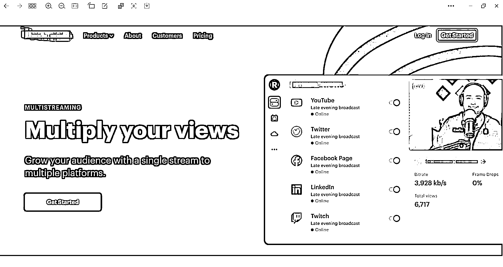
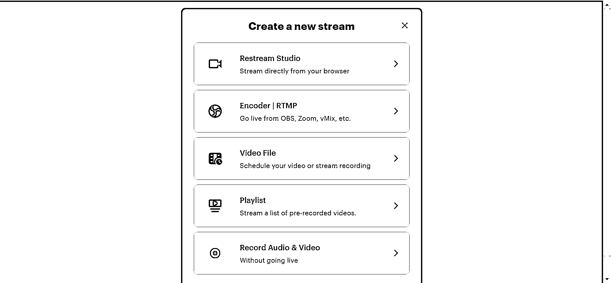
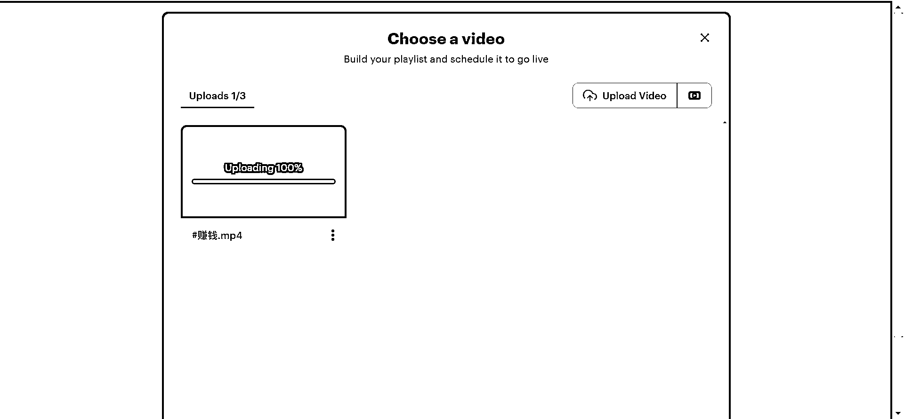
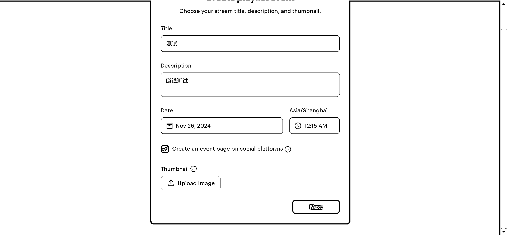
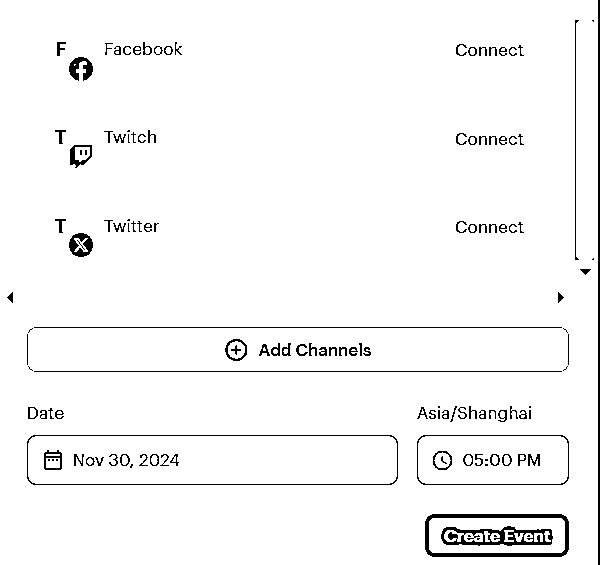
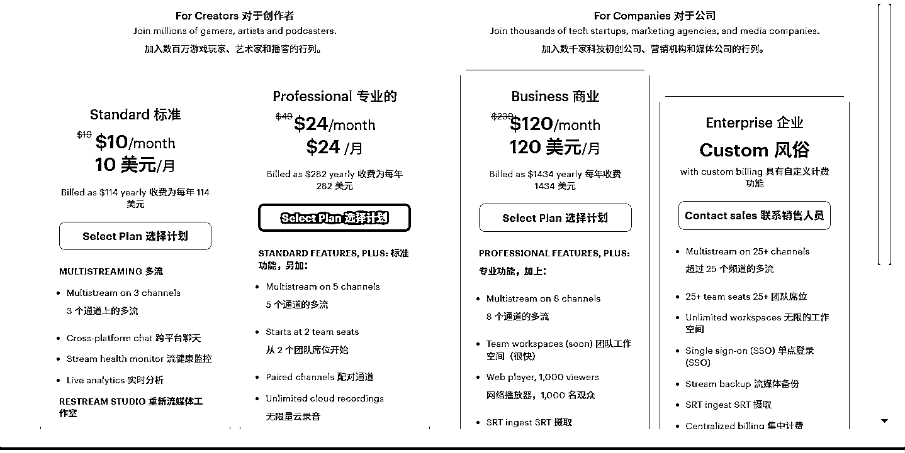
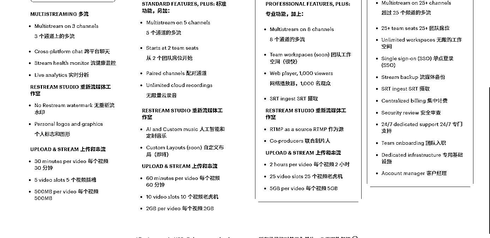
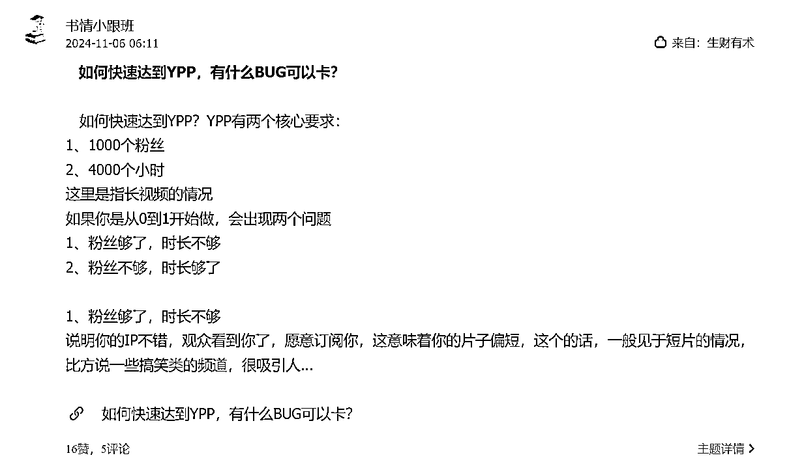
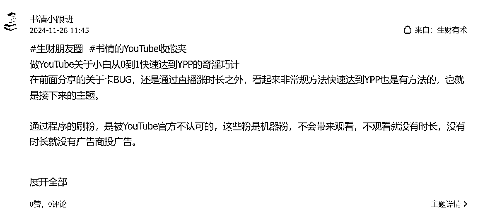

# 想快速拿下YT创收门槛？这个“挂机”直播玩法，帮你悄悄拉满时长
作者：龙哥

> 最近不少圈友在聊YouTube的变现门槛，大多数人不是卡在粉丝数，而是卡在难以积累的**观看时长**上。今天分享一个“偷懒”思路，利用无人值守的循环直播，把账号时长轻松“堆”上去。

具体用了什么工具，为避免广告嫌疑先不提。但可以透露的是，它本身是一个支持**多平台推流**的直播软件。不过咱们的目标很明确——主攻YouTube，用它来冲刺YPP（合作伙伴计划）条件，就足够了。

实际操作非常简单。你只需要在直播类型里选择 **Video File** 模式，然后把提前准备好的视频文件上传进去，就能搞定内容源。

看，视频文件已经成功加载进系统了。

如果你付费解锁了高级功能，还能在下拉菜单里自由设定**视频重播的次数**。想循环几遍，你自己说了算。

要是你不满足于只在YouTube上播，还想同步到其他平台，那记得先去后台把对应的**直播账号**给绑定好，这样才能一台机器多处开播。

最后再说说钱的事，毕竟是付费工具，价格方面放出来了，参考下面截图即可。

估计有人会问：为啥要买这个？其实逻辑很简单。**就得靠这个套路来“刷”直播时长**。之前有朋友分享过一些涨粉的技巧，但那些方法往往只增加订阅者数量，对**观看时长**这个硬指标帮助不大。

而这个帖子里的方案不一样，它是通过**真实挂机直播**的方式，让你的朋友或者小号挂着看，**真真切切地把有效时长累积起来**，直击YPP审核痛点。

#### 

至于这个套路要怎么玩出花来——是用它给主号引流，还是弄成24小时陪伴型频道？那就全看你的商业规划了。

* * *

评论区：

小吉玛丽亚 : 学到了！原来这就是传说中的YouTube无人直播操作呀！

风澜 : 操作过程里瞅见一个“R”字开头的软件，是不是那个工具？

拾悦说 : 对呀，是R开头的那个吗？