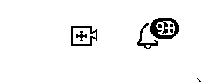
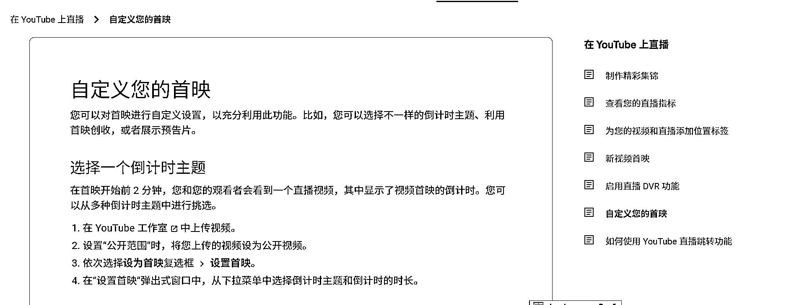
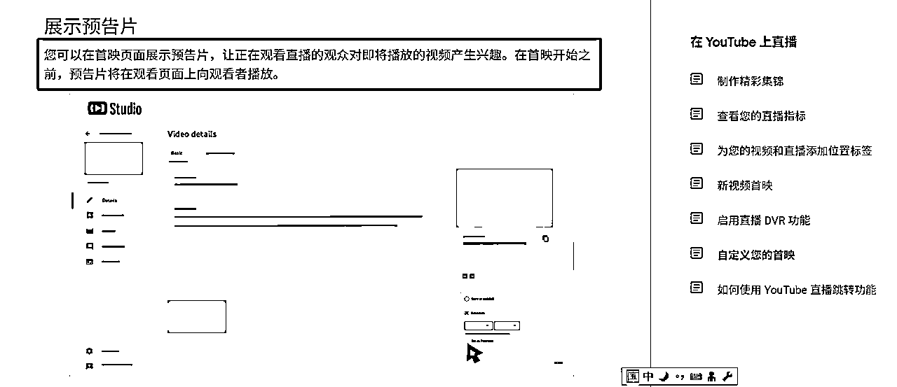
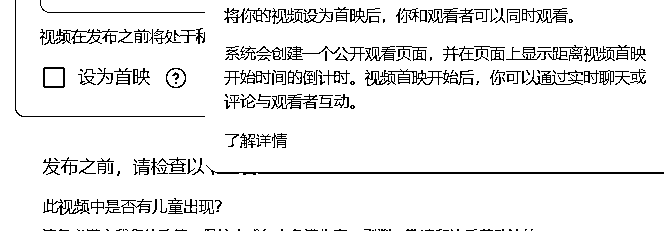

# 做 YouTube 这件事，你得先搞懂这套时长逻辑

## 关于做 YouTube 要掌握的认知——提升时长

作者： 书情小跟班

日期：2024-11-26

现在 YouTube 官方向 Shorts倾斜资源，本质上是想用短视频和 TikTok 抢用户，这点不用怀疑。所以想在平台上变现，趁着 Shorts 的红利期去吸量，是当下很务实的选择。

常用的打法是：先用 Shorts 在公域里收割曝光和订阅，等人群积累起来之后，再用首映把观众往长视频时长上导。

为什么要强调首映？因为很多新手根本没意识到它的提醒力有多强。发起首映后，订阅者会收到强推送，而且在正式开播前的两分钟，观众就能看到一个带倒计时的直播间，创作者可以从多个倒计时皮肤里挑选一个。

普通上传长视频是没有任何倒计时提示的。长视频目前也不是平台的重点扶持方向，普通的上传铃铛更弱，如果粉丝没手动打开小铃铛，是很难第一时间知道你更新了。

首映的机制完全不一样。它自带倒计时提醒，还能挂预告片。你可以在预告里放最抓人的片段，提前把观众的期待感撩起来。

用这个功能是有门槛的，需要注意。

资格条件：创作者需达到以下条件才能使用此功能：频道订阅人数超过

1,000，且没有未解除的[社区准则警示](https://support.google.com/youtube/answer/2802032)。

首映的额外价值在于互动变现。**超级留言和超级贴纸是粉丝与创作者在实时聊天期间进行互动的两种方式**。在这种强互动的场景里顺势做转化，比如带自己的课程、把人引到私域成交，效果会好很多。

如果你本身是做 Shorts 内容的，也能借用这套逻辑。等一波粉丝进来后，可以把几个相关的 Shorts剪辑合并成一个长片，用首映的方式发布，甚至可以关闭互动，单纯利用它的通知机制让老粉都收到提醒。

一旦设置好首映，系统会在开播前30分钟和开播瞬间分别向观众推送一次通知。

更多官方细节可以参考
在 YouTube

上直播自定义您的首映 Hans#zippy=,资格条件,广告,超级留言和超级贴纸)

在 YouTube 上直播新视频首映  Hans)

* * *

评论区：

暂无评论