# 小红书防导流新规下的实操突围笔记

最近小红书的风控动静很大，站外引流被严查是重头戏，尤其是禁止在站内裸露微信号。更新后的导流监控上线后，不少号主都中招了，从私信评论区禁言7天加限流，到后续升级成14天，处罚是真的一步步上来的。

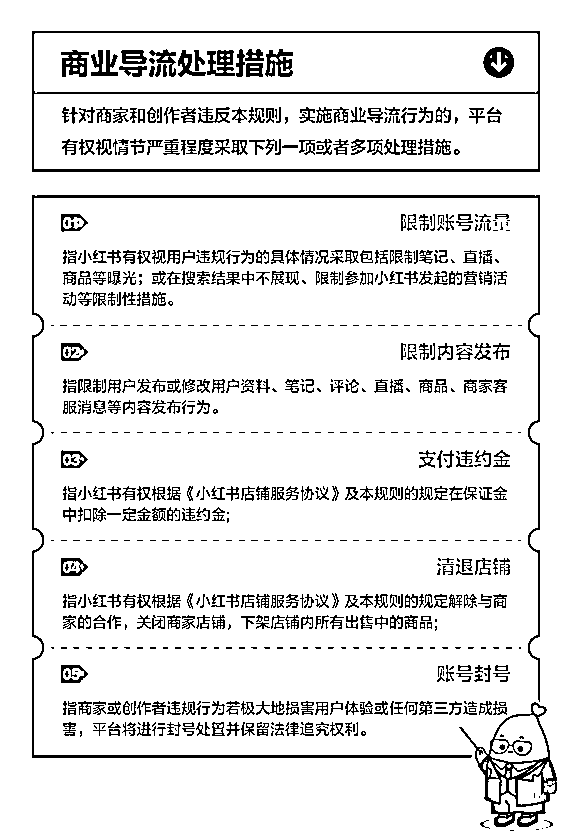

过去常用的留微信套路基本都被封堵。专业号以前还能把群聊名改成微信号，现在直接失效。之前花钱做聚光保护还能让用户说微信，现在这条路也走不通了。

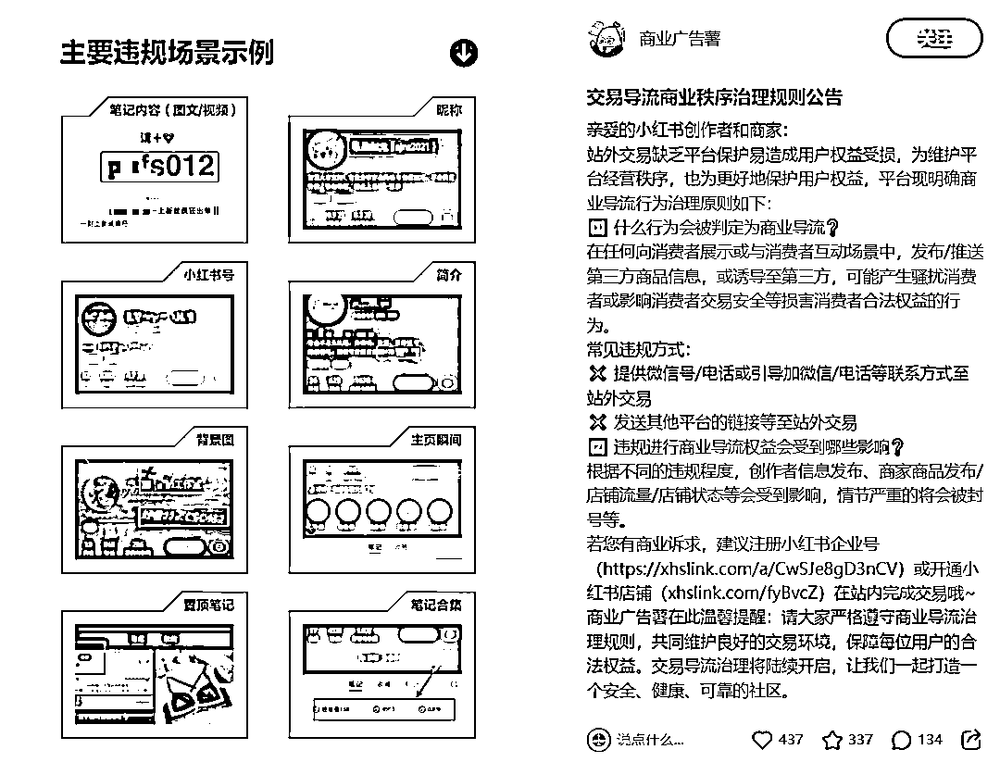
**手里有预算、获客已经跑通的老板，最省心的办法就是直接上聚光投流，老老实实公开放微信。**

**那零成本运营的账号，还能怎么带流？** 近期我实测了两套还能用的做法，分享出来。

# 01 “摩斯”式点位暗码

**怎么玩：** 私信时不直接写微信，而是把微信或手机号里的数字换成点来表示，直接发给咨询的用户。

玩法还能延伸，比如用各种 emoji 代替点，甚至把数字拼在扑克牌上拍成照片发过去。

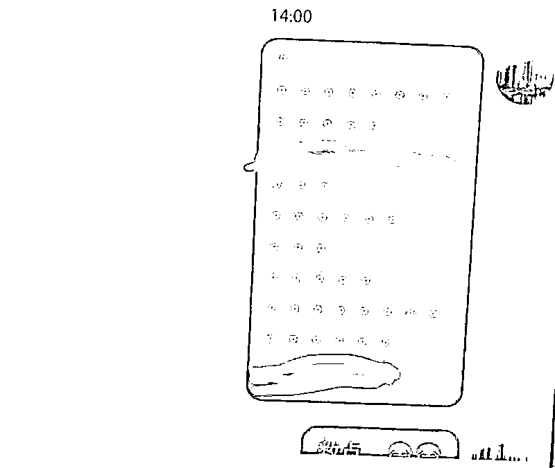
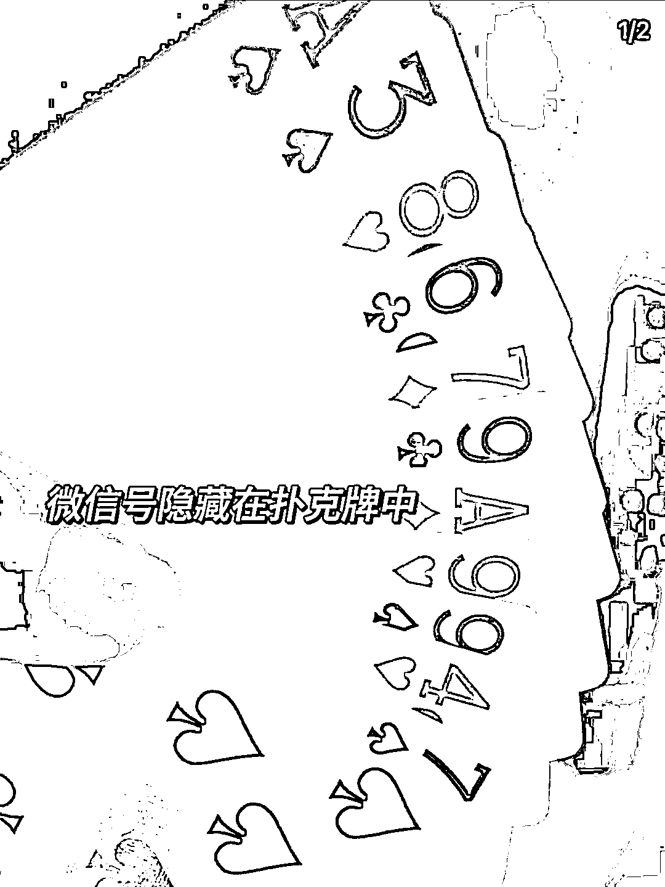

效果上看起来很巧妙，实操却有个硬伤——一旦微信号里带“0”，点位就没法区分，基本就废了。

# 02 用小号发含微信的笔记做中转

**怎么用：** 先让小号发一条带微信的笔记，然后在三个场景里用起来
① 用户私信来问，直接甩这条小号笔记链接；
② 大号把小号笔记收入公开收藏夹，引导用户去翻收藏；
③ 拉用户进微信群后，用小号在群里丢这条笔记。

这招以前就有人用，现在审核更严了。以前微信号不做任何伪装，发出去自己能看见别人看不见。

**那要怎么避开机器识别？**
我总结出来一个思路，暂且叫“看似合理法”。核心是：**在图片的「这个位置」，本来就可能出现一串数字字母，那你的微信混进去就显得自然**。

举个例子，一张英文报纸本身就满是字母，把微信号嵌进去，一眼看上去很正常，系统也很难快速判定。

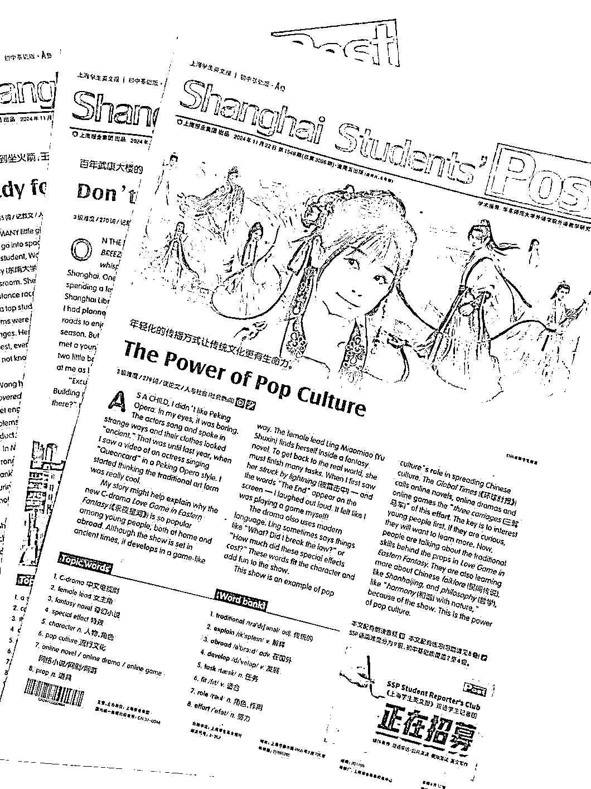
**可不是只要图片里有字母数字就行。**

我拿键盘图做了对比测试：
❌ 微信放在「空格键」上那张，直接被系统判定私密；
✅ 微信放在「按键」上那张，则能正常发布。

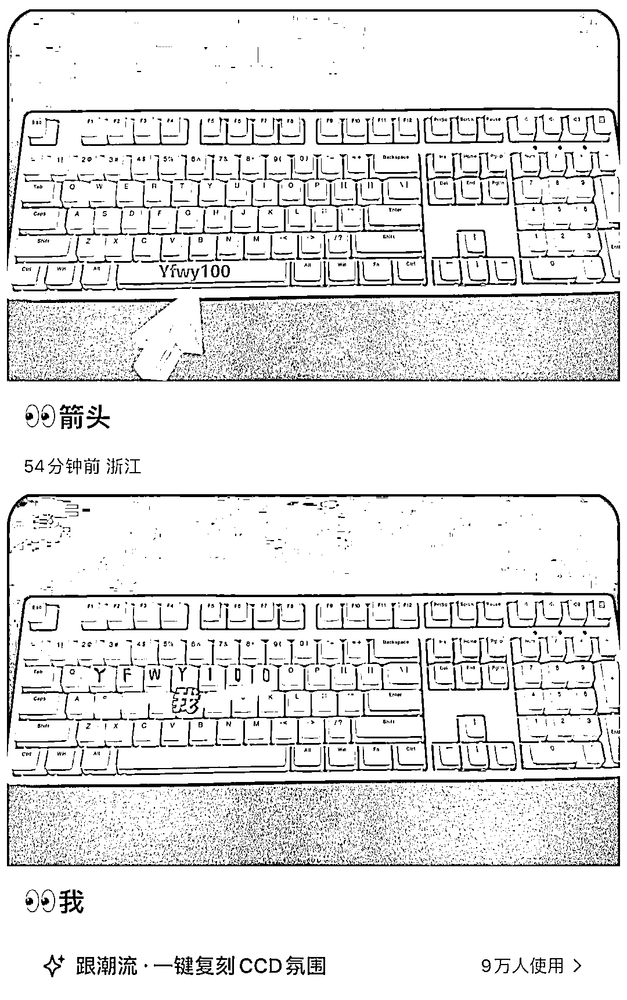
关键就在于放置位置是否合理。问自己一句：**这个位置出现数字字母，合不合理？**

掌握这个原则，我做了5组实测题，都是已经成功发布的案例。你可以先猜答案，再对照文末的标准答案。

———

开考！

**小红书引流图合规判断题 单选 每题2分**

**第1题：便利贴**
A.违规❌ B.不违规✅
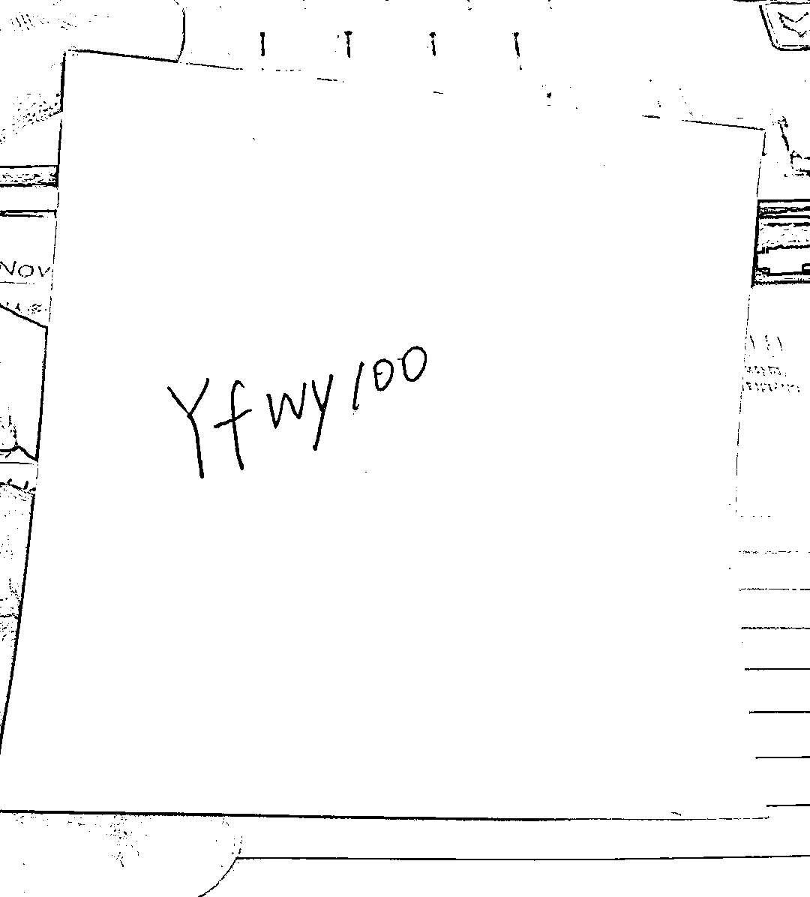

**第2题：汽车车牌**
A.违规❌ B.不违规✅
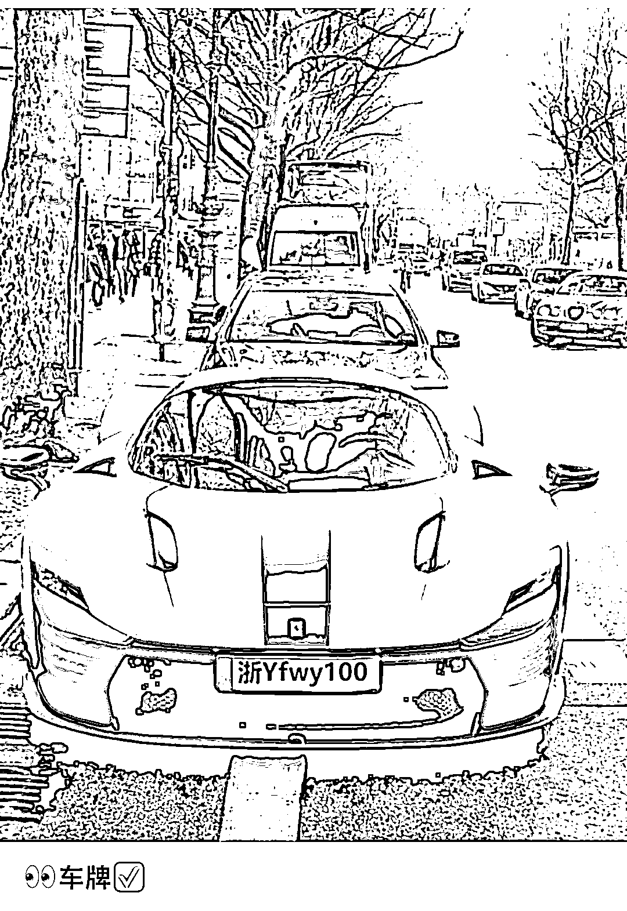

**第3题：面膜包装**
A.违规❌ B.不违规✅
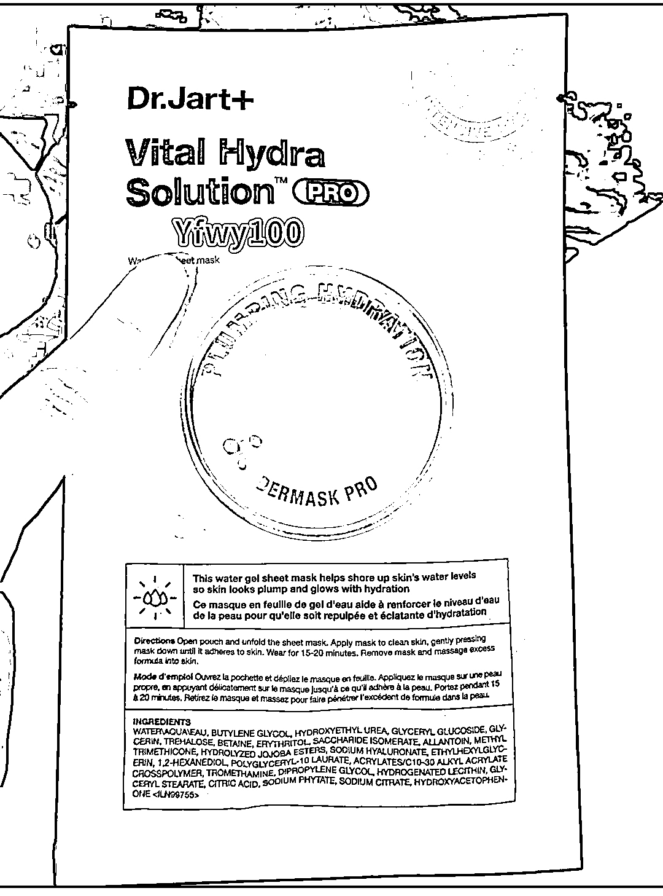

**第4题：赵丽颖写真**
A.违规❌ B.不违规✅
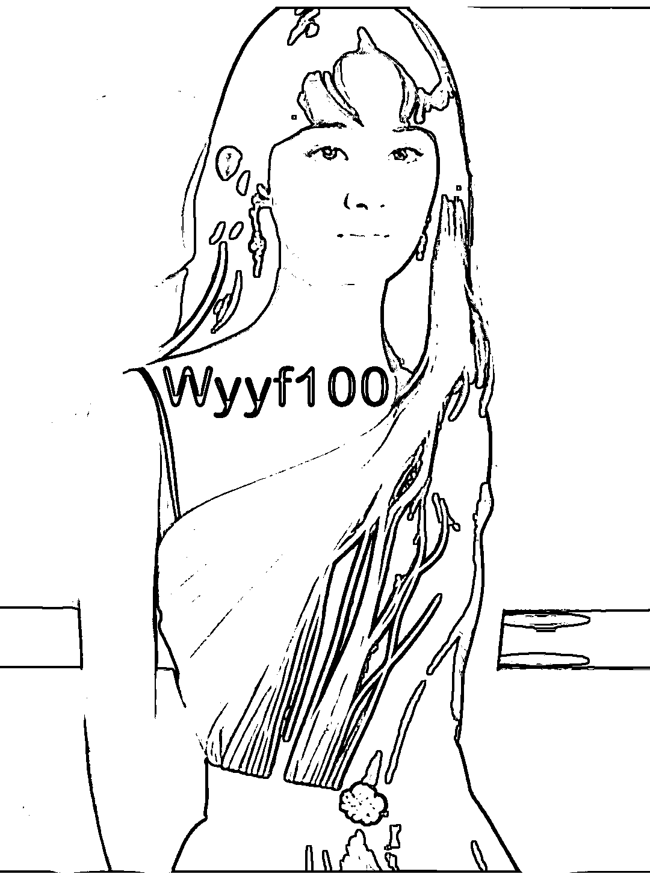

**第5题：个人海报**
A.违规❌ B.不违规✅
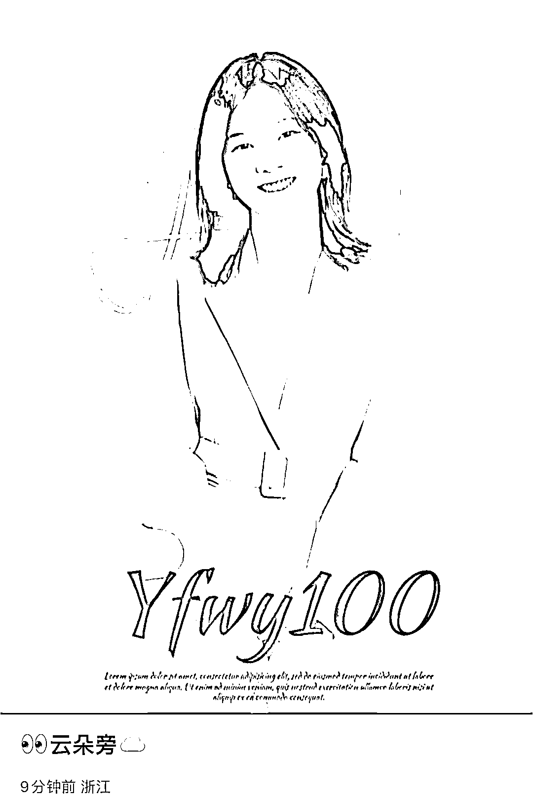

公布答案：**ABBBB**，满分10分，评论区来对答案吧。
第4题和第5题很多人会绊住，原因其实很简单——抛开导流目的单纯看图，排版里出现那串数字字母本就是合理的视觉元素，系统才不会立刻判定。

学会这个判断逻辑，举一反三就能自己做图了。

**最后两个实操提醒：**

**1.能用小号就用小号去导。**
系统可能抓不到，但防不住同行举报。用大号被举报首罚风险很高。我曾用A号举报自己B号的带微信笔记，举报确实成功了，A号收到了举报成功的提示，B号当时没收到违规提醒，笔记也还在展示。我推测是举报量没达到阈值，但平台肯定会根据举报反馈判定违规。

**2.大号发微信后，用户确认收到立刻撤回。**
降低被巡查到的概率。

以上就是近期零成本引流的思路拆解，希望对还在找路的同学有帮助，祝大家导流顺利，微信爆单。