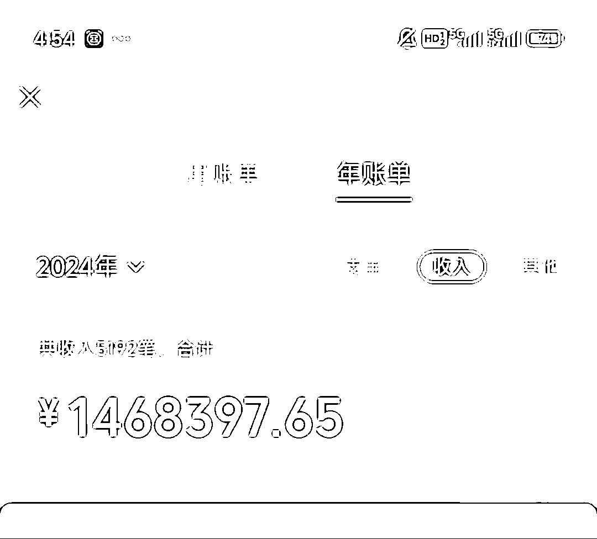
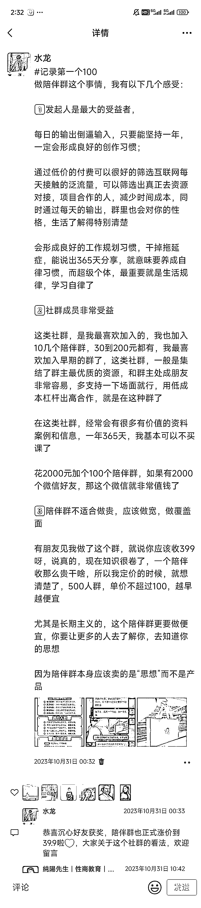
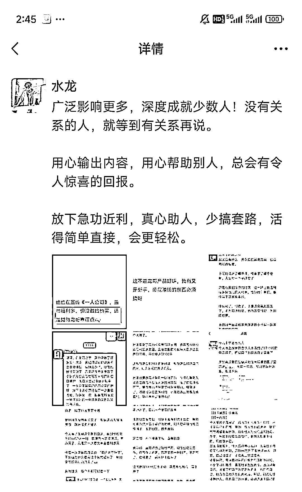
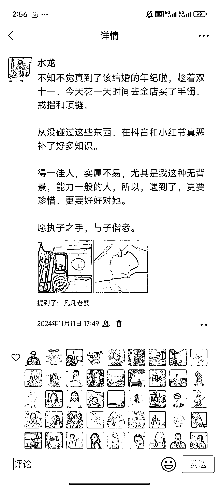

# 从负债上班到年入七位数：一个96后如何用私域分销完成自媒体逆袭

我是龙哥，96年出生。大学二年级就拉着团队做文化衫定制，最好的时候营收破百万。疫情一来生意直接崩盘，背上债务去上班，把网贷还清后才松口气。

去年一次偶然的机会，我踏进了自媒体圈。从零开始做内容，靠给大佬分销知识产品赚佣金，攒下了人生第一笔七位数存款。

这篇文章我把自己的蜕变拆成三段，每一段都把能复用的方法拆开了讲，希望正在想靠自媒体赚钱的朋友能少走弯路。

普通人到底怎么起步，才能真正持续地从自媒体里赚到钱？
不会拍视频，不会直播，也不玩抖音📕的公域引流，纯粹用私域能不能做起来？

过去一年我就是靠**自媒体带货赚佣金**这条路，赚到百万利润，也摸清了最适合普通人变现的打法。

对于时间碎片化的上班族、宝妈、学生在内，带货赚佣金是最现实的切口。

以前自媒体主要靠接广告和带货。近两年环境变差，大V的广告单越来越少，带货也卷到极致，于是很多头部开始转向卖课做知识付费。

抖音是最初的主战场，现在视频号起来了，越来越多的头部把课堂搬到了🛰️私域。这对我们普通人来说，就是一次分钱的机会。

大V在私域卖课基本都会开分销，佣金比例从20%到100%不等。那为什么大V卖课会是普通人的机会呢？

先说普通人做自媒体的三大卡点：

**1、没流量**

**2、没内容**

**3、没产品**

大V在私域卖课，恰好能同时解决这三点：

1、付小钱就能进他们的社群，低成本接触到一群高质量的人，直接盘活你的私域用户池。
2、在社群里沉淀头部的内容，拿来用、整理、再输出，快速建立自己的内容能力。
3、直接分销人家的课，不用自己研发、不管交付，直接拿佣金。

总结下来，普通人自媒体赚钱的底层逻辑就是：

**先付费买大V的知识产品—在他的圈子里学习并攒下高质量私域—用持续的内容输出建立信任，再带货拿佣金。**

讲清逻辑后，下面结合我的实战经历，把成长路径拆给你。

在拆之前先强调一个前提：

**写作是自媒体变现的底座。你可以不剪视频、不开直播，但表达力必须练出来。**

我过去一年变现主要靠三种载体：朋友圈、社群、👸号。它们都建立在持续写作上。

## 一、新手期：把基本功练成肌肉记忆

新手期大概是什么样子？

2、没有写作习惯，从没在朋友圈发过带货文，也没运营过👸号，更没建过自己的社群。
3、对知识星球、小报童、墨问这些内容平台不熟悉。

简单说，就是人脉和信息资源都处于空窗期。

新手阶段的目标不是爆款，是稳步积累。做私域带货记住三件事：

**1、私域增长是日更任务**
**2、把基本功练到自动化，才能持续赚钱**
**3、做离钱最近的事，卖最好卖的产品**

### 1、猛吸圈内信息

新手第一笔钱先用来买课进群。进去后别潜水，疯狂学习、认识人、了解潜规则。多说话、多提问、多记录。信息越多，判断越快。

### 2、反复打磨朋友圈、👸号、私域增粉

#### 1、朋友圈带货训练

新手每天至少发2-3条，固定三种内容：

##### 1、成长+干货带货

分享个人感悟、赚钱心路、实操干货。素材来自知识星球、📕、👸号。刚开始不会重写，就先用自己的话复述一遍再发。

字数控制在200-500字，记得配上支付凭证或评论区挂链接，展示成交。

**举个例子：**

这是我去年卖陪伴群时用的「感悟+底部配图」带货法。刚开始不会成交，先把发圈节奏练熟，等有合适产品再自然带货。

##### 2、夸夸圈，筑信任

在社群和私聊中，把别人的夸奖、认可截图保存下来，定期发朋友圈。别人的好评就是最好的社会证明。

如果你觉得没人夸你，就主动夸别人，多帮群友解决问题。夸出去的往往会回来。

记得用稿定设计打码、标重点，美化配图。朋友圈的视觉感直接影响信任感。

**举个例子：**

这类用户证言对高客单成交特别关键，别小看。

##### 3、生活圈，立人设

发点家庭、聚会、日常美照，让朋友圈有温度。人设可以是爱老婆的创业者、正能量的宝妈、大厂人...选一个你最真实的标签持续输出。

原则就是真实、有参与感，让人感觉你是朋友，不是纯销售号。

总结朋友圈发圈法则：即兴可以，但最好写。至少100字，尽量露出支付按钮。

#### 2、👸号日更，打通公域

把👸号当成每天发一条高质量的朋友圈。核心是展示真实的自己。

👸号是私域和公域的桥梁，标题要夸张吸睛，内容围绕赚钱刚需。不要管阅读量，先写100篇，慢慢找到感觉。

我就是靠👸号沉淀了2000+精准私域，变现十几万。

#### 3、每天增粉，就是每天赚钱

时间允许就冲到30个/天。没有私域，谈变现都是空谈。

## 二、成长期：从执行者到IP变现

当你能熟练发圈、写👸号、混圈后，就要开始做自己的产品。互联网上没有自己的产品，就换不到资源。

付费一定数量的大V课程后，用分销他们的产品来筛选和沉淀自己的私域。把已成交的人打标签，凑够20人就建付费群。

不要做免费群，一定要付费。社群里要学会用水军带货、公开演讲带货，用自己的故事建立信任。

社群会死很正常，重点是训练你一对多销售和公开表达能力。死一个就再开一个，不断迭代。

### 2、做付费专栏，建内容壁垒

社群是社交型产品，专栏是内容型产品。成长期的同时要左手引流、右手沉淀内容。

专栏可以用来赠礼、低成本建立关系，也能降低转化成本。我的专栏吸引了大量铁粉，很多用户看完直接买我其他产品。

新手怎么做？去解答别人的问题，把高频问题的答案整理成合集，就是一个低价专栏。既能避免重复答疑，也能解决白嫖。

### 3、参加圈内活动找商机

打榜活动有三大好处：低成本拿课程+分销回本、免费链接高手、现场学习顶级文案和运营。

人多的地方就有钱。打榜活动越大，商业机会越多。

参与时要学会抱团：

1、死磕一个上升期大佬做销冠，比到处混更有效。我当年绑定老马，借助他的资源才建立起基本盘。
2、拿下销冠要靠团结弱者，日常多帮比你弱的人，关键时刻他们会把你抬上去。
3、要敢重仓。当你不缺启动资金、又缺势能时，敢押注一个榜单，就有机会吃到第一。

### 4、深耕一个专业技能

项目+IP才是长期饭票。选一个长青赛道，比如爆文写作、📕、闲鱼、AI写作，持续精进。

从学员到老师到专家，你的分销竞争力才不一样。

## 三、高手期：建体系、建联盟

高手期标志是：有了铁粉、有被认可的内容、有清晰标签。这时要通过公开发售放大影响力，建立可复用的商业系统。

### 1、低客单社群裂变，解决私域枯竭

200人左右的陪伴群会进入瓶颈。这时需要通过分销+奖励机制裂变。开高比例分销，让信任你的兄弟带人，你赚影响力和流量。

发售后要做二次变现，保证可持续。

### 2、专栏发售，借势KOL放大转化

内容产品发售前要先有信任资产。可以通过拿榜一、爆文10万+、成为大V销冠等事件作为信任背书，再发售专栏。

内容必须日常积累、严格把控，口碑会带来裂变。

### 3、搭建十、百、千、万元产品体系

围绕大V的产品体系，建立自己的价格带。我的体系是：专栏-社群-俱乐部-合伙人

10元专栏持续卖，百元社群建立信任，俱乐部做资源赋能，万元合伙人绑定长期共创。价格递进，服务递进，睡后收入自然产生。

### 4、建立合作联盟

有了产品后要放大，就得找队友。常见模式：你出内容他出流量，或你带流量他做交付。超级个体试错成本低，多尝试合作。

核心小团队从学员里选拔，给流量和特权，让他们和你共创。这样你做发售和合作时效率更高，影响力更稳。

把上面三段路一步步走完，执行拉满，你也能像我一样，把自媒体做成一门持续赚钱的生意。

* * *

评论区：

安俊 : 跟着龙哥赚了不少钱了！龙哥值得！

艺涵 : 水龙哥！值得！冲鸭！

徐铮 : 新手，IP，团队，龙哥写的太详细了，把分销带货的成长阶段拆透彻了。 确实跟着龙哥学了不少东西，赚了不少钱！

老马 : 很厉害，龙哥写的真好