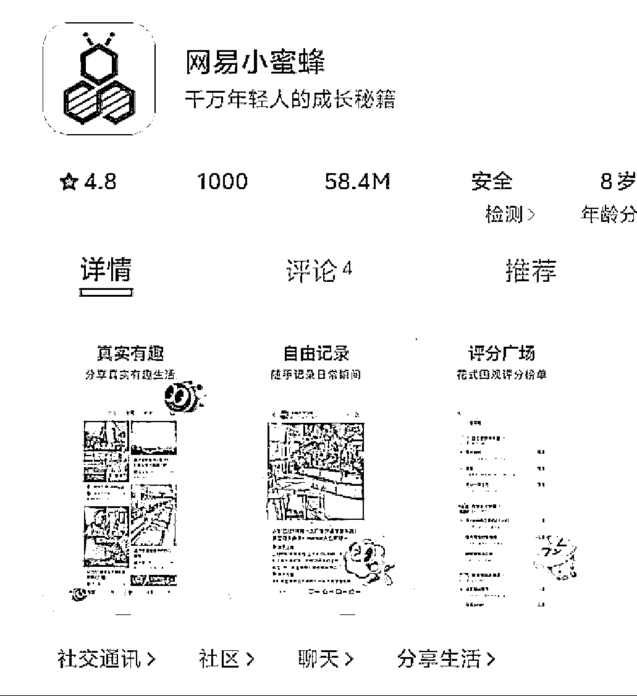

# 再一次大厂红利：网易小蜜蜂的入场窗口

## 高鹏拆解第697个项目：网易小蜜蜂刚上线，正是卡位的好时机

作者：高鹏圈

日期：2024-11-29

各位好，我是高鹏。

今天带大家看一个刚冒头的大厂新品。

能闷声发财的节奏又来了，昨天网易正式上线了一个叫小蜜蜂的 App。

大厂每推一个新东西，对普通人而言基本都是信号弹。想想当年抖音刚出来的时候，首批入场的人现在回头看都是赚翻了，千万粉丝号十有八九都是起步期就扎进去的。

这次的小蜜蜂，安卓 iOS 全平台都能下。

我实测了一下，整体界面很清爽，操作也很顺滑。

官方宣传语是聚焦年轻人日常分享交流的内容社区。

说白了就是走的图文视频内容路线，和抖音、快手、📕一个赛道。

打开之后第一感觉就是撞脸📕。因为它的对标就是这家。

放一起对比就很明显，左边📕，右边小蜜蜂，版式几乎一致，都是双列瀑布流。

当前用户侧功能和老牌平台差别不大，可以发图文笔记，也可以发视频，还能参与平台话题。唯一有差异的点在于它支持企业工牌认证，认证完职场身份后会获得额外扶持。

为什么我强调这是普通人的机会？

第一，它出自大厂；第二，它是全新起步的平台。

这类内容型平台一般会走三步走。

第一步是野蛮生长期，就是内容荒。平台缺内容的时候，搬运都算填补空白，从平台视角就是原创。

第二步是扩张期，创作者越来越多，赛道开始拥挤，平台开始挑质量和原创度。

第三步是成熟期，创作者饱和，竞争白热化，只能靠细分赛道求生。

结论很直白，越早占坑越省力。

那具体怎么玩？结合定位来看，职场和生活这两个垂类是被重点扶持的。

从 Slogan 和产品调性上就能读出来，平台想做的就是这两个方向，所以跑出来的概率更高。

网易在种草领域已经布局很久了，不久前云音乐里就悄悄加了个叫“笔记”的入口，意图很明显。现在单独把小蜜蜂推出来，而且做得这么像📕，基本就是要死磕种草赛道。

前面说了两大机会赛道：职场和生活。内容从哪里来？

平台还在内容饥渴期，正是拿来主义的好时候，直接对标📕、小绿书这两个板块的优质内容，迁移过来就能用。

变现方面，目前能看到的就是打赏功能。用户喜欢你的图文或视频就能打赏，单次几十块，且不封次数，和👸号赞赏逻辑类似。

电商闭环现在还没开放，但种草是它的核心战略，📕有的变现形态未来它大概率都会补齐。

所以策略就一个：先选定领域，尽早入场，把账号跑起来。

玩起来也简单，因为是📕的翻版，你可以直接复用📕的打法。

我这边整理了生活、职场两大板块的📕实操方法，共三套打法，包含几十节视频课，已打包成文档：[`svj4gxvm0v3.feishu.cn/docx/DzpbdyyPgopeVYxxnRycRqaqnMe?from=from_copylink`](https://svj4gxvm0v3.feishu.cn/docx/DzpbdyyPgopeVYxxnRycRqaqnMe?from=from_copylink)

我是高鹏，网络创业深耕9年，今天拆解的第697个落地项目玩法，更多方向欢迎来聊。

* * *

评论区：

璟曦 : 一刷帖都是网易的和大学生在发😂

ToNet : 和脉脉有啥区别