# 一个高客单价产品，如何从用户需求走到200+人规模？

大家好，我是 Sitin 彭涛，一名连续 3 年实现超百万收益的 90 后创业者。

从 2024 年 8 月 26 日到 11 月 26 日，千里会成立满 3 个月，累计收入突破 90W+。这次，我想把整个产品从构想到发售、从交付到增长的过程完整拆开，分享这一路上最关键的 6 个步骤：

1. 从真实需求出发，结合同行调研找到方向  
2. 明确定位，把核心卖点集中起来  
3. 先做小范围测试，再逐步放大  
4. 用户付款后快速交付，持续制造惊喜  
5. 调动流量、内容和团队资源，集中引爆  
6. 把感谢落实到行动里，持续积累口碑  

希望这份复盘，能给正在筹备高客单价产品的朋友一些参考。

## 一、产品不是凭空设计出来的，而是从需求里长出来的

千里会并不是我突然产生的一个想法。

从 2018 年开始做👸号创业，我先后尝试过低客单价的副业产品、写作社群、小报童项目，也做过出海、Python、AI 爆文、AI 代写等更高客单价的训练营。一路走下来，我积累了一批长期支持我的用户。

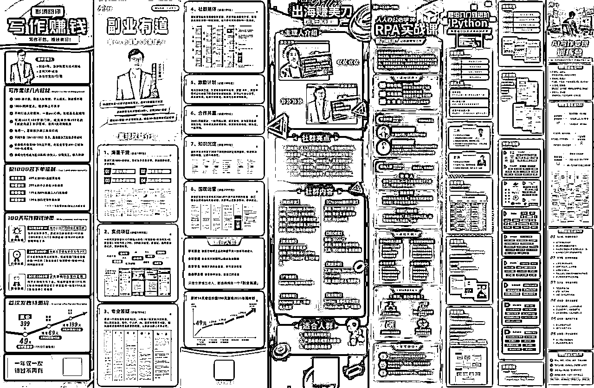

有一次，一位铁粉问我：

“能不能做一个产品？买了以后，你后面推出的新产品，我们都可以享受优惠？”

这个问题让我意识到，用户其实早就给出了一个明确需求。

一方面，我过去的产品很多，但大部分训练营只有 2—3 个月的陪伴周期。项目结束后，用户遇到新问题，往往找不到持续获得支持的地方。

另一方面，那些长期购买我产品、持续支持我的铁粉，也确实应该得到一些回馈，而不是每次都按照原价购买。

还有一个现实问题：这些用户分布在不同社群里，彼此之间缺少连接。我需要一个新的载体，把他们集中起来，同时让他们获得更多资源、项目和赚钱机会。

当然，想清楚需求只是第一步，真正落地并不简单。

我的许多高客单价产品都有合作讲师，如果给铁粉设置优惠，必须兼顾合作方的收益；而且，一旦统一降价，那些过去按原价购买多个产品的老用户，也可能产生“不公平”的感受。

为了更好地解决这些问题，我花了六位数研究和购买同行产品，亲自体验不同社群的运营方式。觉醒生态给了我不少启发，但其中也有一些模式并不完全适合我的情况。

直到 4 月份线下见到阿猫老师，我才真正找到更适合自己的方向。他对私域运营的理解非常深入，于是我马上花几万元购买了觉醒商业私教，希望获得针对这个产品的具体建议。

我在龙哥盟已经很多年，也一直在观察帖子、研究项目和商业模式。可以说，很多思路都来自这个圈子。这里聚集了大量优秀同行，是学习、交流和验证想法的好地方。

## 二、定位不能太泛，卖点必须足够集中

确定要做产品后，我们开始思考：千里会究竟凭什么让用户选择？

把手里的产品重新梳理一遍后，我们发现，“IP+项目”这条路是成立的，但如果只有这两个元素，和市场上的其他产品差别并不大。

最初我们考虑过把编程作为核心标签，但很快发现，编程对多数用户来说门槛偏高，容易让人产生距离感。

在和阿猫老师沟通、并经过团队多轮讨论之后，我们最终决定把 AI 作为主要切入口。

原因有三个：

- 市面上以 AI 为核心的合伙人产品并不多；
- AI 是我准备长期深耕的方向；
- 我手上已经有 AI 爆文、AI 代写等相关产品，能够形成资源组合。

### 定价：先降低进入门槛，再逐步释放价值

最开始，我其实是按照万元圈子的标准来设计的。

当时准备了很多权益，包括旗下几万元产品、AI 代写训练营、1V1 咨询以及流量支持等，按这个权益组合来看，定价 1 万元并不过分。

但阿猫老师建议，不要一上来就把价格定得太高。

第一，前期快速聚集 100 名成员非常关键。成员中的 KOL 后续也可能帮助产品传播，如果增长速度足够快，形成的势能会比慢慢卖满 100 人强很多。

第二，初始价格过高，会限制后续调整空间。如果一开始定到 6999 元甚至 1 万元，卖得不理想，既不能轻易降价，也很难继续涨价，产品会陷入被动。

所以，我们把内测阶段的最低价格定为 3999 元。

这个价格对早期用户足够有吸引力，感兴趣的人更容易下决心购买，愿意帮忙推广的 KOL 也更容易成交。

### 周期：把长期价值变成用户容易理解的价格

最初，我想把产品周期设置为 4—5 年，因为其中包含 1V1 语音咨询等权益，时间太长可能会增加交付压力。

但最后在阿猫老师建议下，我们把周期确定为 7 年。

一方面，1V1 咨询并不一定要从第一天起就永久无限制。早期用户可以享受不限次数，后续加入的成员再逐渐设置次数上限，甚至取消这项权益，这样既能控制交付，也能强化“越早加入越划算”的感受。

另一方面，用户未必真的会每天打电话，但“无限次咨询”本身就会让人觉得价值很高。后来回访时，我也发现不少用户就是被这一点打动的。

为了提高咨询效率，我们还设计了配套流程：咨询前先让用户整理背景、问题和目标；咨询结束后，再把复盘内容发布到社群，由助理统一归档。这样既能提升单次咨询质量，也能让一个用户的问题沉淀为整个社群的内容资产。

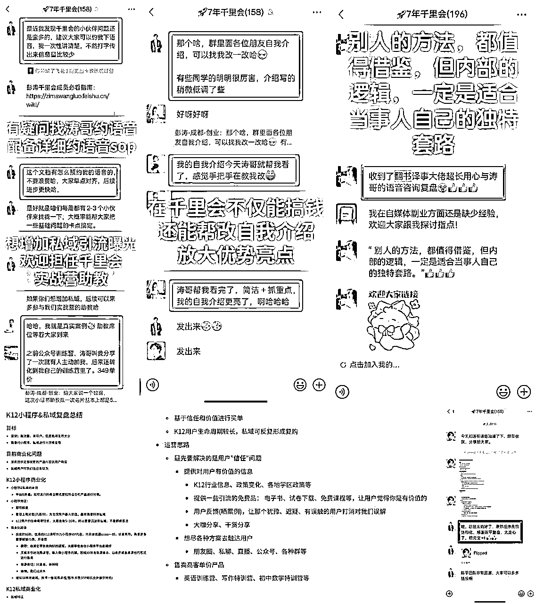

此外，知识付费产品的续费率通常并不高。与其每年续费，不如一次性把周期拉长，让用户觉得平均下来每年只需要几百元，更容易产生“买到就是赚到”的心理。

这一步的设计，直接影响了后续的销售和交付。好的定价不是简单地标一个数字，而是要同时考虑用户感受、增长节奏和长期运营。

## 三、先验证，再放大：灰度测试的4个动作

产品权益和价格确定后，海报还没有制作完成。我们没有等所有物料都准备好，而是先用一张锤子便签和一篇介绍创办初衷的文章，直接开始小范围测试。

整个灰度过程，我认为有 4 个动作非常关键。

### 1. 社群推广：从熟人和高价值用户开始

测试顺序很重要：

先触达熟悉的人，再触达陌生的人；先进入高客单价社群，再进入普通付费群。

我有几百个社群，当时团队成员小梦把所有社群按价格和用户关系整理成表格，大大提升了推广效率。

在社群发消息时，有两个细节值得注意。

第一，要让成员明确感受到自己享受的是内部机会，而不是普通公开销售。

例如：

- 目前还在内部测试，请大家不要外传；
- 大家都是长期支持我的铁粉，所以提前和大家分享；
- 正式价格预计在 5000—10000 元之间，但内部成员只需要 3999 元。

第二，每个社群发布后，要记录成员的互动情况。

我们会把主动提问、点赞或表达兴趣的人备注为“千里会意向”，方便之后进行精准私聊，而不是在几百个群里盲目寻找客户。

### 2. 朋友圈运营：把销售过程变成连续剧情

朋友圈不是一次性发一张海报，而是要让用户逐步了解“为什么做、做到哪一步、谁已经加入”。

我们大致分成四个阶段：

**第一阶段：讲想法。**  
分享自己的商业判断，以及为什么想为长期支持自己的用户做一个长期社群。

**第二阶段：展示内测进展。**  
告诉大家产品还没有正式公开，只在少数铁粉群里试运营，目前已经有多少人加入，并表达自己会认真交付。

**第三阶段：制造兴趣。**  
当越来越多人来询问时，可以透露权益海报还未正式发布，但有兴趣的人可以私聊了解，接受提前锁定。

**第四阶段：借助人数和氛围加速决策。**  
当已经有七八十人加入后，再公布盲定进展，比如“已经接近某个人数，群里高手越来越多，达到 100 人就发红包”。

这类连续更新，让朋友圈更像一部连载剧。用户不是看到一次广告就做决定，而是在持续关注中逐渐建立信任。

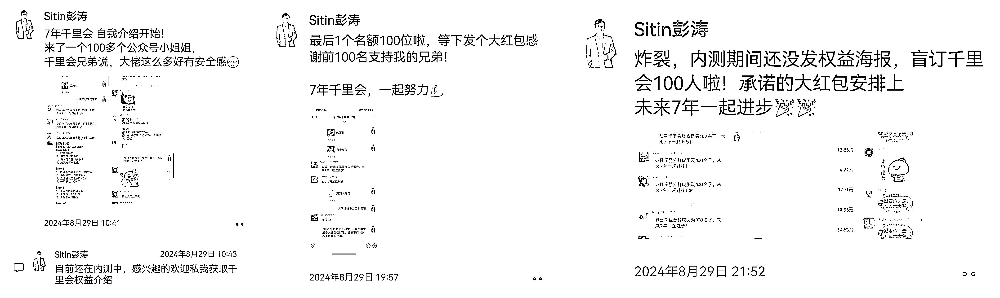

当时我每天至少发布 5—6 条相关内容。为了节省时间，我会把用户反馈和聊天截图发到团队群，让小伙伴帮忙提供素材和角度，再由我整理成朋友圈内容。

### 3. 私聊成交：先了解对方，再谈适配度

高客单价产品不能只靠群发文案，私聊是非常重要的成交环节。

在联系用户之前，我会先查看过去的聊天记录，了解对方的经历、需求和曾经购买过的产品。借助工具，我可以更高效地管理 10W+ 私域，并在交流时做到有针对性。

私聊时，我不会一上来就推销，而是先感谢对方过去的支持，再结合对方的实际情况，说明为什么千里会可能适合他。

这里还有一个长期经营的前提：高价值用户必须平时就维护，而不是等到卖产品时才突然联系。

我过去在训练营交付过程中，会持续回访学习进度，提供资源支持。因为之前已经建立过联系，所以后续私聊不会显得突兀，沟通也更自然。

### 4. 回访用户：既能优化产品，也能收集真实证言

用户为什么加入？最看重哪项权益？对未来有什么期待？

这些问题都应该通过回访得到答案。

回访至少有三重价值：

- 了解用户真正需要什么；
- 进一步优化产品和宣传表达；
- 获得真实用户反馈和口碑素材。

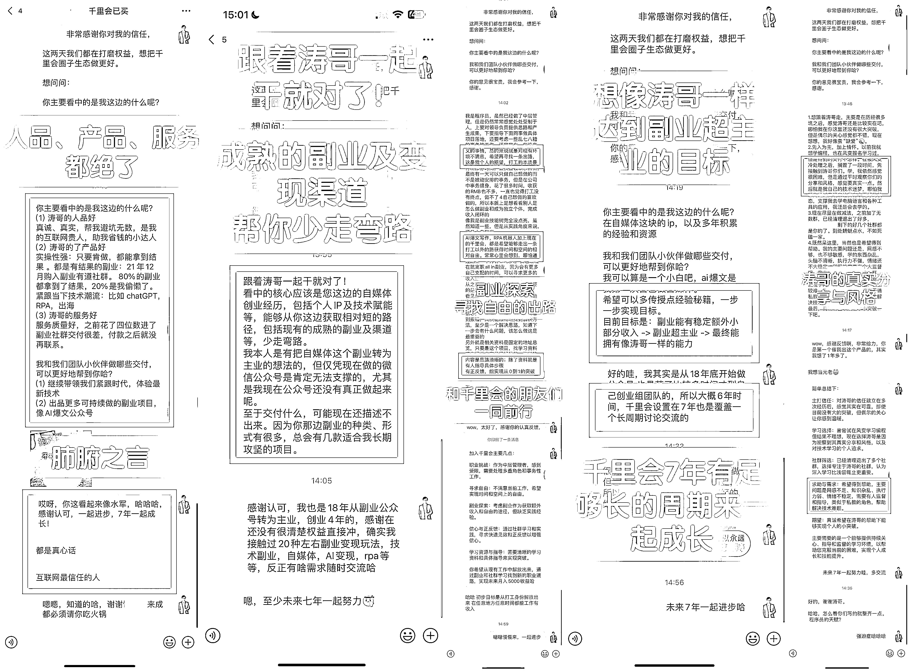

我本身是一个偏内向的人，前期每天私聊 20 位左右，确实会觉得疲惫。

但在回访过程中，我收到很多真诚而温暖的反馈，也更加确定自己应该把这个产品做好。因为当用户愿意把信任交给你，认真交付就不再只是工作，而是一种责任。

## 四、付款之后立刻交付，让用户快速感受到价值

内测阶段，千里会就获得了 150+ 位铁杆粉丝的支持。

四位数的客单价，对许多人来说可能相当于半个月甚至一个月的收入。大家愿意在产品还没有正式公开时支持我，这份信任让我非常感动，也促使我和团队投入更多时间。

除了每天在群内分享内容、主动询问成员需求，我们还一起梳理权益、完善资料。那段时间，晚上十一二点还在确认工作细节，是常态。

但投入在哪里，结果往往就体现在哪里。

2024 年 9 月 1 日，我们正式发布了两份重要资料：

- 千里会旗下产品总览；
- 千里会成员成长路径图。

产品总览把 AI、项目和 IP 相关产品统一整理出来，包含分佣比例、兑换方式等信息，成员可以直接查看。

成长地图则分为通用路径和三大方向路径，帮助大家快速理解已有资源，以及接下来适合学习什么。

这些资料并不是发布后就不再调整，而是持续更新和完善，尽可能降低成员的学习成本。

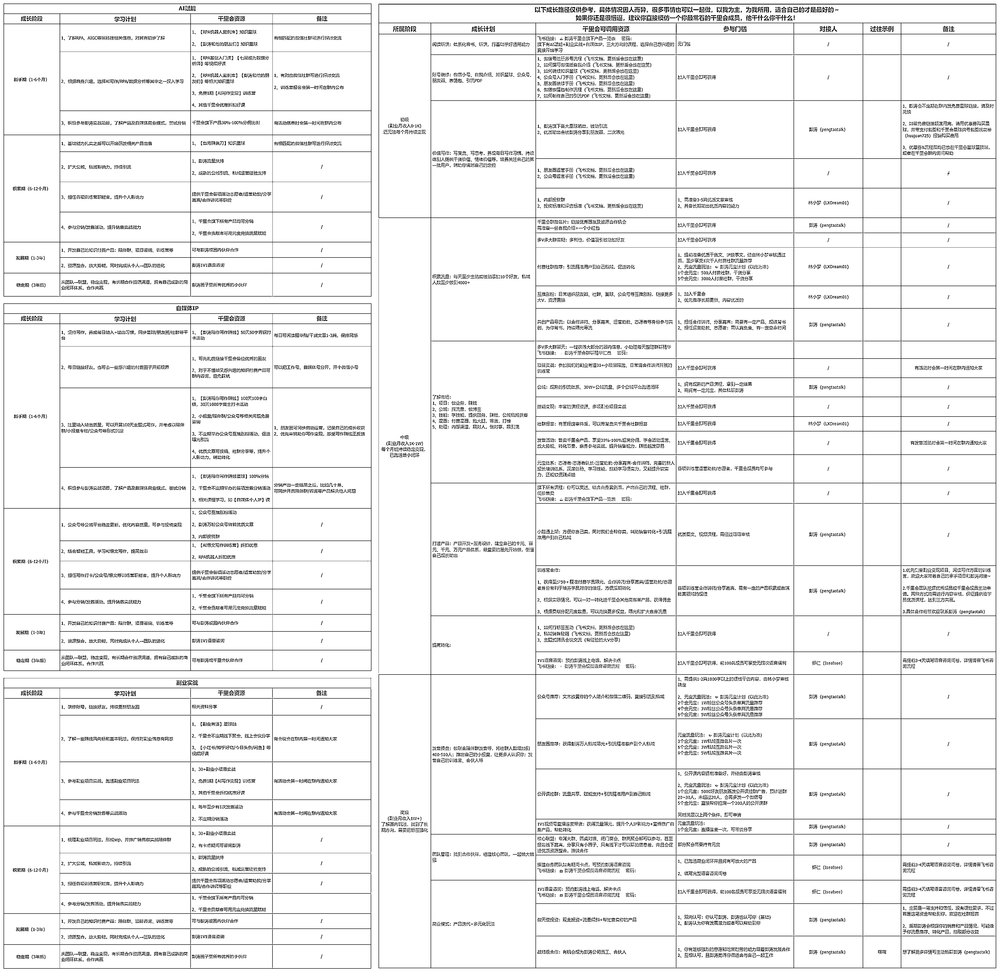

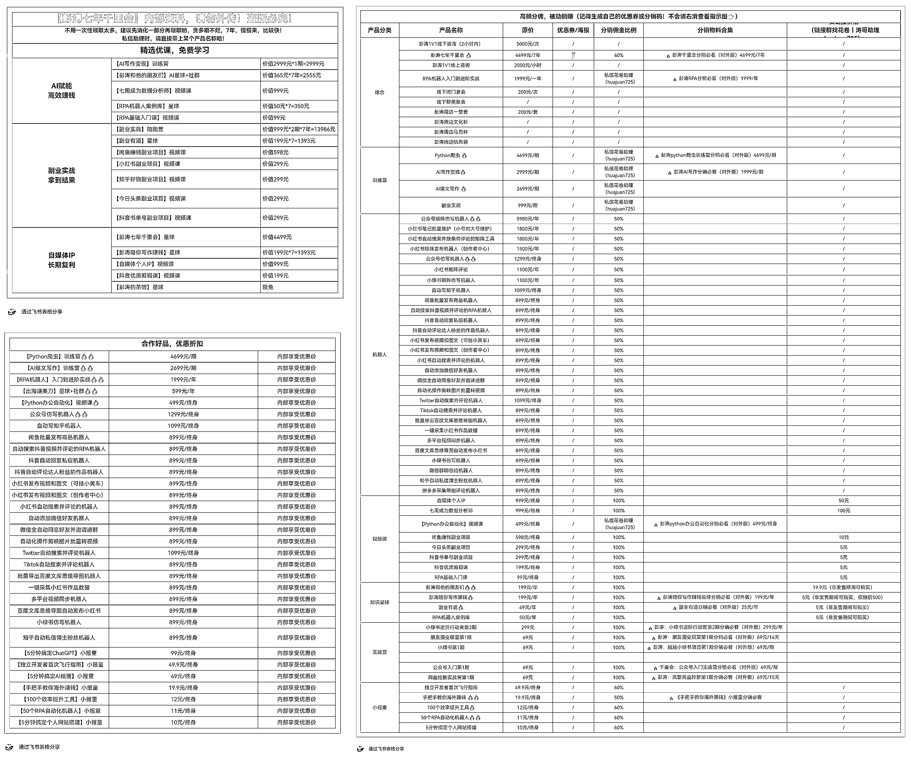

9 月 10 日，我们举办了千里会新人内训和第一次圆桌对话。

一场只有一个小时的活动，背后其实有大量准备工作，包括议题设置、时间安排、资料制作、回放承载、会后复盘等。

越是看不见的细节，越决定用户对交付的感受。活动结束后，成员给出了很多积极反馈。

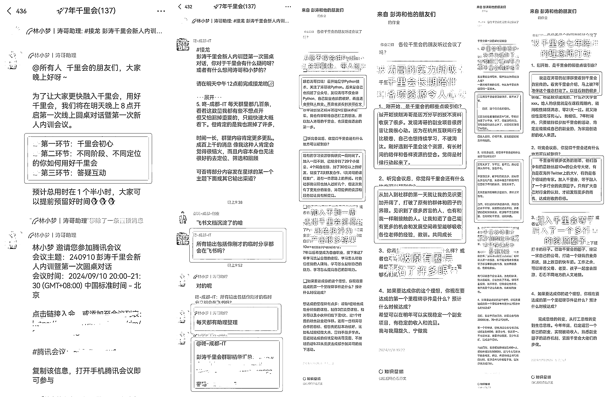

不过，我们并没有满足于“资料交付完毕”。

为了让成员真正做出结果，我又额外邀请有实战成绩的教练，带大家参与具体项目，千里会的副业项目由此陆续展开：

- 2024 年 9 月 12 日—9 月 27 日：网盘拉新赚钱实战营；
- 2024 年 9 月 27 日—10 月 9 日：👸号快速入门实战营；
- 2024 年 10 月 9 日—10 月 24 日：小绿书项目实战营；
- 2024 年 11 月 11 日—11 月 24 日：朋友圈变现实战营；
- 2024 年 11 月 12 日—12 月 12 日：小绿书进阶变现行动营。

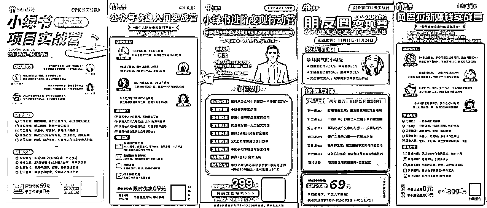

这些训练营都由团队反复打磨，既有适合新手的详细教程，也有沉淀好的问题库。成员可以免费参加，并且享受 100% 分销权益。

很多成员后来都说：“项目根本学不完。”

当用户持续获得内容、项目和赚钱机会后，信任感就会逐渐建立起来。有人通过项目赚到收入，也有人凭借销售能力，通过推广训练营赚回了门票。

截至当时，5 个项目实战营已经发放了 XX 元佣金，还不包括里程碑奖励和其他礼物。

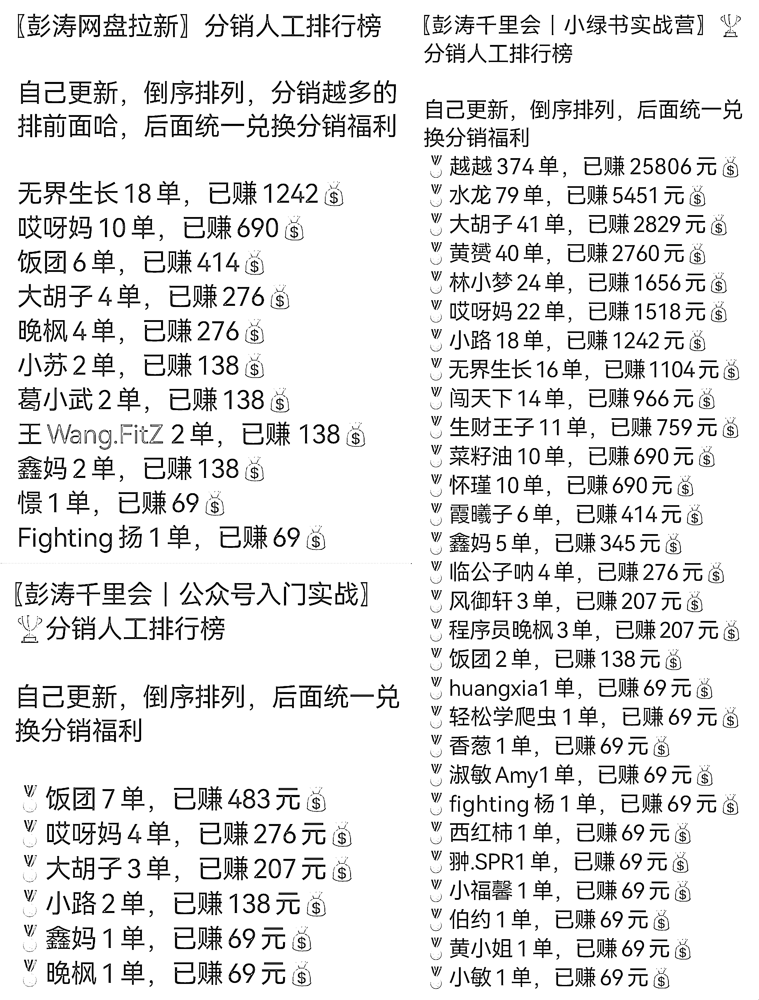

与此同时，小绿书项目带来了 1000+ 新流量，也让我们看到了新的增长方向。

当产品交付能力逐渐成熟，团队开始考虑通过公开课进一步扩大影响力。

## 五、资源集中，借助公开课完成规模化增长

前期产品、内容和交付都准备好之后，千里会也积累了足够的市场预热。

于是，我们在 10 月 24 日到 10 月 30 日举办了一场为期一周的公开课。

最终新增成员 52 人，实现 23.3W 销售额，千里会成员数量突破 200 人，生态开始进入新的阶段。

这次增长不是某一个人的功劳，而是流量、内容和团队协作共同作用的结果。

### 1. 让足够多的人进入场域

公开课期间，我们同时采用了嘉宾邀约和 KOL 拉新的方式。

在筹备阶段，我们提前和多位 KOL 沟通，确认他们是否愿意参与推广。但并没有过早把所有人拉进群，因为战线太长，容易让大家失去新鲜感。

我们先完成意向确认，再统一给参与者做好标签，等到正式冲刺前一周再邀请进群。这样既留出了准备时间，也让大家在真正启动时保持动力。

此外，我们邀请了 7 位嘉宾参与直播连麦：

阿猫老师、微笑哥、水龙老师、蓉儿老师、靠谱老师、临公子、理白老师。

最终，公开课报名人数达到 7137 人，为后续成交打下基础。

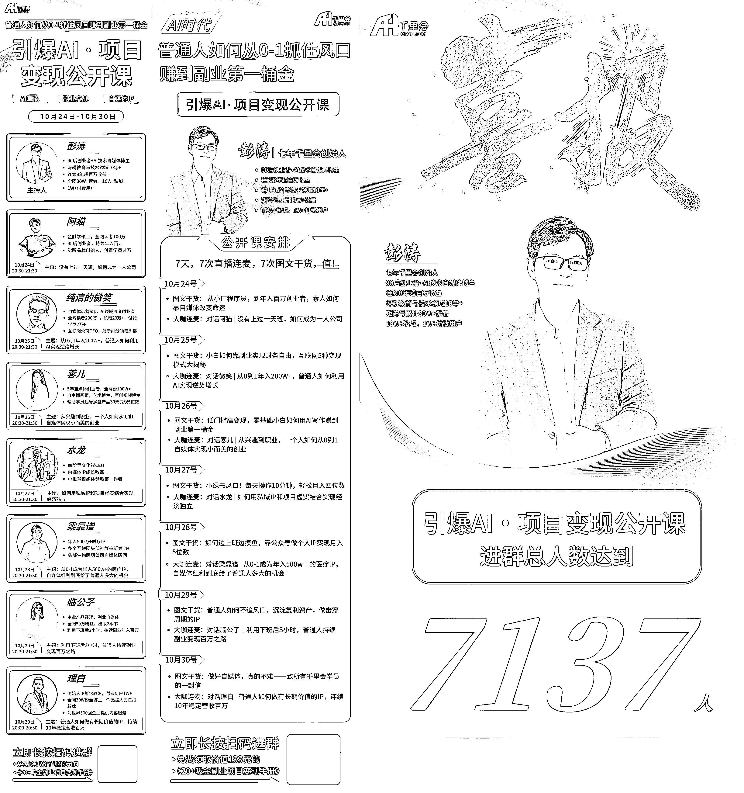

### 2. 内容必须有价值，交付必须看得见

公开课之前，我们已经连续开展了多个副业项目。

这些项目一方面帮助千里会成员真正学习，另一方面也让前来助力的 KOL 看到产品的实际价值——大家为什么愿意帮忙，根本原因还是产品本身能够提供真实收益和长期价值。

成员加入后，还可以直接参与一期原价 1999 元的 AI 写作变现训练营。能不能持续交付，是一个社群能否长期运营的关键。

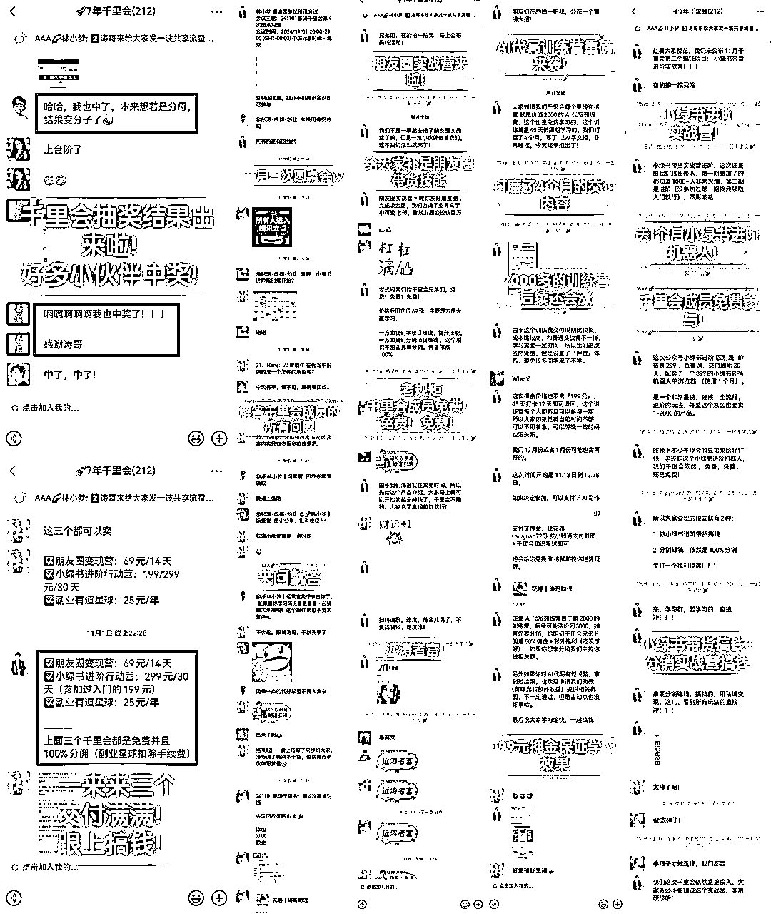

为了做好公开课，我们和团队一起打磨了 7 篇分享稿，内容包括：

- 我的创业与成长经历；
- 3 个副业项目的实战拆解；
- 👸号运营方法；
- 个人 IP 构建；
- 写给千里会成员的一封信。

这些内容几乎覆盖了我多年创业过程中积累的方法和思考，再由彩卉、小梦两位操盘手反复修改。

不少成员就是因为这些分享稿，进一步感受到我们的诚意。

7 位嘉宾也给了非常大的支持，不仅准备了福利，还通过朋友圈和直播持续助力，直播时间远超原本约定的一小时。

尤其是彩卉老师，从晚上 8 点一直直播到 24 点，在内容呈现、现场互动和成交跟进上都非常有感染力。

### 3. 外部操盘和内部团队必须配合

外部方面，彩卉老师带着团队参与了文案、直播、进群追踪、海报制作、社群维护和后续跟单等工作。

从私聊话术，到倒计时文案，再到群内节奏设计，每个环节都有明确安排，整体运营过程非常稳定。

内部团队则负责社群运营、海报对接、文案输出和信息同步。

除了重大决策需要我亲自参与，很多具体事务都由团队伙伴完成。比如跟单阶段，小梦和虾仁提前整理了填写问卷、直播互动过的意向用户，节省了大量筛选和搜索时间。

一个人可以发起产品，但想把产品持续做大，必须依靠团队。

## 六、感谢不能只停留在口头上

为什么团队能够连续高强度工作一周，依然保持积极状态？

因为在我自己很忙、很累的时候，也会主动私信表达感谢，并在每天直播结束后给团队发红包，鼓励大家继续冲刺。

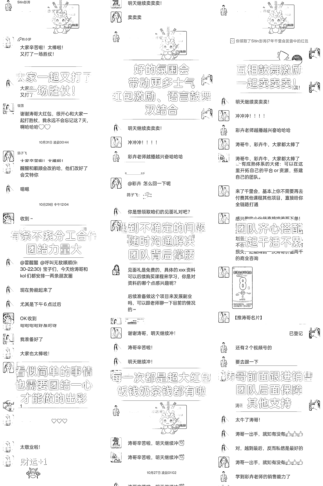

为什么会有那么多同行愿意帮忙拉新、连麦和传播？

很大程度上，是因为我愿意把利益分配做得足够直接。

比如：

- 设置 50% 分佣；
- 简化收款流程；
- 打榜期间发布朋友圈即可获得 18.88 元奖励；
- 优质朋友圈奖励 18.88—66 元不等；
- 拉人进群有奖励，后续成交还有奖励；
- 参与连麦，则尽可能通过客户、资源和现金回报对方。

表面上看，自己让出了很多利润，但实际上，产品获得了更大的传播和信任。

千里会的名声就是这样逐渐建立起来的。越来越多同行愿意主动帮忙宣传，形成持续的长尾效应。

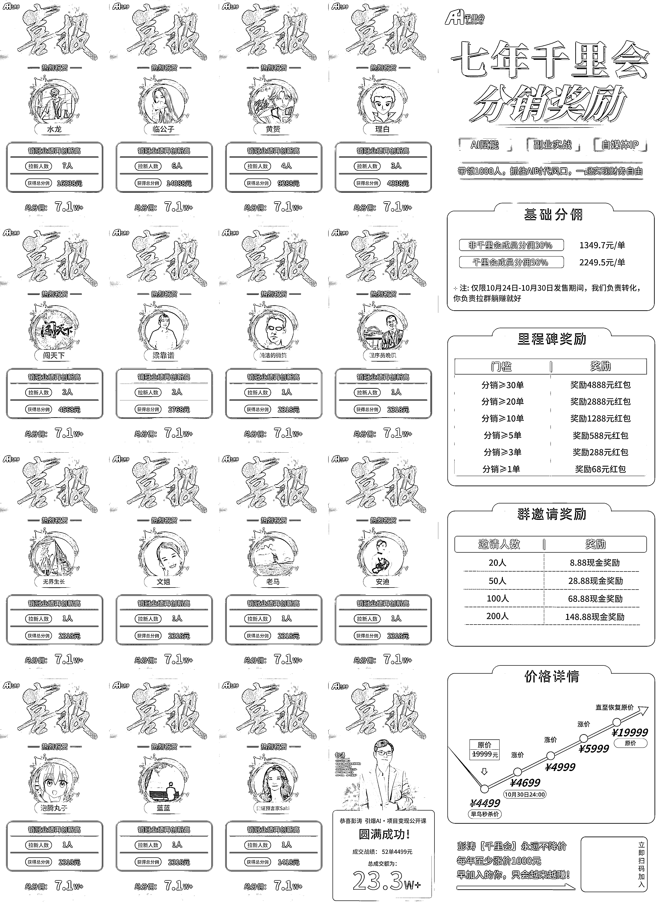

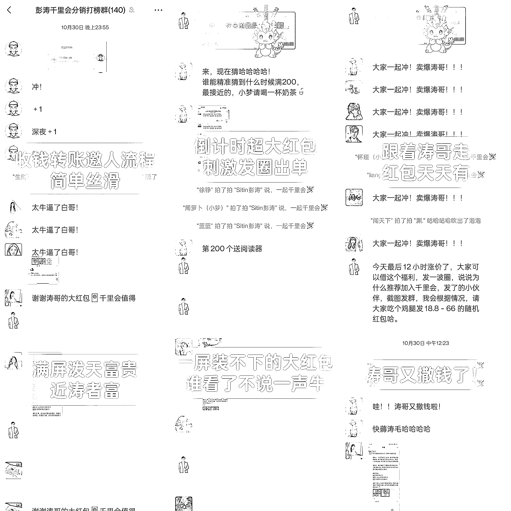

同样，用户为什么愿意购买？为什么发售结束后仍然有人不断加入？

因为真正有效的感谢，不是把话说得多漂亮，而是让用户持续拿到结果。

从入群欢迎、1V1 语音咨询、圆桌会议，到请教练带大家做项目，再到训练营、分销和佣金体系，我们不断把交付往前推进。

让成员真正感受到：

“我不是买了一张门票，而是有人愿意带着我一起成长、一起做项目、一起赚钱。”

11 月，我们继续带着成员开展朋友圈变现、小绿书进阶、AI 写作变现和闲鱼变现等项目；12 月还会安排📕、AI 智能体等内容。

不管成员想学习，还是想推广低客单价、中客单价、高客单价产品，都能找到适合自己的方向。

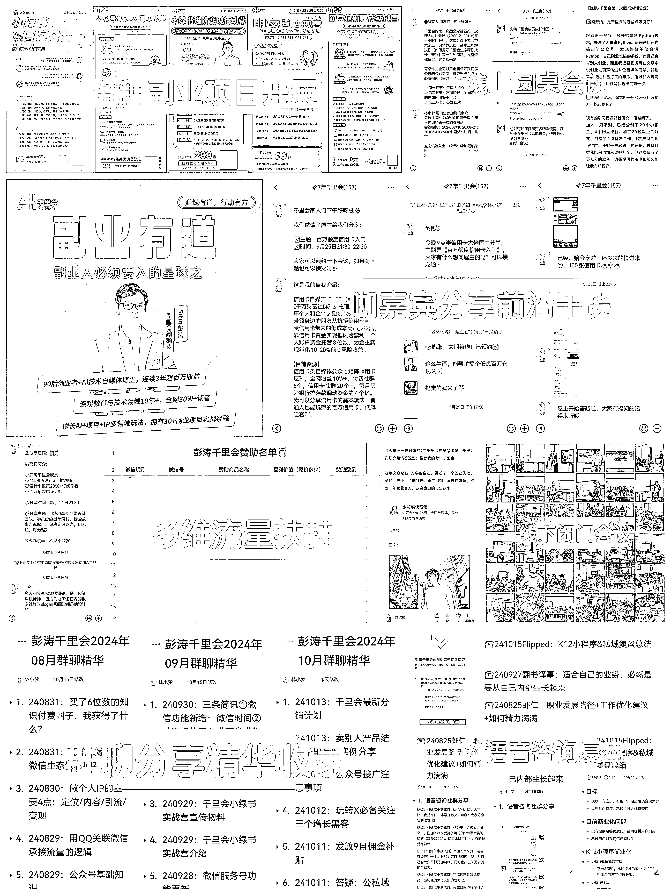

## 最后总结：高客单价产品卖爆的6个关键

### 1. 先找需求，再做产品

不要凭感觉闭门设计。先去了解用户真正需要什么，再通过同行调研验证方向。

### 2. 找到差异化，明确购买理由

用户为什么选你，而不是别人？定位不能模糊，卖点也不能分散。

### 3. 先小范围试错，再逐步放大

可以从社群、朋友圈、私信和回访开始，先验证产品是否有人愿意买，再投入更大的资源。

### 4. 用户付款后，马上让价值发生

刚付款时，用户的关注度最高。越快交付，越容易让对方确认自己的选择没有错。

### 5. 把流量、内容和团队放在同一个节奏里

公开课也好，发售也好，单靠一个人很难完成。要学会整合身边的同行、KOL、嘉宾和团队成员。

### 6. 真正的感谢，要体现在行动上

记住别人的帮助，也要用分佣、红包、资源、客户和扎实交付回应对方。

说得再好听，也不如把事情做好。

能够赢得用户的信任、同行的支持和团队的投入，产品自然会拥有更长的生命力。

* * *

评论区：

龙哥：很多图片好像没有上传成功？

Sitin 彭涛：谢谢龙哥老师提醒，我马上检查一遍。

刚又仔细核实了一下，问题出在配图数量偏多，导致页面加载有些迟缓。这个情况不是个别现象，所有朋友看到的效果都是一样的，别着急哈，抱抱～