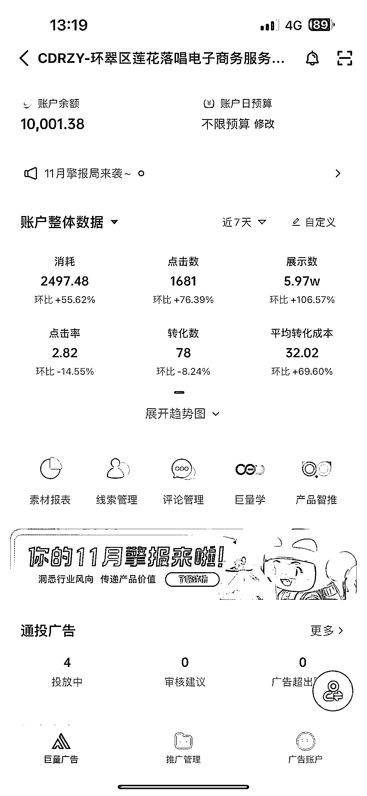
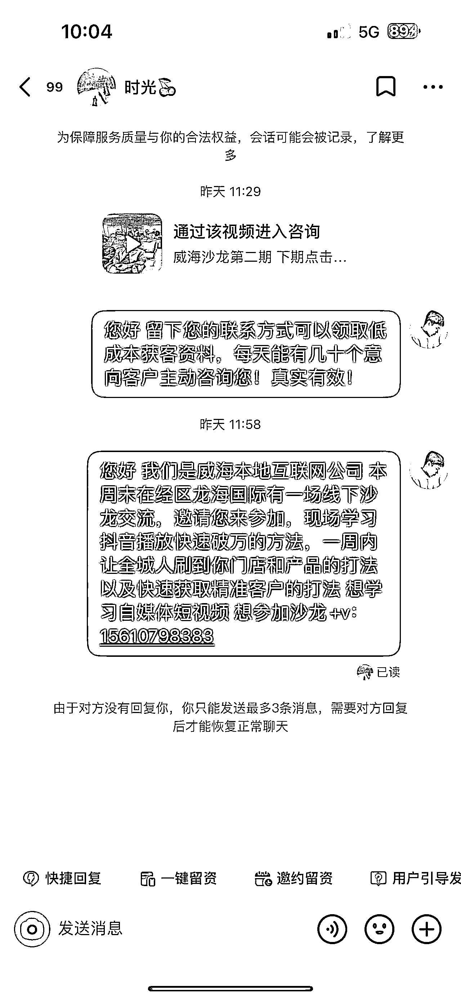
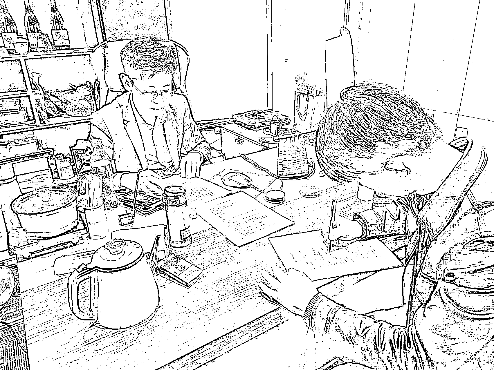
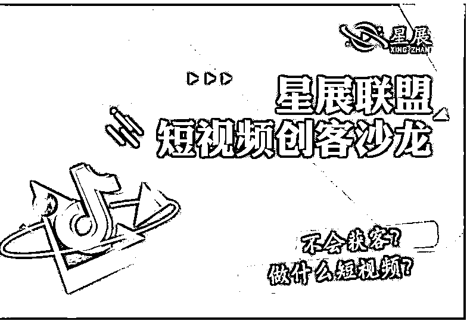
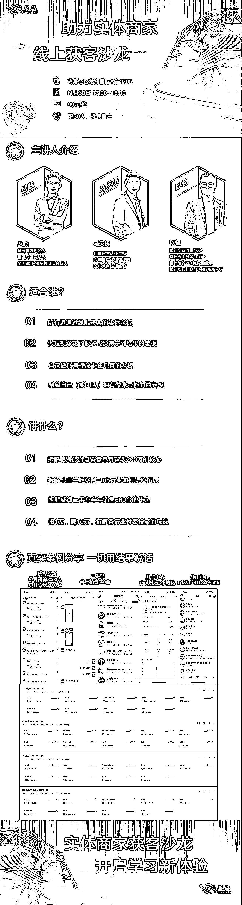

# 利用好投放工具，开本地商家沙龙，每周一次，场场爆满，几乎 0 成本。
作者：龙哥

每周办一场付费沙龙，场场满员，几乎零成本——这事儿听起来像吹牛，但真有人把它跑通了。

过去几个月，老丛靠朋友给的信息切进了付费投流赛道，拿到了结果。最近他原创了一套同城线下沙龙的模型，核心不是办沙龙，而是用投放工具把流量和转化彻底算清楚。

先看一组真实数据：过去一周，投放花掉 2497 元，换来 78 组主动咨询，其中约 50 组加到了🛰️。来的客户意向非常明确——就是要参加沙龙，广告素材里直接写明门票 99 元，所以除了档期冲突的，基本都来了。最终实际报名 24 人，门票收入直接打平投放成本。场地就在公司，水都是客户送的，唯一额外开支是买水果。等于说，这场沙龙物料成本趋近于零，来的每个人都是付费用户。

为什么很多人做不到周周开？因为流量不稳定。组织一两场沙龙靠私域、同城矩阵或个人 IP 都行，但想要“每周稳定 30 人付费到场”，就需要确定性的获客模型。而投流恰好补上了这块短板：客户数量可控，付费意愿明确，成本能被门票覆盖，模型自然能持续运转。

那来的都是什么人？绝大多数是本地小老板，覆盖餐饮、家居建材、汽车后市场、教培、地产等行业，也有部分想学新媒体的朋友。他们的核心诉求是学习新媒体起号、突破播放量瓶颈、快速获取精准客户。因为付费能力有限，主推产品是投流培训/代投、短视频陪跑/代运营，客单价 4980 到 3 万。

进线回复是关键。很多人看完广告并没有立刻咨询或留资，这时候手动回复就特别重要，用钩子话术把感兴趣的人引导到🛰️上，再进入销转环节。而整个模型最大的优势是销转非常轻——一个人就能独立完成全流程，不需要太多时间。

会前准备也不复杂：签到人员负责登记引导，销售提前分配客户，早到的先聊几句，到点准时开场。分享环节走轻量级配置：主持人开场、介绍、做认知铺垫，老丛上台分享，之后主持介绍主打产品，销售配合意向客户做现场转化。剩下的事就是反复打磨分享内容，提升现场和后续签单率。因为一场沙龙下来，总能过滤出几个高质量客户深入洽谈合作方案。

这套打法不限于本地生活或网络公司，法律、家居建材、教培、AI、摄影培训、各类培训机构都可以复制。老丛团队还提供讲师落地支持，能帮你直接到场做分享和会议。

还有 60 天过年，想在年底冲刺一把的朋友，这套模型真的值得拆解研究。

 images.zsxq.com/FnVmQ6Yf6lbtw62XHqOs1d6ib5gD) images.zsxq.com/FlXFQXbJykMlXNNuMrSXRf1ROAY8) images.zsxq.com/FjuioqMIKVi5TOXbB0BppU1xN37S)

 images.zsxq.com/Fl23buZmfp8S7vTbfPuw2z6rqIne) images.zsxq.com/Fi58MfdF1OKQ-_qAnd7YPA9oLc5c) images.zsxq.com/FiLopj0T8hz68u9qrzbYb3U_uC8E) images.zsxq.com/Fqvk-JRQ9HbPUKvzj9l5EcXQ--Qe) images.zsxq.com/FsVFFghAVr3JNSH_Jao6KNYJ_7Tw) images.zsxq.com/FmlxI0pnaGZP0EgKCSNK095Tt-a1)

