# 【2024.12航海】AI动物故事类 YouTube Shorts 从零起步实操复盘

大家好，我是 Kennan恺南，11月才加入赚钱的新人。入圈后迎来一轮又一轮的信息轰炸，我最终挑选了一个与本职工作能产生关联的 AI 赛道。很幸运赶上12月的航海，这是我第一次参与，收获真的很大。

我是一个运营小白，零基础起步。这次想借助 AI 生视频的方式来搭建自己的 YouTube 频道，实操学习如何做视频引流与推广。

下面这份经验总结，是我在参考 @竹子 和 @土豆君 两位前辈教程后，完整跑通 AI 生成视频并上传 YouTube Shorts 的过程。第一次试水，肯定有瑕疵，欢迎大家指点。

先报一下航海两周的初步战绩：

目前共上线 9 条短视频，总播放破 4000+，并且已经初步实现半自动化产出。起步阶段摸索较慢，熟练度提升后基本保持日更节奏。

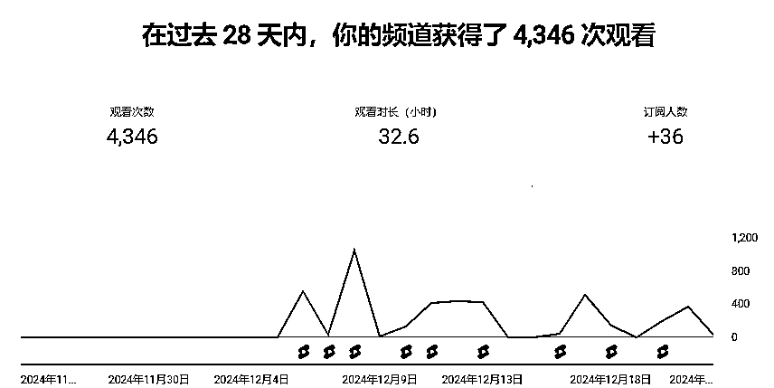

接下来分享我在航海期间的一些心得与方法论：

# 一、航海实操心法

项目参考依据：12月航海手册
龙哥盟·AI shorts 活动详情

反复研读手册后，我提炼出以下几个关键点：

1. 先搞懂平台规则，再动手做内容

知己知彼才能百战不殆。想在一个平台做出成绩，必须先明白它的玩法。

从手册里可以看到平台的核心受众是谁、推流机制是怎样的、变现方式有哪些。前辈的经验总结能帮你少走很多弯路，快速适应新环境。

2. 熟悉账号搭建与科学上网细节，减少踩坑

了解账号注册流程、上网环境的注意事项，能大幅节省试错成本。

3. 多读同类经验贴，快速掌握项目轮廓

大量阅读同类型的复盘帖，就像面试前刷面经一样，刷得多了对项目逻辑、成本、玩法就非常清晰了，遇到问题也能快速找到方向。这些帖子我都收藏起来反复看。

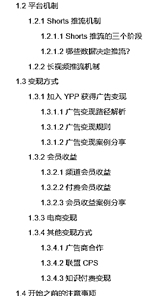

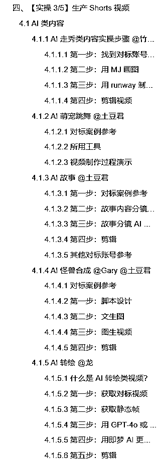

4. 提前设定目标与执行计划

这个思路主要参考了 @一页书 的分享，以及龙哥老师提出的三个月计划。

做任何项目第一步就是明确目标，做出可执行的计划。计划不必一成不变，随着实践会调整，但一定要务实，符合自身能力与项目规律。边成长边交付，合理安排节奏。下面这张图是我航海启动时的目标设定。

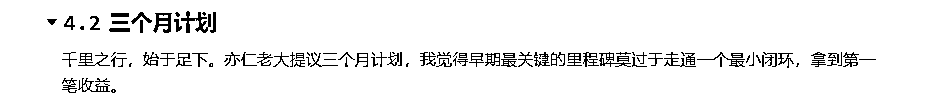

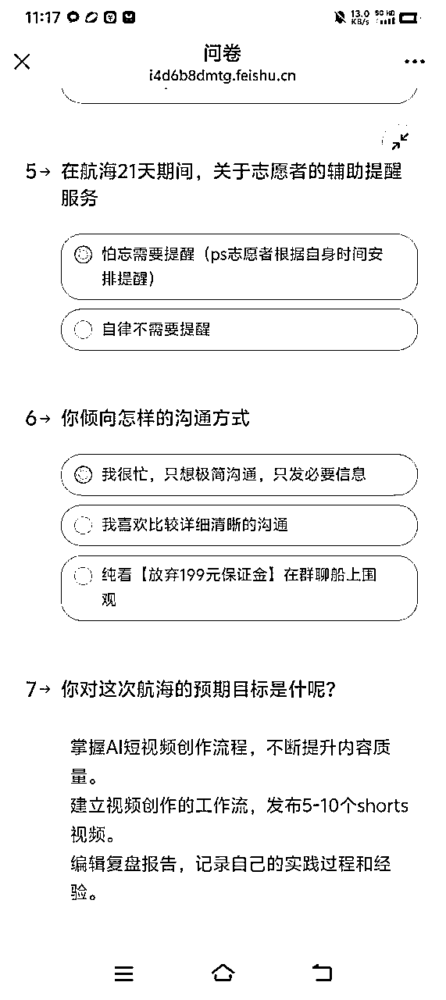

5. 做赛道分析与个人定位

手册里的赛道分析案例非常宝贵，通过学习几位大佬的成功路径，我对赛道分析形成了一套方法论，更容易找到适合自己的方向。

手册还整理了不少工具与技巧，极大节省了资料收集时间，能快速判断一个账号是否值得对标、赛道是否有投入价值。常用的工具有 social blade 和 ytlarge。

这里额外推荐汤姆 CC 老哥整理的工具箱，涵盖赛道收益分析、频道数据查询、AI 生图等需求一应俱全：

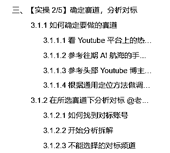

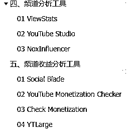

6. 写航海日志

航海期间教练和志愿者会督促写日志。日志既是进度表，也是复盘本，更像一个推进器。每天记录收获、卡点和下一步计划，能保持理性复盘，避免偏离方向。同时看着大家一起进步，老师耐心点评，有种抱团前行的氛围，非常有劲头。

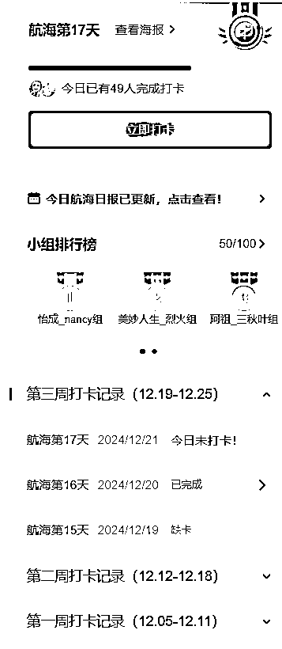

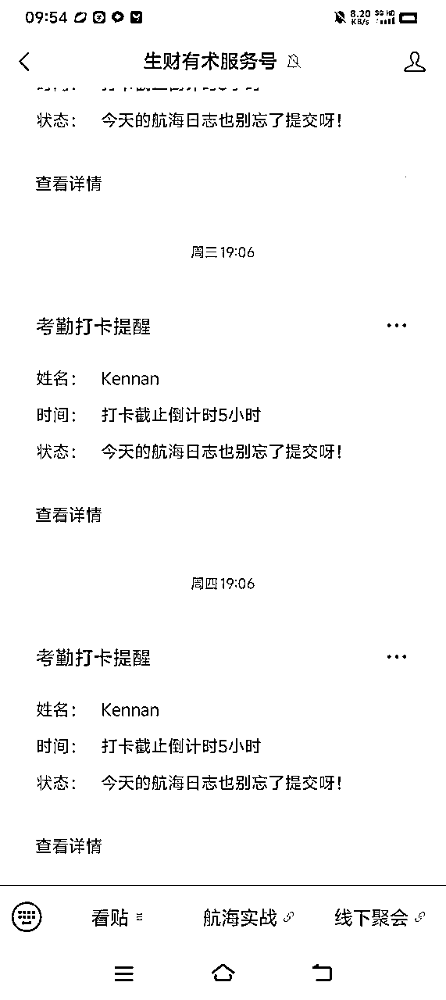

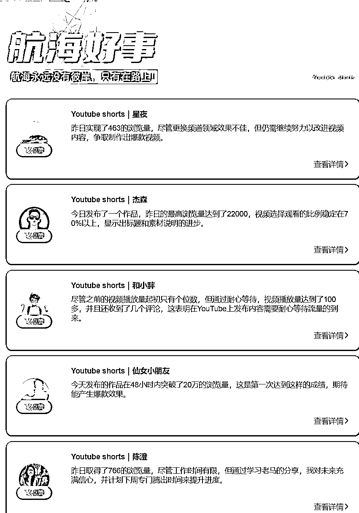

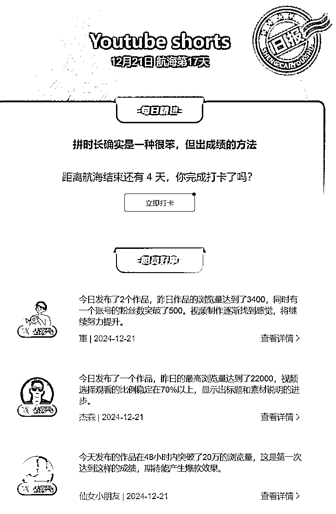

7. 发扬航海群效能

航海群里都是抱着共同目标努力的人，每天进展公开透明，大家会互相感染。

#举手 提问 是第一课，有任何问题直接问，教练会给专业建议，学长也会分享最新实战经验，特别实用。

每天的群公告会汇总共性问题，形成合集，方便快速自查。

教练的日志点评环节，能让工作流和记录方式得到专业优化，少走弯路。

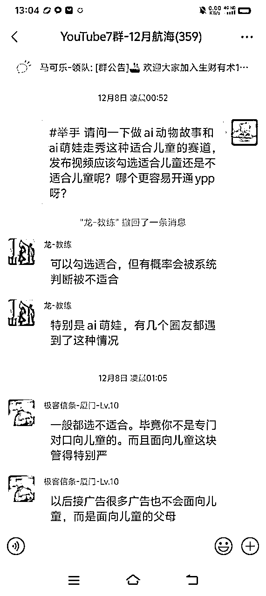

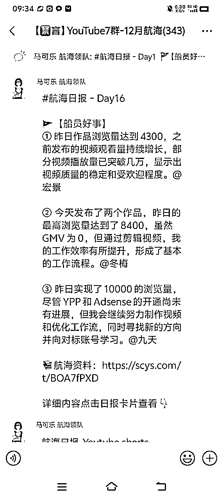

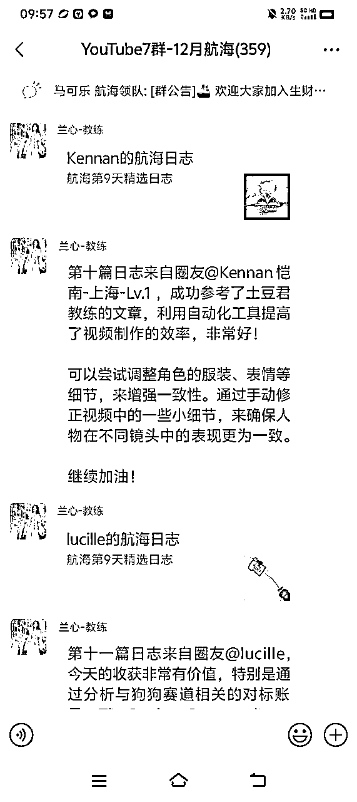

# 二、我的项目目标拆解

目标一：启动准备期 11 月航海前
1. 搭建并美化 YouTube 账号
2. 完成赛道分析与定位，锁定受众人群
3. 寻找标杆账号，制定差异化发展规划

目标二：航海实战期 12 月航海中
1. 掌握 AI 短视频全流程，提升内容质感
2. 发布 5-10 条 shorts
3. 输出复盘报告，沉淀实践经验

目标三：航后复盘与战略规划 1 月航海后
1. 完成 YouTube 合作伙伴计划 YPP 申请
2. 实现收益提现，拿到第一次变现
3. 评估 Shorts 长期潜力，确定下一步方向

# 三、账号搭建基础

1. 账号注册
借助科学上网工具，用 Google 邮箱注册 youtube 账号 *2
2. 频道开通
3. 视频发布
我选择手机端发布，因为手机端可以自定义封面

# 四、赛道分析与自我定位

1. 为什么要做赛道分析
第一，内容创作里时间成本最贵。提前分析热门赛道，能做到事半功倍，避免试错浪费。
第二，YouTube 内容总量每天爆炸式增长，新人很难在一开始就找到创新赛道。最有效的方法是先快速尝试、上手，再根据数据反馈迭代，慢慢沉淀自己的细分 niche。经验积累是核心。
第三，出海创作终极目标是赚钱。投入产出比必须算清楚，要评估赛道的 RPM 潜力，合理规划时间和成本投入。

2. 我的频道定位
大方向原则：积极正能量、易于延展、好复刻

收益参考排序，数据来源：https://www.tastyedits.com/most-profitable-youtube-niches/#elementor-toc__heading-anchor-0
网上赚钱 > 数字营销 > 个人理财与投资 > 教育内容 > 科技、汽车与小玩意 > 生活方式 > 时尚与试穿 > 美妆与化妆 > 烹饪 > 健身与健美 > 电子游戏 > 喜剧 > ASMR > 励志与心灵成长 > 旅行

流量趋势观察：今年爆款偏向可爱向，像萌宠、萌娃类内容，CPM 虽不一定最高，但吸粉快，更容易快速达标开通 YPP。

自我盘点：
能力：熟悉 AI 工具与视频剪辑
偏好：可爱风格、漫威 IP、讲故事，i 人工科背景，想做不露脸的技术流
不喜欢：恶搞、擦边内容

最终定位：
结合市场与自身，我决定做 励志与心灵成长 赛道，以 动物故事 的形式呈现。

优势：
同类爆款已验证，能吸引青少年及职场新人观看，带来心灵放松。
动物故事可融合科普、环保等教育元素，正能量强，易传播。
动物种类丰富，素材永不枯竭。
AI 生图生视频在动物题材上门槛更低，无需处理人物一致性，可批量生产素材筛选。

劣势：
内容同质化严重，需要在故事性与创新度上做出差异化才有机会突围。

# 五、对标账号拆解

## 分析工具
1. 流量分析
使用 social blade：https://socialblade.com/youtube/channel/UCeFtgFQGjiUZ2MXBUKKPJBw
重点看播放量、月度预估收益、增长曲线
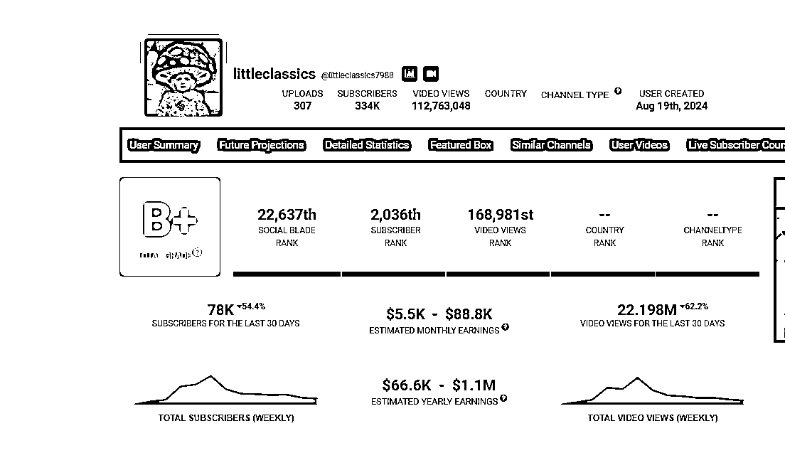

2. 收益分析
使用 ytlarge 货币化查询：https://ytlarge.com/youtube/monetization-checker/
重点看是否已货币化、原创度、广告状态
YouTube 频道 RPM 通常在 0.50 美元到 20.00 美元区间，视主题而定。
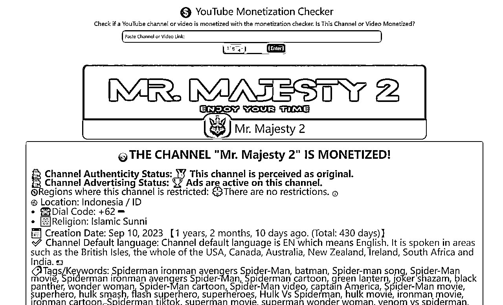

## 我拆解的 6 个喜欢的 AI 账号

| 序号 | 账号 | 规模 | 视频形式 | 主题 | 收益预估 | 制作工具 | 复现难度 | 赚钱参考 |
| 1 | https://www.youtube.com/@SuperLULU-7 | 17.1w 订阅 | 图片转绘 | 漫威+真人 | 64,590.97-2,583,638.96 美元 | 即梦 AI 画图+剪映+拍露脸视频 | 2 星 |  |
| 2 | https://www.youtube.com/@MrMajesty2 | 138w 订阅 | 图片转绘 | 漫威 | 754,704.36-30,188,174.36 美元，年均 640,621.12-19,218,633.60，预估月收入 $35,491 | 即梦 AI 画图+剪映 | 1 星 |  |
| 3 | https://www.youtube.com/@littleclassics7988/shorts | 33.4w 订阅 | 动画 | 萌娃走秀 | 51,290.40-2,051,616.10 美元，年均 217,685.72-6,530,571.51，预估月收入 $4,113 | 即梦 AI 画图+Runway 首尾帧+ChatGPT 脚本+剪映 | 3 星 |  |
| 4 | https://www.youtube.com/@BabyViralTrend | 47.2w 订阅 67 视频 | 动画 | 萌娃走秀 | 55,093.07-2,203,722.96 美元 |  |  |  |
| 5 | https://www.youtube.com/@RabbitsQuest | 46.3w 订阅 24 视频 | 动图拼接 | 兔子+动物+故事 | 存在非原创风险 | 即梦 AI 画图+海螺 AI+文心一言脚本+剪映 | 4 星 |  |
| 6 | https://www.youtube.com/@gingercat-tv | 148w 订阅 | 动图拼接 | 猫咪+剧情+文字+语音 | 156,835.57-6,273,422.66 美元 |  | 5 星 |  |

## 频道装修
参考 https://www.youtube.com/@gingercat-tv 的装修风格，以萌宠讲故事为基调，文案与配图均借助 GPT 生成。频道名、头像、简介、Banner 均按对标风格优化。

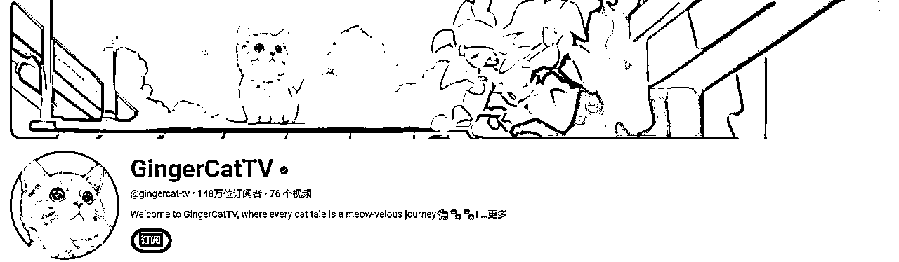

# 六、项目实操流程

整体思路参考土豆君，并在其基础上叠加了 图生视频 环节。观察到原作者也在进化，从早期的图拼接无声故事，发展到现在的视频拼接有声故事。

## 1. 用 AI 大模型生成分镜

此处使用文心一言

1. 先由 AI 挑选主角动物
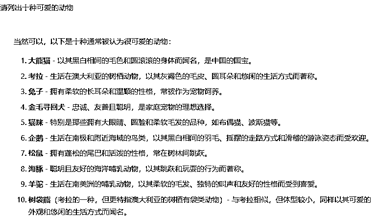
2. 确定动物后生成故事，我这里选的是小松鼠，描述参考大佬案例
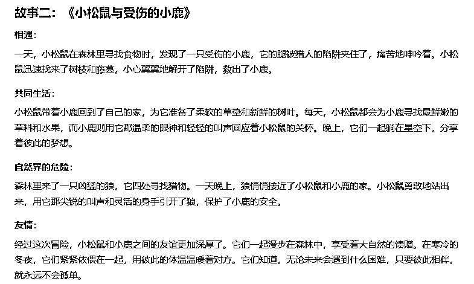
3. 基于故事生成分镜
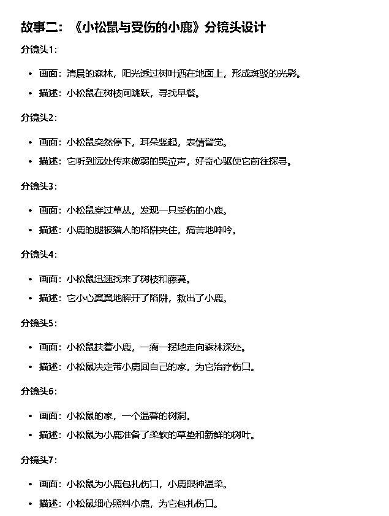

## 2. 根据分镜出图
工具组合：GPT-4o 免费额度、即梦 AI、可灵 AI 做对比测试

关键注意点：
角色一致性，GPT 可用 gen_id，即梦可传参考图
多角色的相对大小与位置关系
提示词的准确性，熟练度决定成片率

镜头1：

镜头2：

...

## 3. 图生视频
工具：海螺 AI、可灵 AI、Runway

注意：
免费额度通常带水印
视频描述要写清楚，否则角色会跑偏、动作不合理
整体效果在可接受范围内

镜头1：
镜头2：
...

## 4. 剪辑成 Shorts
工具：剪映

要点：
配乐选择版权安全、节奏温馨自然，与画面匹配
音效配合画面，增强动物生命力
节奏把控，开头 3 秒抓人，每 3 秒左右一次切换，拉升完播率

对标视频 上 https://www.youtube.com/shorts/7CRSVC8Qb_M 与我的成品 下

## 工具体验与组合建议

实操中用到的工具：

脚本生成：
文心一言：国产免费，文本可用，图片一般
GPT-4o：海外，免费额度有限，文本图片均强，性价比高

图片生成：
即梦 AI：国产，免费额度足，价格便宜，多图出片，利于低成本验证
GPT-4o / DALL-E3：海外，收费高，贴合度高，genid 保持一致性

图生视频：
可灵 AI：国产，免费排队，收费便宜，效果较好
海螺 AI：国产，免费排队，收费便宜，效果次于可灵，可做低成本验证
Runway：海外，收费贵，共享账号可选，效果一般，可能与提示词有关

建议：先用免费额度跑通流程，熟练后固定工作流。我目前稳定组合是 GPT 写词 + 即梦 AI 包月 69 元无水印可参考图 + 海螺 AI 包月 79 元无水印。免费的最贵，排队和反复试错的时间成本很高。

第一个视频全流程约 10 小时，包含学习攻略、工具探索、反复出图、文档记录。第二条视频熟练后压缩到 3-4 小时，效率提升明显。

## 补充：海螺 AI 自动化方案

确定流程后核心是提效：复杂变简单，简单变流程，流程变自动化。图生视频等待时间长，可以用自动化脚本解放双手。

参考土豆君方案：
1. 安装 Chrome 插件 Automa https://www.automa.site/
2. 下载土豆君工作流脚本
3. 导入工作流
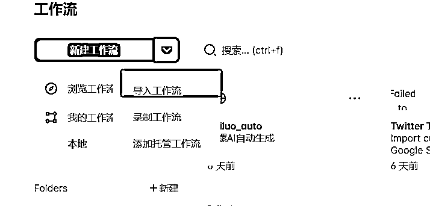
4. 配置本地图片文件夹
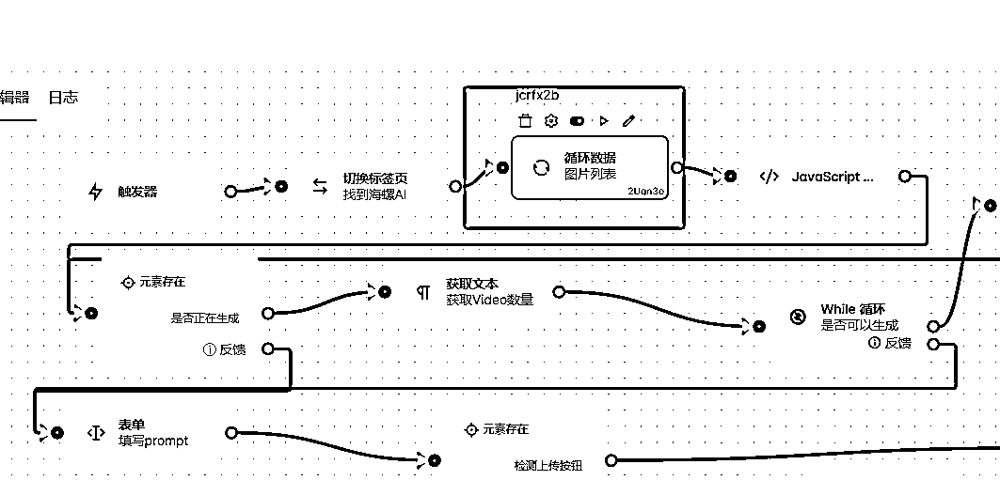
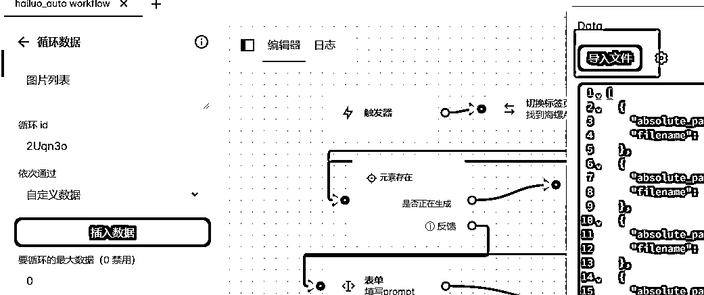
5. 点击开始执行，可挂机运行，适合睡前或上班前启动
6. 等待完成后批量下载

我的优化：土豆君原脚本提示词固定，我在即梦 AI 生图时让提示词自动命名图片文件，脚本读取文件名作为海螺 AI 的生成提示词，效果更佳。

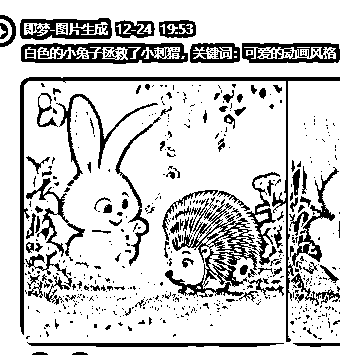
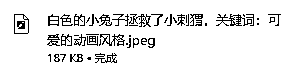
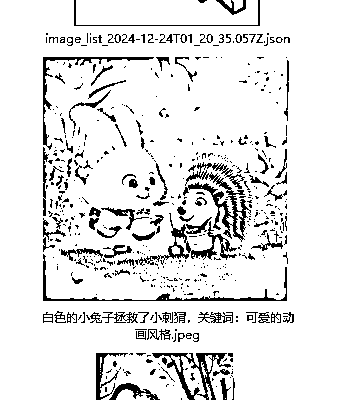
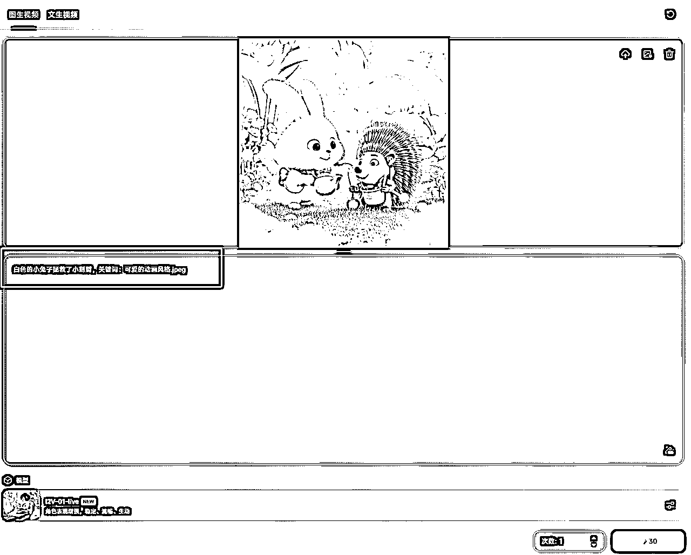

# 七、航海点滴感受

按照准备流程推进，视频上线后第二天就有点赞与播放反馈，像颗糖一样甜，动力更足。

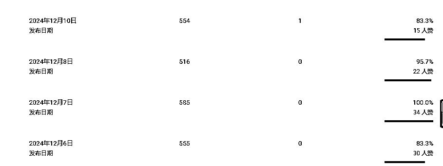

从最初手动 workflow + 白嫖各种免费工具，两天才挤出一支视频，到后来确定工具链并实现自动化。

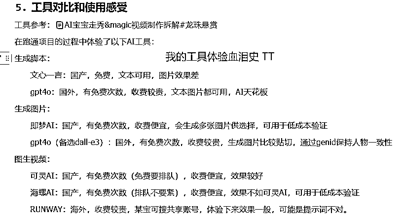

逐步把写词、出图、生视频、剪辑流程自动化，日产提升到 3-4 条，效率感爆棚！

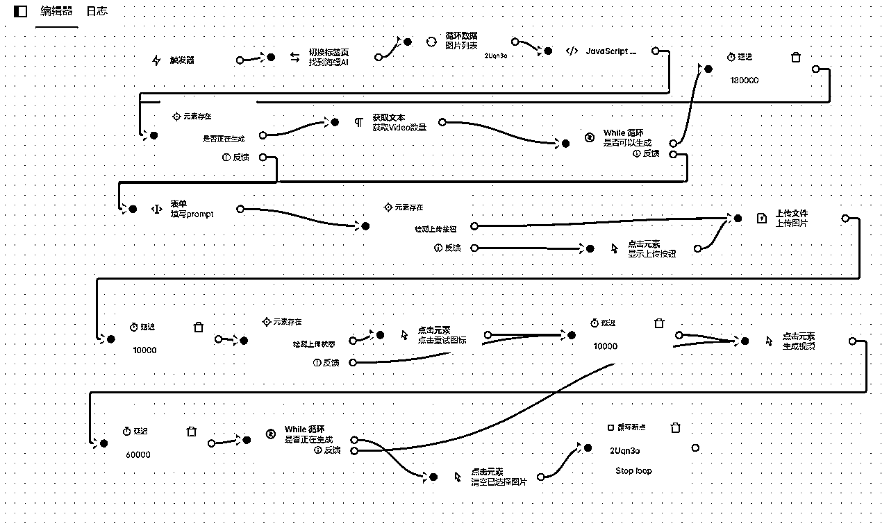

真的想跟还在观望的朋友说一句：抽点时间系统学一下自动化，这东西以后做赛道升级、做多号矩阵、开新方向都会用得上。

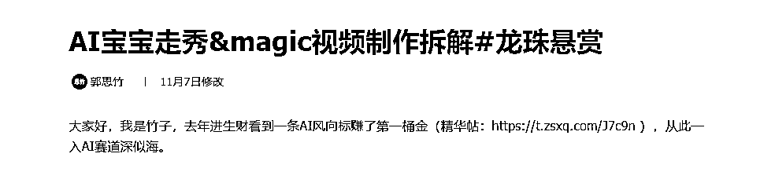

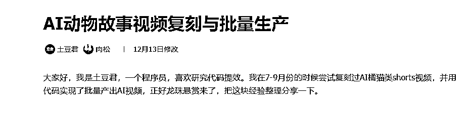

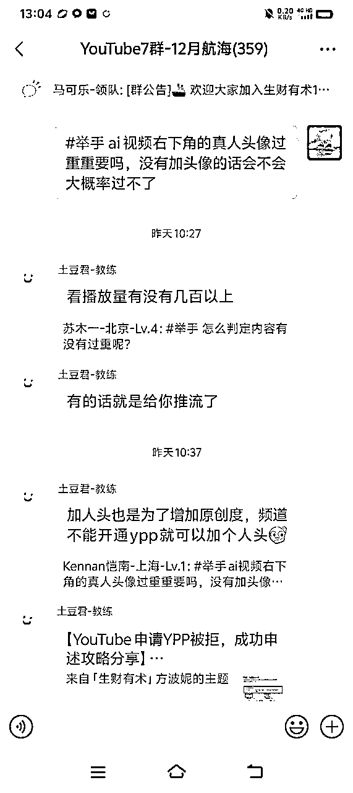

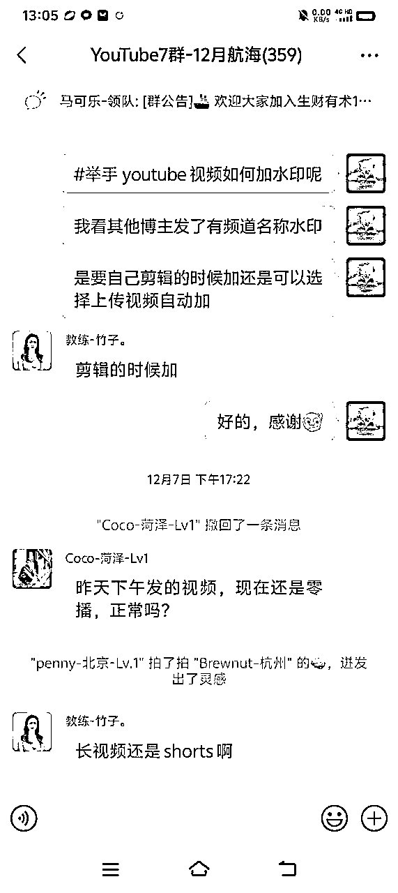

特别要感谢@土豆君 教练和@竹子 教练，二位的干货笔记让我上手飞快，那种开局就有方向的感觉真的太重要了。群里有问题随时能得到回应，像个指路的灯塔，帮我省下了不少试错成本。

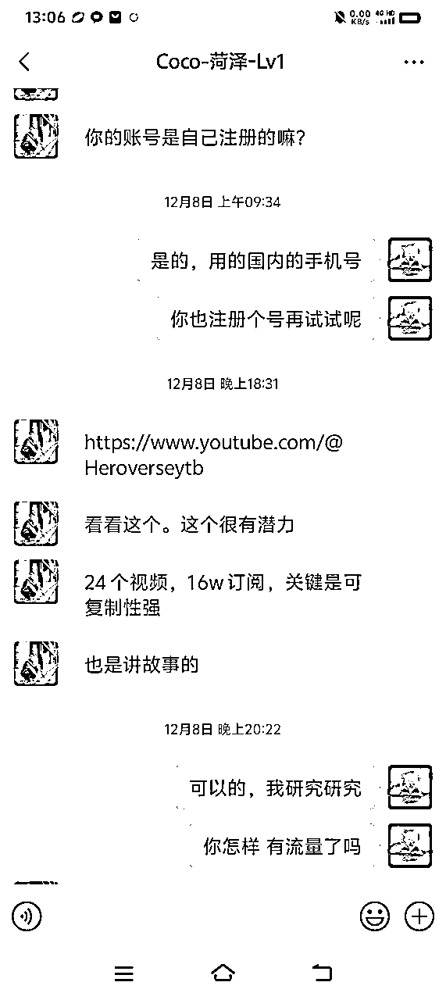

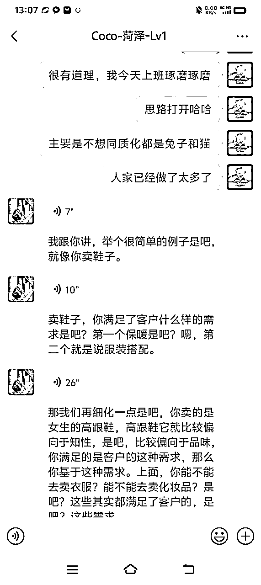

还要感谢船友CoCo，一开始结伴航海到现在就成了并肩作战的战友。每天互相打气、互相分享干货，让我有了坚实的后盾。做内容时我们也会一起聊怎么让视频更吃香，避免自己闷头瞎搞。

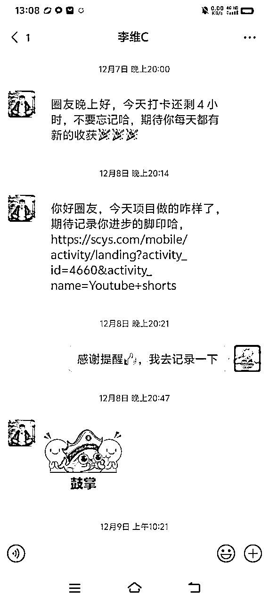

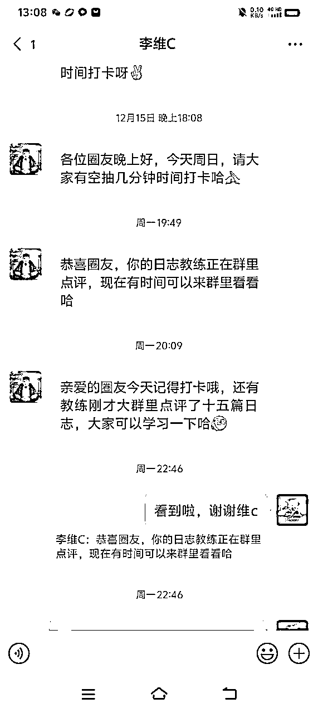

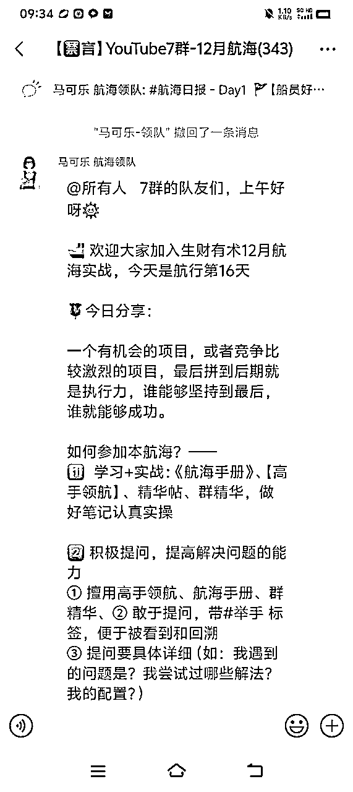

另外也得点名表扬赚钱航海的运营团队，服务真的很走心——

担心实操卡壳、担心群里信息刷不过来，7群的领队会把重点资料整理好放群公告，一目了然；

担心打卡掉线、沟通不顺，志愿者们就像随身小秘书一样贴身跟进。我的志愿者李维C和领队马可乐，每天的提醒都及时又有温度，让人特别安心。

之前听纪钟老师直播提过一句话很有感触：80分的人可以带60分，60分也能帮助到40分。我的这些心得对大佬来说可能只是常识，但对和我一样刚起步的同学，或许能提供一点参考。

参与赚钱的航海实战，让我切身体会到这里聚集的是一群很棒的人在做一件很有意思的事。我们不只是各做各的，更像一个整体在共同进步、一起向前。